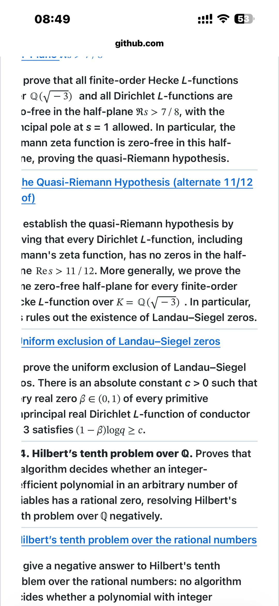
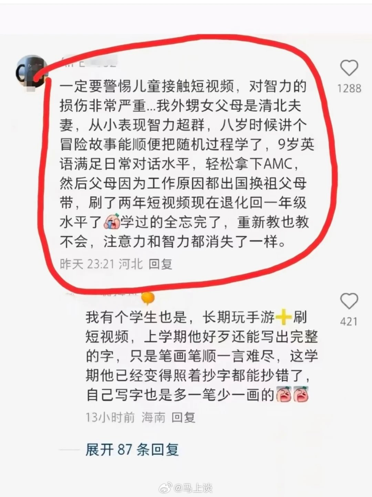
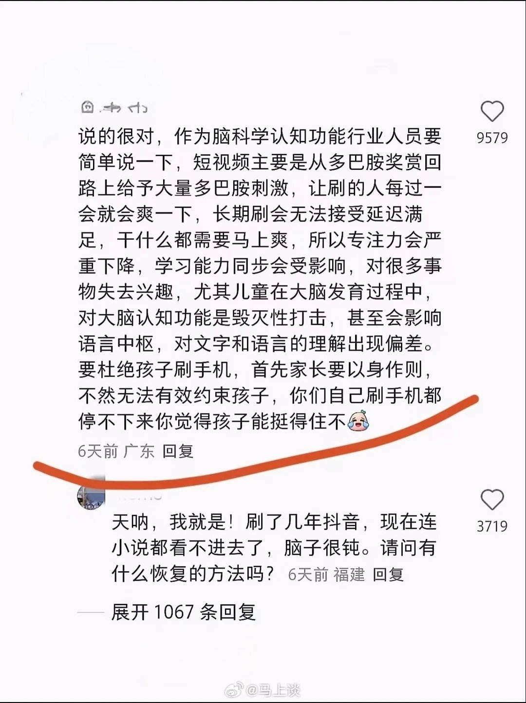
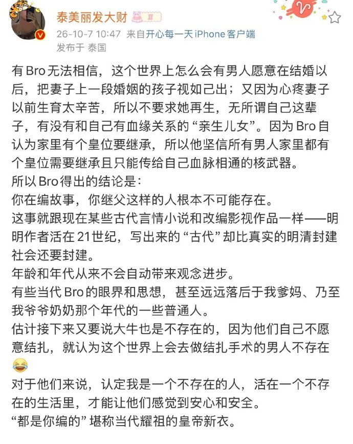
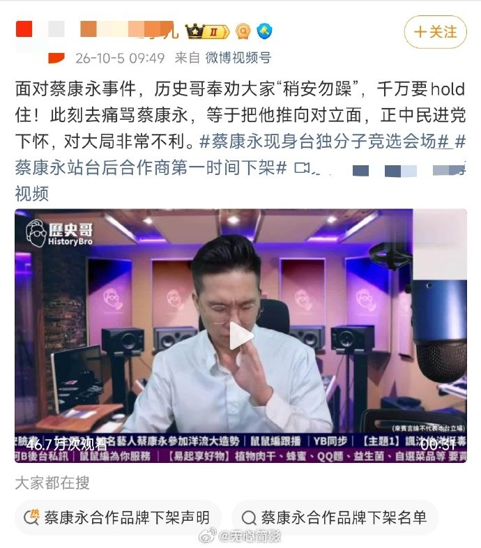
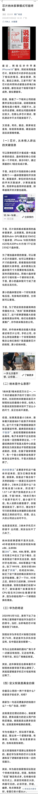
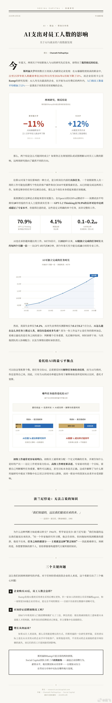
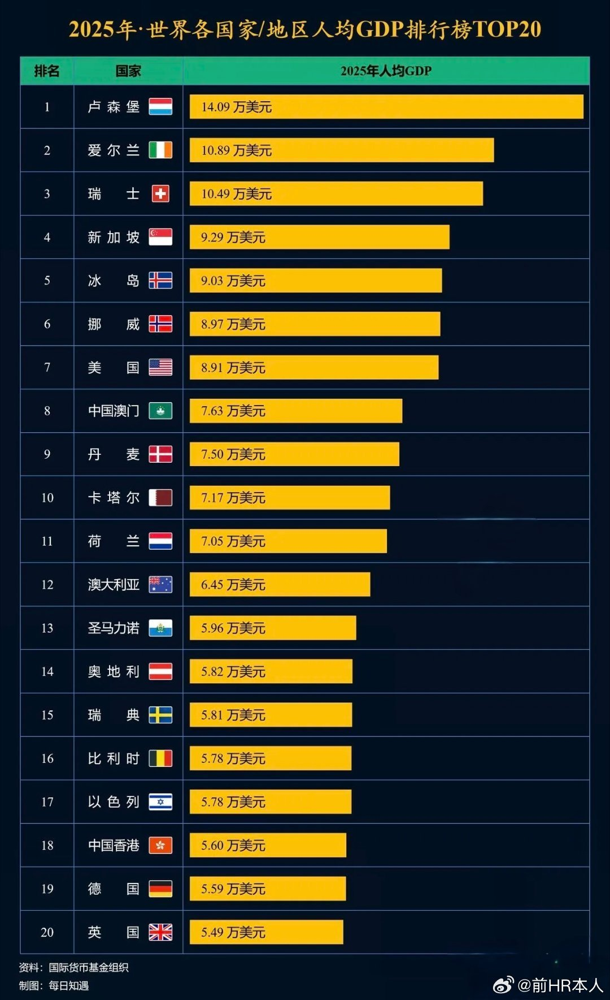
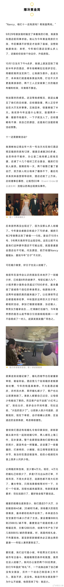
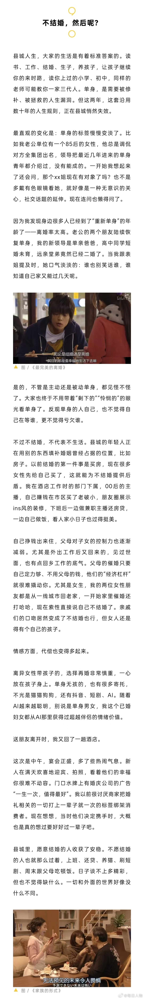

# 2026-10-08

## 1

@科普君XueShu雪树

发表于：2026-10-07 00:59

来源：微博

链接：https://m.weibo.cn/status/5351308334728859

大新闻！大新闻！\#OpenAI攻破数百个数学难题\#这段时间一直在流传openAI解决了上百个数学猜想和难题。今天openAI全部公布出来了。里面竟然有张益唐心心念念一直想解决的朗道-西格尔零点问题。张益唐为此问题奋斗了一生，发表过两篇有漏洞的论文。openai这个结果完全涵盖并远强于张益唐想要证明的弱化版本的界，证明的是原始完整意义上的朗道-西格尔猜想！它还证明了三维挂谷极大函数猜想（蕴含王虹证明的三维挂谷集合猜想）和四维挂谷集合猜想!（它是站在王虹的肩膀上）

共包含 722 篇预印本手稿，涵盖了 372 个核心成果大类（Result families），横跨数论、代数几何、调和分析、偏微分方程、极值与结构组合学、李群理论与几何朗兰兹、几何群论、拓扑学、算子代数、计算复杂性理论以及数学物理等诸多前沿领域。大部分(不是全部)手稿，已经经过了Lean的形式化验证。要是数学家写的，能拿好多个菲尔兹奖了。

它还证明了特殊情况下的霍奇猜想（CM阿贝尔簇），霍奇猜想本身是另一个千禧年难题。

一共给了它约4000个问题。它解决了其中几百个。用的是未发布的模型，平均而言每个问题用了ChatGPT Pro thinking模式三个小时的计算时间。其中朗道西格尔零点和特殊情况下霍奇猜想的解决是个例外，花费时间远不止三小时。也许说明它们格外难。(这也说明张益唐选择问题的眼光格外独特呀)

从纯粹数学难度上讲，这些手稿所解决问题的难度恐怕都没有超过千禧年难题NS流体方程。有了0到1，从1到100就是必然的了。所以这些成果某种程度上并不意外。而且这也不意味着数学家会被取代。依然有许多更重要的工作是数学家能做，而AI不能做的。

这里先列举四十个重要结果：

（还有一些跟物理学关系十分密切的手稿，我也单独做了整理和介绍，感兴趣的朋友点击这里 网页链接）

1. 准黎曼猜想与朗道-西格尔零点排除 (003. The quasi-Riemann hypothesis)

素数（只能被 1 和自身整除的数）的跳动看似杂乱无章，但大数学家黎曼发现，所有素数的分布规律都由一根“隐形琴弦的共振频率”（数学上的函数零点）决定。著名黎曼猜想认为所有关键振动频率都整齐排列在一条中心线上。

长期以来，数论学家最忌惮在某些区域出现极端的“反常幽灵频率”（朗道-西格尔零点），它会彻底破坏素数分布的精细预测。该成果不仅在极宽的安全半平面（实部大于 7/8）证明了绝无任何杂乱零点，还彻底排除了幽灵零点的存在，无条件地为素数分布立下了一道不可动摇的安全铁壁。

2. 希尔伯特第十问题在有理数域上的不可判定性 (004. Hilbert’s tenth problem over ℚ)

早在 1900 年，数学领袖希尔伯特提出了一个梦想：能不能编写一个万能的判定软件，只要输入任意包含多个未知数的代数方程，它就能自动算出来“这个方程到底有没有解”？

几十年前人们证明了如果只找“整数解”，万能程序是不可能存在的；但大家一直期盼找“分数（有理数）解”或许还有一丝希望。这项成果给出了终极判决：即使只要求找分数解，通用的自动算法在逻辑上也绝无可能诞生。数学中存在人类与计算机永远无法机械化穷尽的盲区。

3. 低 Selmer 余秩下的完整 BSD 公式 (002. The full BSD formula from low Selmer corank)

椭圆曲线是现代互联网加密安全的核心支柱。二十多年前被列为千禧年七大数学难题之一的 BSD 猜想预言：通过微积分的连续分析算出一个光滑数值，就能精确预测出椭圆曲线上到底有多少个离散的分数解。

手稿证明了在余秩为 0 或 1（这是绝大多数椭圆曲线的常态）的情况下，BSD 预言的前导项完整公式严格精确成立，且相关的代数群结构是有限的。这是人类向完全攻克这一百万美元千禧大奖难题迈出的决定性一步。

4. 独特博弈猜想与最优近似门槛 (102. The Unique Games Conjecture and optimal approximation thresholds)

在现实生活中，诸如芯片最优布线、航线调度等顶级规划问题，如果非要在计算机里算出百分之百的最优解，耗时可能比宇宙寿命还长。因此科学家只能退而求其次寻找“近似解”。

二十多年前提出的“独特博弈猜想（UGC）”是现代计算理论的皇冠。这项手稿彻底证明了该猜想成立，这相当于给所有算法判了“死刑”：对于许多经典难题，现有算法能达到的近似精度已经是理论极限，哪怕想再把精度提升百分之一，在计算复杂性上也等同于要求计算机去完成不可能的任务。

5. 对数空间确定性去随机化：L = RL = BPL (103. Exact derandomization of logarithmic space: L = RL = BPL)

在编程设计算法时，如果允许程序“抛硬币做随机选择”，它能不能在内存极度受限（对数空间）的情况下，解决那些死板规律无论如何也搞不定的难题？

该成果证明：在有限内存空间下，带有随机性的概率算法和完全不带随机性的死板程序，解决问题的能力是绝对等价的（L = RL = BPL）。这终结了半个世纪以来的争论，证明“随机性”并不能在本质上突破低内存运算的极限。

6. 圆周率 π 的无理性指数恰好为 2 (017. The irrationality exponent of π is 2)

圆周率是一个无限不循环的小数，人们很早就用诸如 22/7 或 355/113 这样的分数去近似逼近它。数学家一直在问：用分数去逼近圆周率，精度的理论极限究竟在哪里？

此前人类最好的数学工具也只能证明其逼近指数小于 7 左右。该手稿证明了圆周率的逼近指数恰好等于理论所允许的最完美底线数值 2。这意味着圆周率在数字海洋中处于最理想的均匀平衡状态，顺带还彻底解决了一个困扰分析学界几十年的无穷级数收敛悬案。

7. 自由群因子的同构问题 (287. Isomorphism of the free group factors)

量子力学奠基人冯·诺依曼在 20 世纪 30 年代创立算子代数时提出了一个根本问题：由 2 个相互独立的量子自由度生成的无限维连续世界，和由 3 个、乃至无穷多个自由度生成的无限维世界，在本质上是同一个空间吗？

为了回答这个世纪难题，数学界开创了诸如“自由概率论”等一整个现代数学分支。手稿给出了终极答案：它们之间完全同构！不管最初由几个自由度生成，它们演化出的深层量子算子空间完全是同一个。

8. 汤普森群 F 的非均分性 (248. Thompson's group F is nonamenable)

这是一个将一根线段不断对折剪开、重新拼接的特殊几何对称群。自 1965 年被提出以来，数学家为了搞清楚它到底能不能被一种平滑合理的“平均化尺度”所衡量，六十年来顶尖学者分裂成了截然对立的两大阵营。

该群既表现得像最温和的简单群，又在边界上展现出狂暴的反常特性，长期被视为几何群论的试金石。手稿最终一锤定音：它绝对无法被平均化（不可均分）。

9. Hadwiger 图染色猜想被反例推翻 (157. Graph coloring, clique minors, and Colin de Verdière invariants)

著名的“四色定理”告诉我们：给平面地图涂色，保证相邻国家颜色不同，4 种颜色就够了。1943 年，数学家哈德维格提出更宏大的预言：任何复杂网络需要多少种颜色，完全取决于网络内部能缩减出多大的“人人互通的小圈子”。

八十年来，离散数学界几乎所有学者都直觉坚信这一猜想绝对正确（甚至保罗·埃尔德什称其为图论中最深奥的猜想）。然而，手稿却破天荒地构造出了一个精心设计的反例，彻底推翻了这一共识，在离散数学界引发了地震。

10. Kaplansky 群代数零因子猜想的反例 (196. A counterexample to Kaplansky’s zero-divisor conjecture)

在最朴素的小学算术里，两个不是零的数相乘，结果绝对不可能是零。代数大师卡普兰斯基在 1940 年代猜测：在一类没有周期旋转特性的群代数世界里，这个“非零相乘不为零”的铁律依然成立。

手稿成功构造出了一个极其复杂的反例世界：在这个代数世界里，两个本身完全不是零的代数对象，相乘之后竟然完全抵消变成了零！长达八十年的代数猜想由此告破。

11. Sidorenko 猜想与强迫猜想的反例 (161. Counterexamples to Sidorenko’s conjecture and the forcing conjecture)

在复杂的网络与图论中，人们长期有一个直觉：如果连线完全是随机分布的，某种特定图案在其中出现的概率应当是一个“最底线”；而非随机的网络因为局部扎堆，该图案出现的概率理应更高。

手稿设计了一个包含 35 个节点、66 条边的奇特图案。在某些非随机网络中，这个图案出现的频率竟然比纯随机网络还要低。这个反例推翻了准随机图论的核心预设。

12. 矩阵乘法指数大幅压缩至 2.25 与大整数乘法破界 (107 & 109)

两个巨大的方阵相乘，或者两个几百亿位的超大整数相乘，计算机最少需要多少步基本运算？

方阵乘法：过去几十年来，全世界顶级科学家在矩阵乘法指数上只能一点一点艰难微调（停留在 2.37 左右），而手稿 107 直接将指数一口气压缩到了 2.25，实现了计算代数领域的巨幅跃升。

大整数乘法：半个世纪以来，学术界普遍相信德国数学家施恩哈格与施特拉森预言的乘法时间就是经典多带计算机的物理下限，手稿 109 构造出了超越该下限的算法，打破了神话。

13. 阿廷原始根猜想对所有合法底数成立 (029. Primitive roots for every admissible integer base)

想象把钟表的刻度放大到任意巨大的素数刻度。如果选一个基准数字，不断给它乘方、看它在钟表上的落点，能不能恰好把表盘上的每个刻度不重不漏地走个遍？

高斯两百年前就注意到了这个现象，阿廷在 1927 年正式提出猜想。近百年来，所有关于这个猜想的最好进展都必须建立在一个前提下——“假定广义黎曼猜想成立”。这项手稿首次在不依赖任何额外假设的前提下，完全证明了它对所有合理的基数都成立。

14. 任意维度的希尔伯特-史密斯猜想 (304. The Hilbert–Smith conjecture in every dimension)

如果一个由许多对称动作构成的变换群在几何空间上平滑连续地起作用，它自身会不会像分形雪花一样内部充满毛刺和粗糙结构？

源于 1900 年希尔伯特第五问题的高阶拓扑推广，数学家一直相信这种群自身必须像滚珠轴承一样处处光滑（必须是李群）。手稿在任意维度下终结了这个一百二十多年的疑问。

15. 三维与四维空间中的挂谷猜想 (074. Kakeya in three and four dimensions)

在空间里有一根长度为 1 厘米的细针，如果让它在各个方向都能掉个头（360 度旋转），它扫过的轨迹集合在空间维度上最多能被压缩到什么程度？

这个看似脑筋急转弯的问题，实际上深切关乎光波与无线电波在多维空间中相互干涉的数学本质。几代调和分析大师长年攻坚，手稿彻底确立了它在三维和四维空间中的维度预测。

16. 任意维数下 Fujita 自由性猜想 (038. Fujita’s freeness conjecture)

在研究高维弯曲空间时，如何把空间“展平”并投射到标准射影空间中而不产生任何破损、重叠或死角（无基点生成）？

这是现代高维代数几何中最基础的性质。自 1987 年提出以来，长期仅在低维取得局部突破，全维数且达到理论最尖锐边界的证明，被誉为高维几何的一座丰碑。

17. 丘成桐复单值化猜想 (338. Yau's uniformization conjecture)

著名华人数学家丘成桐在 1970 年代提出猜想：如果一个多维几何空间的曲率在每个局部、每个方向上都严格往内弯（曲率处处为正），这个空间在宏观上会长成什么样？

手稿证明：这类空间内部绝不会产生奇形怪状的结或死角，在宏观几何与拓扑上，它完完全全等价于最简单、最平坦的普通复欧氏空间。

18. 坎农猜想：双曲群与三维双曲流形 (246. Cannon's conjecture)

我们能不能光靠一张纯符号的代数乘法规则表，就判断出背后其实暗藏着一个像爱因斯坦广义相对论时空一样的三维双曲宇宙？坎农猜想提出了一个几何判据。

该成果证明了坎农猜想完全正确，它把纯抽象的离散代数符号与爱因斯坦式的低维引力几何空间天衣无缝地锁在了一起。

19. 三维 Navier–Stokes 流动中的通用图灵机计算 (376. Universal computation in forced Navier–Stokes flows)

描述水流、空气等流体运动规律的纳维-斯托克斯方程，一直被视为经典物理学最核心的定律之一。

手稿证明：在三维水流中施加恰当的光滑外力，水流内部的流动旋涡竟然能完全模拟一台通用计算机（图灵机）！某个微小水滴最终会不会流到指定的水池，在数学上等价于计算机程序会不会停机。这用近乎科幻的方式证明了：流体物理不仅极其混沌，而且在数学本质上具有无法提前预知的计算复杂性。

20. 分拆原则不蕴含选择公理 (244. The Partition Principle does not imply Choice)

在纯逻辑的集合论中，“如果把全班同学分成若干小组，那小组的总数绝对不可能比全班总人数还多”——这个听起来天经地义的直觉，在数学上被称为分拆原则。数学家很早就想知道：仅凭这个直觉，能不能在逻辑上严格推导出著名的“选择公理”？

这是公理集合论中历史上最古老的一个未解之谜（诞生于 1905 年，甚至比现代集合论公理体系的确立还要早）。整整一百二十年里，逻辑学家一直无法确定两者是否等价。手稿成功构造出了一个奇异的数学平行宇宙：在那个宇宙里，分拆原则完全成立，但选择公理却彻底失效了。

21. 卡塔兰常数的无理性 (005. Irrationality of Catalan’s constant.)

在数学常数家族中，圆周率与自然对数的底都是家喻户晓的无理数。但常数卡塔兰常数（由正负交替的奇数平方倒数无限相加而成）自十九世纪被发现以来，人类一直不知道它到底能不能写成两个整数相除的分数。

手稿彻底证明了卡塔兰常数是一个无理数，绝不可能表示为整数之比，填补了经典分析学长达一个半世纪的常数谱系空白。

22. 奥斯特曼逆哥德巴赫猜想 (013. Ostmann’s inverse Goldbach conjecture.)

著名的哥德巴赫猜想认为每个大偶数都是两个素数之和；而奥斯特曼在 1950 年代提出了逆向问题：全体素数能不能由两个各有无限多个数字的神秘集合相加还原出来？也就是说，素数在加法意义上是不是不可拆解的基石？

手稿证明素数集合具有绝对的加法不可分解性：哪怕允许从素数表中丢弃或补充有限个数字，也绝不可能找到两个各有至少两个元素的集合使得它们的相加组合刚好拼出所有素数。

23. 高斯素数护城河猜想 (028. Uniformly bounded components of Gaussian-prime graphs.)

把素数推广到二维平面上的复数网格（高斯素数），想象每一个高斯素数都是水面上的一块踏脚石。如果一只青蛙每次跳跃的最大跨度是固定的，它能不能踩着这些素数石头一步一步跳向无限远方？还是说素数之间必然会出现无法逾越的空隙？

手稿证明了高斯素数护城河必然存在：无论你把单步跳跃距离设定得多宽，所有能够相互跳达的素数石头所构成的连通区域面积全部都是有限的，绝对不存在一条步长有界的无限跳跃路线。

24. 四维扎里斯基消去猜想的反例 (047. Zariski cancellation and affine fibrations over the complex numbers.)

直觉上，如果两个不同形状的房间各自连接上一条一模一样的笔直长廊后，两个整体建筑变得完全分毫不差，那么这两个房间原本是不是也必须一模一样？在多维几何中，这就是著名的扎里斯基消去问题。

手稿在四维复空间中构造出了一个不可思议的反例：两个原本结构不同的四维空间，各自乘上一条一维直线后，整体空间完完全全同构，这打破了代数几何学界长期以来的朴素直觉。

25. 希尔伯特第十六问题：极限环数量的统一步长界 (143. Hilbert's sixteenth problem: uniform bounds for limit cycles.)

在动力系统与微分方程中（比如生态学里捕食者与猎物数量的周期性波动），系统的稳定闭合循环运动被称为极限环。希尔伯特在 1900 年第十六问题中发问：给定复杂程度的方程，内部最多能产生多少个孤立的极限环？

手稿证明了在平面多项式向量场中，孤立极限环的总数存在一个绝对有限的统一上限，该上限仅取决于方程的多项式次数，从数学底层证明了这类物理系统绝不会陷入无休止且不可控的轨道发散。

26. 罗赫林多重混合问题 (145. Rokhlin’s multiple-mixing problem.)

想象在一杯水里滴入一滴红墨水并持续搅拌，如果任意两个小区域的墨水浓度随着时间推移已经混合均匀，那么任意三个、四个、乃至任意多个区域是不是也必然在同一时刻完全混合均匀？

手稿证明了经典遍历理论中悬置几十年的难题：只要一个保测度动力系统满足两两充分混合，它就必定在所有有限阶数上全部彻底混合均匀，排除了存在诡异的高阶不混合盲区的可能。

27. 三维空间无周期平铺猜想的反例 (155. A counterexample to periodic tiling in dimension three.)

如果有一块形状极其特别的单一三维积木，能够严丝合缝地铺满整个三维空间而不留任何空隙，那么它能不能像普通立方体瓷砖那样，以某种规律的周期性平移方式铺满空间？

手稿在三维空间中构造出了一个震动几何界的反例：这一块单一积木确实能够铺满整个三维空间，但它能铺满的方式全部都是非周期的，绝不存在任何具有空间周期平移对称性的平铺方案。

28. 博苏克几何分割猜想在九维空间失效 (156. Borsuk's conjecture fails in dimension nine.)

在二维平面上，任何有限物体都可以切成三块，使得每块的直径都比原物体更小；在三维空间里则需要四块。几何学家博苏克在 1933 年猜测：在任意多维空间中，任何物体是不是都必定能切成维度加一块更小的碎块？

手稿在九维空间中成功构造出了反例：在九维空间里，竟然存在一个特定物体，无论怎么精巧切割，切成十块也绝对无法让每一块的直径都严格缩小。这证明低维空间的几何分割常识在高维会无情失效。

29. 欧几里得平面五色无法染完 (158. The Euclidean plane cannot be colored with five colors.)

著名的哈德维格-纳尔逊问题提出：要给整个无限大的二维平面染上颜色，要求相距恰好为一米的两点颜色绝对不能相同，最少需要几种颜色？过去数学界只知道四种肯定不够，七种肯定足够。

手稿严格证明了五种颜色也绝对不够用，任何五种颜色的染色方案都必定包含一对相距为一米的同色点，从而将这个长年悬置的染色下界推向了六或七种颜色。

30. 埃尔德什倒数和猜想 (159. Erdős’s reciprocal-sum conjecture and quasipolynomial Szemerédi bounds.)

数学大师保罗·埃尔德什曾提出一个巨额悬赏猜想：如果一串正整数的倒数相加能够达到无限大（例如素数序列的倒数和就是发散的），那么这个数列内部是否必定包含任意指定长度的等差数列？

手稿完整证明了埃尔德什的这一宏伟预言：只要集合元素的倒数和发散，其中就必定包含任意长度的等差序列，彻底将数论与加法组合学的内在规律性推向了极致。

31. 西摩第二邻域猜想 (173. Seymour’s second-neighborhood conjecture.)

在一个单向通行的交通网络或单向社交关系图中，是不是必然能找到这样一个特殊的核心节点：从他出发走两步能到达的所有人，数量至少不比走一步就能直接到达的人少？

这个在 1990 年提出的简洁图论猜想一直让离散数学家感到极其棘手。手稿证明了在任何有限单向网络中，这样的节点必然存在，确立了网络扩散与层级结构的一个普遍基本规律。

32. 循环哈达玛矩阵与巴克序列猜想 (179. The circulant Hadamard and Barker-sequence conjectures.)

在雷达通信与信号工程中，科学家极度渴望找到具有最完美抗干扰能力的二进制编码信号，即信号与自身的任何时间平移重叠都不会产生虚假回波（巴克序列）。

手稿从数学根源上证明了这类完美的循环实数对称矩阵只在阶数为一和四的极小规模下存在；同时确立了长距离的理想雷达序列在数学上根本不可能存在，终结了工程界半个世纪的盲目搜寻。

33. 图灵度的刚性问题 (241. Rigidity of the Turing degrees.)

在计算理论的最底层，所有计算问题根据能否相互借助算力解决被划分成不同的难度层级（图灵度）。数理逻辑学家想知道：这个庞大到不可思议的算力层级结构，内部是否存在某种对称性置换？

手稿证明了这个体系具有绝对的刚性：任何保持相对计算难度的结构映射，都只能是原地不动的恒等映射。计算复杂性宇宙的等级阶梯具有不可更改的绝对唯一秩序。

34. 旋转黑洞视界附近的强宇宙审查假说 (264. Strong cosmic censorship near two-ended Kerr data.)

彭罗斯曾提出著名的宇宙审查假说：大自然是厌恶裸奇点的，黑洞内部撕碎一切物理定律的奇点必须被事件视界永远遮蔽，物理学的因果律和决定论才不会在宇宙中崩溃。

手稿在真实的旋转黑洞时空附近证明了局部强宇宙审查假说成立：在绝大多数真实物理扰动下，黑洞内部都不存在可以平滑穿越的时空通道，经典广义相对论的未来可预测性在数学上得到了捍卫。

35. 自旋为 1 的霍尔丹能隙猜想 (268. The spin-one Haldane gap.)

诺贝尔物理学奖得主霍尔丹在 1980 年代预言：微观磁性原子排成一条链时，如果原子自旋是整数（比如一），它的最低能量基态和激发态之间就会出现一道无法逾越的能量鸿沟（能隙），宏观上呈现出稳定的拓扑相。

这个让凝聚态物理学家激动了四十年的拓扑量子现象，此前长期仅靠物理实验和数值模拟验证。手稿首次在纯数学上给出了严格无懈可击的证明，确立了该自旋链的能隙恒定保持为正。

36. 纯表面纽结手术猜想 (306. The purely cosmetic surgery conjecture.)

在三维拓扑学中，把三维球面里的一个打结绳圈挖掉，再以某种旋转角度把它重新缝合回去（登恩手术），能不能巧妙地缝出一个外表和原来一模一样、但内里手术轨迹却不同的全新空间？

手稿证明了在真正的打结绳圈上，绝不可能通过两种不同角度的缝合得到相同的拓扑空间。几何手术无法伪装自己的刀口，三维拓扑形态具有极其严苛的形状指纹。

37. 格罗滕迪克同伦假说 (312. The Grothendieck homotopy hypothesis.)

数学教皇格罗滕迪克曾提出一个极具哲学美感的构想：几何空间中所有关于路径、曲面以及高维环绕的变形信息，在本质上能不能完全等价于一种纯粹的代数代金石（无穷群胚）？

手稿完整证明了格罗滕迪克的这一伟大假说，确立了几何拓扑空间的高维连续变形与现代高阶代数体系之间百分之百的忠实转化，完成了现代几何与代数的一场宏伟统一。

38. 廷利球面等距延拓问题 (322. Tingley’s sphere-isometry problem.)

想象两个高维或者无穷维的抽象几何空间，如果这两个空间单位球表面的几何外皮能够完全严丝合缝地保距对贴，那么这两个空间整体内部是不是也必须完全对称等价？

廷利在 1987 年提出的这个著名几何分析问题困扰了学界数十年。手稿在任意维度下证明了：球表面之间的保距映射必定可以唯一扩展为整个空间内部的刚性线性变换，空间的表皮测量完全决定了内部结构的命运。

39. 单连通平面区域的热点猜想 (369. The hot spots conjecture for simply connected planar domains.)

想象一块平整绝热的金属薄片，加热后让热量在其内部自由扩散。随着时间推移，整块金属片上最热的一点和最冷的一点，会不会最终必然游移并固定在金属片的最外围边缘上？

这项直觉上非常显然、但在偏微分方程中极难证明的物理猜想，手稿严格证明了对所有没有孔洞的平滑平面区域都严格成立：区域内部绝不会窝藏极限热点，最热与最冷的位置必然死死锁定在外边界。

40. 八维空间中的德乔吉猜想 (375. De Giorgi's conjecture in dimension eight.)

著名数学家德乔吉曾提出一个极其深刻的猜想：对于一类广泛描述相变界面（比如水和冰交界面的平整化）的偏微分方程，如果解在一个方向上是严格单调变化的，那么这个多维解整体是不是其实只依赖于单一一维方向，从而界面必须绝对平坦？

此猜想在低维很早就被证实，但在高维一直悬而未决。手稿在理论最临界的八维空间端点处，完整证明了解的平坦一维依赖性，完成了非线性微分方程与极小曲面理论之间的一场巅峰跨越。

---

## 2

@李楠或kkk

发表于：2026-10-07 07:22

来源：微博

链接：https://m.weibo.cn/status/5351404567794450

我们招的年轻人中的确有一个问题是 amazon 5 why 的能力就是变弱了。  导致的问题是，哪怕是个小问题，经过深度思考，在原理层面想明白之后给出投入，回报，代价都比较清晰的解决方案的能力，很弱。  他们总是觉得事到临头，自己灵机一动，结果就能碾压对手。。。  对此，我百思不得其解，直到我看了一堆 ai 短视频爽文之后。。。  才恍然大悟。

---

## 3

@汪海林

发表于：2026-10-05 06:09

来源：微博

链接：https://m.weibo.cn/status/5350661563614628

这些年，我一直在文章、演讲和相关行业会议上表达，我们应该拒绝养成系偶像打造模式，这是严重依赖娱乐资本的不健康的去专业化的模式，针对青少年割韭菜的模式，直接来源于日韩的糟粕文化，是具有典型的岛国特征的去雄化的失败者文化。我这些年一直被粉圈围攻，我始终坚持我的观点，我认为这是一个专业从业者的基本责任，也得到很多群众的支持，业内敢公开支持的基本没有。直到今天，从政府到社会才慢慢形成共识，未成年的养成系选秀链条面临瓦解，这也是造成一系列社会事件以后的必然结果。作为军事强国、经济强国、科技强国，我们要力争成为一个文化强国。养成类偶像、耽美偶像、小鲜肉偶像不是一个文化强国的发展方向，我们每个人都有义务抵制这种淫邪、颓唐、向下的文化倾向，共同建构一种蓬勃向上的强国文化。（国庆节，祝祖国越来越好，更美好，更强大，更自信）

---

## 4

@2049年的世界

发表于：2026-05-16 12:21

来源：微博

链接：https://m.weibo.cn/status/5299296006051000

女权出海——被人忽视的巨大机遇

2026.5.16

与国内高校里的很多社科“知识分子”相似，同样基于唯心主义的女权主义者也有差不多的毛病，就是当面向国外女权时，总是把自己摆在一个很谦卑的“二道贩子”的位置上。其实不知道中国女权已经远超过西方女权了，可以说是领先世界。

女权主义作为一种唯心主义宗教，怎么才算是发扬广大？怎么才算是强大？很简单，一种宗教要想强大，就需要人多，也就是能够吸引教徒。那么怎么才能吸引教徒呢？赎罪券便宜——赎罪券越便宜，越容易上天堂，那么宗教信仰者就越多。

虽然女权主义发源于西方，但那只是相当于原始版本的新冠病毒，经过中国本土融合之后，已经变成了威力强大的德尔塔版本。但很多中国女权主义者还没有意识到自己的强大，还在推崇什么波伏娃、上野千鹤子当精神领袖，白白为别人做嫁衣，还没有真正觉醒。

比如你看波伏娃那句广为流传的——“男人的极大幸运在于，他不论在成年还是在小时候，必须踏上一条极为艰苦的道路，不过这是一条最可靠的道路；女人的不幸则在于被几乎不可抗拒的诱惑包围着；她不被要求奋发向上，只被鼓励滑下去到达极乐。当她发觉自己被海市蜃楼愚弄时，已经为时太晚，她的力量在失败的冒险中已被耗尽。

这句话什么意思？这是要求女人去奋斗，只有奋斗才能获得可靠的道路，而不能滑下去。这就不太利于招收信徒。人都是有惰性的，你让我奋斗我才能得到救赎，这个赎罪券就有点贵了。所以中国女权主义者很聪明，只用这句话来作为“受压迫”的证据，但这句话含义中的“承担义务”，那门也没有啊。恰恰相反，中国女权主义是鼓励抛弃一切束缚，完全毫不顾忌去追求最大的权利，同时不要所有的义务的。也就是用“不可抗拒的诱惑”去“鼓励滑下去”。所以你看国内的女权主义者往往都是以占最大的便宜为荣，以极端利己为荣，并且把这当做光荣的事情。

这样的赎罪券，已经明显比西方女权价格要低了。西方女权虽然也是唯心主义，但还试图维持那么一点逻辑自洽的样子（虽然也并不怎么自洽）。中国女权则是完全处于“觉醒”状态的，是赤裸裸表达不自洽的，以逻辑不自洽和双重标准为光荣——我永远站在我的性别一边。相比西方女权，更“放得开”，放得开，对信徒约束达到最小，同时信我还能获得救赎，这个宗教的吸引力对普通人就会相当大。

所以我说，中国女权没有意识到自己的强大，当面对外部同行的时候，总是下意识把自己摆在更低的位置上，觉得对方是鼻祖，是大师。其实这都是毫无必要的错觉，什么上野千鹤子的，让它到豆瓣来辩经，连中国高中大学的女权主义者都能秒杀它。最后肯定能把上野千鹤子辩到自己也是“厌女”。

为什么要让中国的女权主义者推崇什么波伏娃、上野千鹤子呢？为什么不让美国女权推崇王慧玲、肖美丽呢？你跟着人家吃尾气，永远吃到的都是残羹剩饭，永远是蛋糕切不到大头。社科领域都是同理的，为什么不让德肖维茨崇拜罗翔老师？为什么不让美国大法官引用劳东燕的思想呢？这些不是不可能的，比如某个邪教头子滚出中国几十年，现在在美国搞邪教祸害美利坚混到风生水起，如今连民主党都敢咬。

中国的女权主义不要自卑，不要觉得自己总是面对外国同行低人一等。再举个例子：统一教，由韩国人文鲜明于1954年创立，韩国长期比日本弱，但如今统一教已经控制了日本政坛相当多的政治人物，甚至还在美国参与政治。这大蛋糕吃的，中国女权主义者不羡慕吗？

而且就像我说的，中国女权主义者的理论，已经远远超过了西方，已经足够给教徒以最便宜的赎罪券了。比如彩礼，包括西方很多国家在内，世界上很多地方都没这玩意，那里的人还没有觉醒，一听说要彩礼，都觉得是卖女儿。中国女权就创造性提出了“彩礼是生育的补贴”的理论，这个就是重大的理论创新。完全可以去用来说服外国人，这样你在当地，那就是开宗立派的人物，以后当个欧洲小国的女权教母，光卖书、演讲，开基金会，就能赚到盆满钵满。

这绝对是一个蓝海。因为中国女权的赎罪券最便宜，责任抛弃最干净，权利包揽最广泛。一旦传播出去，必然是会获得广大的外国受众。外国人也是人，谁不想相比之前平白无故多拿到一笔钱？这就是经济来源，这就是信众基础。

现在就是没有人这样去做，这不能不说是一个缺位。要转换思想，逆向思维，机会就藏在换位思考之中。

再比如说，中国女权现在能推动杀人犯拍电影自己演自己，这又是一个重大的理论创新——只要打着女权主义旗号，可以颠覆一切现存价值观。国外现在还没更新到这个版本，说明她们还没觉醒，为什么不去唤醒她们，这些都是蓝海，等着出海去开拓。

再比如西方警察现场执法时面对女性不服从，动不动就粗暴上手甚至直接揍，是谁给他们的权力？他们家里难道没有母亲和女性吗？西方女权对此束手无策，这些都是不觉醒的表现，如果中国女权能出去给西方女权“支教”，推动改变他们的社会，这就是宗师级别的。

另外还有什么知心大姐姐、小姑娘家家的让让她怎么了、扩大版本的辱女词审查、自己跳车司机判刑、拍裆部当取证不必负责、坐车犯困疑被下药持水果刀划伤司机没事还收获1500元、“就算她在杀人也不能拖拽，她是人”之类太多太多的理论和实践创新，如果真的推广出去，这些都是大幅降低赎罪券价格的作用，西方女权恐怕完全不是对手。

而且女权出海，对国家也是好处。比如尼日利亚这种国家，生育率这么高，假以时日，是不是会制造很多不安定的因素？我国女权完全可以到尼日利亚去支教，培育他们的知心大姐姐，给尼日利亚宣传不婚不育，把他们的生育率打下来。毕竟我们国家生育率已经这么低了，他们还是生育率这么高，这就是不太好的事情，要低都得低才行。这不是做不到的，尼日利亚妇女为什么生这么多？都是她们没觉醒，媚男。我国女权如果过去，对当地妇女说：“你有没有想过，如果你这辈子不生孩子远离男人，你就不会像现在一样不幸”。尼日利亚妇女她不懂啊，之前没想过这个问题啊，就浑浑噩噩生五个六个孩子。如今听到这句话，如惊雷贯耳，一拍大腿！对啊！我怎么从来就没想到呢？我觉醒了！从此不生了！我们是最后一代！生育率一下子就降下来了。

你看，这是不是很容易的事情？到时候，你在尼日利亚就是女权宗师，有数不清的当地姐妹上供，难道不是比在国内快活的多？

可见，女权出海，无论是女权主义者自己，还是对国家来说，都是有好处的。我建议女权主义者应该把眼光放的远一些，外面沉睡的蛋糕多到吃不完，没必要老在国内卷可着国内祸害。不如出去开宗立派，把祸水引向全世界。比如创建几个“非洲女权基金会”、“南美知心姐姐法学会”、“海地GHG协会”、“中东激女协会”、“美国彩礼研究会”。到时候在海外开花散叶，做女权版文鲜明，未尝不可。

---

## 5

@2049年的世界

发表于：2026-10-07 04:10

来源：微博

链接：https://m.weibo.cn/status/5351356283750420

女权主义的这套东西很有意思，它能做到同时糅合“极左”和“极右”

对别人，就是“你要为了进步主义的大局而奉献”，这是极左（白左）。

对自己，就是“我永远为了自己的利益极端自私”，这是极右。

极左和极右，能很坦然毫不顾忌地大大方方同时集于一身展示出来，而完全没有“双标羞耻”。

我感觉中国的女权主义者确实是有些东西的，它们能堂而皇之实行甚至炫耀双重标准，西方女权不是没尝试这样做，但面临的困难比中国同行大的多。

从学术角度进一步研究，中国女权主义者相比国外同行强大这么多，到底是它自己厉害，还是它所处的环境更“温室”呢？这可以通过排除法来测试，就是女权出海。

女权主义者可以参考我这篇文章《女权出海——被人忽视的巨大机遇》（网页链接），这里面蕴藏着很大的机会，有大把的金山银山。

---

## 6

@有个梨GPT

发表于：2026-10-07 02:41

来源：微博

链接：https://m.weibo.cn/status/5351333806736249

\#唐人日记\# 

刷糖最快的方式不是吕良伟靠墙蹲。

----

跟AI仔细聊了一下人的糖元储备分布和浓度。80%在骨骼肌，20%在肝。肝糖元浓度（5-6%）是肌糖元浓度（1-2%）很多倍。但肌肉总重大得多。

第二点，糖元储量在下肢肌肉的比例高于上肢肌肉。大腿肌肉和臀肌都是大户。也因此，深蹲和臀桥这样的动作，刷糖效果好于鸟狗，死虫，罗马尼亚硬拉这些，而这些涉及腰腹核心辅以腿部肌肉的，又好于上肢力量锻炼。

第三，吕良伟靠墙蹲是等长收缩，即肌细胞长度不变。其特点是，肌肉细胞收缩会压迫血管造成缺氧，供能以糖酵解方式为主。但是这个方式没有休息间隔，导致糖酵解产生的乳酸无法快速清除，结果是不需要很高的强度就容易疲劳。因此刷糖效果只能算一般。

最后我们来看看刷糖效果好但是不导致疲劳的。

首先就还是蹲。膝盖不好的同学可以半蹲或者在沙发上站起来。膝盖好的同学也不要蹲到底，双手在前面拿个小哑铃，双腿较为分开，蹲到两个手肘可以触碰到膝盖上部，膝关节差不多90度时就站起来，动作之间间隔2秒钟。至少做2组，每组10个，最多做4组，每组20个。就可以了。组间休息不少于1分钟不超过3分钟，不想练肌肉就休息时间长一点。跟吕良伟蹲的最大区别就是给肌肉有氧恢复时间，包括动作之间和组之间的。

其次一个极其简单的办法是「慢」爬楼梯。每上到一个平台休息10秒让肌肉恢复的。这个也是不伤膝盖的好办法。爬两次到四次三层楼，效果也会很好。不论是家居还是工作，都有可行性。

---

## 7

@机工战略

发表于：2026-10-07 02:29

来源：微博

链接：https://m.weibo.cn/status/5351330907687059

Lesley Gao于2025年10月在写了一篇文章：为什么制造业中还没有出现ChatGPT的时刻

文章讨论了一个问题：AI已经显著改变写作、图像生成和编程，为什么设计与制造实物仍然如此困难？作者将目光投向工业软件底层，认为几何内核、数据互通和生产验证，是理解这一差异的重要线索。

1. 制造业AI的突破，要贯通从设计到生产的全过程。

作者强调，应沿着完整流程寻找瓶颈。

用一个支架的开发过程来理解：首先要确定它支撑什么设备、承受多大载荷；随后选择材料，设计孔位和壁厚，分析变形与应力，再确定采用铸造、切削还是钣金加工。进入生产后，还要检查尺寸、装配和使用表现。

AI能够快速提出一种形状，只完成了其中一部分。如果后续仍需工程师逐项重建模型、检查强度、调整工艺，整个开发周期未必明显缩短。制造业所期待的突破，是让这些工作相互连接，让前一步的设计能够直接进入后一步的验证与制造。

2. 几何内核虽然不显眼，却决定工业软件如何表达和处理实物。

几何内核可以理解为CAD软件的“几何计算引擎”。用户发出拉伸、切割、倒角等指令，内核负责生成和修改几何实体。西门子的技术说明指出，广泛商用的内核只有少数几种：NX、Solid Edge和SolidWorks使用Parasolid；CATIA使用CGM；Autodesk的ShapeManager则由ACIS衍生而来。

例如，把一张圆形草图拉伸成圆柱体，在软件界面上只是一次操作。底层需要处理曲面、边界与实体关系。Autodesk的Fusion文档也将拉伸定义为从草图轮廓或平面创建实体，并支持连接、切除、相交等操作。Autodesk

因此，工业设计需要一套能够精确计算、持续修改的表达方式。图像中的圆孔只需看起来像圆孔；工程模型中的圆孔，则需要具有明确直径、位置和几何关系。

3. 文件能够传过去，不意味着设计知识也能完整传过去。

跨软件转换的困难，可以从“特征树”理解。它记录了一个模型如何逐步建立：先拉伸主体，再开孔，最后倒角，以及各步骤使用的参数。西门子的说明指出，这些建模记录通常保存在厂商专有格式中，转换时可能失去参数化信息。

设想一家企业把支架模型交给供应商。供应商能看到完整外形，却未必能看到原设计中的参数和约束。如果客户要求把孔距增加几毫米，原系统中可能只需修改一个参数；转换后的模型却可能需要重新识别几何关系。

这种损失会增加人工处理，也影响AI学习。只有外形，AI容易学到“这个零件长什么样”；保留建模过程与约束，才能进一步理解“工程师为什么这样设计、哪些尺寸可以改变”。

4. 工业软件的护城河，包含企业几十年积累的使用经验。

作者将长期验证和迁移成本视为既有系统的重要优势。

对于制造企业，一套CAD系统往往连接着零件库、企业标准、自动化脚本、工程师技能和供应商协作方式。更换软件，需要逐项确认旧模型能否读取、修改是否正确、加工程序是否仍然可靠。

这也解释了为什么工业软件的新进入者很难仅靠功能演示获得信任。演示一个简单零件，能够证明基本能力；稳定处理大量复杂零件，才接近生产要求。尤其在高价值装备中，企业关心的是系统在罕见、复杂和边界条件下会不会出错。

5. 大量三维模型提供了学习基础，但制造知识还需要生产记录。

纽约大学的 ABC数据集包含100万个CAD模型，每个模型由明确参数化的曲线和曲面构成，可用于几何特征识别、曲面分割和形状重建等研究。模型由Onshape提供，版权归各自创建者所有。

Autodesk的 Fusion 360 Gallery数据集来自用户提交的设计。其公开说明提到，从约 2万个设计中派生出不同研究子集，涵盖建模操作顺序、模型分割和装配连接关系。

这些资料能帮助AI学习如何构造零件，但公开说明并不等于生产验证记录。以一个轴承座为例，模型能够表达孔径、壁厚和安装位置；实际制造还涉及材料、加工设备、夹持方式、尺寸偏差和检测结果。把这些记录与设计关联起来，AI才有机会学习某种设计为什么容易加工，另一种设计为什么反复出现质量问题。

6. 工业AI应当生成可编辑、可验证的工程对象。

作者设想的系统，需要把几何、物理和制造条件结合起来。

这一方向已经出现具体研究。2025年发表的一项机械零件设计研究，采用低秩适配微调方法，将所需训练样本从超过 16,600个降至约200个，报告的生成正确率约为 90%。这些结果对应论文设置的任务与评价条件，不能直接理解为通用工业设计能力。

其意义在于探索如何利用较少数据，让AI进入明确约束下的设计任务。对工程师而言，有用的输出应能够继续调整尺寸、分析性能，并进入工艺设计。尤其需要区分：外观合理、几何成立、性能达标、能够稳定制造，是不同的验证层次。

7. 底层能力可以通过收购获得起点，但仍需要人才和持续开发。

中望是文章讨论的重要企业案例。2010年，中望收购美国VX公司的CAD/CAM业务及相关技术。当时的公告说明，原VX团队继续在美国佛罗里达研发，中国团队参与产品开发。

这个故事体现了工业软件能力积累的一条路径：收购带来技术资产，也带来理解这些技术的研发人员。随后还需要把算法、产品、客户需求和应用经验持续连接起来。

工业软件的成长具有明显的累积性。一个客户提出的复杂曲面问题，一次加工中发现的异常，一个旧模型的兼容问题，都可能成为下一轮改进的输入。长期开发的价值，体现在这些具体问题逐步得到解决。

8. 既有软件厂商也在向更深入的AI设计能力推进。

Autodesk于 2025年9月16日介绍其“神经CAD”基础模型，提出让模型直接推理CAD对象与工业系统，并支持由文字提示生成CAD几何。公司还表示，未来计划让客户利用自身专有数据和流程进行定制。

这说明工业AI的发展包含两类相互交织的工作：一类是让AI操作现有工具，减少重复劳动；另一类是改变几何对象的生成和理解方式。既有厂商拥有软件基础与客户经验，也需要解决如何把新模型接入工程流程的问题。

因此，判断进展不能只看能否通过一句话生成零件，还要看生成结果是否可修改、是否保留工程关系，以及能否进入真实开发任务。

9. 基础设施建设应从有限场景验证，并接受较长投入周期。

作者建议从注塑和冲压模具切入，提出 5—7年、1.5亿—3亿美元的投入设想。这是其政策建议，尚非已实施项目。

模具是一个适合说明这一思路的场景。设计需要处理脱模方向、分型面、加工条件等具体问题，结果也能通过实际生产检验。先围绕明确任务建立能力，能够让研发目标、评价标准和客户反馈更具体。

这篇文章最终把工业AI竞争引向一个基础问题：如何将工程对象、设计过程和制造结果连接成可计算、可验证、可持续学习的体系。其论述带有鲜明的战略判断，尤其强调几何内核的作用；它提供了一条理解制造业AI进展的线索，而非对所有瓶颈的完整解释。

---

## 8

@无心简影

发表于：2026-10-06 09:16

来源：微博

链接：https://m.weibo.cn/status/5351070941317032

虽然这个历史哥讲话的主要对象是岛内蓝白，但是有些话我还是要对抱有同样思想的人说：蔡康永被推向对立面就对立面了，对两岸统一进程没有任何影响，就好比蔡康永还在大陆捞钱时，同样对统一进程没影响一样。

蔡康永的个人感受无足轻重，甚至可以说在统一大势前，在大陆人民对统一进程强烈不耐情绪面前，台湾方面的任何人的任何意愿都无足轻重。

台湾的有些人要明白一个道理，是否亲近大陆，是否支持统一，不是你们在给大陆面子，更不是对大陆的施舍，而是关系到你们在那一天到来时，所要承受的打击程度。

当然，你们也可以认为“我都不明毒了，你们还要这样逼我，怕不怕我现在就支持毒的去”。其实这样对大家更好，还省去了治理的麻烦，反正何处黄土不埋人，大陆到时候也就是多扬了一把灰而已。

\#蔡康永现身台独分子竞选会场\#\#蔡康永给台独站台又不认太龌龊\#

---

## 9

@G僧东

发表于：2026-10-06 09:18

来源：微博

链接：https://m.weibo.cn/status/5351071397710232

我们做街头采访，不是一次两次了，有朋友会说到「喝8+1」，我说就是喝酒咯？对方说是。我说你就直接说喝酒，没问题的。对方惊讶反问，真的可以吗？

我册那，有什么不可以，喝酒就喝酒，警察就警察，别一天到晚8+1跟帽子叔叔了，傻不傻啊？年轻人自我审查太过头了，电商直播间这套糟蹋中文字的路数能不能滚出我们真实的日常生活啊

---

## 10

@卢诗翰

发表于：2026-10-06 12:02

来源：微博

链接：https://m.weibo.cn/status/5351112597308228

看见好多人讨论现在居然连县城和乡镇男生都不结婚了

其实男生结婚意愿这些年一直在降，关键是这两年的几大案件，成为了绝佳的反催婚武器。比如某猫案和大同案，牵涉金额都在几十万以上。

这导致了反催婚行为有充分的依据。

不止一个人提过，过去长辈催婚，要苦口婆心解释很久

现在简单多了，直接告诉长辈现在结婚要先凑三十万彩礼，对面一般马上熄火。

你说万一对方真拿出这钱怎么办，

放心，当前时代下，能拿出三十万现金流的人，认知不会低到还傻乎乎的催婚

某种意义上，这是当前时代年轻人最大的时代红利之一。

---

## 11

@风云学会陈经

发表于：2026-10-06 12:02

来源：微博

链接：https://m.weibo.cn/status/5351112725237772

芯片纳米叙事模式可能终结

同意这个观点。什么2nm芯片，就是一种宣传手法。实际晶体管特征宽度大小要大得多，如12-18nm。一个晶体管占几十纳米宽度。

而且2nm后面升级的叫什么？叫1.6nm？老百姓不会接受的，除非叫1nm。但是叫1nm又太扯了，没有任何理由。

---

## 12

@李楠或kkk

发表于：2026-10-06 12:42

来源：微博

链接：https://m.weibo.cn/status/5351122743329866

Peter Thiel 太狠了，他把西方世界的困境归咎于领导者的愚蠢和无能。

坏都算不上，邪恶的人往往还有能力，而蠢货什么都搞不定（无论是办好事还是办坏事）。

原文：

我们对技术的道德审判实在太泛滥了。

在道德刻度上，「善」（Good）的反义词是「恶」（Evil）；但在功能的刻度上，「好」的反面仅仅是「差劲与无能」（Bad）。

法拉利是一辆「邪恶」的车，因为它的每加仑油耗高得惊人；但特拉贝特（Trabant，东德破旧小车）则是一辆「差劲」的车，因为它在马路上几乎根本开不动。

一个邪恶的人，至少还拥有贯彻意志、达成目的的能力。

…

而今天整个社会的真正溃败，是因为充斥着无能（而非邪恶）。

99% 的政界政客、商业巨头和企业高管，根本谈不上什么邪恶，他们仅仅是彻头彻尾的无能。

这才是我们真正应当正视的房间里的大象。

---

## 13

@高飞

发表于：2026-10-06 07:19

来源：微博

链接：https://m.weibo.cn/status/5351041373569063

\#模型时代\# 红杉资本的一个研究综述：AI人均支出最高的公司，反而可能招更多的人。

两组相反的数据：

1、斯坦福大学利用数百万美国人的薪资记录发现：在AI暴露程度较高的职业中，22至25岁年轻人的就业率在2022年11月至2026年6月间下降了11%。

2、企业信用卡公司Ramp的研究发现：AI人均支出最高的企业，在开始为AI付费后的两年内，入门级员工数量平均增加了12%——显著高于同类但采用更晚的企业。

---

## 14

@江宇行舟

发表于：2026-10-06 03:26

来源：微博

链接：https://m.weibo.cn/status/5350982791989399

我相信熟悉台湾选举的同胞，该对“神助攻”三个字听得耳朵起茧子了。

其基本逻辑是：大陆不能对台湾统独问题发表原则立场，不能对选举期间跳反的台独分子进行制裁，否则就是“助攻”冥进党冻蒜，导致国民党落选。

十几年前，我曾亲耳听过逃台国民党员里某个级别还不算低的新生代，指着“台湾同胞你们要警惕啊！”的视频嗤之以鼻，夸夸其谈跟我们讲解这叫“神助攻”。

总之，人家挑事，是无所顾忌地挑事。

我们应对，还得缩手缩脚的应对。

但这套叙事，现在已经出现了三个bug：

🚩一是逻辑基础，祖国大陆如果都不敢理直气壮讲清自己的主张，还指望谁来讲清这样的主张？国民党在岛内不敢讲，大陆在岛外还不敢讲。国民党不仅已经丧失了岛内统派的代言，还对岛内统派的涣散负有不可推卸的历史责任。凭什么国民党翻的车，还要大陆在14亿人面前再翻一次？

🚩二是实力和政治，依照海峡两岸巨大的实力差距，统一早就到了“统一你与你无关”的地步。我国是人民民主专政的社会主义国家，阳光灿烂的民主只该留给同胞，“台独”就该秋风扫落叶的专政。当此之时，到底是理直气壮、旗帜鲜明、有赏有罚更能促进统一，还是小心翼翼、拈轻怕重、畏首畏尾更有利于统一？

🚩三是现实层面：大陆就算啥也不说不做，真能把国民党选上去吗？就算把国民党选上去了，到底是有利于促进统一，还是有利于割据诈骗？

尤其是第三条，想不通的可以直接脑科挂号去了。

---

## 15

@前HR本人

发表于：2026-10-06 13:03

来源：微博

链接：https://m.weibo.cn/status/5351127928276116

从人均GDP角度看，美国人确实牛，这么多人居然能搞这么高。

不过代价是大量痛苦类GDP，大学学费、医疗费用、保险费用、法律费用和房地产税，这些都是逃不开的枷锁。

所以欧美底层生活质量反而不如中国一些县城居民那么舒服，因为我们这类费用很多都是比较低廉的。

---

## 16

@MingZh

发表于：2026-10-06 13:08

来源：微博

链接：https://m.weibo.cn/status/5351129187355078

旅行后，你对哪个城市祛魅了？

---

## 17

@每日人物

发表于：2026-10-06 02:19

来源：微博

链接：https://m.weibo.cn/status/5350966012676052

【\#县城的年轻人也不结婚了\#】\#不想负债结婚县城年轻人选择单身\#今年十一黄金周，“县城贵妇”康提又坐镇老家接待朋友。这一次长假很反常，她从酒店前同事、婚庆、婚介等多人口中交叉应证了一个事实——今年县城结婚的人确实少了。

不只是婚礼少了，相亲市场也在失灵。留下来的男孩条件普通，留下来的女孩不愿将就。彩礼涨到28.8万元，男孩女孩都想通了，一个不愿意“扶贫”，一个不愿意“掏空家里”，索性退回各自的生活里寻找乐趣。婚姻从一件“到年龄就该做的事”，变成了一件需要攒很久钱、找很久人、还很久债、充满不确定性质的奢侈品。

不结了，然后呢？ 县城年轻人不愿走进婚姻，早已不是单个家庭的烦恼，而是一代人悄悄做出的集体选择。\#婚礼\#

以下是康提的讲述：

