# 2026-10-09

## 1

@兽爷

发表于：2026-10-08 13:51

来源：微博

链接：https://m.weibo.cn/status/5351864996464087

今天被安利了一波紧急制动的踩刹车标准姿势，收获很大

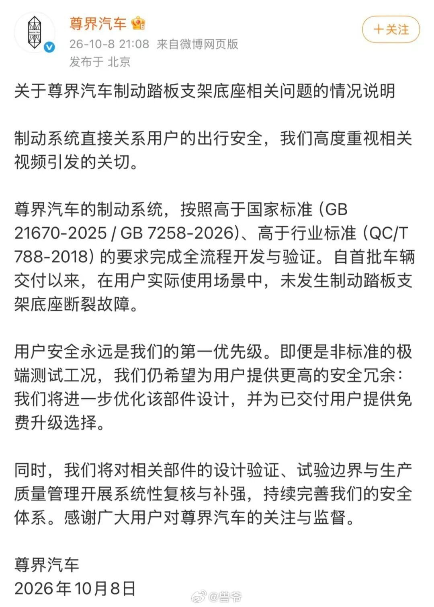

---

## 2

@猩猩吸猩猩

发表于：2026-10-08 14:03

来源：微博

链接：https://m.weibo.cn/status/5351867934313801

我这次在英国伦敦，发现伦敦普通的打工人，过的比广州的普通打工人更艰难一点。

比如网约车司机吧。伦敦的税后收入大概是2万人民币，也是要加班才有这么多。广州的差不多是9千（别杠说广州滴滴司机没这么多， 平均数绝对有）

但是伦敦的生活成本可不止广州的两倍。特别是租房。

可能有人会问，那这些伦敦的打工人怎么活呢？真相是：伦敦有大量外来的印度人，还有非洲人。他们真的比中国的底层打工人能吃苦多了。

在迪拜也一样，的士司机月收入大概7000人民币，但迪拜的物价可太高了。这些的士司机也是印巴人特别多。

所以别以为，到国外去当体力劳动者，会比国内好。你是和印度人，菲佣，墨西哥人，非洲人竞争呢。

---

## 3

@新浪科技

发表于：2026-10-08 14:09

来源：微博

链接：https://m.weibo.cn/status/5351869443998262

【\#OpenAI拒绝改叫OpenSI\#】美国总统特朗普9月29日在白宫会见黄仁勋、马斯克、扎克伯格等科技企业负责人时，正式宣布将"人工智能"改名为"超级智能"（SI）。

马斯克10月4日已在社交平台跟进，表示SpaceX是一家超级智能公司，将把SpaceXAI改名为SpaceXSI。

OpenAI首席执行官萨姆·奥尔特曼则明确表示，不会将公司名称OpenAI改为OpenSI。

奥尔特曼认为，尽管超级智能概念日益受到关注，但人们依然会习惯性地称之为AI，改名并无实际意义。

奥尔特曼此前也曾在播客中表示ChatGPT这个名字"很糟糕"，但它现在已经无处不在，没法再改了，这种对品牌惯性的务实态度与他对改名的回应一脉相承。

资本市场已对改名可能性做出判断，预测市场平台Polymarket数据显示，OpenAI在2026年12月31日前正式更名为OpenSI的隐含概率仅约3%。

科技营销专家认为，由于超级智能一词在学术界已有既定含义，这次改名不太可能被整个业界接受，术语的学术准确性与公众用语习惯之间存在难以在短期内跨越的鸿沟。（快科技）

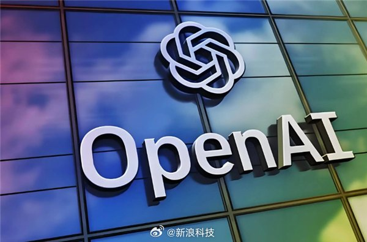

---

## 4

@前HR本人

发表于：2026-10-08 14:06

来源：微博

链接：https://m.weibo.cn/status/5351868558999945

网友：日本崩溃速度让全世界目瞪口呆！社媒形容：日本已进入“坠落倒计时”，一个G7成员国、全球第四大经济体，2026年出口已经被中国香港超越，也被中国台湾省超越，被当年日本看不起的韩国甩开1100多亿，日本已经不是“失去的三十年”，而是永远！

日本一方面是战略错误，采取远交近攻的策略，导致没有融合产业链。另一方面对美国太过忠心耿耿，被美国放血过度，比如半导体产业和汽车产业都被美国人搞得很惨。

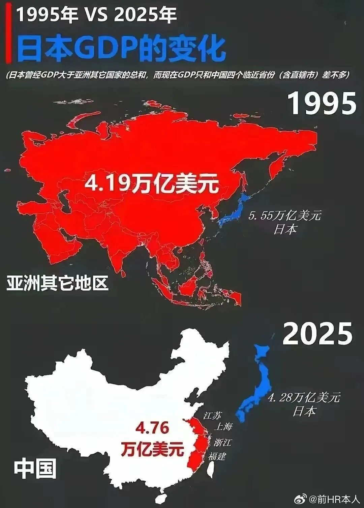

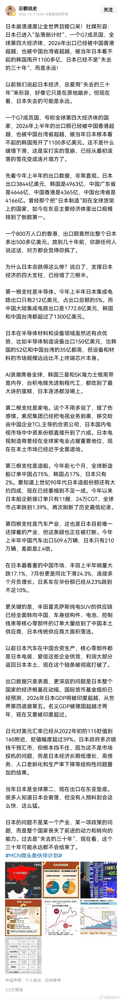

---

## 5

@挖地瓜的超级鹿鼎公

发表于：2026-10-08 07:20

来源：微博

链接：https://m.weibo.cn/status/5351766453652281

保护好贤妻良母，保护好有责任心有担当的丈夫，保护好正常婚姻，打击海王和小仙女，打击婚外情，区别保护婚生子女和非婚生子女，才是重树正常婚姻观的正确道路

---

## 6

@AB的海外研究

发表于：2026-10-07 06:53

来源：微博

链接：https://m.weibo.cn/status/5351397253971977

隔壁 Adobe 哭晕。一家 GitHub 开源组织最近放出了 7 款用纯 Rust，从零重写的工具，界面对标 Adobe 的每一款产品，主打免费、开源、本地运行。

其中对标 Photoshop 的产品，介绍里写着，你本来就会用的开源图像编辑器（嘲讽拉满。

这几天它们的开源 GitHub 星标更是冲到近万，其他几款工具也跟着涨。

目前市面猜测，这家团队是用 Claude，快速让 AI 实现了它们，从而降维打击了收费昂贵的 Adobe。

不过它们文档也说，目前还不能彻底替代它们，如复杂 PSD 还原、插件、专业排版等还有明显缺陷，但不得不说这个行为非常叫好。

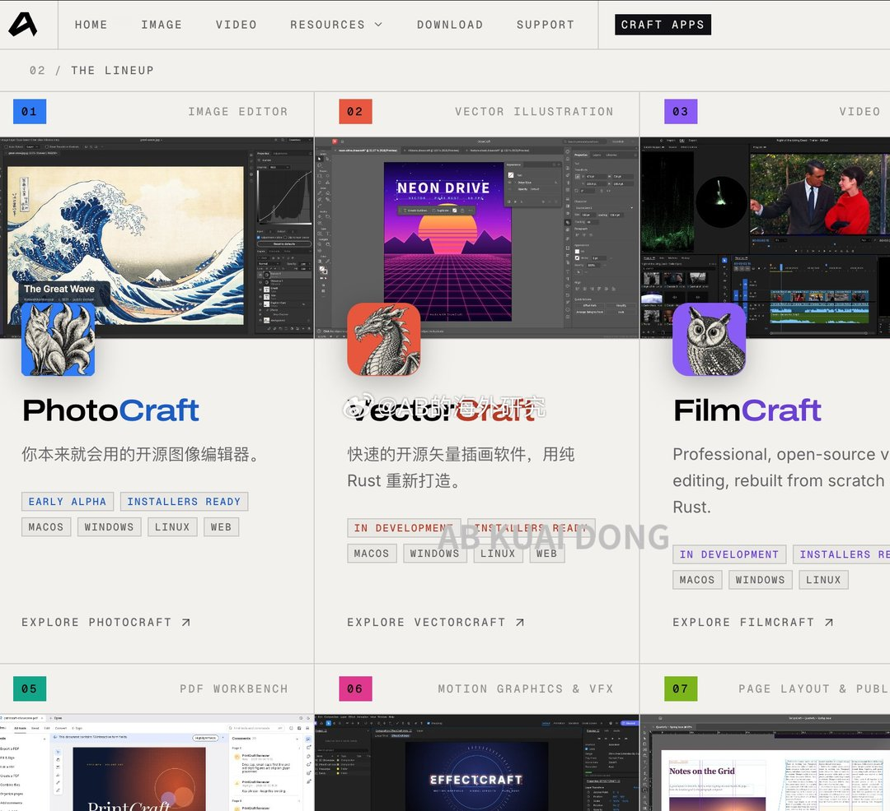

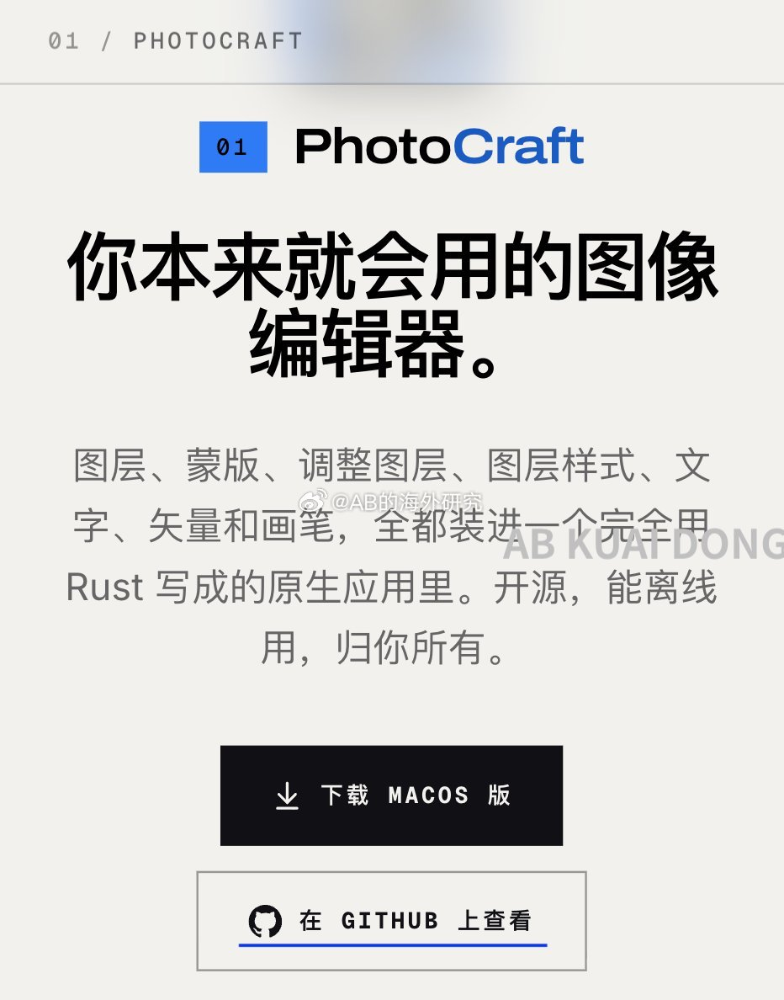

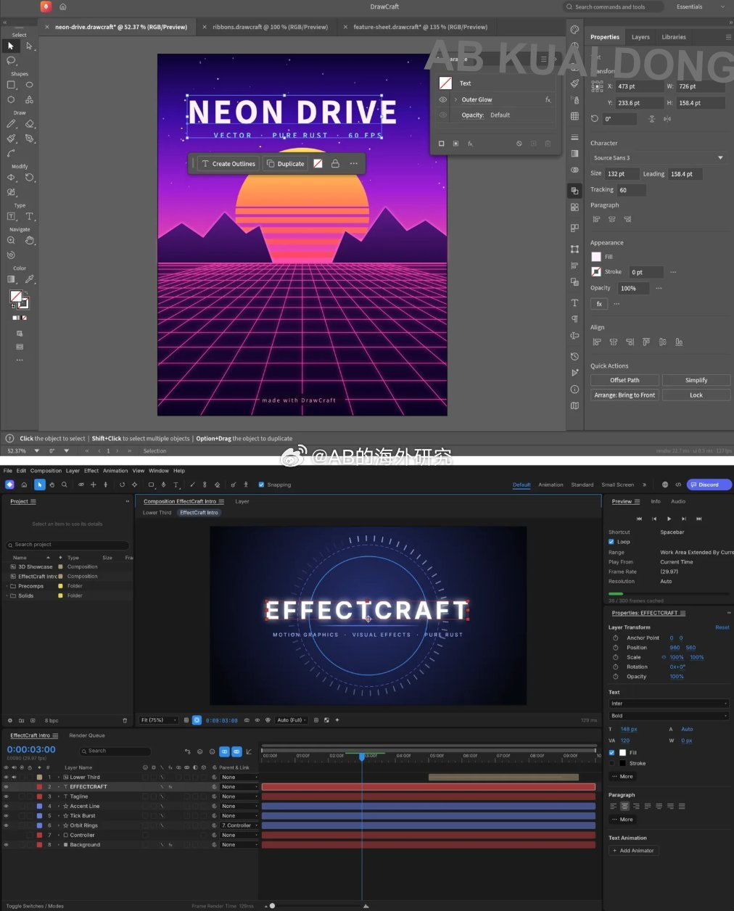

---

## 7

@科技先生

发表于：2026-10-07 12:02

来源：微博

链接：https://m.weibo.cn/status/5351475186504458

Photoshop 被反编译 然后 用 AI 重写成 Rust 代码。。。。。可能比 Photoshop 更快，还免费开源。。。。

转：这就是几天前预测的厄运，现在降临到 Photoshop 头上了。

一个干净室的开源重新实现。

猜测做法：把 Photoshop 反编译成源代码，处理成某种非代码规范语言，再把规范喂给 LLM，指示它生成 Rust 代码，奖励都不用。

Adobe 刚被核弹炸了。闭源软件死定了，死定了，死定了。

⚠️ 读者补充背景：这些项目（如针对 Photoshop 的 PhotoCraft）明确禁止反编译或复制 Adobe 代码，声明仅基于公开规范和观察到的行为进行实现。

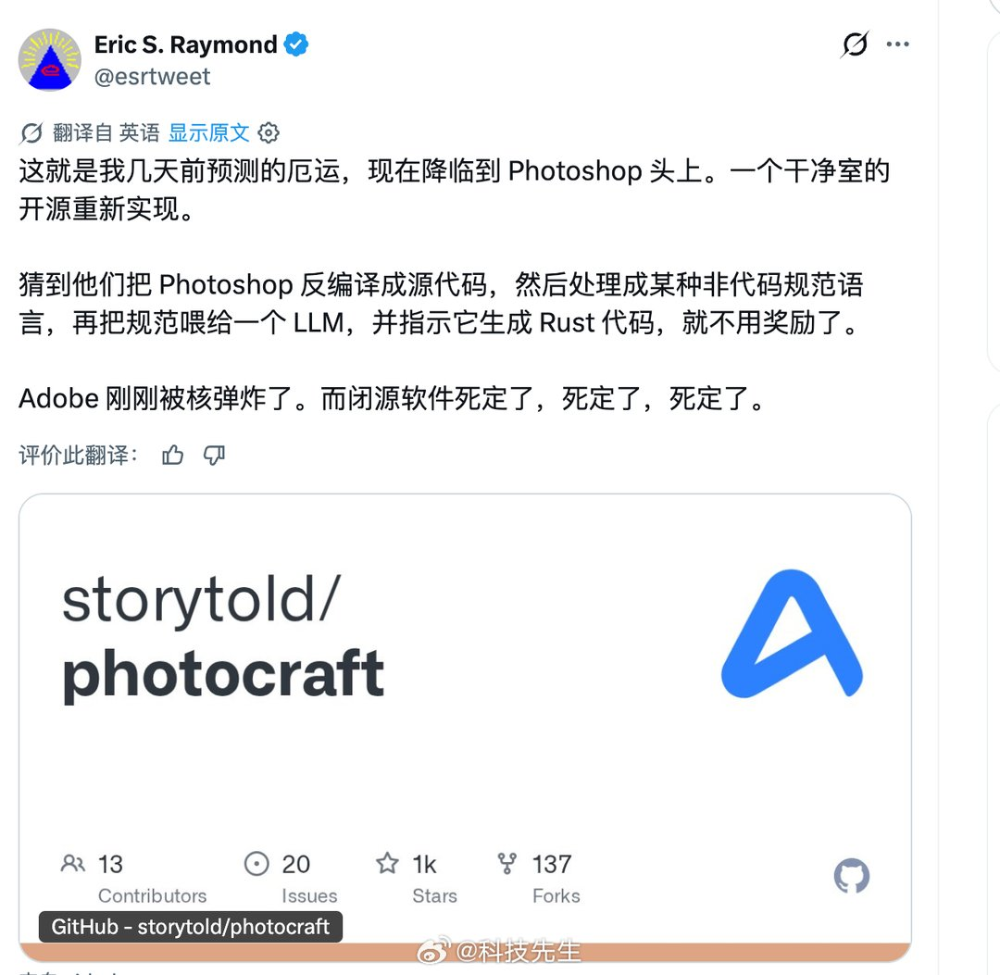

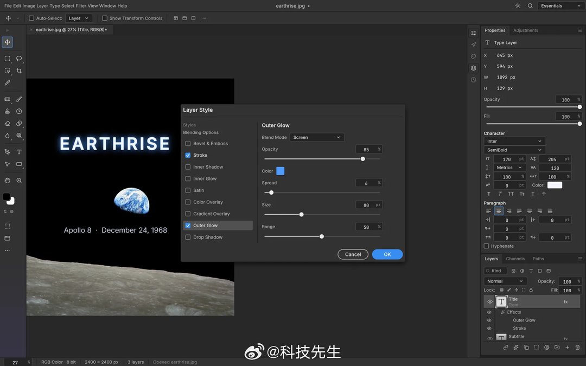

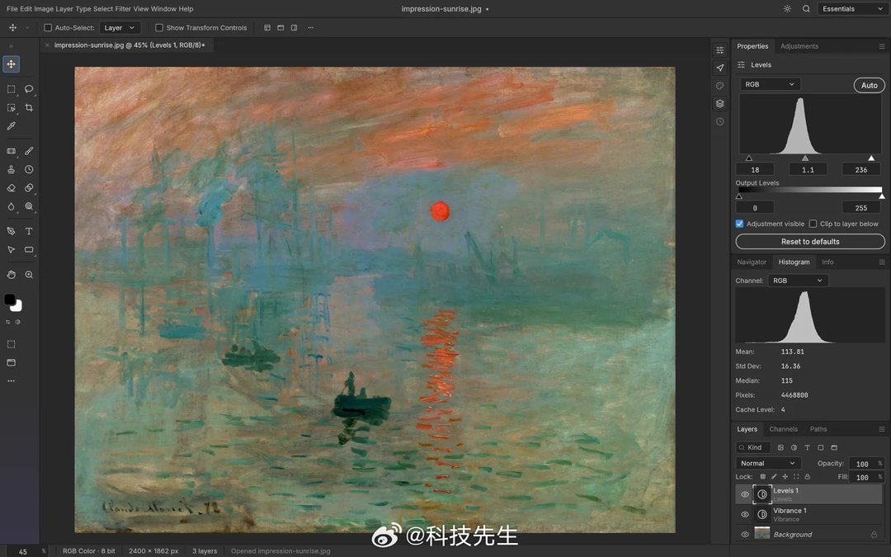

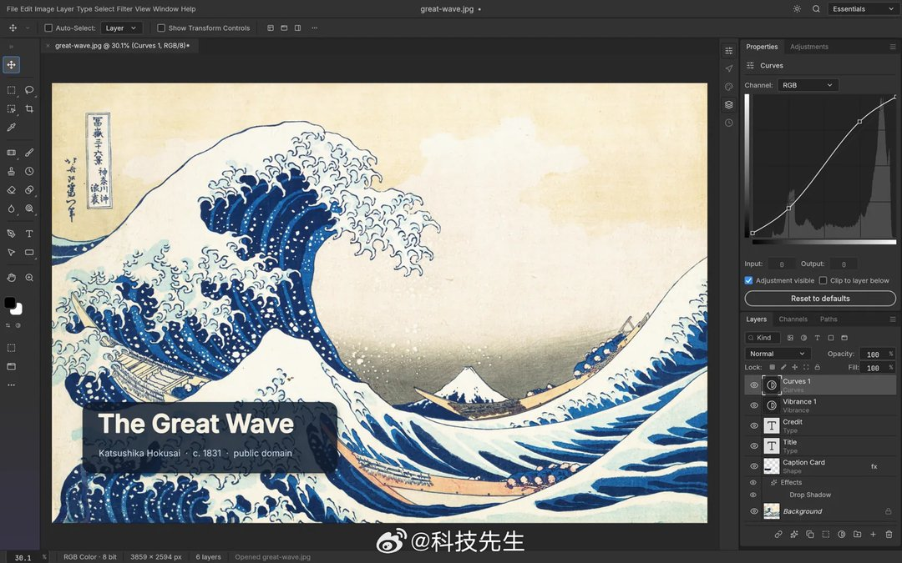

---

## 8

@李楠或kkk

发表于：2026-10-07 13:14

来源：微博

链接：https://m.weibo.cn/status/5351493303014159

未来顶层非顶尖的科学家，拿着无限能源和无限 token 解决问题的能力和速度，超越什么 50 年 50 个诺贝尔得主的国家。

如果军工，医药研发，以及数学 700 多个未解决难题的突破还不能让你看到这一点。。。那我只好说。。。

时代变了，大人。。。

