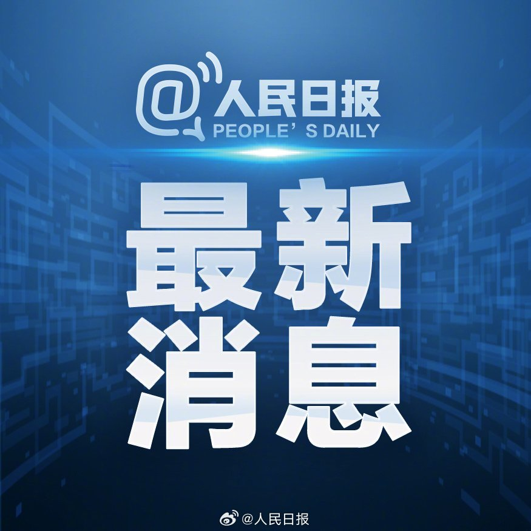
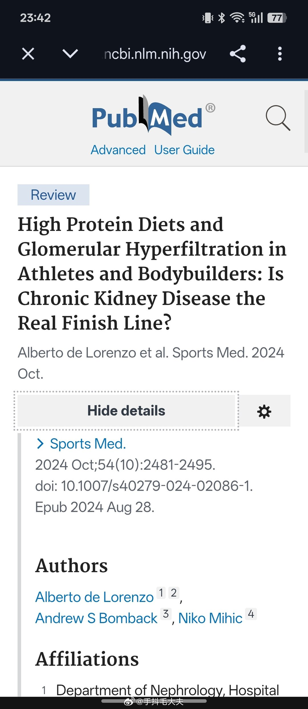
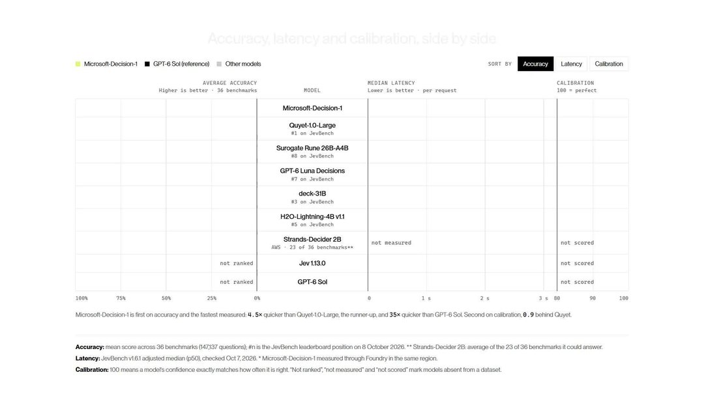
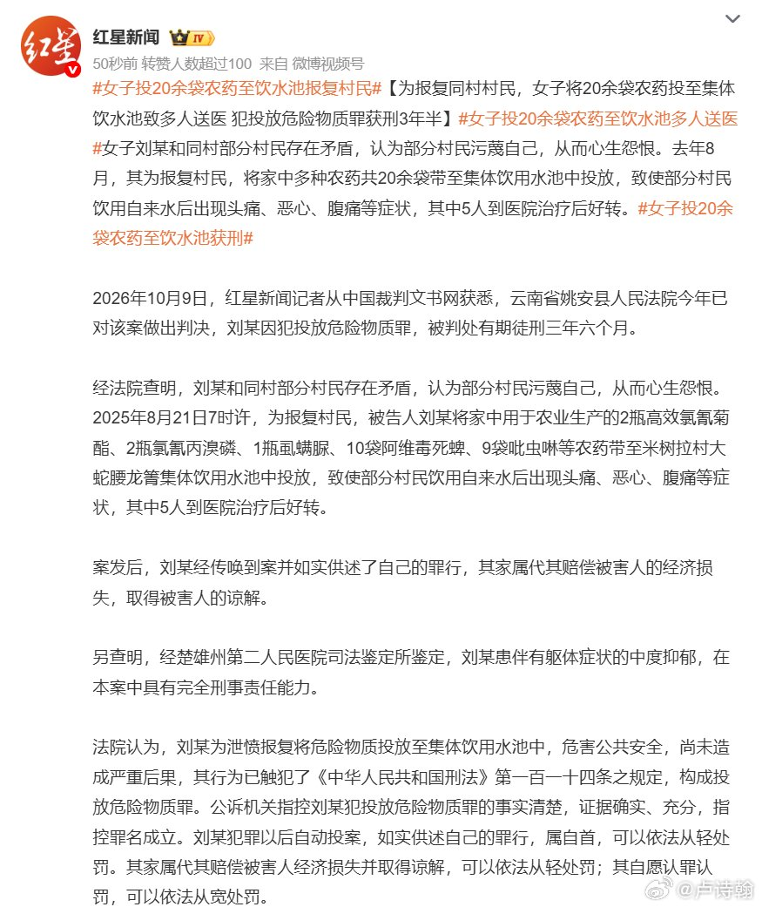

# 2026-10-10

## 1

@人民日报

发表于：2026-10-09 23:42

来源：微博

链接：https://m.weibo.cn/status/5352376057989086

【普京与特朗普通话：\#俄将向美国和全球市场供应石油\#】俄罗斯总统普京9日晚通过总统官网发布声明，称当天在同美国总统特朗普通话中，确认俄将向美国和全球市场提供石油和石油产品。\#俄美元首电话交谈\#

声明说，俄美两国元首9日进行电话交谈，聚焦乌克兰危机解决前景、伊朗局势及俄美双边关系。

在谈及全球能源局势时，俄方确认将向美国和全球市场提供石油和石油产品。普京认为，此举将对全球经济产生积极影响。

声明说，双方还确认，俄美两国元首将继续保持联系，两国相关部门也将继续开展合作。

美国财政部外国资产控制办公室9日发布公告称，将在未来几个月放松针对俄罗斯柴油贸易的制裁，以缓解美国内柴油供应紧张、平抑油价。同天，美国总统特朗普宣布，美俄领导人就俄向美国及全球市场提供柴油达成一致。（新华社）

---

## 2

@飞象网项立刚

发表于：2026-10-09 23:28

来源：微博

链接：https://m.weibo.cn/status/5352372621544506

\#做早饭时想\# 【台积电绑架了整个信息产业】

研究最近10年全球信息产业，惊讶的发展，这10年，全球的信息产业不是上行的，而是越来越沉闷，逐渐下行的的。

我们大家都知道，2016年以前，全球信息产业呈现着欣欣向荣的态势，电脑价格大幅度下降，电脑成为普通的工作和生活工具，手机从功能面逐渐过渡为智能手机，每年智能手机出货量大幅度增长，不仅是发达国家，不太发展的国家，也通过3G和4G的建设，实现了移动通信高速度增长。这也带来的了移动支付、移动电子商务的出现，大大提升了社会效率。

然而近10年，尤其是进入2018年之后，全球智能手机出货量一直呈下行的态势，电脑的出货量除了2020年-2021年因为疫情，带来了一定程度增长，也还是呈下降的，信息产业一波一波的都是什么区块链元宇宙、元宇宙？产品的价格越来越高。

究其原因当然是多个方面，台积电对于全世界信息产业的绑架，起了重要的作用，这个基本的概念就是炒作概念，不断地拉高价格，极大地提升自己的毛利率，最后损害了世界信息产业的发展。

本来一个做芯片代工的企业，不过是一个芯片的加工商，挣的都是加工费，无论是技术能力还是对世界芯片产业的影响，都是有限的，很长时间，台积电这种芯片代工企业，不过是世界芯片产业的配角，全世界芯片产业最有影响力的是英特尔、高通、德州仪器、博通，这样的一些企业。

芯片产品价格是不便宜，但是芯片产品总体是呈稳定，甚至是下降的状态。这支撑了全世界信息产业的发展，保证了服务器、电脑、电子产品的价格稳定。

从 2014 年开始，台积电开始芯片制程的炒作。从传统的 28 纳米芯片，开始风险试产 16 纳米的芯片，2018 年风险试产 7 纳米芯片。此后，把世界芯片产业拖入制程战，芯片制程从 7 纳米、5 纳米、3 纳米、2 纳米，还要往 1.4 纳米发展。

把它在技术上面做一些突破，并不是坏事，对世界的芯片产业也是有帮助的，这个过程台积电不断的关闭 6 英寸、8 英寸晶圆厂，每次制程的提升都建设新的晶圆厂。以此为借口，极大拉高先进制程芯片生产成本。让别的代工厂不敢大规模投入，同时也拉高芯片的价格。

在这种制程炒作之下，台积电逐渐成为产业垄断者，原来台积电的毛率不到 50%，通过几年的炒作，台积电的毛利达到了惊人的 60%。完全超出了一个普通制造业的水平，获得了大量的垄断利润，2014 年台积电的营收 1548 亿人民币，利润 530 亿人民币，2025 年营收已经达到了 8744 亿，利润约 3975 亿人民币。

台积电通过对于美国芯片企业的绑架，把美国高通、英特尔、AMD、德州仪器等企业的利润变成了自己的利润。

基础芯片制造的高价格，传导到电子信息的上游，我们都知道，今天全世界的电子信息产业价格是平稳的，甚至是下降的。只有两个产业的产品价格在大幅度上涨，一个是智能手机，在 2014 年左右，智能手机的通行价格在 2000 元左右，今天，智能手机的通行价格已经涨到了 6000 元。另一个就是人工智能，本来服务器智算中心的芯片都是稳定的。因为需要所谓的先进制程芯片，芯片价格炒成了天价。

而其他领域的芯片都是稳定的，甚至价格是在逐渐走低。

炒作制程是否带来了技术的突破？事实上，每一轮制程的提升，不过是性能提升了百分之二三十，功耗下降了 15% 左右。这样的提升，通过设计和新的架构也可以实现。根本不需要通过高成本提升制程。甚至到了 5 纳米之后，制程有没有提升，没有人知道。很可能就是用一个概念，又一次拉高了价格。

全世界信息产业要健康发展，必须干掉台积电这样的毒瘤，让芯片回归正常位置，才能迎来产业的欣欣向荣。信息产业发展不能靠涨价。

未来的三年，破局制程领先，用新的理念和架构重构芯片发展方向，这个重任落在中国大陆企业的身上。中国大陆芯片企业的全面崛起，才会迎来世界信息产业再次繁荣。

---

## 3

@手抖毛大夫

发表于：2026-10-08 15:43

来源：微博

链接：https://m.weibo.cn/status/5351892977976051

\#向佐喝蛋白粉把肾喝成70岁\# 其实正常人长期大量摄入蛋白质（比如蛋白粉）对肾功能是不是有损伤，一直是有争议的。

理论上来说，因为肾需要排泄蛋白质代谢产生的废物，比如尿素氮等，而且过多的蛋白质摄入机体会增加肾脏血流量和肾小球滤过率（GFR），让肾小球持续处于高滤过状态。

这时候氨基酸滤过与近端肾小管重吸收增加，管球反馈机制减弱，入球小动脉舒张、肾血浆流量增加，单肾单位GFR升高、肾小球毛细血管压力可能增加，长期可能出现足细胞应力、白蛋白尿、肾小球硬化。

当然了，你可以完全忽视上述这一堆专业术语，只用知道蛋白质摄入多了，肾的负担就会加重，肾也会进入高滤过运转模式。

但问题在于，这种“高滤过运转”是不是一定会损伤肾功能呢？

这其实就是争议所在的地方。

你可能觉得这是废话，天天地板油开车，发动机肯定会受损……但问题在于，人体并不是发动机那样的机械装置，包括肾在内的器官都是有修复功能的细胞组成的，只要损伤程度在可修复范围内，理论上不该有永久性损伤。

比如，我检索到的这篇 2024年发表于 Sports Medicine 的综述专门讨论了运动员、健美人群长期高蛋白饮食与高滤过的关系，并指出长期肾脏结局仍存在证据不足的问题，也就是这些长期高蛋白饮食的人群没发现肾脏永久性损伤的强硬证据。

当然，你要是反过来检索高蛋白可能导致肾损伤的文献，也同样一抓一大把，可能的原理包括但不限于前面的肾高负荷（高滤过）学说，还有肾小管缺氧学说、氧化应激学说、蛋白尿介导肾小管纤维化学说、蛋白质代谢的酸性产物导致肾小管酸中毒学说等等……但无论如何，也都没有非常确凿的证据。

现在比较达成的共识是，对于肾功能正常的人，多余的蛋白摄入肾脏通常能够有效代偿。但对于慢性肾病患者，过多蛋白摄入可能加速肾脏疾病进展。

这好像也是废话，仿佛在说车子的发动机好好的你使劲踩油门没事，发动机有问题你还使劲踩油门会坏。

但是问题就在于，生活中很多时候，我们是不知道肾有没有问题的……

慢性肾病早期几乎没有特异性症状，肾脏代偿能力极强，等到出现明显不舒服时，肾功能往往已经损伤比较重。

正常人两个肾脏，只需要约一半肾单位就能维持日常代谢、排毒。哪怕一部分肾小球受损，剩余健康肾单位可以加班代偿，肌酐、尿素仍能维持在参考范围，身体不会出现明显不适感。

 

那你说我体检行不行？

其实很多普通体检套餐不包含尿微量白蛋白，只查血肌酐、尿素尿常规，但血肌酐并不是敏感指标，肾功能丢失一半以上，肌酐才会升高，这时候容易会漏掉早期肾病。

所以如果你是：糖尿病、高血压、高尿酸/痛风、肥胖、代谢综合征、有慢性肾病家族史

、长期服用解热镇痛药、含马兜铃酸中药、部分偏方、年龄＞60岁、既往肾炎、尿路感染、蛋白尿、血尿病史……每年体检一定要做以下筛查，这仨是早期发现的黄金组合：

 

1. 尿常规；

 

2. 尿微量白蛋白 / 肌酐比值（UACR）；

 

3. 血肌酐 + 估算肾小球滤过率 eGFR。

当然如果有以上这些情况，蛋白粉就不要吃了，给肾减减负吧，毕竟一旦肾功能衰竭依赖上透析，生活质量就大打折扣了。

---

## 4

@宝玉xp

发表于：2026-10-09 21:26

来源：微博

链接：https://m.weibo.cn/status/5352341733639006

微软发布 Microsoft-Decision-1：专做“选择题”的 AI 模型，基于 Qwen3.5-9B 后训练

微软推出新模型 Microsoft-Decision-1。它不写文章也不聊天，只做一件事：给定几个选项，快速判断该选哪个，并给每个选项打一个概率分。Satya Nadella 在 X 上宣布了这个模型，它已在微软的 AI 开发平台 Microsoft Foundry 上线，之后还会上 OpenRouter（一个聚合多家模型的 API 平台）。

微软把这类模型叫“决策模型”。大语言模型擅长生成文字、推理复杂问题，但软件里很多 AI 调用其实只是在做判断：这条用户反馈属于哪一类？这个请求该交给哪个模型处理？智能体下一步该继续、重试，还是交给人？这类问题的答案都在固定选项里，拿大模型来答又慢又贵。决策模型直接输出结构化结果，程序拿到就能用。

它是在阿里开源模型 Qwen3.5-9B 的基础上后训练出来的，只算一遍就出结果。支持是/否题、多选题和打分，也能按评分标准给 AI 的回答或智能体的动作打分。微软说之后会换到自家 MAI 模型和 OpenAI 的模型上重新训练。

它输出的概率是“校准过”的：模型说有 90% 把握时，实际大约十次能对九次。开发者可以据此设门槛，把握高就自动执行，把握低就转人工审核。

以下性能数据都来自微软自己的测试。在 36 个基准、近 15 万道题的对比里，它的准确率最高。速度上，它比第二名 Quyet-1.0-Large 快 4.5 倍，比 GPT-6 Sol 快约 35 倍。微软还测了稳定性：把同一个请求换种说法、打乱选项顺序等，一共八种改动，判断结果平均只有 1.3% 会变，打乱选项顺序时一次都没变。

速度之所以重要，是因为智能体干活经常要连着做几十个小判断。每个判断慢 100 毫秒，20 步下来就要多等 2 秒。

微软内部已经在用。Xbox 研究团队用它把 1 万多条玩家反馈和评论按主题归类，质量和 GPT-6 Sol 相当，速度快 14 倍以上，成本低 200 倍。Copilot 团队用它给回答质量打分，效果接近 GPT5.6 Luna，速度快 100 倍。

对开发者来说，它适合那些答案在有限选项里的环节，比如模型路由、意图识别、内容审核、数据打标签、给 AI 输出当评委，以及让 AI 操作电脑时选下一步点哪里。把这些环节从大模型换成它，延迟和账单都能降下来。

价格是每百万输入 Token 0.042 美元，输出免费。现在就可以在 Microsoft Foundry 的模型目录里调用。

官方公告：网页链接

---

## 5

@卢诗翰

发表于：2026-10-09 10:07

来源：微博

链接：https://m.weibo.cn/status/5352170983525479

许多人一直不理解这些年欧美的极右翼转向

然而今天恰好出现了一个非常直白的案例

一个男子，毒小区的狗，应该如何判罚？

许多人可能会说，今天毒狗，明天可能就毒人，所以应该重罚，

有道理，那就判他四年

\#男子毒死9条宠物犬被判4年\# 

那么问题来了，如果今天出现一个女子，跳过毒狗，直接毒人

而且还是把农药投到饮用水源，直接毒全村那种，应该怎么判呢？

如果你觉得这判罚无论如何应该比之前男子毒狗要高

你这就算极右翼了

我知道这听起来不可思议，但目前算法就是这样的

---

## 6

@高飞

发表于：2026-10-10 15:12

来源：微博

链接：https://m.weibo.cn/status/5352488723285383

\#读书看电影\# 诺贝尔文学奖得主安妮·卡森谈写作：手写能力消失之后，思考也跟着停了

2026年10月8日，瑞典学院宣布安妮·卡森（Anne Carson）获得2026年诺贝尔文学奖，授奖词称她“以大胆且富于创造力的作品，为当代文学创造了新形式”。接到电话时她正在冰岛，说自己在“聆听风声”（listening to the wind）。卡森1950年生于多伦多，诗人、散文家、古典学者、翻译家，代表作《红色的自传》（Autobiography of Red）、《丈夫之美》（The Beauty of the Husband）、《夜》（Nox）。2024年9月，她在丹麦路易斯安那现代艺术博物馆（Louisiana Museum of Modern Art）接受挪威作家琳恩·乌尔曼（Linn Ullmann）对谈上线。这场对谈由博物馆旗下的影像频道Louisiana Channel录制并发布在YouTube上，一个小时里聊了写作、帕金森症、翻译和母亲。以下笔记整理自这场对谈。

卡森被确诊帕金森症之后，最让她受不了的症状是笔迹的崩溃。她用笔在本子上写了一辈子，日复一日，年复一年。帕金森来了以后，竖笔开始弯折或断裂，元音缩成墨团，倾斜度失去了利落的角度。她用“羞耻”形容这种感受。更让她不解的是，手写能力一旦失控，思考本身也跟着迟滞。手上的快感和脑中的快感，原来纠缠到这种地步：一种消失，另一种也不愿意来了。

于是她去上了拳击课。

一、一切从怀疑开始

1、笛卡尔那句话被截掉了前半段

所有人都知道笛卡尔（René Descartes）那句“我思故我在”，到处印在T恤上。但卡森说，原句其实是 dubito ergo cogito， ergo sum：我怀疑，所以我思考，所以我存在。“怀疑”被拿掉了，因为怀疑的名声不好。

这让她觉得特别有意思：思考的真正起点是怀疑，也可以说是犹豫。她曾专门写过一篇关于“犹豫”的演讲稿，受邀在马德里的普拉多美术馆讲。结果写着写着，思路拐到了花栗鼠的话题上，而西班牙根本没有花栗鼠。她赶紧往稿子里塞了18世纪西班牙画家戈雅（Francisco Goya）的画来补救。

那幅画很多人见过：巨大的金色画布上，角落里只有一个小狗的脑袋，往上看着头顶无边的空间。每个人看到的表情都不一样。

2、“错误”是加拿大人在美国的生存方式

卡森出生在加拿大，后来去美国教书。在鸡尾酒会上，美国人总问她：加拿大和美国有什么区别？她想出一个标准回答：“你们统治世界，加拿大人永远彬彬有礼，但总是错的。”

她把这个“错”字用到了自己身上。散文集通常被期待是一个前后连贯、层层递进的整体，但她的散文集不是。写《错误的诺玛》（Wrong Norma）时，她干脆在封底告诉读者：这些文章之间没有联系，所以叫“错误”。与其说什么名人推荐语，不如直接让读者知道自己要面对什么。

3、在现实与再现之间，我们永远在怀疑自己是否算得上好人

“错误”和怀疑在卡森这里指向同一件事：现实和对现实的再现之间永远存在碰撞，而我们永远在怀疑自己能否做一个好人。笛卡尔那句完整的话之所以让她在意，正是因为思考不是从确定开始的，是从不确定开始的。

二、把聚光灯移到边缘

1、默斯·坎宁汉和约翰·凯奇：去掉舞台中心

卡森的丈夫和合作者Robert Curry把美国先锋派作曲家约翰·凯奇（John Cage）的作品和思想带进了她的世界。凯奇和编舞家默斯·坎宁汉（Merce Cunningham）共同发展出一个观念：把观众的注意力从中心移到边缘。坎宁汉的舞者不总是面朝观众，脸上几乎没有表情，不试图把你的思维固定在某一个点上。注意力在空间里流动。

卡森自己其实不喜欢站在舞台中间被聚光灯照着朗读。这件事总让她觉得“作为一个晚上的娱乐来说，有点不够”。所以她和Curry开始合作：她退到舞台一侧念文字，他在中间用纸箱、雕塑或其他物件制造空间和动态。

2、两种对现实的理解

她想的现实是句子，纸上的文字。Curry想的现实是雕塑，是空间、人和运动。两个人完全不会用对方的方式思考，所以Curry把空间和运动放进了文字里。在他们合作的作品《Stacks》的现场演出中，那些东西变成了纸箱。

3、教授的本能是讲课，但讲课不是思考

做了一辈子教授，卡森的本能是站在台上讲一个真理，坚持你必须用这些词、按这个方式知道这个真理。“这真的很无聊，而且它根本不是思考。因为它不让你移动。”

“你的心智想要移动。一件艺术品能做的最好的事，就是带着你的心智一起移动，去一个你从未预料会去的地方。”

美国现代主义作家格特鲁德·斯坦因（Gertrude Stein）也说过类似的话。但卡森紧接着自嘲：想到斯坦因的时候，你脑子里浮现的绝对不是她周围的边缘人物，而是她那个巨大的自我占据了你全部的注意力。所以“消除自我”这件事，在创作艺术品的过程中，是一个奇怪而无望的计划。“但我们一直在试。”

三、写作者的任务是观察小事

1、花74年学会的事

大多数时候，我们对自己身边的人采用一种“抹过去”的方式：妈妈永远在另一个房间抱怨什么东西。我们以为自己了解他们，就跳过了真正的观察。

卡森说自己花了74年才学会一件事：去注意人们到底在做什么，怎么做的，在你已有的刻板印象之外的部分。这么做了之后，结果总是让她吃惊。

笛卡尔负责宏大的事情，她负责小事。“注意小事才能带来区别。”

2、拳击课上的人性课

她因为帕金森症去上了拳击课，班上有一群固定学员，和她完全不同。卡森坦承：“我基本上是一个傲慢的知识分子，觉得自己比所有人都高一等，因为我读过那么多书。”拳击班的人大多不读书，看看电视，来上拳击课。

她原本可以因此看不起他们。但她慢慢学会了不这样做。一旦放下这种态度，就开始看到：他们每个人其实都很独特，大概有点疯，而且愿意对你友善。

“这种对细节的注意，把你带到一个比概括更真实的地方。”

3、两个早晨并排存在

有一天早上她独自在海里游泳，回家后打开报纸，看到叙利亚难民潮的报道：挤在不够用的船上、溺水、整夜被锁在拥挤的火车里。

“你怎么能读一个关于悲剧和创伤的故事，沉入那种悲伤，然后合上报纸去烤面包？我们怎么做到的？我们怎么能让不存在就这样紧挨着存在？”

她不知道答案，但我们确实在这么做。我们管它叫“继续生活”。这个问题无论怎么想都解决不了。

诗人也面对同样的困境。卡森提到美国当代诗人Danez Smith在Louisiana Channel做的一个访谈：他写了关于明尼阿波利斯警察射杀事件的诗，在台上朗读，人们说“好诗”，然后回家觉得已经“处理”了这个问题。但问题还在那里。诗人必须一直和这种东西搏斗：那两样东西就在那儿，并排放着。

四、帕金森、拳击与消失的笔迹

1、拳击为什么是帕金森的推荐疗法

帕金森症是一种神经系统退行性疾病，干扰注意力和身体运动。拳击被推荐为治疗手段，原因很具体：它训练手眼协调和动作序列。拳击训练由教练喊出数字编号，每个编号对应一种出拳方式，学员必须在听到编号的同时做出对应动作。

帕金森患者的大脑恰恰不想做“注意这件事然后执行”这个过程，所以拳击迫使大脑反复进行这种刺激。卡森在访谈时刚开始上课两三个月，说自己很喜欢。

2、笔迹崩溃与思考的停滞

帕金森带来的诸多症状里，卡森谈得最久的是笔迹的瓦解。她一辈子用笔在本子上写作，一天一天、一年一年。手写这个动作本身带来一种独立于内容的快感，和想写什么、想什么是两种不同类别的快乐。

当手写变得不可控，这种快感就消失了。大多数帕金森患者会改用印刷体，但印刷体“没什么乐趣”。更让她费解的是，笔迹崩溃居然抑制了思考本身。她试过打字，但打字是另一回事，“打出来的不是思想”。

两种快感纠缠得太深，以至于现在每次想坐下来写点什么，她都会停下来，因为光是想到要让笔迹正常运作就已经够痛苦了。

3、“Life is not fair”的三层意思

卡森在英国文学评论杂志《London Review of Books》2024年8月发表的散文《Gloves On》里写到一句话：“Life is not fair。”

文中写到她嫉妒英国浪漫派诗人济慈（John Keats），因为济慈的书信和日记都是手写的，字迹极其漂亮。济慈把誊写整齐的手稿称为“fair copies”，fair在这里是“工整漂亮”的意思。而fair同时还有“公正”的意思。这是一个双关语：她的笔迹不再漂亮（not fair looking），生活对她也不公平（not fair as in just）。

但卡森没有停在这个双关上。文章的标题是“Gloves On”，戴上拳套继续打。爱尔兰剧作家贝克特（Samuel Beckett，1969年诺贝尔文学奖得主）的那句话在底下托着整篇文章：“I strive。 I do not win。”

五、翻译里的裂缝

1、萨福的空白不是缺陷，是历史本身

卡森翻译古希腊女诗人萨福（Sappho）时，用方括号和空白来标记原文中已经散佚的部分。很多翻译者会把残缺的诗行补全，编出一个完整的故事。她觉得这么做不诚实。有的残篇我们真正确认的只有11个词，把它翻译成一首完整的诗，是不现实的。

保留空白是为了呈现文本的历史。不过她也承认，另一个原因是“它看起来好看”。

空白同时提供了思考的空间。写作和做艺术的任务之一，是给别人一种他们从未有过的思维体验。有空间的语言，就是一个可以走进去想事情的地方。

自从那本书出版之后，她不断收到读者寄来的稿件，“热心地”替她把所有空白都填上了。她通常回信说“谢谢”。

2、翻译中的“第三种语言”

翻译让卡森着迷的原因是可以“从裂缝里往下瞥一眼另一样东西”。翻译中存在三层结构：原文、译文，以及夹在两者之间的一种可能的语言。那种语言能同时做到原文和译文各自在做的事，但我们抵达不了它。“从哪一边都走不到那里。”

“就好像物理学中的弦理论：可能存在各种不同的现实，我们碰巧活在这一个里面。但我们也可以活在那个裂缝里。只是我们还没有学会怎么感知它。”

德国思想家、文学批评家瓦尔特·本雅明（Walter Benjamin）在论文《译者的任务》（The Task of the Translator）中把这叫作“神圣的对话”，两个文本底下那一层。卡森对“神圣”两个字不太确定，但觉得这个描述抓住了某种东西。

3、自传冲动与母亲的眉毛

卡森对写自传这件事感到“惊骇”。每次坐下来都下决心不这么干，但最终总是绕回来。“你没有别的故事可讲，也没有别的方式来理解现实，除了你自己活过的那种。”

她没有虚构的能力。小说家朋友们每天醒来脑子里就有一个故事可以写成小说，她从来没有过。但如果她去洗手间的路上绊了一下脚趾，她能写那个，因为它刚刚发生过，它是真的。

关于母亲，卡森笔下不同作品中的母亲形象并不相同，但有一个共同点：她们都在抽烟。她的母亲确实一直在抽烟。至于她的长诗《Red Doc>》（《红色的自传》的续篇）中母亲临终的场景，那更接近真实发生的事。

母亲在医院里最担心的事情，让卡森觉得既心酸又无奈，是自己的眉毛。母亲有浓密的眉毛，每天都拔。住进医院之后，她没法拔眉毛了，担心自己看起来很糟糕。卡森去看她的时候，两人试着让卡森来拔，怎么弄都弄不好。卡森反复跟她说：你的眉毛已经变透明了，全白的头发让眉毛消失在皮肤里，拔不拔根本看不出区别。母亲完全无视了这一点。

“这就是我们的相处方式，一直如此。但也有点令人难过，她到最后还在担心一件在我看来根本无关紧要的事。然而，人就是这样。”

访谈的结尾，卡森朗读了《Red Doc>》中“Brain之妻”（Wife of Brain）的合唱段落。那是一个不确定的声音，俯瞰着角色们的行动和思想：

“夏天里的母亲们，冬天里的母亲们，秋天里的母亲们，春天里的母亲们，高处的母亲们，孤独中的母亲们……羞愧的、燃烧的、清澈的母亲们，在尽头，她们几乎都是这样的。然后，母亲们不再出现了。在春天里。”

核心归纳

Q1： 写作者最该做的一件事是什么？

观察小事。大多数人对身边的人采用“抹过去”的方式，用已有的刻板印象替代真正的观察。卡森的体会是，注意人们在做什么、怎么做的，在你对他们的预判之外的部分，“把你带到一个比概括更真实的地方”。

Q2： 帕金森症和写作之间的关系是什么？

帕金森症摧毁了卡森的手写能力，但更深层的发现是：手写的物理快感和思考的智识快感纠缠得太深，一种消失之后另一种也不愿意来了。她无法用打字替代手写来思考。拳击课作为一种帕金森治疗手段，通过训练手眼协调和动作序列来刺激大脑，是她找到的应对方式。

Q3： 笛卡尔那句名言为什么重要？

完整的原句是“我怀疑，所以我思考，所以我存在”，而不是人们通常引用的“我思故我在”。怀疑（或者说犹豫）是思考真正的起点。这个被截掉的前半段，对卡森来说，呼应了她整个创作方法论的核心：从不确定出发，在不确定中保持移动。

