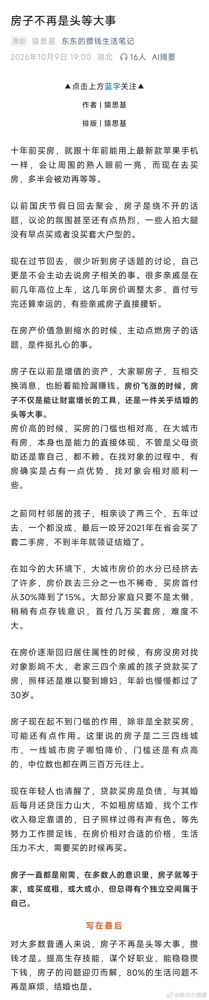
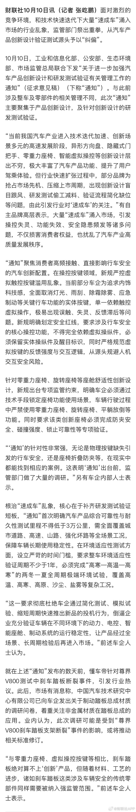
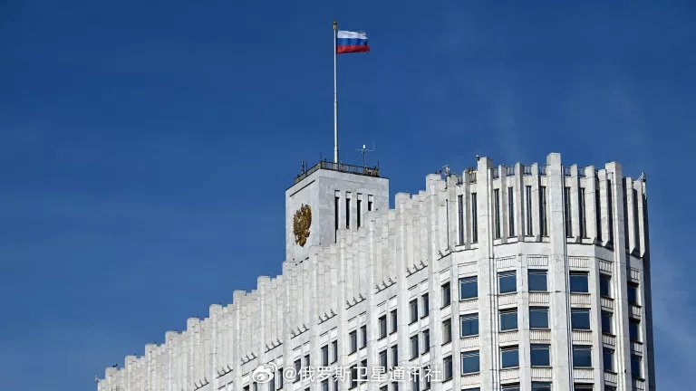
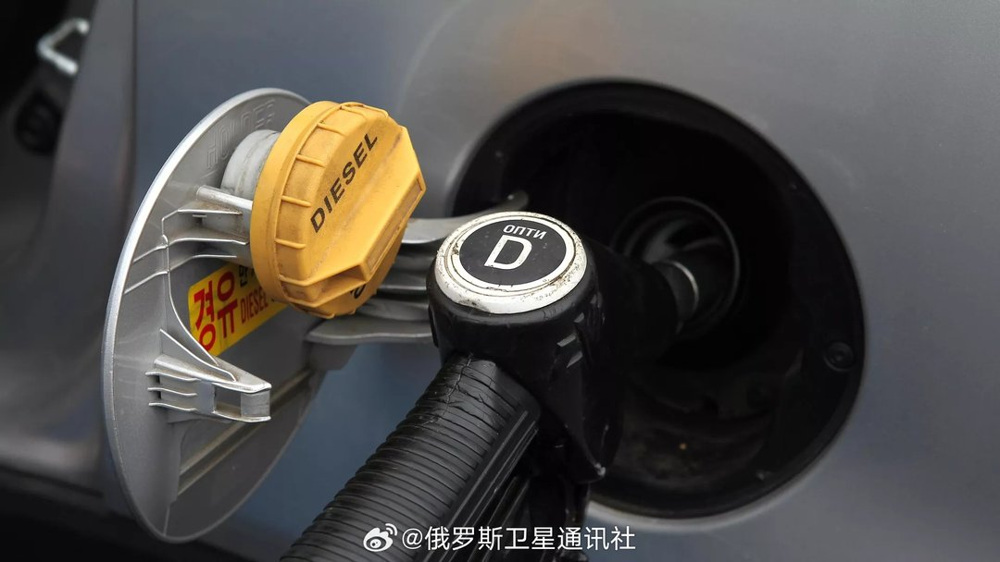
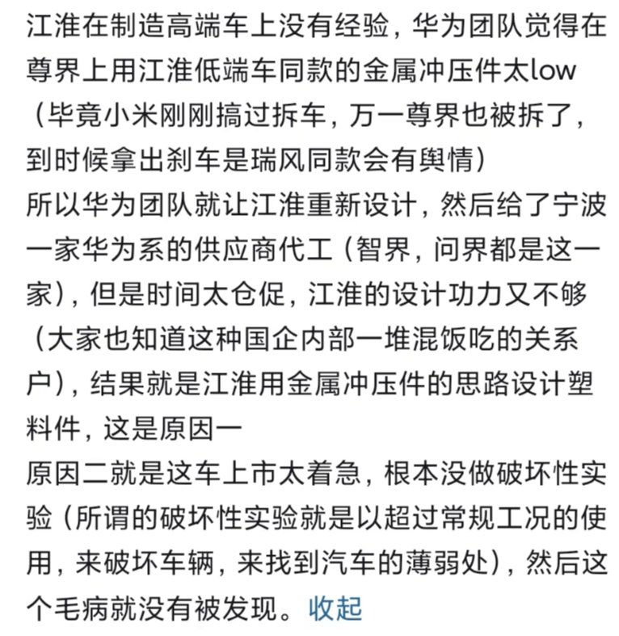
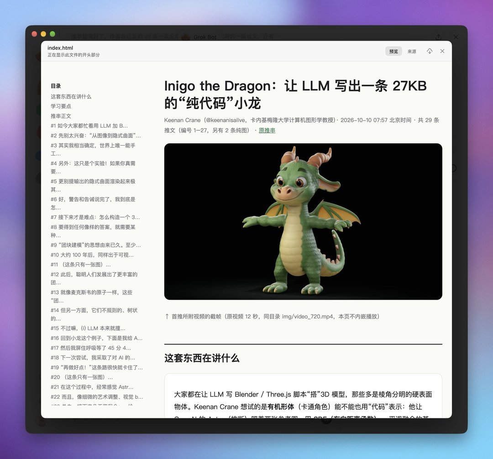
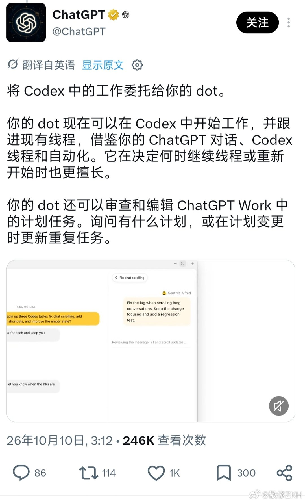

# 2026-10-11

## 1

@学术大观察

发表于：2026-10-10 12:36

来源：微博

链接：https://m.weibo.cn/status/5352570835963206

有房没房对找对象已经影响不大了

除非你是全款买房。不然，有房有贷，哪怕在北上广深也是负债。与其婚后每月还贷压力山大，不如租房结婚，找个工作收入稳定靠谱的，日子照样过得有声有色。

---

## 2

@财联社APP

发表于：2026-10-10 13:48

来源：微博

链接：https://m.weibo.cn/status/5352589022468810

【四部门“通知”终结“速成车”乱象！环境验证不少于一年 可靠性试验大于三万公里】财联社10月10日讯 面对激烈的竞争环境，和技术快速迭代下大量“速成车”涌入市场的行业乱象，监管部门祭出重拳，从汽车产品创新设计验证测试源头予以“纠偏”。

10月10日，工业和信息化部、公安部、生态环境部、市场监管总局联合下发“关于进一步加强汽车产品创新设计和研发测试验证有关管理工作的通知”（征求意见稿）（下称“通知”）。与此前涉及整车及零部件的相关管理不同，此次“通知”主要聚集于产品创新设计，及针对创新设计的研发测试验证。

“当前我国汽车产业进入技术迭代加速、创新场景多元的高速发展阶段，异形方向盘、隐藏式门把手、零重力座椅、智能虚拟操控等创新设计层出不穷，极大丰富了汽车产品功能、提升了用户驾乘体验。但行业快速扩张过程中，部分品牌为抢占市场先机、压缩上市周期，出现创新设计盲目跟风、研发测试偷工减料、验证流程简化缺位等问题，由此引发行业对‘速成车’的关注。”有自主品牌高层表示，大量“速成车”涌入市场，引发操控失灵、功能失效、安全隐患频发等诸多问题，不仅损害消费者权益，也扰乱了汽车产业高质量发展秩序。（记者 张屹鹏）

---

## 3

@挨踢牛魔王

发表于：2026-10-10 13:47

来源：微博

链接：https://m.weibo.cn/status/5352588695568586

openclaw企业版，这个是Openai、红帽redhat，英伟达联合打造的智能体基础设施。

由小龙虾的创始人牵头。

搞企业级智能体的，要密切关注这个项目的进展。

说不定你搞的那些东西，这个项目已经做了，或者计划做了。

到时候，你做的工作可能就打水漂了。

目前还在很初级的阶段。

项目地址：github.com/openclaw/openclaw-enterprise

---

## 4

@行政法思述

发表于：2026-10-07 04:51

来源：微博

链接：https://m.weibo.cn/status/5351366684052575

有学者分析，追星，是东亚年轻人从事“政治活动”的替代品（唯一？）

为什么在东亚，追星会成为年轻人投入最深、组织最严密的一项集体活动？

几十万粉丝跨时区协同行动，分级管理、统一口径、公示账目、清洗叛徒，这套运作方式如果拿掉「偶像」二字，几乎就是一本完整的政治动员手册。追星有着强大的力量，这股力量在现代社会被释放出来之后，资本拿它来安抚大众，革命则拿它来动员群众。而当它流入东亚，由于合法的公共参与通道始终供给不足，饭圈便把它组织得最为严密，却不再指向任何地方。

---

## 5

@俄罗斯卫星通讯社

发表于：2026-10-10 18:33

来源：微博

链接：https://m.weibo.cn/status/5352660674806433

【\#俄罗斯可在第一阶段向世界市场供应50万吨柴油\#】\#俄罗斯\#政府发布消息表示，解除对柴油出口的部分限制，此使俄罗斯可以在第一阶段向世界市场输送50万吨柴油。\#俄将向美及全球供应石油\#

10月10日，俄罗斯政府决定放宽对柴油出口的禁令，此是俄罗斯总统普京与美国总统特朗普达成协议的一部分。

消息说：“这一决定于10月10日生效，允许向全球市场输送50万吨柴油。”

---

## 6

@包容万物恒河水

发表于：2026-10-10 18:49

来源：微博

链接：https://m.weibo.cn/status/5352664607227959

🔻突发新闻，特朗普说：“我认为是时候让乌克兰换一位新总统了。”

🔻美国总统特朗普抨击乌克兰总统泽连斯基，批评他袭击俄罗斯炼油厂，并称他应该被替换。

🔻特朗普表示：“泽连斯基本来有很多次机会可以了结这场战争，很多很多次，而且，呃，他选——他选择不了结。我们告诉他，‘你想怎么做都行，但别去动柴油，因为有个大问题’，那他做了什么？他去打击柴油了。他想做什么都行，但唯独不能那么做，因为我们面临一个全球性问题，而这个问题是由柴油炼油厂不足造成的。而他就是想给全世界制造麻烦。他想给我们的农民制造麻烦。你知道我建议乌克兰人什么吗？我建议他们换一位能达成协议的新总统，因为他本可以达成很多协议。但不知为何他从不这么做。那是一场本就不该开始的战争，而我认为，乌克兰是时候换一位新总统了。”

🔻via 天空新闻

\#俄将向美及全球供应石油\#\#微博视频精选大赏\#\#海外新鲜事\#\#热点聚焦\# 包容万物恒河水的微博视频

---

## 7

@俄罗斯卫星通讯社

发表于：2026-10-10 18:16

来源：微博

链接：https://m.weibo.cn/status/5352656366993527

【俄专家：\#俄美柴油协议成乌克兰重大失败\# 美对乌立场出现重要转变】俄罗斯高等经济大学欧洲和国际综合研究中心副主任苏斯洛夫向卫星通讯社表示，普京与特朗普近日通话及双方达成的柴油协议，是自安克雷奇峰会以来美俄关系中最重要的事件。他指出，该协议标志着美国在乌克兰冲突立场上的重要转变——美方此前坚持任何制裁解除与对俄合作都须以乌克兰停火或冲突解决为前提，如今却将制裁长期豁免至4月7日，并开始大规模进口俄罗斯柴油，这与乌克兰冲突的解决无关。\#俄将向美及全球供应石油\#

苏斯洛夫认为，该协议与泽连斯基及其欧盟支持者极力寻求的能源和港口停火毫无关系，泽连斯基对此反应强烈已凸显这一点。协议可能是特朗普政府对乌施压的开端，以确保乌方接受俄方停火条件。\#美俄达成柴油协议\#

苏斯洛夫称：“特朗普对泽连斯基感到愤怒，他曾六次要求泽连斯基停止打击俄罗斯炼油厂，但每次都遭到拒绝。现在特朗普与普京达成了这项柴油协议。”

苏斯洛夫还指出，泽连斯基对俄远程打击适得其反，极大改善了俄处境并损害乌韧性。若泽连斯基与特朗普陷入严重对峙，美方在后续武器出售等问题上的决定将不利于乌方，可能促成基辅政权的彻底失败。\#俄乌局势新进展\#

---

## 8

@沉睡之书11

发表于：2026-10-10 17:15

来源：微博

链接：https://m.weibo.cn/status/5352640935888786

目前看下来，这刹车的事解释这个是最合理的

不是坏，就是纯菜。因为那东西拆出来外行都知道有问题，你兄弟家的做挺好啊。抄都抄不明白？对吧

算了，后面不讨论这个期货死车了

---

## 9

@歸藏的AI工具箱

发表于：2026-10-10 17:04

来源：微博

链接：https://m.weibo.cn/status/5352638222436635

超有用的 GrokBot 用法：

将复杂难阅读的推串内容变成长文档，在手机上阅读

有人让 LLM 通过纯代码完成了一次细节非常丰富的 3D 龙建模，分享了整个过程，内容极其复杂。

我直接让 Grok bot 帮我拉取了所有内容：

不仅把推文串拉全了，还补充了解析所有生僻概念的内容和相关链接信息，重新排版成了一篇完整的中文文章。

在这种场景下简直太好用了，我直接在手机上就能看、能消化这些信息

---

## 10

@塔列郎

发表于：2026-10-10 17:00

来源：微博

链接：https://m.weibo.cn/status/5352637172288073

他们被叫做“洋孩子”。外国人的模样，却穿梭在胡同里，一口京片子，放鞭炮、玩弹弓，穿着‘小军服’，吃着大锅饭，他们真正是“红旗下长大的一代”。

1951年，这个叫柯马凯的孩子出生于北京，他的父亲母亲都是外国人，而他在大院里长大。二十年前，柯马凯的父亲读了一本书，叫做《西行漫记》，后来这本书改变了他的一生。

那是一个共产主义风起云涌的时代，它席卷西方，把一大帮“左派”西方青年吹到了苏联和中国，柯马凯的父亲大卫·柯鲁克便是其中之一。当年他看的那本书由埃德加·斯诺撰写，在中国人们习惯叫它：《红星照耀中国》。

那一年，作为国际纵队共产党员的柯鲁克在西班牙执行任务时得知一个消息，他有机会去上海做特工。柯鲁克毫无犹豫地答应了，在他阅读《红星照耀中国》时，那片遥远的红色土壤早已在他心中筑造了一座“乌托邦”。

1938年，他踏入上海。此时他的身份是圣约翰大学的文学教师，而他的任务则是监视一名托派（托洛茨基主义）记者。柯鲁克的工作是高压的，但看上去却必须要怡然自得、要与校园、与上海融为一体。在这种“分裂”的状态下，柯鲁克却处理得异常熟练，他小心谨慎的监视，却也其乐融融的教书和拍照。

1940年，柯鲁克与特工总部失去联系，此时的他在中国真的只是一个普通人了。他找到另一份教书的工作，前往成都，他还有另一个目的，献身革命。

在这里，他邂逅了一生挚爱，她叫伊莎白。1915年，伊莎白出生在成都，其父母是来自加拿大的基督教传教士，伊莎白的童年和少年时期是在成都度过的，高中毕业后她回到加拿大学习，1938年，从多伦多大学儿童心理学硕士毕业后，她选择回到中国。伊莎白受雇于中华基督教协会，来到了重庆兴隆场。她的工作是对当地农民进行逐户调查，为建立合作社做准备。

1942年，柯鲁克和伊莎白离开中国，在伦敦结婚。二战爆发后，柯鲁克加入英国空军，伊莎白则成为加拿大女子军团的护士，同时，她跟着丈夫加入了英国共产党，开始信仰共产主义。

战争结束后，柯鲁克和伊莎白返回中国，他们希望能继续对中国革命的进程进行研究。1947年，经过英国共产党总部的介绍，柯鲁克夫妇以国际观察员的身份，被安排在了位于晋冀鲁豫解放区的十里店村。

在十里店，伊莎白完成了著名的社会调查《十里店(一)——中国一个村庄的革命》和《十里店(二)——中国一个村庄的群众运动》。

1948年，二人应中共邀请，为即将建国的中国共产党培养外语人才，参与创办南海山外事学校（北京外国语大学的前身），之后在北外任教英语、历史等课程，参与编写教科书、中英词典。1956年时，夫妻俩被教育部授予专家身份，并为他们提高工资，但夫妻俩拒绝了，他们不爱搞特殊化，说这样不符合国际主义精神。

柯鲁克和伊莎白就这样在北外大院里住了多年，搭建了自己的小家，有了三个孩子---除了外表，兄弟仨一口的京片子。他们几乎感觉不到自己与中国人的差异，在胡同中蹦跳嬉闹着长大了。

1957年，柯鲁克夫妇带着孩子们回加拿大和英国探亲，漫长的旅途中，伊莎白顾不上休息，抓紧时间给三个儿子恶补英语。那是柯马凯第一次离开中国，对6岁的他来说，是真正意义上的“出国”，然而他的感受却不如想象中兴奋，他至今记得，走在大街上时，总会指着一些人跟父亲说：“这人是特务吧？那是帝国主义的吧？”

1960年时，柯鲁克夫妇收到了英国百年老校利兹大学的聘请函，邀请他们去执教，那里有着丰厚的薪酬、富裕的生活、年年有机会周游世界、孩子们的教育也不成问题。但夫妇俩还是做出了重要的决定：“我们必须留在中国！”

1966年，柯鲁克一家再次回加拿大和英国探亲，此时的局势已经不容乐观了，但他们还是只做了短暂的停留，便返回中国。

1967年，柯鲁克以国际间谍的罪名被关入监狱，直到1973 年才获得释放，恢复工作，直至退休。

伊莎白说：“正是他乐观的性格和生活的纪律性帮助他度过了艰难的囚禁岁月。”她说起柯鲁克一件趣事。在监狱中时他想读《人民日报》，却因没有字典而比较困难（他不太认得中文），于是灵机一动，向监管人员借了一本中英对照的《林彪语录》当做字典。

对于这场牢狱之灾，柯鲁克只是说：我知道“革命不是请客吃饭”。他后来没有因为这段委屈的经历而怪罪中国。

柯鲁克入狱之后，伊莎白也进了“学习班”，那是在北外的老图书馆里，每天有看守监视着，整整三年，完全没有自由。

在北京外国人的圈子里，他们暗中叫像柯鲁克和伊莎白这样的人为“百分之三百”，意思是他们太“左”了，中共号召什么，他们就三倍的拥护什么。

那时的柯马凯已经中学毕业，他去到北京第二机床厂劳动锻炼，经常上着大夜班，挺苦的。在那待了一两个月，他又独自一人去到光华木材厂，父亲出事的时候，他还在那儿干活。

1973年的3月8日，周总理在人民大会堂接见了受到错误对待的外国朋友，走到柯鲁克一家的圆桌旁时，总理满是歉意：“柯鲁克同志，你受苦了！祝贺你们全家团聚了。你是中国共产党、中国人民的好同志、好朋友，我向你们道歉！”

然后他转身跟柯马凯三兄弟说：“我知道，你们想出国上大学。好啊，你们回去上大学，学完了还要回来嘛，这是你们的第二故乡嘛！”很快，出国签证就批下来了，国家还给了哥仨每人一千美金。

2000年，柯鲁克去世。伊莎白依旧致力于对中国农村改革、身份的历史记录和实验研究。即便告别兴隆场多年，她却一生都在从事中国农村的调查工作。

2013年8月，伊莎白出版了《兴隆场的困惑：战争时期中国农村的身份、改革和抵抗》（Prosperity'sPredicament: Identity, Reform, and Resistance in Rural Wartime China）一书。

2023年，伊莎白在北京辞世，享年108岁

---

## 11

@散修ZKH

发表于：2026-10-10 06:30

来源：微博

链接：https://m.weibo.cn/status/5352478641490793

这算是巨大进步了，我一直都希望 dot 能站到全局高度来理解项目，把各种资源都整合起来思考，这会带来质变

