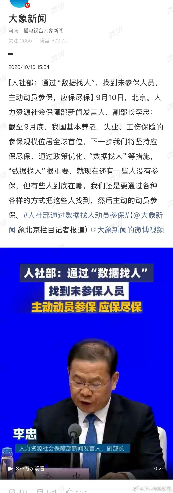
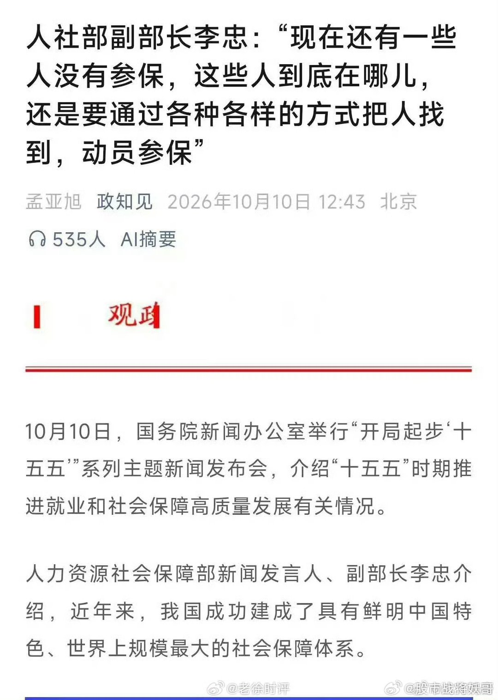
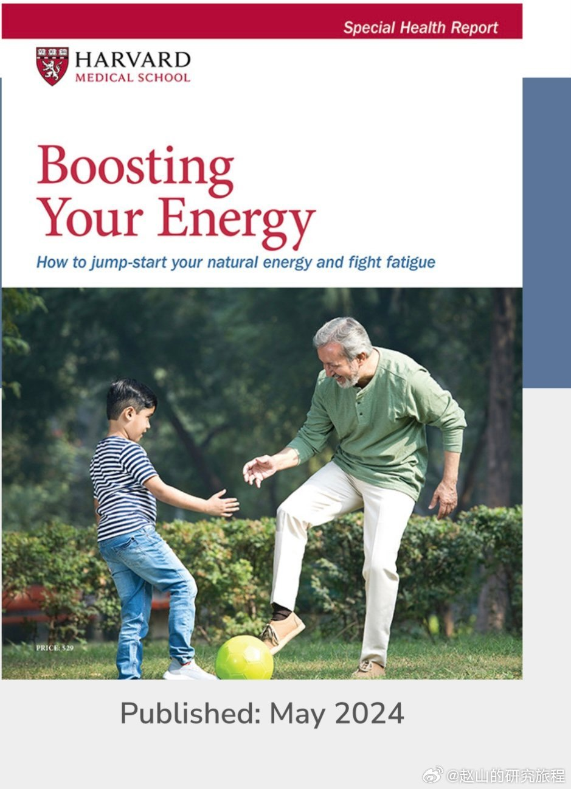
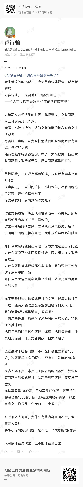
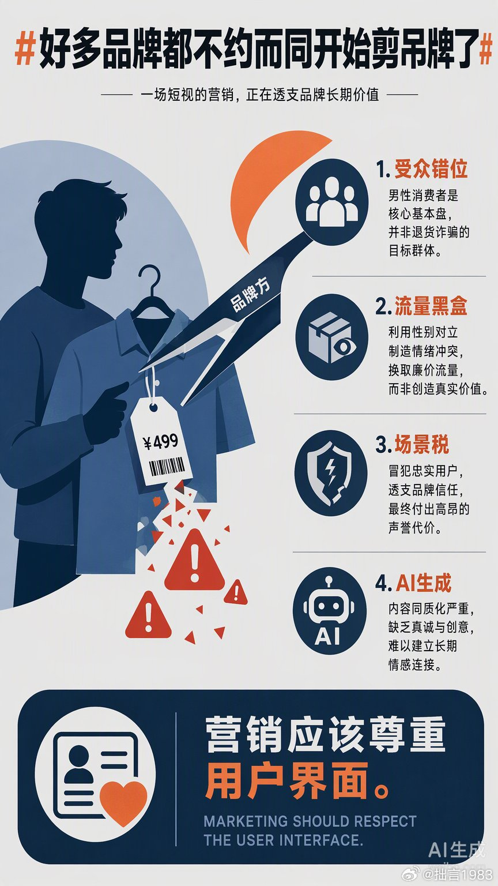

# 2026-10-12

## 1

@汪海林

发表于：2026-10-11 04:23

来源：微博

链接：https://m.weibo.cn/status/5352809253045887

这两天了解到当下影视行业的一些具体情况，思虑再三，先不说了，都是爆炸性的内容，特别不好，说出来我就成为爆料者，让看客兴奋，除了各种谩骂和嘲讽，对行业半点裨益全无，当下需要顺应形势，在内容上做好，把观众拉回来。巨变中，丑陋和残酷的事情在所难免，泣血椎心，风雨如晦，时代不会怜悯任何一个人。每个人应竭力保全自己，在夹缝中踯躅前行。 我们无法对抗荒诞，我们就是荒诞的一部分。

---

## 2

@股市战将妖哥

发表于：2026-10-10 18:55

来源：微博

链接：https://m.weibo.cn/status/5352666142081238

人社部宣布，不再坐等群众上门参保，而是联合公安、税务等多部门进行后台数据交叉比对，精准筛出应保未保或中断缴费的人员，再由社区工作人员主动联系动员，目标是将基本养老保险参保率稳定在95%以上，重点覆盖外卖骑手、网约车司机、灵活就业人员等群体。

最好把没工作没收入的人也找出来，帮他们解决工作和收入问题！

---

## 3

@卢诗翰

发表于：2026-10-11 14:00

来源：微博

链接：https://m.weibo.cn/status/5352954339269020

\#好多品牌都不约而同开始剪吊牌了\# 

老生常谈的就不说了，今天从自媒体视角，说点新鲜的

内容行业，一定要避开“烟雾弹问题”

——“人可以活在失败里 但不能活在谎言里”

去年写女装经济学的时候，我观察过，女装问题，网上其实有几大流派。

我属于比较直接的，认为女装问题的核心来自女性消费者

有委婉一点的，认为女性消费者和女装商家都有问题，各打50大板

还有看起来特别客观的，举了一大堆数据，指出女装问题和女消费者无关，所有问题都是商家的

从场面看，三方观点都有道理，未来都有学术空间对不对

但事实是，一旦时间拉长，比如今年，吊牌问题热门起来，开始拍情景剧了

你就会发现，后两派难以为继了

讨论女装退货，嘴上说和性别没有一点关系，所有问题都是商家板式尺寸导致的，

结果一拍吊牌情景剧，立马把女角色换成男角色

说明哪个问题是核心问题，大家从始至终心知肚明

为什么女装行业会出问题，因为女性这边出了问题

为什么商家平台来回改没好转，因为源头在女消费者这里

为什么要找板式尺码那么多理由，因为要避开性别这个房间里的大象

为什么吊牌情景剧必须换个性别，依然是因为房间里的大象

你不要看那些讨论板式尺寸的文章，长篇大论扯了一堆，还有人感叹这么专业的回答为何无人问津

因为这些说法都是谎言，理解吗？

所有这些说法，都是为了避开房间里的大象，特意找的其他理由

他们自己都明白这个道理，你真让他拍情景剧，什么地方保留，什么角色要改，他太清楚了

也就是对于社会问题，不存在什么主要矛盾100分，次要矛盾80分的说法，只有100分和0分的差别。

很多次要矛盾，本质是主要矛盾的烟雾弹，就像女装问题里的板式尺寸，看起来颇有道理，其实没有意义，

你认真写是1000赞，用AI写是1000赞，甚至胡乱瞎写也是1000赞，所以你在这块钻研再多，都没有意义，你只是一个借口，一个理由。

所以很多人询问，为什么有些内容明明不错，但一直无人关注

要小心你研究的问题，是不是一个大号的“烟雾弹”

人可以活在失败里，但不能活在谎言里

---

## 4

@赵山的研究旅程

发表于：2026-10-08 14:14

来源：微博

链接：https://m.weibo.cn/status/5351870700983575

感觉不少人认为自己精力不够，今天看了一本权威的书籍：哈佛医学院（Harvard Medical School）2024编著的《增加你的能量》《Boosting Your Energy》一书。它提出了一套科学抗疲劳与精力管理框架。该框架的核心在于通过低血糖指数饮食、规律运动与固定作息建立稳定的生理能量基底，同时，结合正念减压、积极社交与潜在健康问题的排查。

以下是5个维度的核心建议：

1. 饮食与水分管理

1.1 优先选择低血糖指数（Low-GI）食物：多摄入全谷物、高纤维蔬菜和优质蛋白，维持血糖稳定，避免血糖骤降引发的“糖崩溃”（Sugar Crash）。

1.2 少食多餐与均衡搭配：每隔3～4小时补充少量复合碳水与蛋白质（如坚果、酸奶），维持大脑稳定供能，防止餐后昏睡。

1.3 策略性摄入咖啡因：不把咖啡当成替代休息的支柱，建议下午2点后停止饮用，以免影响夜间深度睡眠。

1.4 限制酒精摄入：酒精会破坏睡眠结构（尤其是REM快速眼动睡眠），导致次日醒来身体更加疲惫。

1.5 保持规律饮水：轻度脱水就会显著降低体能与注意力，每天应主动、少量多次饮水，切勿等口渴才喝。

2. 运动与身体激活

2.1 坚持中低强度有氧运动：每周保证至少150分钟快走、慢跑或骑行；哪怕仅15分钟快走，抗疲劳效果也远优于静坐休息。

2.2 打破连续久坐：每隔30～60分钟站立、拉伸或走动几分钟，促进血液循环与大脑供氧。

3. 睡眠质量优化

3.1 锁定固定的昼夜节律：不论工作日还是周末，保持同一时间上床和起床，建立稳定的生物钟。

3.2 严格控制白天小憩时间：午睡控制在20～30分钟以内，避免进入深度睡眠导致越睡越困（睡眠惰性），或干扰夜间入睡。

3.3 营造优质睡前环境：保持卧室黑、凉、静，睡前1小时远离电子屏幕，防止蓝光抑制褪黑素分泌。

4. 压力管理与心理能量

4.1 削减认知过载：精简不必要的事务，学会合理拒绝，避免任务过载引发的心理耗竭（Burnout）。

4.2 诱发“放松响应”：通过冥想、正念、深呼吸或瑜伽，降低交感神经系统的过度兴奋，减少慢性压力对体能的隐形消耗。

4.3 建立积极的社交连接：多与能带来正向情绪的人互动，促进多巴胺和催产素分泌，有效缓解精神疲惫。

5. 潜在健康排查

5.1 排除生理性病因：若长期疲劳且通过休息无法缓解，需尽早前往医院排查贫血、甲状腺功能减退、睡眠呼吸暂停、维生素D/B12缺乏或药物副作用等潜在因素。

原书网址 网页链接

---

## 5

@史老柒

发表于：2026-10-11 15:03

来源：微博

链接：https://m.weibo.cn/status/5352970150740257

附议最右，我也一样//@专注旁观路人乙://@明涛AI_ECON:其实我感觉疲劳源自缺乏掌控感和成就感。青少年精力旺盛是因为觉得操纵自己这幅身体可以获得足够掌控感和成就感，所以喜欢各种运动活动。但是当了社畜牛马逐渐体会到各种无力就觉得疲惫，做什么事情都觉得不能成功那还费什么劲不如睡觉所以就觉得疲劳，但你看领导们个个随时随地神采奕奕精力充沛，就是构建了可控、行动与成就感的良性循环，所以这本书可能提供的也是一种生活可控和行动然后暗示自己有改善的成就感。基于这个逻辑，有可能我们自己随时就可以搭建一套这种成就感，比如说找个自己热爱的领域，搭建一套agent每天对他们发号施令使得自己每天离梦想更进一步，只要一周也能获得空前的精力旺盛。

---

## 6

@专业戳轮胎熊律师

发表于：2026-10-11 06:00

来源：微博

链接：https://m.weibo.cn/status/5352833587348678

男性消费之前已经有很多人论证过了

就是他会长期固定在一个地方买同一样东西

这可能也属于一种原始狩猎本能

在一个地方，花资源，就可以得到满意的另一种资源。

这是最稳定和最安心的一个形态。

但一旦出现什么问题。

可能有些会再偶尔尝试下。

但最终都会选择换个地方，本能认为这个资源点已经枯竭了，要试试其他的了。

所以很多男性消费为主的企业想做增量却不怕得罪存量这点，就是对男性的逻辑没任何认知。他们的苦难配得上他们的认知。

---

## 7

@薄暮冰轮

发表于：2026-10-08 23:58

来源：微博

链接：https://m.weibo.cn/status/5352017604379987

之前就看到过村上春树的作息，和东野圭吾作息的对比，现在我确定了村上才是对的。

村上春树那个作息健康到逆天，4点起来吃早饭喝咖啡，5点哞的一声开始写，写到10点，over。

这一天的写作就结束了，接下来全是运动、日常事务、吃饭、休息、社交、享受，然后21点就去睡觉——我作证这个点睡觉真的睡得香。

这完全日出而作日落而息、符合人类生物钟和自然规律的，而且工作集中在起来后皮质醇逐渐上升，注意力集中专注度很高的时段。

而且上午10点之后就再也没有写作相关的工作了，全是嗨皮嗨皮运动，嗨皮嗨皮干饭，嗨皮嗨皮午睡，嗨皮嗨皮娱乐，猛猛回蓝条，到晚上21点时自然而然就满足地去睡觉了。

而且睡眠时长足够，晚上7小时+午休半小时，这个年纪睡这些时间是足够的。

东野圭吾的作息也很逆天。

此人凌晨4点才睡觉，只睡3-4小时，8点起来先干点杂事+梳理思路，预备工作阶段。

吃完午饭13点开工，写到18点，然后开始运动健身干饭，洗漱整理聊天（不知为何这里过去了6小时），然后最可怕的部分来了，半夜0点不睡觉，0点到4点开始阅读和打磨稿子……

凌晨啊！不睡觉继续琢磨稿子！

也就是说他的工作时间包含了早上的梳理思路阶段+整个午后的写作时间+半夜修稿，实则工了一整天！根本没停过！

不要以为只有写的时候才是在干活，整理思路和修稿一样是高强度脑力劳动环节，非常磨人，我实际体感下，敲字的时长基本上和构思+修稿时长差不多，后者可能更长一点。

一直在干的话，san值会回不上来，再加个熬夜，身体和精神总得先崩一个。

干创意类工作的朋友，想活得健康点，最好参考村上春树这个早起干活、干完就歇了回血回蓝然后早睡的思路。

不要担心睡不着，长期习惯了早起，晚上9点真的会困，不要抵抗困意坚持玩手机，把眼睛闭上了就睡着了，这本来就是人类原始状态下的作息，身体是知道的。

上班的朋友也可以试试，不知道把晚上打游戏的时间挪到早上起来后能不能把自己骗下床……

有小孩的朋友据我观察，很多会按照孩子的作息（不一定）早睡但一定早起，某种程度上来说被逼得健康了，没招了属于是。

---

## 8

@蘸盐

发表于：2026-10-11 17:04

来源：微博

链接：https://m.weibo.cn/status/5353000543454402

//@儒家公羊学:北宋时期“海子”就是汉人的常用词汇，沈括《梦溪笔谈》卷二十四：“镇阳池苑之盛冠于诸镇，乃王镕时海子园也。镕尝馆李匡威于此，亭馆尚是旧物，皆甚壮丽。镇人喜大言，矜大其池，谓之潭园，盖不知昔尝谓之‘海子’矣。中山人常好与镇人相雌雄，中山城北园中亦有大池，遂谓之‘海子’，以压镇之潭园。余熙宁中奉使真定，时薛师政为定帅，乃与之同议，展‘海子’直抵西城中山王冢，悉为稻田，引新河水注之，清波弥漫数里，颇类江乡矣。”//@蘸盐:不是。明朝就叫海子了，积水潭是海子，南苑飞放泊是南海子。蒙古语里没有把湖叫海子的说法，蒙古语里湖泊叫 naɣur/nuur（淖尔) ，蒙古人入中原建大都之后，大都京畿的汉人用汉语词“海子”来称呼大片积水湖沼，但是北方其他府州路的汉人是不这么叫的。而大都汉人这个叫法，后来反过来影响了元朝和明朝的官方称呼，正是明朝时期，“海子”叫法才逐渐从京畿向河北山西扩散//@张忆安-见龙在田:海子的意思，来自蒙古语，是满清入关带进来的称呼。

---

## 9

@2049年的世界

发表于：2026-10-11 15:44

来源：微博

链接：https://m.weibo.cn/status/5352980632048348

\#好多品牌都不约而同开始剪吊牌了\# 

女装退货问题，根源就是部分女性消费者导致的。

这是一个非常浅显清晰，但很少有严肃讨论敢提及的问题。

至少主流媒体基本不敢做这样的归因。

我们的社会舆论，至少从互联网时代开始，就是非常“照顾女性”的，是有舆论红利的。

批评男性的时候基本上没有什么顾忌，但一旦要批评女性，就普遍感觉这是不合适的，是违反了“政治正确”的，违反了“进步主义”的。甚至还有“厌女”的帽子在前面等着。

反之，舆论上几乎就没有“厌男”的帽子，男性自己都不去用这个当攻击，因为某些人甚至会主动说“对啊对啊我就是厌男怎么了”，会把它当成一个时尚单品。

可以说，这二十年的网络舆论，实际上是一个大型的“富养女”的社会实验。

“富养女”的结果怎么样呢？很不好。所谓“富养”只能养出嚣张跋扈的废物来。

基本的明显的社会批评不敢去做，没有了舆论的负反馈，一直都是被主流社会舆论捧着：大胆做自己啊，不要在意别人的评价啊，不要被定义啊。

男人则没有这样的舆论红利，始终是处于被定义的。

上面说的“富养”是“公共舆论”层面上的，也就是公共传播渠道上的 ，不是个人私下讨论的那种。比如那些女权的脱口秀，可以堂而皇之播出，如果性别互换，甚至都不用互换，只互换到1/10的程度，都不可能在公共渠道上播出。

结果呢？整个严肃讨论的链路里没有负反馈，全是回音壁之内的“进步主义”共振。

这就不是一个唯物主义的态度，这能养出什么东西来？

批评都不能批评，“永远站在自己性别那一边”，“永远不围剿任何一个女性”。那结果就首先会在女装上体现出来。

女装退货率高如果原因是简单的“货不对版”，那说明整个经济学理论就是错误的。因为它完全否认了市场信息的传导。女装是一个没有多少进入门槛，流动性和信息传递效率很高的市场。哈耶克的大手在这类领域里面是最好用的，你货不对版，那么你很快就会被市场淘汰，因为市场的需求自然会被别人看到，市场竞争者会很快生成出符合消费者需求的产品。经过几轮迭代之后，不可能长期货不对版。

女装退货率高只是女权主义带来的一个很小很小的问题。

公共舆论上的“进步主义”、异化了的“女性优待”，其实都是自我感动，对女性的整体发展是有大害的，这种“富养”实际上是在养猪，害人害己害社会。

唯心主义是要害死人的。

---

## 10

@拙言1983

发表于：2026-10-11 04:10

来源：微博

链接：https://m.weibo.cn/status/5352805818961979

回力、匹克这波剪吊牌广告，逻辑上简直比路边摊拒绝现场开壳卖“土豆榴莲”还离谱。

表面上看是想遏制退货乱象，实则是一场精心设计的“流量黑盒”。品牌方把女装领域高发的“穿完即退”痛点，硬生生安在了核心男性客群头上。这就像给一台主打性能的电脑强行装上了花哨但无用的装饰灯，不仅没解决散热问题，还把原本稳定的用户给劝退了。

这种操作背后是典型的“算法焦虑”。运营团队手里攥着点击率数据，却看不懂受众的真实情绪。他们以为搞点性别对立的剧情能换来泼天的流量，结果交了一笔昂贵的“场景税”：得罪了真正买单的人，只收获了一堆看热闹的骂声。

在数码圈我们常说，切断核验接口就是骗局。品牌方这次切断的是与核心用户的共情接口。当营销只剩下低成本的AI生成内容和挑动情绪的剧本，那离翻车也就不远了。毕竟，真正的性价比从来不是靠牺牲用户尊严换来的。\#好多品牌都不约而同开始剪吊牌了\#

