# 2026-10-13

## 1

@赤道财经

发表于：2026-10-12 13:35

来源：微博

链接：https://m.weibo.cn/status/5353310385344062

【\#日本百岁老人首破10万男性仅占一成\#】据日本《读卖新闻》消息，日本厚生劳动省9月15日公布的最新调查显示，截至9月1日，日本百岁或以上老人数量达107677人，比去年同期增加7914人。

这是该数据有记录以来首次超10万，也是连续第56年创下新高。

其中，女性94298人，占比近90%；男性13379人。

报道称，得益于医疗技术的进步和人们健康意识的提高，日本百岁老人的数量持续增长。1963年开始统计时，百岁老人仅有153位；到2012年，这一数字已超5万，此后一直保持增长势头。

新加坡《联合早报》提到，与此同时，日本人口危机持续恶化。

据世界银行数据，日本人口中位年龄为49.9岁，仅次于摩纳哥，是全球人口老龄化程度第二高的国家。

今年6月公布的数据显示，日本去年总和生育率再创新低。人口老龄化与出生率下降已导致劳动力短缺、社会保障支出不断增加，以及税收基础萎缩，对这个全球第四大经济体构成长期压力。（观察者网、环球网） 头条新闻的微博视频

---

## 2

@海兰珠阿婶

发表于：2026-10-12 14:27

来源：微博

链接：https://m.weibo.cn/status/5353323533180110

兄弟，你这招以印治印玩的妙啊

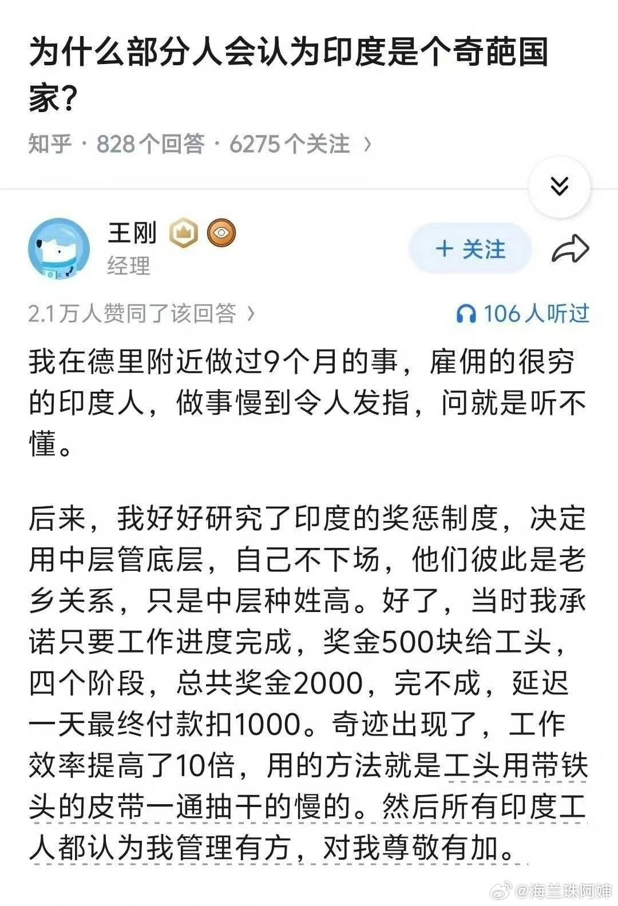

---

## 3

@数字生命卡兹克

发表于：2026-10-12 06:28

来源：微博

链接：https://m.weibo.cn/status/5353202926750526

最近，有一个词，开始频繁出现在AI行业里。

逆向一切。

这个词的热度，已经到了实在没有办法忽视的程度了。

这个故事我觉得的起点，要从最近火遍全网、大快人心的一个开源项目说起。

事情的主角呢，叫Brandon Thomas，是ArtCraft项目背后的开发者。

这个人有多年的工程开发经验，长期使用Rust，也在做面向影视创作者的AI产品。

然后呢，他最近做了一件很搞的事，直接用Claude Opus 5.5给Adobe逆向了，用Rust重写了Adobe的软件，然后，免费开源。。。

而这件事的起因，也非常朴素，他被Adobe的取消订阅费用恶心到了，如果在公司干设计的朋友，买过Adobe正版的就知道，他们有多恶心。

Adobe说是按月付款，但是，你实际上是要承诺订阅一整年的套餐，也就是说，如果你要提前退订的话，就需要给Adobe交违约金。。。

然后Thomas也被这事恶心了，给他逼急了，你恶心我是吧，行，那我也恶心你。

然后，他就用Claude，直接给Adobe逆向重写了，而且，是一口气做了7个，全部开源。（图1）

PhotoCraft、VectorCraft、FilmCraft、LightCraft、EffectCraft、DesignCraft、PrintCraft。

对应的是谁，如果大家用过Adobe家产品的话，看名字估计都猜得出来。（图2）

Photoshop、Illustrator、Premiere Pro、Lightroom、After Effects、InDesign、Acrobat。

都是一些贯穿了我这么多年设计生涯的名字。。。

Adobe全家桶，被人一锅端了，不知道为啥，当时我看到的时候，有一种大快人心的爽感。

当然，这些软件讲道理跟完全体的Adobe还有一些差距，不过我只能说，AI还是太神速了，几乎现在每天还在光速迭代中。（图3）

就看看这个Issues和PR的数量，大家估计也能感受到社区的热情了。

不到10天，单PS的这个项目，现在已经有4万6的Star了。

而对于自己搞出来的这个东西，作者在Hacker News上是这么说的。

Software is over. But for real. I just one-shotted Photoshop. The whole thing.（图4）

其实讲道理，软件时代结束了，类似的话，我这半年真的已经不知道听过多少遍了。

今年3月份的时候，我还专门写过一篇《AI，正在吞噬所有软件。》，聊过AI正在怎样改变整个软件行业。

当时我就说过，软件正在从资产变成耗材，而现在，我们就身处这场新旧交替的洪流之中。

只不过，那时候我们说的还是，人人都可以构建自己的软件，那时候，Fable 5甚至都还没有上线，人类用AI创造软件，还没有像如今这么迅速。

但今天，被推倒的，确是曾经的一堵墙。

这堵墙背后，当然有像Adobe这样口碑不是很好的公司，也有很多在过去认真做产品的公司，在做客户端、做软件的公司。发现，一夜之间，自己的护城河突然消失不见。

因为逆向工程，因为AI让逆向工程高效到了一个极其夸张的地步。

所有的软件、硬件、游戏等等，只要AI可以读到你的代码，你的产品，就已经在事实层面上是开源的了。

为了帮助大家理解，我觉得我还是想花一点点篇幅，讲一讲啥是逆向。

逆向工程，Reverse Engineering。

字面意思，很好理解。

大家肯定都知道，一个正常的软件开发过程，就是程序员编写源代码，再通过编译等步骤，最终变成电脑能够执行的程序。

如果你只有一个已经安装好的应用，没有它的源代码，想知道它内部究竟怎么工作，就需要进行逆向工程。

这件事情过去一直非常困难。

因为编译以后的程序，已经失去了大量原本方便人类阅读的信息。

举个例子。

程序员写代码的时候，可能会把一个函数命名成“计算用户余额”，然后另一个函数叫“验证支付密码”。

这两个名字，人一看就懂是干啥的对吧，但编译了之后，可能这些就都消了，因为电脑根本不需要理解这个函数叫啥，只需要知道，哦执行到这里，哦去这个内存地址，哦进行这个运算。

所以，当你尝试把一个已经编译好的软件重新拆开时，看到的往往是一大坨的非常难以理解的程序逻辑。

于是这些玩意到底对应了什么功能，那就只能靠逆向工程师自己去推断了，那整个过程其实极其的痛苦。

那过去呢，逆向大概会有两个路线。

第一条就是上面Thomas逆向Adobe的路子，一般称为净室设计。

净室设计最经典的商业案例之一，就是1982年的康柏。

1982年的时候，那时候IBM推出个人电脑没多久，IBM这台机器有个特点，就是大部分零件都是市场上现成买得到的，唯独有一块芯片里的程序，叫BIOS，是IBM自己写的，受版权保护。谁想造一台和IBM兼容的电脑，你就卡在这块BIOS上。

于是，一家刚成立的小公司，叫康柏，为了避免版权问题，就想了个办法，它把工程师分成两拨，一拨人去研究IBM的BIOS，只许把它的行为写成说明书，不许抄一行代码。然后另一拨人从来没见过IBM的代码，只看说明书，从零写一个新的BIOS。两拨人严格隔离，最后，干了几个月，直接造出了跟IBM几乎百分百兼容的电脑，给IBM干懵了。

我其实之前重构我的AIHOT的时候，也是这个思路，自己对自己进行净室设计。（图5）

这套方法跟AI现在最擅长的工作，契合度实在太高了。

因为对于使用者来说，根本不care你当年用了什么代码什么架构，我只想要你的功能仅此而已，甚至你原来的那些架构是一坨屎，我重写以后，性能会更强，这也是我上面重构的思路。

一个Agent直接暴力负责研究产品的功能，另一个Agent直接暴力把功能实现出来，你完全最后可以根据端到端的测试Agent不断比较结果，发现问题，修改代码。

GPT-6 Astra在操作UI的能力上极强，做端到端测试极度的细心，在我过去的经验里面，它的过度防护虽然很多时候被诟病，但在做端到端测试的时候，相信我真的是无敌的强，而且是可以做超长时间的自动化的。

第二条就是反编译重建，暴力拆解软件内部代码，尽可能原封不动的还原。

比如你拿到一个游戏的安装包，或者游戏卡带里的ROM文件。

通过反汇编、反编译之类的技术，把里面的机器码重新转换成人类相对能够阅读的代码，再根据代码一步一步理解，这个游戏究竟是怎么运行的。

这个路线基本上就讲究从内部破解，原版还原，但是真的非常痛苦。

2019年，一群玩家把《超级马里奥64》完整地反编译了出来，就是把这张二十多年前的卡带，一点一点还原成C语言代码，而且重新编译以后，能得到和原版一模一样的游戏，这事他们干了两年。

2021年，另一群玩家用同样的办法，搞定了《塞尔达传说：时之笛》，几十个人，同样也是干了将近两年。

这就是过去逆向工程的价格。

所以你要知道，原来很多商业软件的保护，来自于别人看不懂，也懒得花那个时间研究。

或者用另一句话来说，就是别人重新实现你的软件所需要付出的成本。

因为过去逆向成本太高了，我逆向你花费的成本，甚至高于我购买你的成本，于是我没有必要逆向。

但是，AI来了，而且是GPT-6 Astra和Claude Opus 5.5这两种组合起来约等于天顶星科技的AI。

于是，逆向起飞了。

GitHub上这两天还有一个非常值得关注的项目，热度在最近也是疯狂上涨。

REA，全称Reverse Engineer Anything，逆向一切。（图6）

最近的热度是这样的，一根穿云箭，已经马上10万Star了。（图7）

它的核心思路，就是把Ghidra、Hopper等专业逆向工具，通过MCP和命令行接口接给AI Agent。

Agent可以研究二进制文件，寻找相关函数，追踪调用关系，分析反编译结果。

最后尝试把理解到的逻辑，用到自己的项目里。（图8）

我也拿它，简单试了一下，让他去解析一下Mac上很有名的清理软件CleanMyMac。（图9）

垃圾清理、完整卸载、重复文件检测，恶意软件防护都给分析了一遍。（图10）

然后，我又让它按照这些思路，直接开发一个原生Mac应用。（图11）

没过多久，就给我搓出来了一个雏形。（图12）

开源世界的老OG Eric S. Raymond也说，软件保密时代即将结束，几乎所有软件，都将失去保密这道护城河。（图13）

注意，这里我绝不是鼓励大家去逆向所有的产品。要知道，逆向工程本身就有复杂的法律边界，如果你未经授权，直接复制别人的受版权保护的代码，甚至把这些内容公开传播，就可能涉及侵权。

自己逆向进行学习，或者给自己为了省点钱，或者做一些更加定制化的产品，我支持，毕竟过去的软件真的很贵，但一定要注意边界。

当然，Adobe这种另说，虽然我知道他不道德，但我依然有一种大快人心的感觉。

于是，在Thomas开源Adobe、以及REA爆火之后，X上就掀起了一股逆向热潮。

甚至已经不是逆向软件了，直接逆向硬件的协议。

比如有人把苹果的AirDrop给搬到了Linux上，直接用普通笔记本和iPhone隔空互传文件。（图14）

有人把家里的空调给逆向了，做了个Mac状态栏应用，以后连遥控器都不用找了。（图15）

过去，厂商可以通过不公开通信协议，限制第三方软件的接入。你想使用某个功能，往往只能通过官方提供的方式。但现在，开发者可以借助AI研究这些协议，自己开发兼容工具，甚至实现厂商原本没有提供的功能。

甚至，直接重写硬件底层。（图16）

当所有的软件的本质都将成为开源模型，越来越容易被研究、模仿和重新实现，那建立在它上面的整套商业逻辑，也将必然有所影响。

以后，凡是能装进你电脑里的东西，都约等于开源。

而不想被开源的东西，就再也不会装进你的电脑里了。

你会看到越来越多的软件，客户端越来越薄，薄到只剩一层皮，真正干活的逻辑、模型、数据，全部锁在服务器上，必须联网，必须登录，必须订阅。

一个所有软件都被“开源”了的时代，我们离“拥有一个软件”这件事，反而可能越来越远了。

这也带来了我最近一直在思考的问题。

就是，当所有人都能低成本复制软件以后，谁还愿意花钱做原创呢？

所有人都觉得，AI让软件越来越容易被复制，是一件大好事。

对于普通消费者来说，确实如此。

以前需要花几千元购买的软件，以后可能有免费的替代品。

大量知识和技术，开始向普通人开放，这当然是一件特别有意义的事情。

但问题来了。

当复制一个好产品越来越便宜，创造第一个好产品的成本，应该由谁来承担？

因为作为一个用户体验设计师，作为一个产品经理，作为一个内容创作者，我过去所有的经历都在告诉我，原创真的很难。

你需要判断用户究竟需要什么，需要探索正确的产品形态，需要经历大量失败，还要承担市场不接受你的风险。

我们终于创造了一个市场买账的产品，可对不起，这是AI时代了。

创造这些成果的人，能够独享收益的时间，却可能越来越短。

可能只需要3天，你的开源版本，就已经满天飞了。

那怎么办呢？我不知道。

3年前，那时候我做了很多年的产品，至今我最喜欢的事、我的梦想还是做产品，但是那时候，我对AI时代的产品未来感受到了深深的绝望，所以我选择做IP，把自己打造成一个无法被复制的产品。

3年后的今天，我感受到的，却是更深的绝望。

我几乎开源了我的一切，因为我真的不觉得产品、方法论等等，在这个时代，还有任何的护城河可言，那不如早一点开源出去吧，还能对世界做做贡献，还有人可能还会记得我。

所以，如果你现在问我，你觉得这个时代，还有什么东西能构成护城河呢。

我可能，只能说出那个唯一的答案：

注意力。

你能获得多少这个世界长期、正向、有价值的注意力，你就是能垒起多高的护城河。

《Attention Is All You Need》

答案。

其实已经藏在9年前的这个标题里了。

以上，既然看到这里了，如果觉得不错，随手点个赞、评论、转发三连吧，这对我们有特别大的帮助~

谢谢你看我的文章，我们，下次再见。

\#科技先锋官\#\#数字生命卡兹克\#

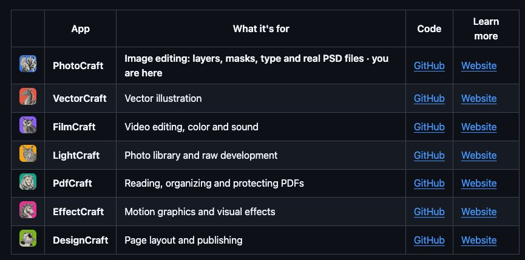

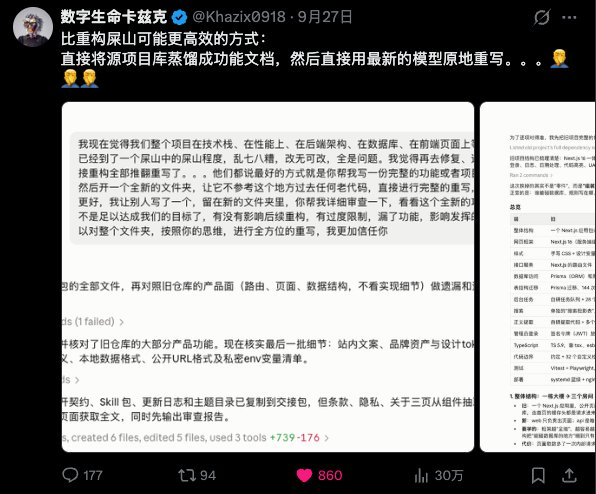

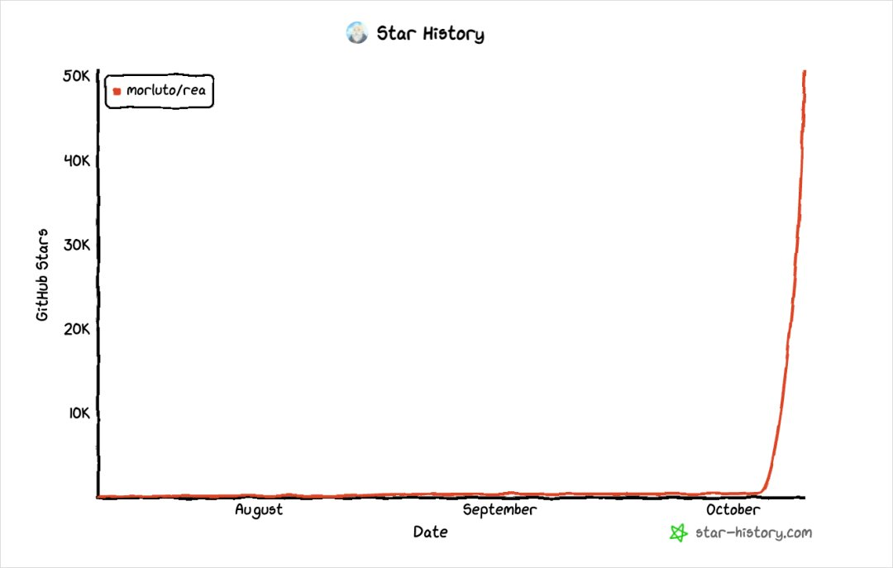

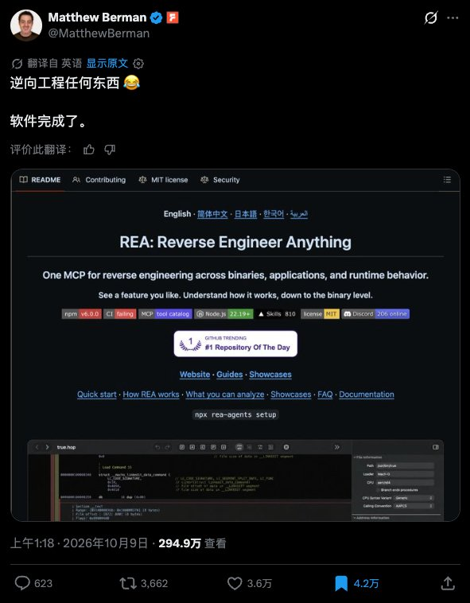

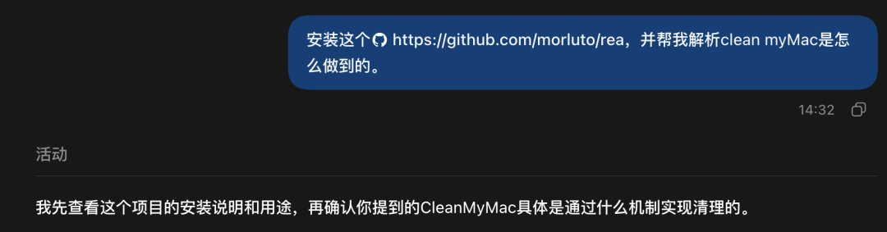

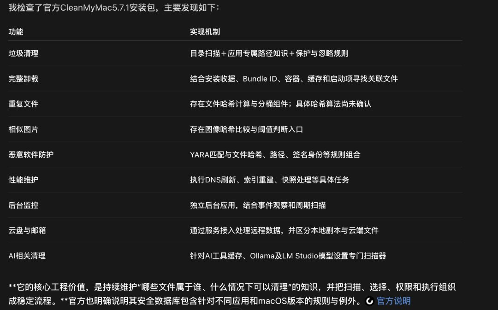

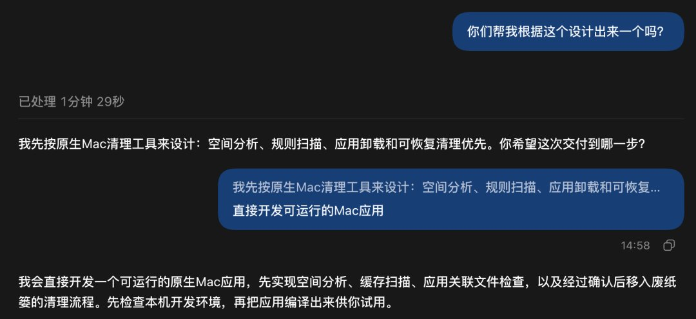

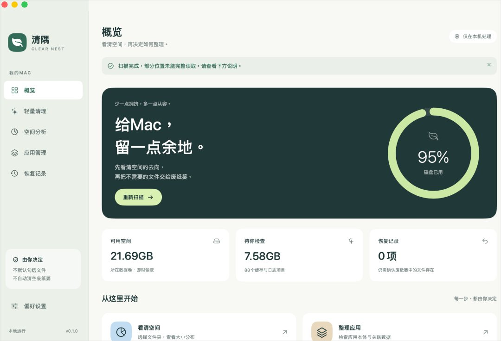

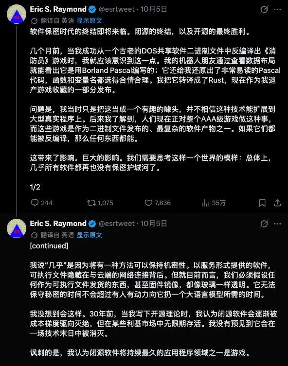

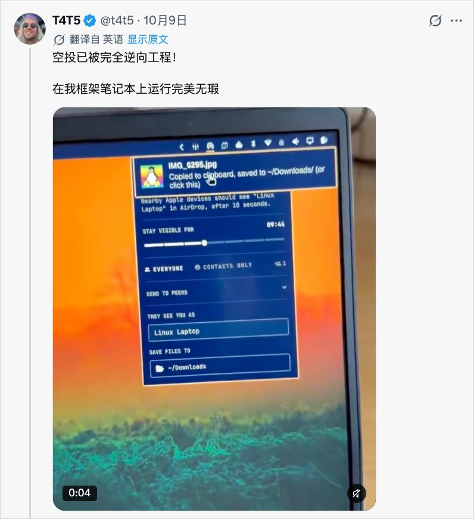

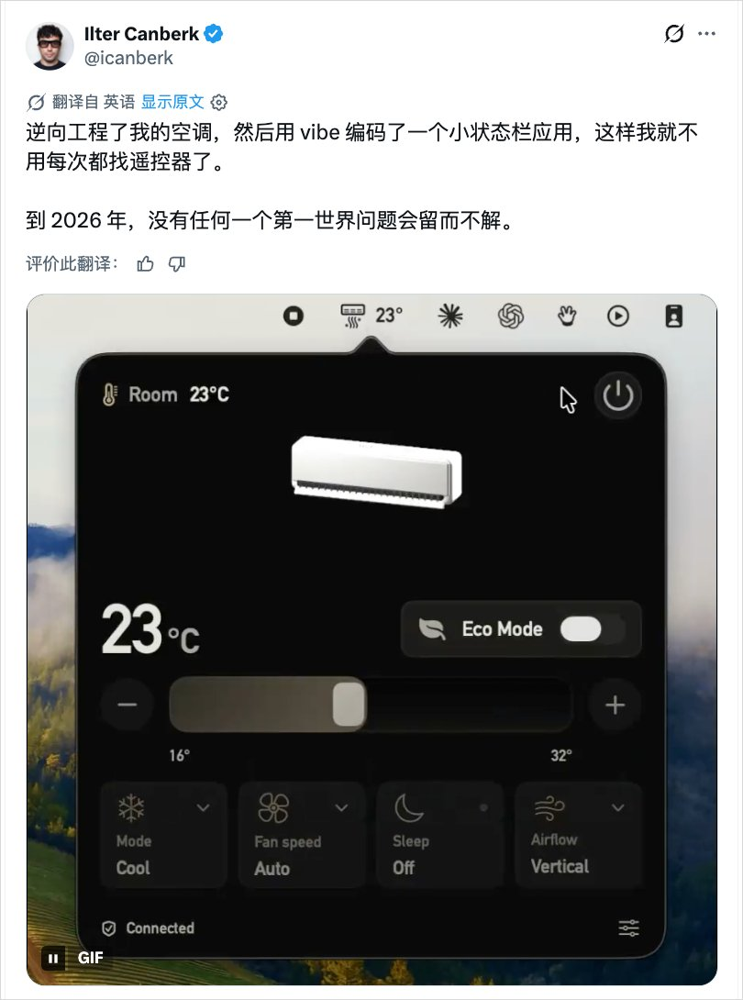

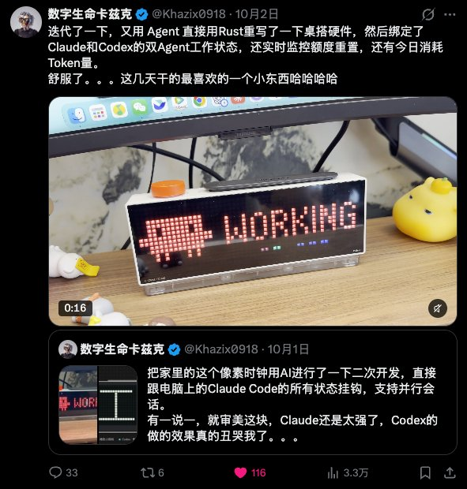

---

## 4

@EE_Archeology

发表于：2026-10-12 04:44

来源：微博

链接：https://m.weibo.cn/status/5353176719950494

最近看到满世界都在全民AI大逆向，实在是坐不住了，把一个月前AI逆向第一颗国产CPU的过程发一下吧(本来打算整理好再发的)

一个多月前，我偶然得到一块奇怪的国产电路板，在网上找了一圈资料之后，最终确定这是用骊山771所(今天的西安微电子技术研究所)研制的LS77-II处理器制作的一块单板机。LS77-II是由1977年的LS77-1优化而来的处理器，提高了集成度，用一片ALU+一片微码ROM实现了全部功能。板子上那颗正方形的大芯片就是ALU了。目前关于这套处理器，全网只有一篇介绍LS77-1的论文和两篇LS77-II应用的论文，里面的内容较为模糊并且存在错误。我这块板子也有损坏，所以一时半会也跑不起来。不过可以确定，这是一颗16位处理器，使用的国内自主设计的指令集，并且很特别地用了17位数据宽度，最高位作为特征位，使得微程序可以自己确定数据宽度，自动执行多字长运算。目前为止我还没在其他处理器系统上见过这样的设计。

至于AI，一开始，我只是把三篇论文丢过去，想让它总结一下架构和指令集，出一篇通俗易懂的文档。AI很轻松便完成了任务。这个时候我突发奇想，把板子上几颗ROM的镜像丢给它，让它写一个模拟器。很快啊，AI只用了5分钟，便摸清了板子上外设的地址等信息，写了个模拟器，跑起来板子ROM里带的monitor和汇编程序。由于这是一个非常小众的架构，网上不可能找到任何好用的编程环境，接下来我又上了些强度，让AI在上面实现一个tiny BASIC解释器。没想到，在一个下午的循循善诱之后，AI真的用一个陌生的汇编语言，写了近2000行代码，实现了一套完整可以运行的tiny BASIC解释器，并且成功在上面运行了经典的井字棋和生命游戏等程序。

这时候我真的体会到了震惊瘫坐，如同原子弹爆炸的感受。最令人震撼的是AI居然能理解一个几乎没有公开记录的处理器架构，并从固件中自己摸索出技术细节，去实现相对复杂的功能。以后逆向工程大概真的不需要人类了

(注:本次使用的是GLM5.3+Claude Code，全程我只有指导，没有动手写一行代码，图3为模拟器运行的原厂ROM固化汇编器，图4为AI写的BASIC解释器代码截图，图5-6为tinyBASIC运行画面。目前我正在修复原版硬件，详细内容等后面写博客吧)

\#电子考古学\#人工智能

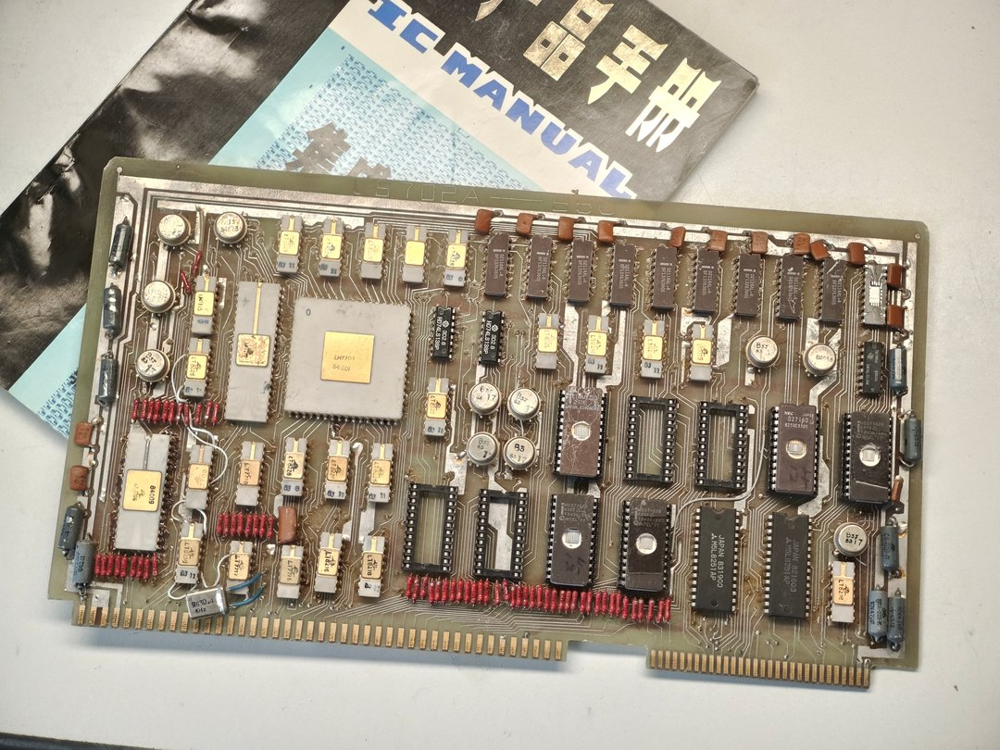

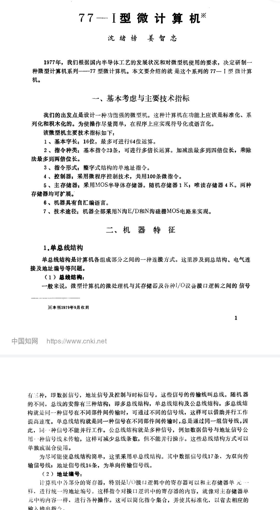

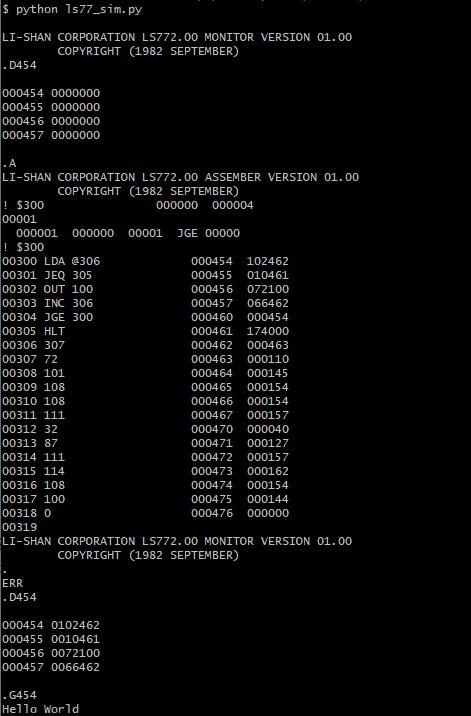

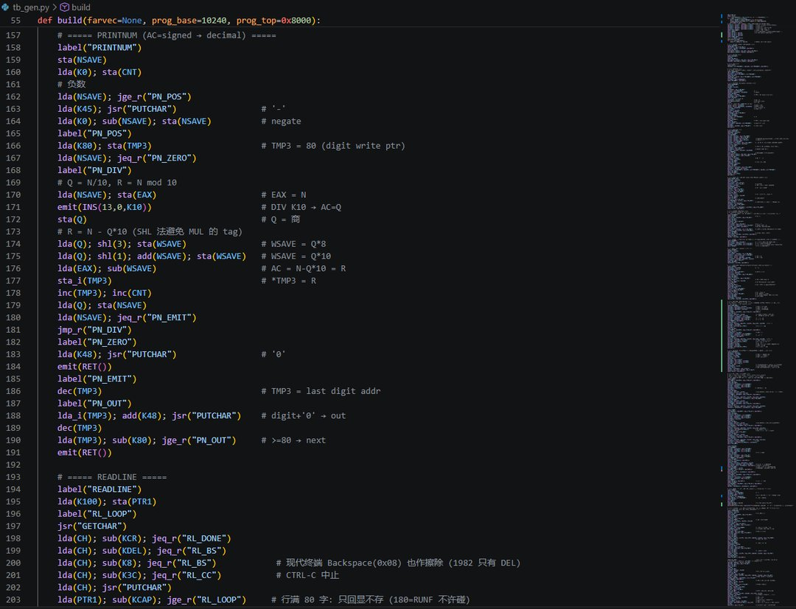

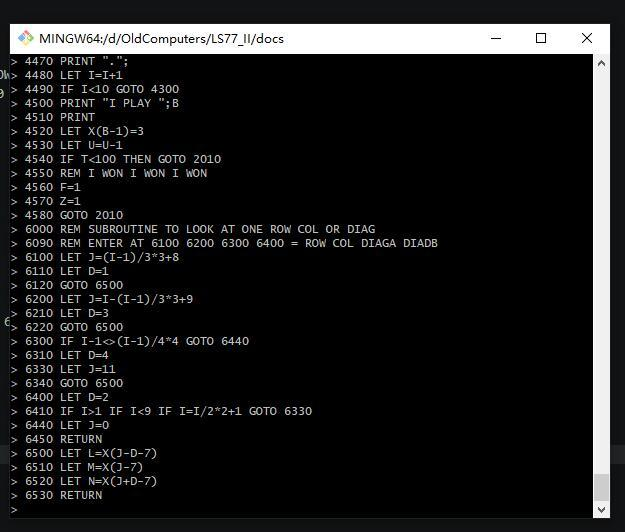

---

## 5

@幻想狂劉先生

发表于：2026-10-12 07:58

来源：微博

链接：https://m.weibo.cn/status/5353225603778460

作为文科生我个人的主观感受是中学时代容易被女生按在地上摩擦，本科的时候拔尖的和最辣鸡的都是男的，但是女生在中上这个区间占据了优势。硕士阶段男的优势比较明显了，上博士的时候天赋拔尖的女性就比较少了，而那些天赋不够拔尖的女性，无法再通过增加单位时间的投入来胜出了。因为竞争规则已经非常不同了，在这个阶段，一个人24小时不眠不休可能也比不上另一个人灵光一现了，而你已经没有第25个小时来继续加码了。而且我个人认为中国的高等教育制度的优点，恰恰在于能够将大量天赋不那么出色的人但能基本自律培养成基本合格的人才，这些人在西方教育制度下很可能根本走不了那么远。而少数天赋异禀又异常自律的人，反而在西方高等教育制度下能走的更高更远。大部分中国女性“好学生”恰好在天赋不那么出色但能基本自律的区间里，她们可以说是高等教育制度最大的受益者。

---

## 6

@冬亚

发表于：2026-10-12 09:55

来源：微博

链接：https://m.weibo.cn/status/5353254972032405

当下中小微餐饮大多根本扛不起员工社保。

尤其是小微餐饮

现在选择基本都是交可以，从员工收入里扣。

员工显而易见不乐意，这样就还不如去铁人三项，交灵活就业社保了。

所以中小微餐饮招人反而更难了。

当然，你可以说交不起社保的中小微餐饮死了活该。

嗯，我完全同意， 都活该，这些扛不动员工社保的中小微餐饮死光了，世道一定就能好起来

---

## 7

@EricTsui

发表于：2026-10-12 18:35

来源：微博

链接：https://m.weibo.cn/status/5353385949921694

集体躺平，自私冷漠，逃避责任的后果

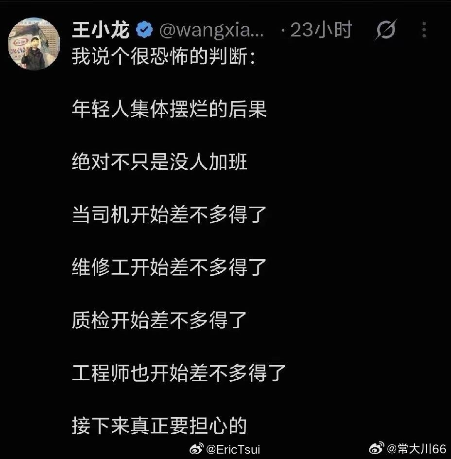

---

## 8

@贝贝是Bebe

发表于：2026-10-07 10:30

来源：微博

链接：https://m.weibo.cn/status/5351451812430594

外网疯传168w的30天重启生活

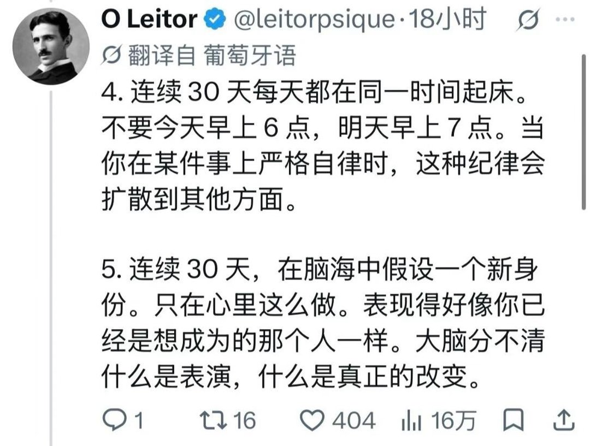

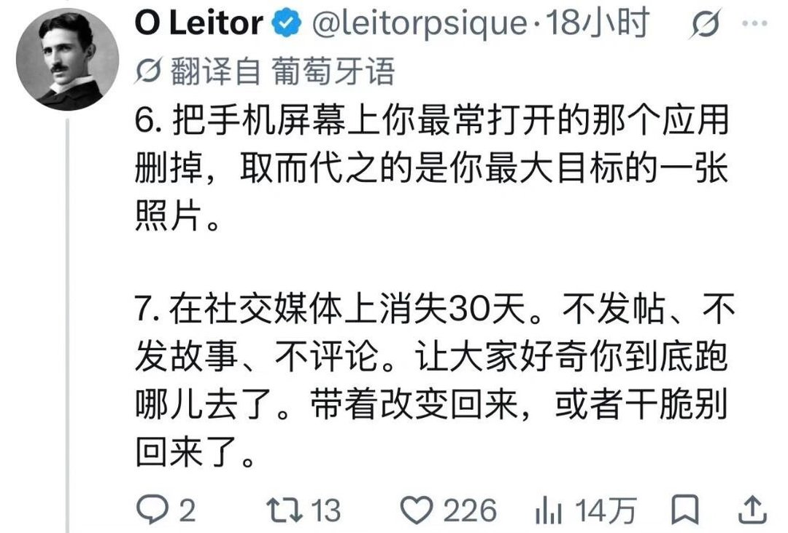

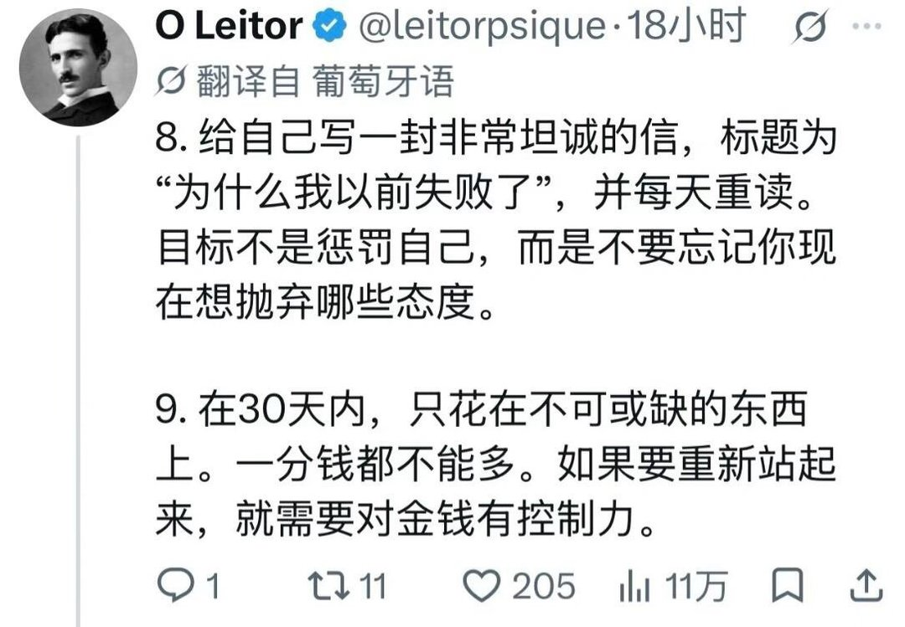

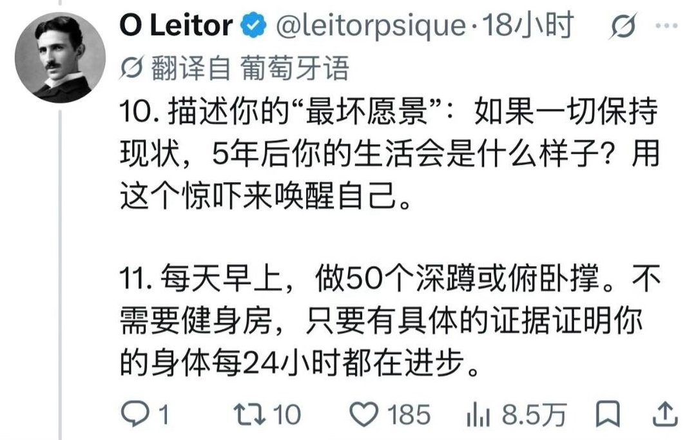

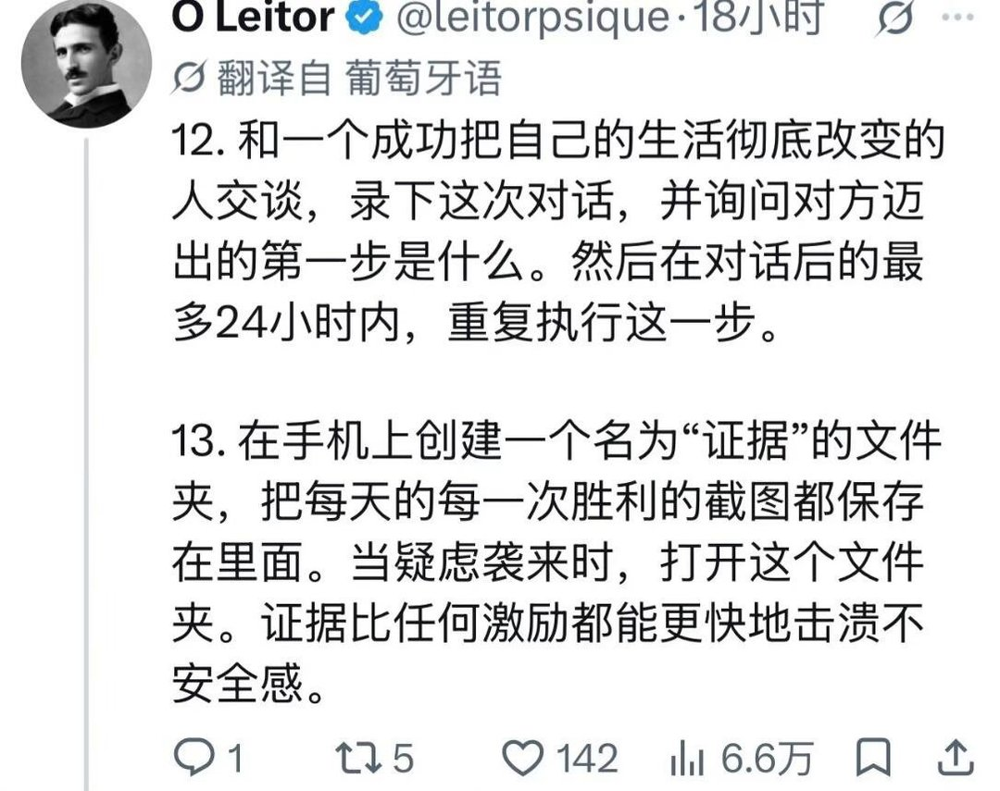

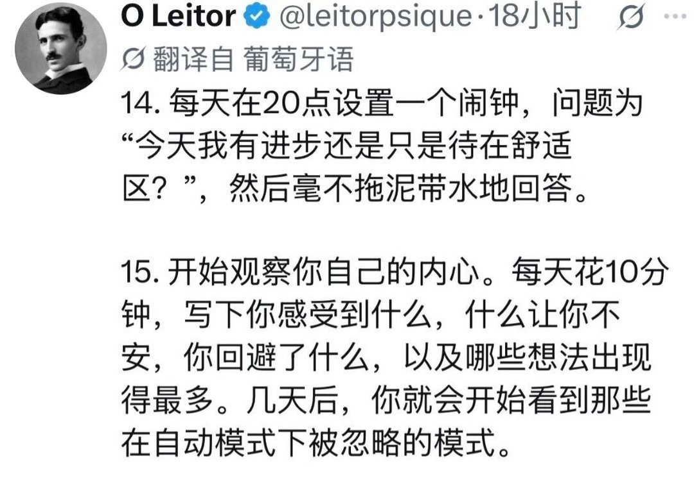

---

## 9

@宝玉xp

发表于：2026-10-12 17:49

来源：微博

链接：https://m.weibo.cn/status/5353374392256259

Meta 发布 Muse Wonder：开发者今天能用，普通用户还要等

Meta 10 月 12 日发布新一代大模型 Muse Wonder，一共两个版本：Muse Wonder 主打速度，Muse Wonder Full 是完整版。扎克伯格说，这个模型让 Meta 进入了“前沿”梯队，也就是和 OpenAI、Anthropic、Google 最强模型同一档。

做这个模型的是 Meta 超级智能实验室（Meta Superintelligence Labs）。按 Meta 的说法，14 个月前它把 AI 业务推倒重来，从底层技术栈重新搭起，第一代成果是 Muse Spark 系列。Muse Wonder 比 Muse Spark 大得多，在 Meta 吉瓦级的 Prometheus 数据中心训练。

【谁能用，怎么用】

开发者今天就能用 Muse Wonder：通过 Meta Model API（Meta 的大模型接口平台）调用，或者在 Meta 的 AI 编程工具 Muse Code 里用。

完整版 Muse Wonder Full 目前只开放给 Muse Code 的订阅用户。官方博客只写了它在 Muse Code 里可用，没提 API。

普通用户用的 AI 助手 Muse，官方博客写的是“很快”接入 Muse Wonder，先给订阅用户。扎克伯格在 X 上说的是“今天订阅就能用 Muse Wonder 驱动你的 Muse”，两边说法有出入。免费用户什么时候能用，Meta 只说会逐步把这个水平的能力带给所有人，以后还会用 Muse Wonder 开发专门的模型给所有 Muse 用户，没给时间表。

模型卡写的规格：上下文 100 万 Token，够一次放进一个中大型代码仓库；能读文字、图片、视频和音频，输出只有文字。

【和 Claude、GPT 比怎么样】

下面的成绩都来自 Meta 自己公布的对比表，对手是 Claude Opus 5.5、Claude Fable 5.1 和 GPT-6 Astra，全部按最高推理强度测。其中个人超级智能指数、MemoryBench、FocusBench 是 Meta 自建的测试。对手的成绩有一部分是 Meta 自己跑的，模型卡也写明，这些跑法未必为对手模型调到了最优。

Muse Wonder Full 领先的主要是三类任务。

一是替人办事的智能体任务。Meta 自建的个人超级智能指数，Muse Wonder Full 59.1 分，Claude Opus 5.5 55.2，GPT-6 Astra 54.5；跑完整业务流程的 AutomationBench，45.4 对对手最高的 41.6。

二是长时间写代码。DeepSWE 79.0，对手最高 74.2；做大型软件项目的 SWE-Marathon 57.5，对手最高 46.3。

三是法律。法律 AI 公司 Harvey 的智能体测试 13.1，对手最高 8.6。这个测试要求交付物每一项都达标，所有模型的通过率都很低。

落后的项目也不少，大多输给 Claude Opus 5.5：终端编程（Terminal-Bench）57.1 对 59.6，从零写一个完整程序（ProgramBench）59.0 对 70.5，操作电脑（OSWorld）78.4 对 81.8，健康问答 62.3 对 65.6。专业文档任务 GDP.pdf 输给 GPT-6 Astra，33.2 对 34.2。

Meta 博客里也放了第三方机构 Artificial Analysis 的综合智能指数：Claude Opus 5.5 以 58 分排第一，Muse Wonder Full 56 分排第二。开发者现在能通过 API 调用的是 Muse Wonder，它是 52 分，低于 Claude Fable 5.1、GPT-6 Astra 和 Google 的 Gemini 4 Argon（都是 53 分）。

按 Meta 给的数据，让 AI 长时间替你干活、跨对话记住你的情况，是 Muse Wonder 领先的地方；比综合能力，它还排在 Claude Opus 5.5 后面。

【Active Memory 和 Active Focus 是什么】

这是 Meta 给两项能力起的名字，也是这次发布的卖点。

Active Memory（主动记忆）：跨对话记住和你有关的重要信息，做新任务时自己判断哪些旧信息用得上，主动调出来。Meta 用自建的 MemoryBench 测这项能力：在 6.4 万到 10 万 Token 的长对话里掺进干扰内容，还有和前文矛盾、后来又更新的信息，看模型最后能不能记对关键细节。Muse Wonder 85.6 分，Muse Wonder Full 85.5，Claude Opus 5.5 81.5。

Active Focus（主动专注）：盯着一个难目标持续干下去，一条路走不通就换一条，遇到卡点自己想办法，情况变了跟着调整；需要时会问你，做重要操作前先跟你确认。Meta 用自建的 FocusBench 测这项能力，任务涉及租房、旅行、IT、理财等，模型要在多轮交互里应付各种现实障碍。

Meta 的演示里，Muse Wonder 直接在浏览器和多个 App 之间操作，根据用户的个人偏好和情况排出一份周六跑步计划。

【官方没说的】

价格：博客和模型卡都没写 API 怎么收费，也没写 Muse、Muse Code 的订阅多少钱。

开源：没说会不会开放模型权重。模型卡只提到，开发和部署期间按 Meta 的权重安全计划保护模型权重。Meta 过去的 Llama 系列是开放权重的，这次没有任何相关说法。

安全：Meta 说这一代模型防范化学、生物、放射性、核武器和网络攻击滥用的措施是它迄今最强的，同时保留了用于网络防御的能力。完整的安全评估报告“很快”发布。 宝玉xp的微博视频

---

## 10

@盖世英雄玉椒龙

发表于：2026-10-12 12:39

来源：微博

链接：https://m.weibo.cn/status/5353296227209573

这是我今年看的槽点最多的视频，

1.清华法学教授劳东燕表示，她因为之前在加拿大住过一段阵子，App Store是设置在加拿大的。

2.回国之后，有一回开车交通违章，车检的时候交管部门工作人员建议她下载交通相关APP，结果她下了好几次，还下错了。下成了加拿大AppStore的哪个APP，还因此花了35块钱。

3.她为此投诉(交管工作人员？交管APP？)，却没有回应。感叹维护权益太难。

————

这不是你不会用手机的问题吗？怎么赖到别人身上了？很难想象这是我们中国顶级学府的法学教授啊 盖世英雄玉椒龙的微博视频

---

## 11

@不善言辞爱国熊猫

发表于：2026-10-12 12:15

来源：微博

链接：https://m.weibo.cn/status/5353290343912103

把少年宫和少先队搞废了之后

青少年的思想工作交给了QQ群

现在闯出祸事

这都是因果。

