# 2026-10-14

## 1

@俄罗斯卫星通讯社

发表于：2026-10-13 14:48

来源：微博

链接：https://m.weibo.cn/status/5353691181221012

【\#中国将出台更多刺激经济措施\#】面对外部风险和部分行业承受的压力，中国正准备出台更多刺激经济发展的措施，以实现2026年GDP增长目标。

中国国家发展和改革委员会主任郑栅洁向民营企业代表表示，将加大逆周期调节力度，将强化存量与增量政策协同发力，推动经济持续向新向优向好发展以刺激内需。中国政府的目标是通过投资和政府的额外支持，保持经济增长势头。

此次会议召开之际，中国各行业企业正都面临着诸多挑战。来自石化、天然气、农机制造和人工智能企业的代表讨论了全球供需变化、大宗商品价格波动以及日益激烈的技术竞争的影响。企业家们呼吁有关部门支持重大项目实施，改善大宗商品交易环境，采取措施规范市场竞争，并扩大新技术应用的机会。

郑栅洁宣布的逆周期政策是指根据当前形势和支持商业活动的需要，调整经济政策。他承诺将重点加快推进能够刺激内需的重大项目。中国政府目前正通过货币、财政和其他刺激措施支持重点行业。其中就包括国有银行正积极向从事前景广阔行业的企业提供贷款。

一方面，这种模式使国家能够发展新技术和有前景的产业。例如，十多年来中国一直在积极投资电动汽车技术的研发。这是一个资本密集型产业，需要长期投资。故吸引私人资本，尤其是在初期，异常艰难。然而，现在已经表明，国家投资总体上取得了成效：中国已成为全球电动汽车生产的重要参与者。

与此同时，在某些场合，国家直接支持实际上加剧了经济失衡。例如，2008年金融危机后的基础设施建设就出现了这种情况。巨额资金被用于扩建高速公路、机场、购物中心等等。此类资本投资的回报令人质疑。

\#中国经济\# 

国际货币基金组织（IMF）的数据显示，中国今年的公共债务占GDP的比重已达107%。相比之下，2015年这一数字为41%。虽然这比美国的公共债务低——后者2025年的这一数字为123%，但这仍然开始给中国经济造成一定压力，尤其是在不利的外部环境下。

中国政府尚未公开宣布具体的逆周期措施。尽管如此，北京显然需要采取极其灵活的策略，在优先领域的利益与客观的市场规律之间取得平衡。有时，为了恢复经济健康，需要适当给市场降温。

---

## 2

@王言它

发表于：2026-10-13 13:44

来源：微博

链接：https://m.weibo.cn/status/5353675011917554

🚨 突发：泽连斯基确认美国切断了给乌克兰的任何情报支持

      自昨晚以来，俄罗斯军队使用超过100件武器袭击乌克兰，包括喷气式无人机、巡飞弹药和弹道导弹。

      乌克兰总统弗拉基米尔·泽连斯基表示，大量武器被拦截，但不幸的是并非全部。

      俄罗斯对基辅发动了弹道导弹袭击，五枚导弹击中了民用基础设施。

     “遗憾的是，我们的伙伴国没有就这次袭击发出任何警告，”乌克兰总统强调道。关于俄罗斯弹道导弹发射的情报对于拯救生命至关重要。

       泽连斯基还指出，在特朗普宣布能源停火后，乌克兰已连续两天避免打击俄罗斯炼油厂。与此同时，俄罗斯继续轰炸平民。

\#特朗普被泽连斯基气得不轻\#

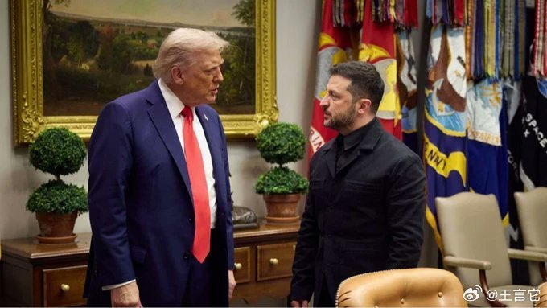

---

## 3

@MingZh

发表于：2026-10-13 15:05

来源：微博

链接：https://m.weibo.cn/status/5353695485101049

马斯克近日直言：“我就是亲华，因为中国是个有正能量的国家！

全球首富马斯克直言不讳：“我有点亲华，我在中国确实获得了一些利益，但实话说，我认为中国被低估了，我认为中国人民真的很棒，那里有很多正能量。”

马斯克有个细节，被很多人忽略了：不管是接受采访，还是跟人对话，他几乎从不打断别人。

你看那些访谈，别人说话时，他就安静听着，偶尔停顿一下再回应。要知道他这种级别的创始人，个个都是表达欲爆棚的话痨，能在别人说话时管住嘴，本身就是一种极强的自律。

\#马斯克怀疑自己有中国血统\#\#一分钟视频助燃计划\#\#热点解读\# \#马斯克怀疑自己有中国血统\# 品茶说酒的微博视频

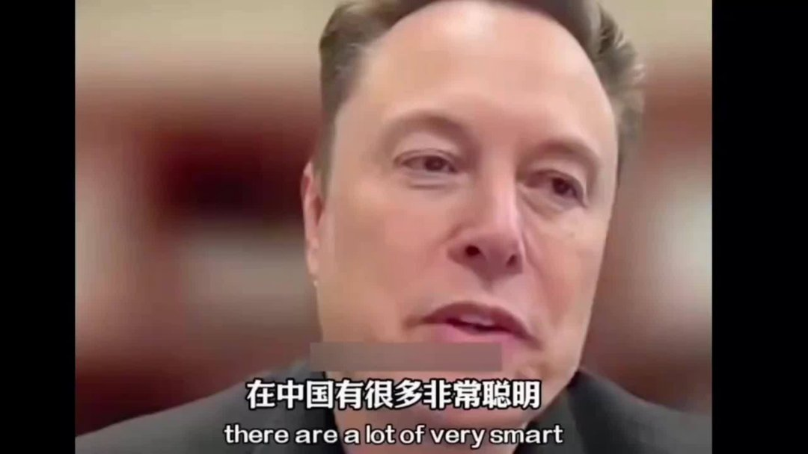

---

## 4

@新浪科技

发表于：2026-10-13 07:23

来源：微博

链接：https://m.weibo.cn/status/5353579133013148

\#马斯克称中国扩产能力超全球总和\#【\#马斯克大赞中国制造\#：一旦掌握，扩产能力往往能超越全球总和】埃隆 · 马斯克今天在 X 平台表示，一旦中国掌握某种产品的制造方法后，他们的扩产能力往往能超过世界其他地区之总和。

此番讨论建立在人工智能分析师 Melvin 的长篇文章之上。这名分析师认为，长鑫存储正成为美光、三星、SK 海力士的竞争对手。据 TrendForce 数据，长鑫存储目前在全球 DRAM 市场营收份额约为 9.5%，高于上一季度的 7.6%，已成为全球第四大 DRAM 制造商。

不过这名分析师认为，市场对长鑫 4F² DRAM 技术的突破有点反应过度，这家公司仍然需要证明自己能实现有竞争力的良率、定价、可靠性和产量。且该技术主要针对传统 DDR5 服务器内存，而非 HBM。

马斯克则回复道，当中国掌握某种产品的制造方法后，他们的扩产能力往往能超过世界其他地区之总和，锂电池和太阳能产业就是鲜活的例子。（IT之家）

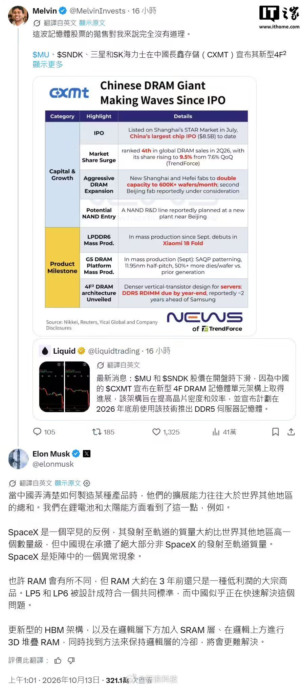

---

## 5

@tombkeeper

发表于：

来源：微博

链接：https://m.weibo.cn/status/4995962208519761

2008 年，美国次贷危机，雷曼兄弟破产，金融风暴横扫华尔街。这一年的 9 月 24 日，有位中国的老人在纽约华尔道夫饭店对美国金融界人士说了一句著名的话： “信心比黄金和货币更重要”。

2008 年，中国 GDP 增长了 9%。2009 年中国 GDP 增长 8.7%。2010 年中国 GDP 增长 10.3%。2011 年中国 GDP 增长了 9.2%。

以上是背景。

2011 年，某原教旨主义左派论坛有人撰文批判“信心比黄金和货币更重要”这句话，认为强调“信心”是“历史唯心主义”，认为不仅美国和欧洲的经济问题没有解决，中国经济也没搞好，因为“走进了雇佣劳动经济制度的死胡同”。

闭着眼不看现实，活在自己的幻境里，却说别人是唯心主义。

---

## 6

@tombkeeper

发表于：2026-10-13 07:30

来源：微博

链接：https://m.weibo.cn/status/5353581051641973

刚刚获得本届诺贝尔经济学奖的罗伯特·E·霍尔，其主要理论就是：人的消费行为主要取决于对未来长期收入的预期。

---

## 7

@耿向顺

发表于：2026-10-11 08:13

来源：微博

链接：https://m.weibo.cn/status/5352866908734975

最近关于社保的争议很大，我有几点提议：

第一，社保缴纳基数应与实际工资一致，或者，应降社保最低缴纳基数和城市的最低工资一致，而非按照虚高的最低缴纳基数缴纳，特别是中小企业职员、灵活就业者应该如此。

现在的社保基数太高、太贵了，老百姓社保负担太重，交不起了；企业用人负担也重，特别是现金流薄弱一点的中小企业，不敢招人、用不起人 。

比如我们这，最低工资为2540元一月，但最低社保基数为7270元，相差很大。

一个人即使工资只有五千，也要按七千多缴，扣掉社保个税等，到手的可支配资金更少了，拿什么来消费和生活？这无论对个人生活，还是对社会经济发展、鼓励促进消费，都是不利的。

职工每月至少要交2000多，灵活就业社保最低也要交2000多，没有工稳定工作、稳定收入、收入不高的人，根本承受不住。

特别是，灵活就业者，数量本来就庞大，工资收入本来就不稳定、也不高，对高昂的灵活就业社保真的望而却步，交几个月可以，长期交几十年真交不起。

对于灵活就业者的最低社保基数，应该降低到当地最低工资标准，减轻灵活就业者负担，或者设置由低到高多个档次，一两百、五六百、七八百、一千多、两千多这样，让灵活就业者都可以根据收入情况自主选择交多少、交什么档位。

第二，中小企业是吸纳就业人员最多的地方，降低中小企业的社保负担、降低中小企业用人成本，鼓励中小企业发展，才能尽可能多创造就业岗位。

人力成本过高，只会导致中小企业减少就业岗位，增加在岗人员的工作量，找不到工作的人变多了，有工作的加班更严重了，陷入恶性循环。

养老金医保金不仅要开源，更要要节流，现在退休老人越拉越多，年轻人却越来越少，长期下去是不健康不可持续的。

第三，尽可能减少养老金、医保金的支出。

对养老金和医保金进行限高，比如一万以上的养老金进行削减和暂停增长，不要再涨超高养老金、医保金了，而且即使涨养老金，也不能按比例涨。

养老金是用来给老人养老兜底的，而不是用来让某些退休老人及子女致富的。

设置退休金上限，降低部分人员超高退休金降低到合理范围，能基本保障老人的晚年退休生活即可。

真正需要养老金的人，反而是那些养老金很低的人，应该适当提高低养老金群体的养老金，做到相对公平分配，缩小贫富差距。

也应该缩减体制内和体制外的退休金差距，现在的差距还是蛮大的。

在工作岗位上时，工资高低按贡献、按劳动成果算，有很大差距很正常，但退休之后，大家对社会的贡献不会差很多，因此退休金也不应该有那么大的差距。

不然，不同人群差距很大，资金越来越少，资金池子不够用，年轻人看着没信心，担心以后自己领不到，也就不愿意交了，让年轻人看到信心、看到希望、看到好处很有必要。

第四，很多人交了很多年社保，但没交满最低年限，就因为失业、经济恶化等原因，导致断交了，不是不想交，而是真没法交了。

对于这种情况，到退休年龄最低缴费年限不足的，应该允许一次性补缴，如果不允许一次性不交，或者当事人没能力再交了，那就应该吧别人交了的钱如数退还（包含统筹部分，那也是别人自己交的），给别人作为养老金，这也是老百姓真金白银给出去的钱。

第五、在非体制内人员很多经济情况，不是当事人自己能掌控的，所以允许人们在失业、经济困难、收入降低的时候，自愿选择只缴纳五险一金中自己想交的(比如医保)部分，或者可以选择一个最低额度来交，作为临时过渡。

只交社保中的部分或只交最低标准的情况，不应视为断缴，而是应该看累计缴纳年限，更不应该以交社保年限和是否断交，来作为入学、招工、考学等方面的限制条件。

第六，对于灵活就业者，不应该设置所谓的“统筹部分”，应该全部算作当事人的个人部分，因为灵活就业者没有工作单位，所有的钱都是自己真金白银交的，本来就已经比较拮据、压力大了，还要统筹掉大部分，这是不合理的。

第七，对于灵活就业者、低工资收入者，应该给与一定社保补贴，降低灵活就业者、低收入者的社保负担。

第八，应该允许灵活就业者，自主选择交社保中的险种的其中几种，能力强收入高的就全部交，能力差的允许就只交医保，而且应该开放参保城市。

现在灵活就业，非常普遍了，到处都是灵活就业者，能不能放开全国的社保（特别是医保）参保城市啊，不要限制只能在户籍地缴纳之类的限制。

我觉得交医保还是真的很有用很划算的，医保的重要性比养老金的重要和急迫得多，医保还是尽量要交着的，不能断。

医保是马上就能用、随时就能用的，若生个较为严重得病、受个严重意外伤害等，有医保能切实大幅减轻负担，能真金白银省钱。

........

当然，以上，只是我的一些想法看法，可能有想得不全面不合理的，欢迎大家提出、批评和讨论、补充一些你的看法。

\#退休金一万到底要缴多少社保\#

\#社保应该在应保尽保下功夫\# \#年轻人不愿交社保\#

---

## 8

@高飞

发表于：2026-10-13 02:12

来源：微博

链接：https://m.weibo.cn/status/5353500843185725

\#模型时代\# SpaceXAI真改名了。现在是SpaceX Super Intelligence。第一条推文：我们已将 Grok、Cursor 和 X Premium 的套餐进行了统一。

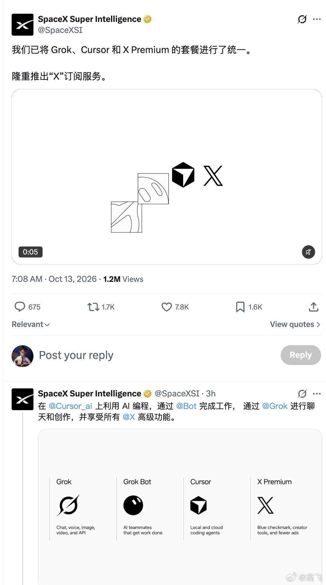

---

## 9

@高飞

发表于：2026-10-13 03:25

来源：微博

链接：https://m.weibo.cn/status/5353519198770059

\#模型时代\# 扎克伯格、Alexandr Wang联合访谈：Meta建造一个前沿AI实验室从零到一的全过程，为什么敢在前途未卜的时候，赌上千亿美金？

最近Meta又有点刚发布LLama模型时期的味道了，也就是意气风发。

当时Meta引领了开源模型的浪潮，到Llama4陷入作弊风潮戛然而止。这一次，扎克伯格和Alexandr Wang合作，通过Muse，又重回主流。最近，两位也上了很多播客。不过这期Cheeky Pint应该是最重要的。采访人是Stripe联合创始人John Collison，本身就是科技公司创始人，所以问的问题也聚焦到决策本身。几期访谈看下来，扎克伯格真应该感谢OpenClaw创始人Peter。在Meta的AI路线陷入迷茫的时候，Meta的AI班底集体进入了OpenClaw狂热，押注这是未来AI的一条主轴。虽然他们没能把Peter挖过来（去了OpenAI），但是可以说Meta团队绝对是OpenClaw最狂热的信徒，也是最忠实的接班人。

对了，我今年4月份在旧金山当面采访过主持人John Collison，问他如何主持播客，构思对嘉宾的提问的，他说想搞清楚受访人决策背后的why。这期播客，可以说都是类似的智慧。

书归正传，以下是完整笔记：

Meta创始人兼CEO Mark Zuckerberg和Meta Superintelligence Labs（MSL）负责人Alexandr Wang，Wang的头衔是Chief AI Officer。Wang此前创办了AI数据公司Scale AI，2025年被Zuckerberg以约140亿美元的交易请来领导新成立的MSL，交易包含收购Scale AI 49%的股份。节目于2026年10月13日发布，正值Meta发布新一代前沿模型Muse Wonder。Wang加入Meta时年仅28岁，MSL成立至今刚刚一年多。

Zuckerberg在节目开头回忆去年底的一幕：模型还没出来，但千亿美元的支票必须签了。他问Wang：你确定这能成吗？CFO Susan Li在夏威夷的高管offsite上多次把Wang拉到一边，说如果模型不行，财务后果会非常严重。Wang说当时他能提供的证据只是一份关于研究进展的vibe report和几张曲线图。他作为一个创业者、一个承受过风险的人，也觉得这个赌注大得离谱。

但Zuckerberg的算法是：这笔投资失败的前提是AI整体得失败，只要AI成立，Meta的算力就有人愿意高价购买，连最差的情况都能用在自家核心业务上。所以他选择全部押上。

一、Muse的爆款用例

1、Zuckerberg的MMA教练是AI

Zuckerberg在自家健身房装了摄像头，让Muse实时观看他的格斗训练，在回合间60秒休息时间里给反馈。这对模型提出了很高要求：要快速处理大量视频帧（他反复催Muse：“你给反馈用了30秒，我只有60秒休息，快点优化自己”），还要真正理解MMA的动作细节，包括平衡、髋部位置、side control下underhook的角度。

他说这个用例实际上成了产品的eval。他甚至在Muse之前就用OpenClaw做过类似尝试。模型自行编写了一整套视频处理和图像处理的pipeline，从视频中抽取关键帧，标注具体问题（“你这里后腿承重太多”），配上截图。而这一切对用户完全透明，看不到任何代码。

Zuckerberg由此引出了一个更大的判断：未来每个人都在写大量代码，只是自己不知道。“Everyone is actually going to be writing tons of code。 They're just not going to know that they're writing code。”

2、Wang的AI茶叶采购员

Wang给自己的Muse取名Oiler，让它每周从台湾地区或日本等地的小茶园采购越来越冷门的茶叶。他说现在Oiler已经在独立完成从选品到下单的全流程。

3、多模态感知是核心差异化

Zuckerberg认为MMA教练之所以成立，背后是Meta在多模态模型上的持续投入，在预训练阶段就大量加入图像、音频、视频数据。Wang指出，今年早些时候行业存在一种紧张关系：共识认为“只有coding才重要”，但对于Muse这样的消费者产品，多模态能力的权重远高于纯代码能力。

二、模型即产品

1、产品差异化正在从应用层下沉到模型层

Zuckerberg提出了一个内部反复讨论的判断：the model is the product。Muse的产品团队在思考如何让体验更好时，讨论的核心是post-training，即如何训练模型的行为、个性和可靠性，而不仅仅是调UI。

Wang用了一个类比：就像移动互联网早期，大家觉得“一切都只是app”，但后来app之间的差异化巨大。现在AI行业也处在“一切都只是agent”的阶段，产品规格书上那些传统维度已经不是AI原生产品真正的设计决策点了。真正重要的设计发生在模型训练阶段：在各种场景下模型到底该怎么表现、该有什么样的个性、该如何处理工具调用。这些决策的细节加起来，才是一份极其复杂的产品规格。

2、Discretion：个人智能体独有的能力

Zuckerberg举了一个例子：你有食物过敏或者怀孕了，需要预订餐厅，但不想把自己的医疗信息告诉餐厅。个人智能体需要在掌握用户大量私密信息的前提下，对外披露尽可能少的内容。这种“discretion”在coding agent的场景里几乎不存在，但在个人智能体里至关重要。

3、不给用户选模型的选项

Muse的消费者产品里没有模型选择器，也没有effort选择器。Wang说得很直接：很多AI产品是高度技术化的人设计的，他们脑子里没有“随机抽取一个普通美国人”的用户画像。模型名字数字倒着走、各种代号混用，一个不仔细研究API文档的普通人根本不知道该选哪个。Zuckerberg的态度更简单：我只想让它变简单。

三、Muse Wonder：新一代前沿模型

1、从Spark到Wonder：两代不同的预训练

Muse的模型谱系分两条线。Muse Spark（内部代号Avocado）基于去年底完成的一次预训练，之后的1.1、1.2、1.3版本都是在同一个预训练基础上叠加更多RL。Muse Wonder（内部代号Watermelon）则是全新的预训练，规模大幅提升。Wang说团队现在“用完了水果名”。Zuckerberg接了一句：我们水果用完了。Wang回了一句：技术上榴莲比西瓜大，但你不会想用榴莲当代号。

2、Active Memory和Active Focus：训练进模型内部的能力

Muse Wonder有两个核心特性。Active Memory是模型对长期上下文的记忆系统。John Collison提到OpenClaw的记忆功能“buggy AF”，那是因为它用的是外挂式压缩方案。Wang强调Muse的记忆系统直接训练进模型内部，不依赖外挂的harness。模型知道自己的记忆系统存在，知道如何利用不同来源完成任务，也知道如何做有效的压缩。这套系统在Meta内部用一个叫Memory Bench的eval来衡量。

Active Focus则是在复杂长周期任务中保持执行连贯性的能力。遇到障碍时，模型能识别替代方案继续推进，而不是中断。

3、前沿编程能力和领域专长

Muse Wonder在DeepSWE和SWE-Marathon上达到了state-of-the-art，在Terminal-Bench 4等榜单上表现优异。同时在金融和法律领域的专业eval上也是最强。Wang的理念是：最好的个人智能体应该像你身边有一个专家团队，法律、财务、医疗，一个模型全包。

4、Big Model Smell：量化“大模型味”

Wang在Muse Wonder的研究博客中引入了一个指标：big model smell。做法是测量模型在RL和post-training分布内任务与分布外任务之间的表现差距。差距越小，说明模型的真实智能越高，benchmaxing的成分越少。从Spark到Wonder，这个差距有巨大提升，原因在于底层基础模型本身强了很多。Wang说他们已经能把这种原本只可意会的“大模型感”量化了。

5、付费策略：先收费，后普惠

Muse Wonder因为模型更大、服务成本更高，首先面向付费订阅用户。免费用户仍然使用Muse Spark。Zuckerberg说他们希望不久之后，能做出和Wonder同等能力但以Spark成本运行的模型，届时可以免费服务数亿用户。同时，Wonder也通过Meta Model API和OpenRouter对开发者开放。

四、前沿模型是怎么炼成的

1、预训练：高风险的科学

预训练是把海量数据灌入模型的阶段，对数据格式要求不高，核心是量大、模态丰富。如果要让模型擅长感知，就需要在预训练中加入大量图像、音频和视频。如果要让模型精通特定领域，也要在预训练阶段就让它接触相关语料。

Wang说预训练是整个研发中风险最高的阶段。Meta把很大比例的算力投入到Muse Wonder的预训练中。样本极少（你不可能反复训练前沿级别的模型来积累经验），研究者必须靠推理和直觉判断。他引用了Roon的一条推文来形容做预训练的人的状态：整天嚼碎玻璃、茫然望向远方的研究员。

2、Post-training的两段论：SFT + RL

Post-training分两步。第一步是SFT，通过监督微调把原始的预训练模型塑造成能正常对话、具备特定行为的状态，个性、回应方式都在这个阶段初始化。Wang打了个比方：SFT结束后，模型可能已经具备了你想要的行为，但只有10%的概率表现出来。

第二步是RL，通过强化学习把这些行为的出现率大幅拉高。Zuckerberg说Muse Spark从1.0到1.3的全部提升都来自RL，预训练完全没动。Wang说1.0到1.3之间的差异之大，外部观察者会以为它们来自完全不同的预训练。

3、RL的数据哲学和对齐思考

与预训练追求海量数据不同，RL更关注环境和任务的质量，数据量反而是“少即是多”。RL会给模型施加极强的优化压力，如果任务设计不当，比如唯一的成功路径需要不对齐行为，模型就会学到错误的东西。因此Meta在Muse Wonder的RL阶段非常谨慎地策划了训练环境，确保所有优化方向都指向对齐行为。

Zuckerberg的对齐观和行业主流有差异。他认为个人智能体的对齐，更多是让模型的指令执行和价值判断与它服务的用户保持一致，而不是给用户上道德课。只有在真正灾难性的请求面前才需要优雅拒绝。

4、从规划到发布：一年以上的全链条周期

Muse Wonder从去年8月就开始规划。预训练、RL、评估、serving，每个阶段都耗时数月。多代模型并行推进，当前的研发支出是多代模型开发的叠加成本。

算力基础设施的周期更长。Meta在俄亥俄建造的Prometheus集群已经扩展到超过1GW；在路易斯安那建造的Hyperion集群将达到5GW。这些项目的规划从2023-2024年就开始了，远早于MSL成立。

五、押注千亿美元

1、“你确定这能成？”

去年底，Muse Wonder的预训练还没有结果，但Meta已经要做出千亿美元级别的资本承诺。Zuckerberg回忆当时问Wang：你确定这能成吗？运营一个1GW的集群，每年大约150亿美元；建设的CapEx在500亿到600亿美元之间，而这只是一个集群的一部分训练成本。加上研发中大量的梯度实验和服务部署，训练一个前沿模型的总成本在数百亿美元量级。

Susan Li在夏威夷把Wang拉到一边，不止一次告诉他：如果模型不行，财务后果会非常严重。Wang说当时他能提供的证据只是一份关于研究进展的vibe report，他自己感觉不错，但远远谈不上确定。

2、Zuckerberg的风险对冲逻辑

Zuckerberg认为这笔赌注没有看起来那么冒险。他列了两层逻辑：第一，只要AI整体成立，Meta的算力就有人愿意买，价格还可能远超成本。“In order for it not to work out， it's not just that we have to fail， AI overall has to fail。” 第二，即使最差情况，算力也可以用在Meta现有业务上。

他还指出另一个更难的决策：除了训练，还有serving。他们在产品还不存在的时候就要为推理需求建设数据中心，需要提前好几年做判断。确实有高管建议保守一些，但Zuckerberg的回应很简单：就这么干，我们一定能做成。

3、“Lean Startup的反面”

Wang把训练前沿模型比作Lean Startup的反面。Lean Startup的方法论是做出最小可行产品，验证后再加码。AI做不到，你必须在没有验证的情况下投入巨量资源，等到结果出来再行动就已经落后了。

Wang也坦诚地说，尽管他自己也是创业者、也承受过风险，但当时的感受是这个风险大得离谱。Zuckerberg对此不以为然。Collison总结说Zuckerberg完全内化了幂律法则：失败不重要，重要的是赢的时候赢多大。

六、Agentic Commerce

1、从浏览器操作到API直连

Muse训练了很强的浏览器使用能力。browser use是一层向后兼容方案，确保不需要任何商家做任何适配就能替用户完成操作。但长期方向是API直连，直接和商家系统对接，更快更高效。Zuckerberg说主动找Meta要求深度集成的商家远多于试图屏蔽的，那些选择屏蔽的最终会发现这在战略上站不住脚。

2、市场扩张：智能体也有账户了

Zuckerberg分享了一个个人案例。他以前几乎不用Instacart，每年大概用一两次，偶尔借Priscilla的账户。为了给Muse开通购物能力，他注册了自己的Instacart账户。现在每周用一两次，因为他和3岁女儿Aurelia通过Muse的语音模式讨论周末要烤什么。

语音模式能分辨不同说话人的声音。他们父女俩整个星期都在和Muse聊周末要做什么甜点，Aurelia会提出各种不存在的“创意食谱”，Muse帮忙转化成真正可行的方案。到了周六要烤的时候，Instacart已经把所有食材送到了。这个周末Muse知道Wonder要发布，内部代号Watermelon，所以往购物车里加了一个西瓜。Zuckerberg觉得特别可爱，在直播上把那个西瓜吃了。

这引出一个更深层的经济学问题：这个Instacart账户到底是Zuckerberg的，还是Muse的？Zuckerberg认为整个市场的可寻址空间正在结构性扩张，智能体也在开账户、也在消费。

3、个性化推荐的升维

Wang认为Muse在购物推荐上有独特优势：它有用户生活全局的上下文，包括家人、朋友、同事，跨场景、跨时间线的信息。传统推荐系统只能看用户在单一平台上的行为。Collison也验证了这一点：用户让Muse买东西时，它经常会引用另一段对话中的上下文来辅助决策。

4、Stripe与agentic commerce的升温

Collison提到Stripe今年5月的Sessions大会上发布了一系列为agentic commerce准备的功能。从9月开始，agentic commerce的交易数据开始垂直上涨。Stripe已同意收购OpenRouter，目前领先的模型网关，每天路由超过10万亿token，让开发者通过单一API接入数百个模型。Meta的模型包括Muse Wonder也通过OpenRouter对外提供服务。

七、超越智能手机

1、眼镜是纯粹的多模态产品

Zuckerberg认为大多数人其实不太喜欢阅读，文本交互只是因为别无选择。Meta的Ray-Ban智能眼镜已经证明：仅靠摄像头和音频（没有显示屏或只有小显示屏），就足以构成一个有用的产品。他设想未来眼镜可能不需要应用商店，模型直接在视野中生成用户需要的一切。

2、语音输入的爆发

语音是高带宽的输入方式，但听别人说话是低效的信息接收方式，这也是纯语音助手一直不温不火的原因。但agent改变了这个局面：之前的语音AI只能回答问题，现在它能帮你做事，交互模式从“信息检索”变成了“委托”。Wang观察到，连AI研究人员都在对着键盘小声说话让AI处理。大学生更极端：对着AI连续说15分钟stream of consciousness，然后让AI整理成结构化内容。

3、Muse Gadgets：开放硬件生态

Meta发布了Muse Gadgets，让外部生态可以尝试各种设备形态。已有手机厂商主动来谈集成。他们还推出了HomeLink，一个硬币大小的USB设备，让Muse连接家中的智能家居，包括Sonos音箱、智能灯等。Zuckerberg说自己每天晚上让Muse统一调暗全屋灯光。带显示屏的智能眼镜也在推进发货中。

八、谁来买单

1、多条收入线并行

Zuckerberg列出了几个方向。订阅是最直接的：想用Muse Wonder就付费。Commerce抽成是长期大方向：Muse帮用户省钱、买到更好的东西，Meta从中取一小部分佣金。API和企业服务也在铺开。Meta新成立了Enterprise Platform，由CJ Desai领导，把Muse Wonder以企业级方式输出。

2、核心业务是最强后盾

Meta的广告业务年收入数千亿美元，而且还在高速增长。Zuckerberg说，用AI模型加速核心业务，哪怕只提升几个百分点，就能覆盖大量AI投入。Wang的评价是，Meta的核心业务是商业史上最强的生意之一。

自建数据中心在财务上还有结构性优势：CapEx可以折旧摊销，GPU在折旧完成后仍然有使用价值甚至增值；而云客户按年付费，享受不到这种长期成本递减效应。

3、“必须能赚钱”

Collison问AI业务最终能不能赚钱。Zuckerberg的回答很短：必须能。Wang补充了历史视角：每年市场都在担忧AI公司怎么赚钱，每年收入增长都超预期。

九、AI不会赢家通吃

1、为什么没有一家公司跑赢所有人

几年前很多人预测AI会出现赢家通吃的局面，一家lab通过递归自我改进拉开绝对差距。现实是竞争极其激烈，多个lab都在前沿。Wang给出了三个原因：各lab的执行力有波动期，领先者不可能永远不犯错；蒸馏技术的存在是一种anti-hegemonic force，让小模型快速获得大模型的能力，惠及开源生态；行业内很多人在价值观上也希望多元竞争的格局存在。

2、模型之间的差异化正在加大

Wang认为现有的benchmark把不同模型的差异“压平”了，掩盖了底层越来越大的设计分歧。Meta在个人和职业智能体方向上的投入与其他lab明显不同。OpenRouter的价值也在于此：帮助开发者理解模型之间的深层差异，做出更合适的选择。

3、开放是Meta的安全哲学

Zuckerberg认为AI安全的最佳保障在于让多种模型广泛可用，形成制衡。只有少数公司拥有好模型才是更危险的未来。

十、MSL：100人的前沿实验室

MSL的故事要从一次失败开始。

1、从Llama 4到全面重启

2025年4月4日，Meta发布了Llama 4。大约两周后的4月20日或21日，Zuckerberg开始给人打电话征求意见。其中一个电话打给了Wang。Wang收到WhatsApp消息时正在开会，Zuckerberg问他有没有时间通个电话。两人通话44分钟，两天后Wang发来了一份长文档，开头第一条就是：你不需要很多人，talent density才是关键。

Zuckerberg清空了自己一两个月的日程，只做一件事：见研究人员和做面试。他和Wang以及后来加入的Muse产品负责人Nat一起，做了一个当时看来很激进的决定，对AI团队进行完全的reboot。一开始他们还没确定必须全面重启，是在和顶尖人才的招募对话中发现，只有“从零开始”的定位才能吸引最好的人。

2、Talent Density：每个人都必须是最强的

MSL的研究团队不到200人，核心研究人员约100人，加上大量基础设施人员。Wang坚持极度扁平的结构，他名义上有近200个直接汇报的人。Zuckerberg澄清了这个数字的含义：重点在于取消了中间的非技术管理层，让所有研究人员直接和Wang沟通。

Zuckerberg说他和业内所有lab的负责人、研究领袖都聊过，最后认定了一件事：必须是Wang。尽管Wang此前从没训练过前沿模型，但Zuckerberg看重的是他的战略清晰度、对talent density的极端执着，以及所有最厉害的人都想和他一起工作这个事实。

3、“我们需要reasoning model”——对方说“不需要”

Wang透露了一个早期的关键时刻。他加入后第一次和现有AI团队的leader开会，提出首先要训练一个优秀的reasoning model。一个关键负责人当场反驳：我们的消费者需要reasoning model吗？做一个普通模型就行了。

Wang说那一刻他的心沉了下去。会后立刻打电话给Nat，告诉他会上刚发生了什么。这件事确认了一个更深层的问题：Meta的AI领导层需要大幅提升对技术走向的判断力和紧迫感。Zuckerberg也说，他在和外部人才交流的过程中得出了同样的结论：整个团队需要更“AI-pilled”。

4、没有deadline，但所有人都在拼命

Meta对MSL说：没有deadline，按正确的节奏来。Wang说这话听起来可能让人害怕，投了这么多钱然后告诉大家不着急？但因为招来的都是“insecure overachievers”，自驱力本身就极强。

Wang有一个习惯：每隔三个月问团队“你觉得我们三个月后会在什么位置？”每次收到的都是极度悲观的答案。三个月后他把当时的预测翻出来，实际结果远超预期。但下一轮预测依然悲观。Zuckerberg对此有一个精确的观察：团队里每个人对MSL整体都很乐观，但对自己负责的项目都非常苛刻。他认为这是一种很健康的动态。

5、保持技术判断力是生死线

Zuckerberg和Wang都反复回到一个原则：所有人必须保持技术性。Wang指出，研究人员从一线走向管理层后，脱离技术的速度远超自己的意识。在AI这么快速演进的领域，这尤其致命。所以MSL要求所有人使用agent、写代码，保持对技术的第一手感知。Adam Mosseri（Instagram负责人）就是一个正面例子。Wang说他搭建的个人vibe code和mini app setup是他见过的最精致的之一。

十一、为Zuckerberg工作

1、“高学习率”的CEO

Wang说Zuckerberg最让人印象深刻的特质是：一旦得出某个结论，他会以极快的速度和极大的力度调整一切使之与这个判断一致。大多数CEO即使嘴上说AI是最重要的，实际日程和资源分配可能还是老样子。Zuckerberg直接清空日程、调动全公司资源来支撑MSL。Wang用了一个词来形容这种特质：very high learning rate。

John Collison总结了四件多数CEO不会做的事：公开承认之前的AI团队不够好；愿意付天价（包括收购Scale AI 49%的股份）招人才；赌一个从没训练过前沿模型的人来领导lab；作为万亿市值公司的CEO，清空自己两个月的日程只做一件事。

2、Meta是一家极其抗打的公司

Wang加入后发现，Meta的高管团队大多数都经历过公司的多次危机，移动转型、隐私风波、元宇宙争议。他们对MSL这个“可怕的赌注”的反应是：我们是Meta，我们扛得过去。Wang说这种韧性不是口号，是从十几年的风雨中磨出来的。他加入时和这些高管对话的感觉，跟一年多后完全不同。整个管理层变得更“AI-pilled”的速度让他很意外。

3、“Stay technical， stay at the frontier”

节目最后聊到了Wang在X上大量发帖的习惯。Zuckerberg说每次打开X就看到四条Wang的帖子，你哪来这么多东西可写？他认为沟通最重要的是authentic，偶尔翻车比过度包装好得多。

Collison用一句话收尾整场对话：很容易掉队。Zuckerberg接上——也是这期播客的最佳总结：

“Stay in the details。 Stay technical and stay at the frontier。”

总结

这期对话拆解了一个前沿AI实验室从零到一的全过程，具体到每一个决策节点的取舍。Zuckerberg和Wang展示的是一种极端押注方式：用不到200人的精英团队取代上千人的旧组织，在模型结果出来之前就签下千亿美元的基础设施投资，把产品差异化全部放在模型层。

对于关注AI产业的读者，这期最有价值的内容可能在组织方法论：talent density优先于人数、预训练和RL的不同管理哲学、在极端不确定性下做决策的思维框架，以及一个传统消费互联网巨头如何在一年多内把自己改造成前沿AI公司。

核心归纳

Q1： Muse Wonder的核心差异化是什么？

它是一个为个人和职业智能体场景专门优化的前沿模型。两个关键特性都训练进模型内部：Active Memory是模型原生的长期记忆系统，Active Focus则赋予模型在复杂任务中持续执行的能力。在编程（DeepSWE、SWE-Marathon）、金融、法律等领域eval上均达到state-of-the-art。Meta还用big model smell指标来量化模型的真实智能程度，衡量分布内和分布外任务的性能差距，差距越小说明benchmaxing的成分越少。

Q2： MSL如何在一年多内从零到前沿？

三个核心要素：极端的talent density，研究团队不到200人，核心约100人，没有非技术管理层；Zuckerberg的全资源投入，清空日程、调动全公司支持、提前数年建设GW级算力集群；以及一个关键的组织决策，全面reboot，在旧团队上修补走不通。Wang带来的战略清晰度和扁平文化，让大量顶尖人才主动加入。

Q3： 千亿美元的AI投入怎么回本？

多条收入线：Muse订阅、agentic commerce抽成、企业API服务，以及用AI加速Meta已有的千亿级广告业务。Zuckerberg的对冲逻辑是：失败的前提是AI整体得失败，只要AI成立，Meta的算力就有人高价购买。自建数据中心的CapEx可折旧，GPU在折旧后仍有使用价值甚至增值，比租用云服务有长期财务优势。

---

## 10

@小虾才没香喷喷

发表于：2026-10-12 02:19

来源：微博

链接：https://m.weibo.cn/status/5353140250739074

草草草草草

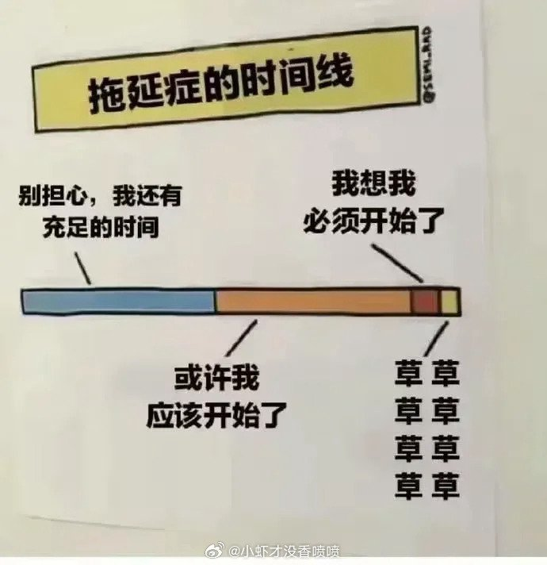

---

## 11

@阑夕

发表于：2026-10-12 15:15

来源：微博

链接：https://m.weibo.cn/status/5353335554572600

晚安。

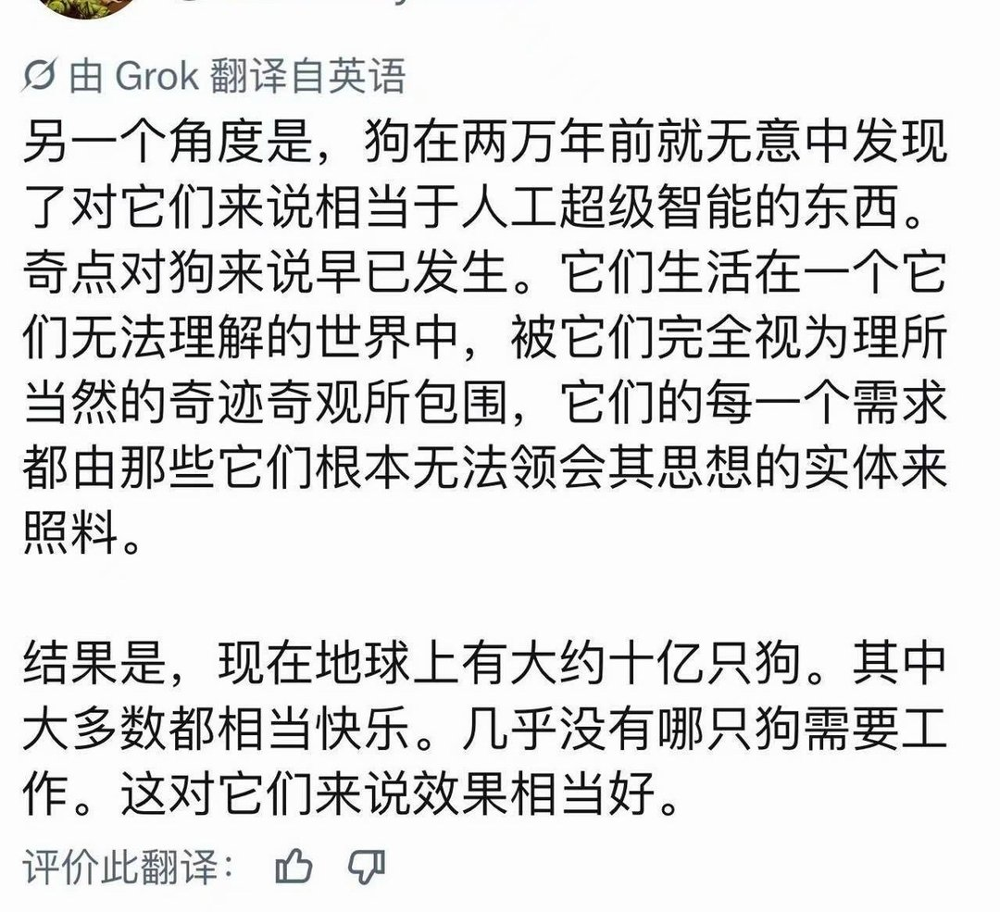

---

## 12

@宝玉xp

发表于：2026-10-09 15:43

来源：微博

链接：https://m.weibo.cn/status/5352255453665665

Deno 团队加入 Cloudflare，Deno 运行时一年后停更，Deno Deploy 半年后关停

Deno 整个团队加入 Cloudflare。接下来一年，Deno 运行时每月发一个版本，只修 bug 和安全问题，一年后官方停止开发。托管平台 Deno Deploy 再运行六个月就关闭。

Deno 是 Ryan Dahl 做的 JavaScript 运行时（运行 JS 代码的环境，Node.js 也是一种）。Dahl 也是 Node.js 的作者。Deno 的卖点是默认更安全、自带全套工具链、能把程序打包成单个可执行文件，后来又兼容了 Node.js 生态。Deno Deploy 是配套的云托管服务。

如果你在用 Deno，现有项目短期内照常能跑，未来一年还有安全补丁。一年后官方不再维护，代码仍然开源，社区有人愿意接手可以继续开发。长期项目现在就该评估往哪迁。

部署在 Deno Deploy 上的服务有六个月搬家时间。付费用户可以拿到迁往 Cloudflare Workers（Cloudflare 的无服务器平台，写好函数就能在它的全球节点上运行）的迁移支持，免费用户要自己动手。

JS 包仓库 JSR 继续运营，底层设施搬到 Cloudflare。Deno 团队还会继续维护 rusty_v8（在 Rust 里调用 V8 引擎的库），并把它整合进 Cloudflare 的开源运行时 workerd。

Dahl 说，做 Deno Deploy 让他看到底层基础设施有多复杂，所以后来做了 celld。按 Cloudflare 联合博文的介绍，celld 是 Workers 和 Durable Objects 的开源实现，今年 8 月发布，是一个用 Rust 写的单文件程序，只依赖一个对象存储桶，可以部署在自己的服务器上。

Durable Objects 是 Cloudflare 的一种编程模型。每个对象相当于一个单线程的小服务器，带自己的 SQLite 数据库，能直接处理 WebSocket 长连接。比如聊天应用可以一个频道对应一个对象，用户多了，系统自动分摊到更多机器上，开发者不用自己搭扩容架构。

加入 Cloudflare 后，Dahl 和 Deno 联合创始人 Bert Belder 会把 celld 的代码和思路并入 workerd，让“在自己的机器上跑 Workers 应用”成为官方正式支持的用法。目前 workerd 的 Durable Objects 只支持单实例，本地测试够用，上不了规模。这件事做成以后，这套写法既能跑在 Cloudflare 上，也能跑在自建机房里。

Dahl 最看重的方向是 AI 智能体。智能体需要长期保存状态、保持实时连接、闲着时不花钱，Durable Objects 正好都能提供。他在文中邀请想在自有基础设施上大规模运行智能体的团队直接联系他。

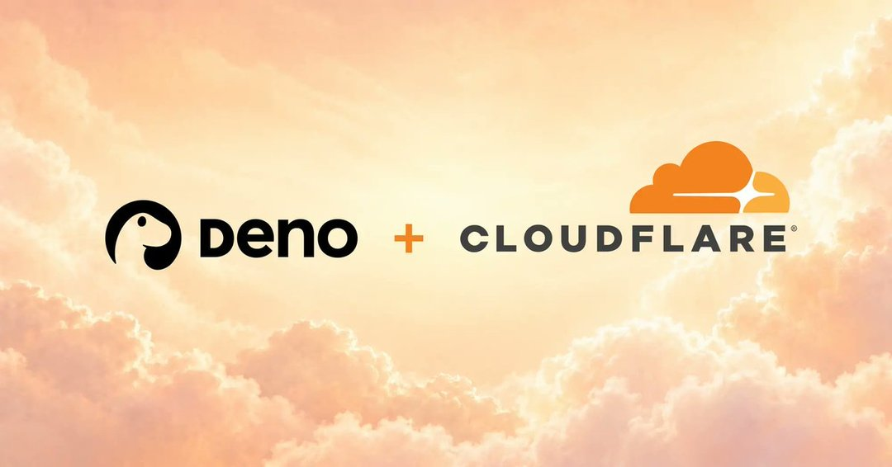

---

## 13

@你把打字机留在了我的公寓里

发表于：2026-10-12 09:25

来源：微博

链接：https://m.weibo.cn/status/5353247541824232

几块钱的小吃，还要发出来避雷避雷，结果把人家逼死了，互联网避雷文化

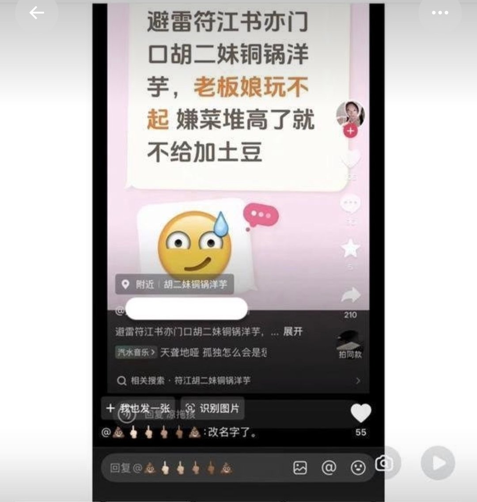

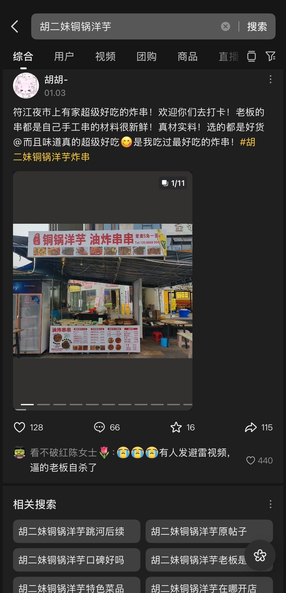

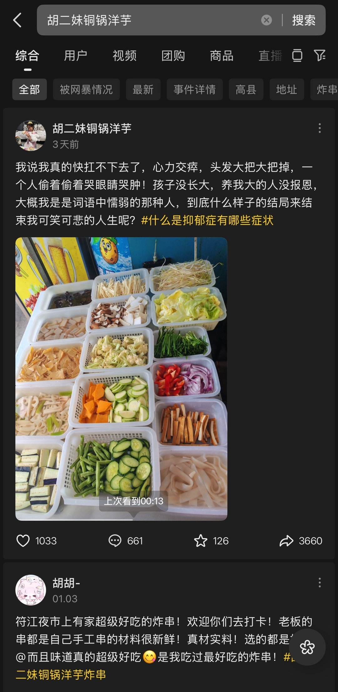

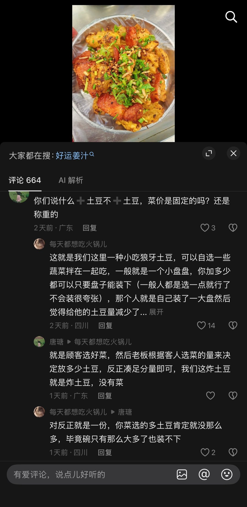

