# 2026-10-18

## 1

@AIGC·非著名程序员

发表于：2026-10-13 09:29

来源：微博

链接：https://m.weibo.cn/status/5353610834870761

红果短剧日均125分钟登顶，抖音紧随其后120分钟，两个App加起来每天吃掉一个人将近4小时。字节系拿走全网41.8%的时长份额，这个数字太吓人了，快半壁江山了。

表面上看，这是字节的产品胜利，算法推荐做到了极致，短剧的"下一集"钩子设计得无懈可击。但换个角度，一个普通人每天清醒时间大约16小时，光红果加抖音就占去四分之一，再加上微信、快手、视频号、小红书，六个App叠满差不多8小时。也就是说，你醒着的一半时间都交给了手机屏幕。

更耐人寻味的是红果短剧悄无声息地超越了抖音。短视频至少还有知识区、技能区可以自我安慰"我在学东西"，短剧连这层遮羞布都省了，纯粹靠情绪刺激和剧情反转把人钉在屏幕前。当一个免费短剧App能让用户日均停留两个多小时，说明"注意力收割"已经进入了一个新阶段：连内容质量都不再重要，只要节奏够快、钩子够密，时间就会被吸走。

腾讯系跌到28.6%也很有意思。微信作为基础设施级产品，日均才80多分钟，说明大家打开微信越来越像"处理事务"，聊完就走。社交关系链曾经是腾讯最深的护城河，如今挡不住算法投喂的多巴胺流。

说到底，时长份额的争夺战里没有赢家是用户。平台赢了注意力，广告主赢了曝光，用户赢了什么？每天多刷两小时短剧之后，生活有变好吗？这张图与其说是行业格局图，不如说是一张集体时间审计表。看完之后最该做的事，可能恰恰是放下手机。

\#科技先锋官\#

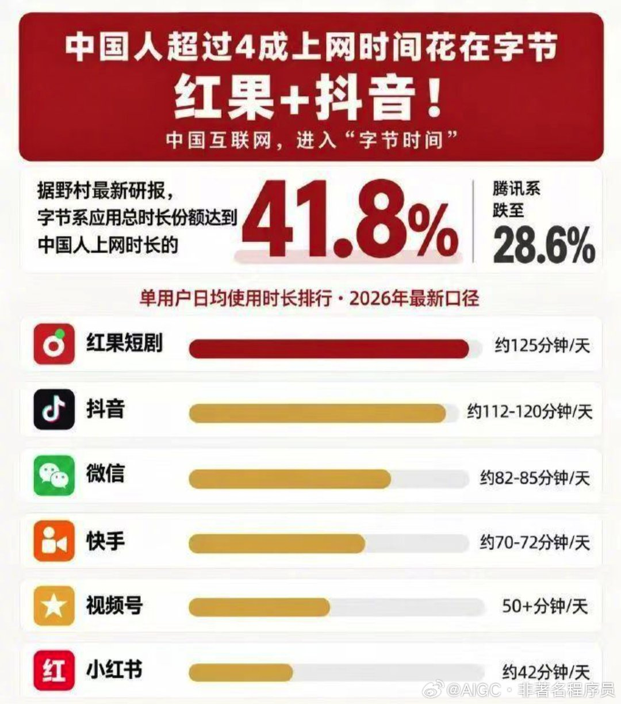

---

## 2

@宝玉xp

发表于：2026-10-17 16:02

来源：微博

链接：https://m.weibo.cn/status/5355159458941932

DeepSeek 发布 V4.1-Flash-1017：做事更快、回答更短，官网和 App 已换新；联网搜索 API 每千次 5 元，11 月 1 日起收费

DeepSeek 发布 V4.1-Flash 的升级版 V4.1-Flash-1017（1017 指 10 月 17 日）。官方说它测试分数更高、完成任务更快、输出更短。输出短，消耗的 token（AI 计费单位，可以理解成文字碎片）就少，同一件事做得更好，也更省钱。

普通用户打开 DeepSeek 官网或 App 用的就是新版。开发者调 API 的模型名还是 deepseek-flash，代码不用改。

这一版主攻从零做完整个项目，演示里它从头做出了小游戏和 3D 模型。官方在 Hugging Face 公布的测试里，进步最大的是让 AI 在命令行里自己敲命令干活，从 31.2 分涨到 42.3 分。和 Anthropic 的 Opus 5 比，几项自动办事的测试它分更高，高难度问答和写完整程序仍然落后。这些分数都是 DeepSeek 自己测的。

另一件事跟开发者的钱包有关：DeepSeek 把自家搜索引擎开放成接口。Search 输入关键词返回网页结果，Fetch 给一个网址把网页内容抓成文字，合起来能让 AI 应用上网查资料。每个接口每 1000 次成功请求收 5 元（英文版标 0.75 美元），失败、没搜到、超时不收钱。

如果你把 DeepSeek API 接进 Claude Code、Codex 或 DeepSeek 自家的编程工具 DeepSeek Harness 当背后的模型，这些工具里 AI 自动发起的搜索和抓网页目前免费，北京时间 11 月 1 日零点（10 月 31 日 16:00 UTC）开始按次收费。

模型同时开源，MIT 协议，允许商用，可在 Hugging Face 和魔搭社区（ModelScope）下载。它有 7630 亿个参数，个人电脑跑不动，主要给企业和云服务商自己部署。

模型下载：网页链接

搜索 API 文档：网页链接

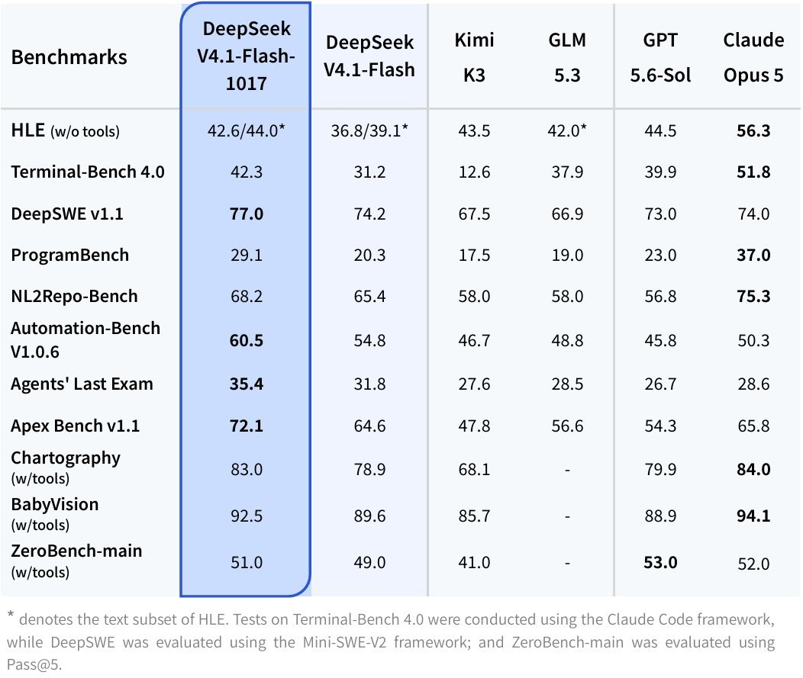

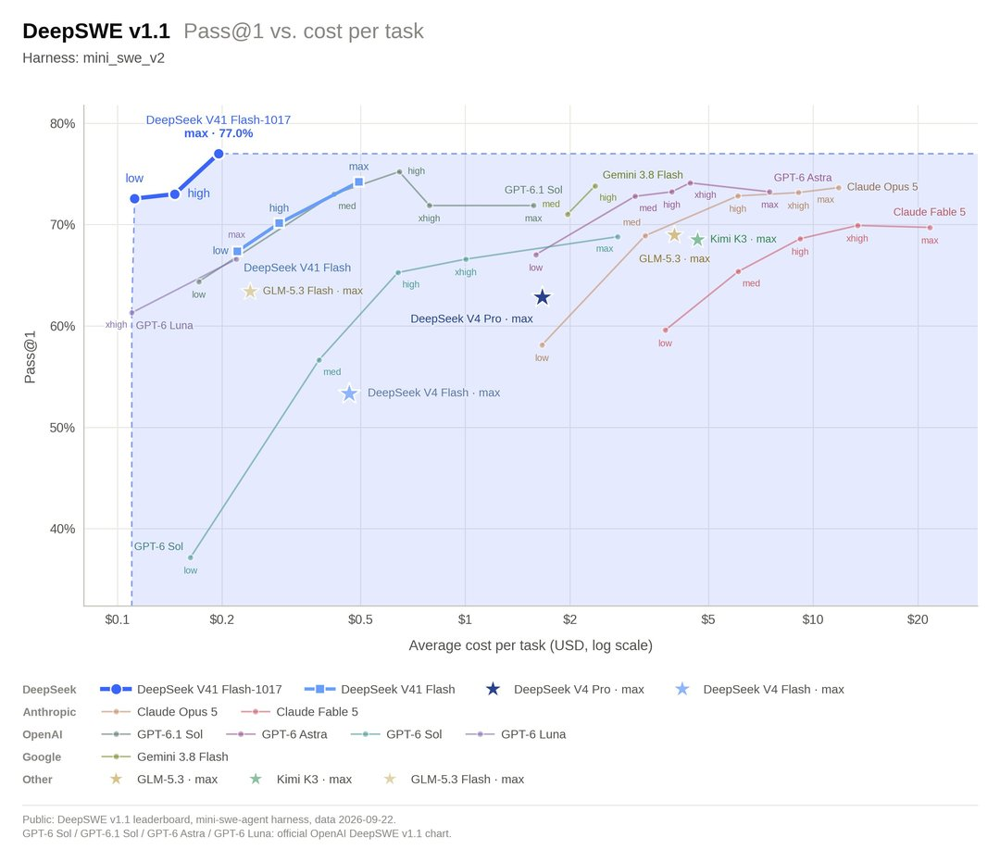

---

## 3

@文物医院

发表于：2026-10-17 16:04

来源：微博

链接：https://m.weibo.cn/status/5355159913500009

AI生成的城市微缩模型

---

## 4

@堂前萱草开

发表于：2026-10-15 01:29

来源：微博

链接：https://m.weibo.cn/status/5354214777686116

我觉得根本没有必要讨论因为六块钱发避雷帖应不应该。

我想知道的是，为什么这样一个无关痛痒的小帖子可以大肆推流，而其他的维权帖，比如钱被银行挪走了，或者自己买的车子质量出现问题，反而会被删帖禁言封号？

前几天看到一个人说，摊主之死说明，网络维权不该对着个人，太容易引发网暴，而个人是无力承担的。

但是这个是应该由个体来承担的责任么？是谁放纵对于个体的网暴，却精心管控着对于公司，机构，组织的维权。一边是摊主被避雷帖逼死，一边是平民维权者无法发声。

谁在放纵个体之间的互害？谁堵住了个体的发声渠道？

---

## 5

@歸藏的AI工具箱

发表于：2026-10-17 08:57

来源：微博

链接：https://m.weibo.cn/status/5355052489509064

Deepseek 发布了 V4.1 Flash 1017 版本

他这个 DeepSeek SWE V1.1 测评，他自己这个基准上这个图有点离谱了啊，完爆了所有模型！

整体能力再次大幅提升，同时缩短了模型的任务运行时间和输出长度，能以更低的成本完成同样的任务。

另外，他们这次着重强调了可以从零开始完成整个项目的开发：

不用人工干预，用非常简单的提示词就行，类似 OpenAI 5.5 这种一句话做个视频或一句话做个游戏。

还有一个比较重要的点是它开放了自研的搜索 API。

Deepseek 在国内信息数据的搜索结果上非常精准且强大，所以这个 API 挺有用的，可以给你的 Harness 配上

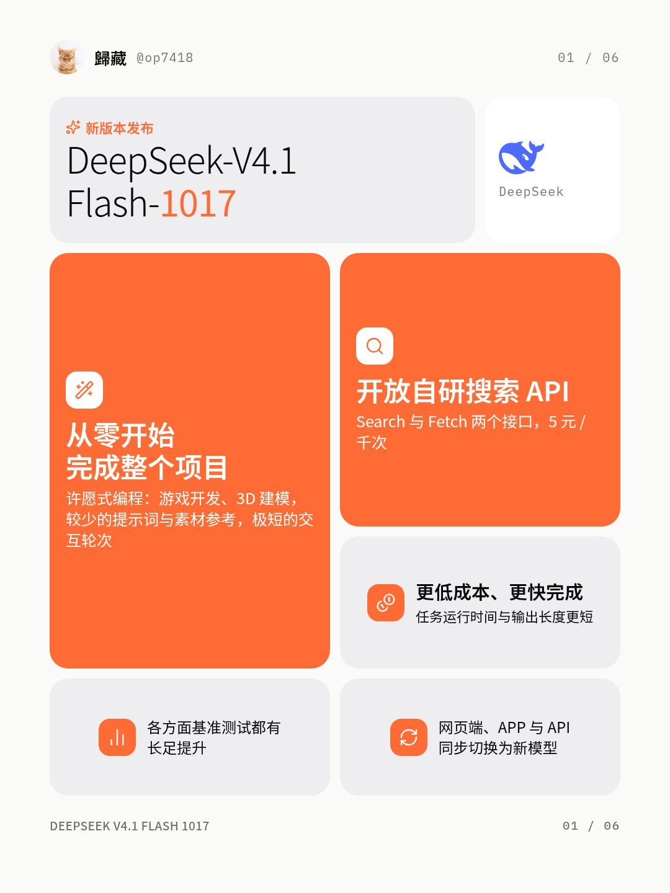

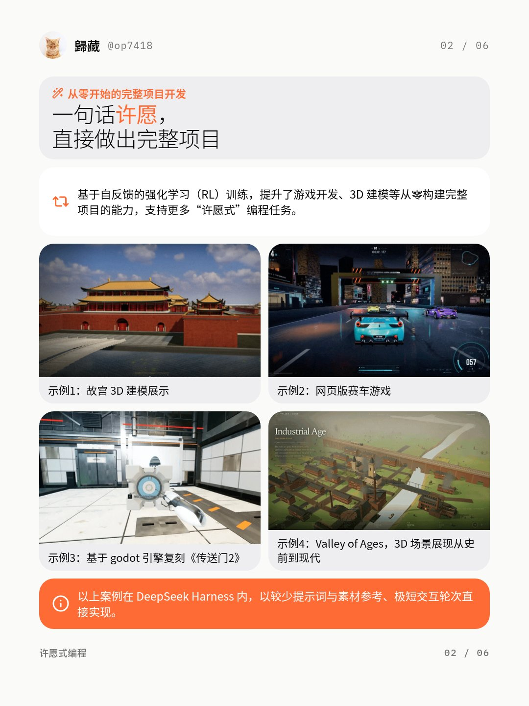

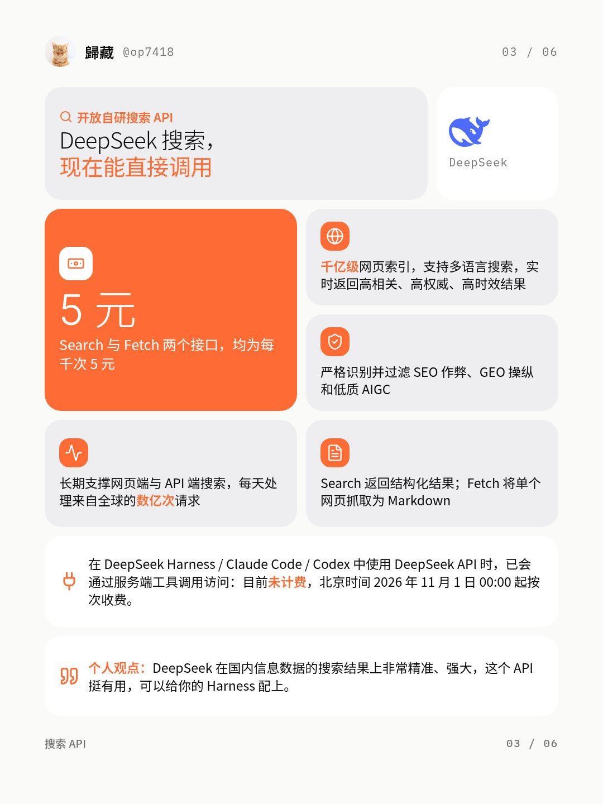

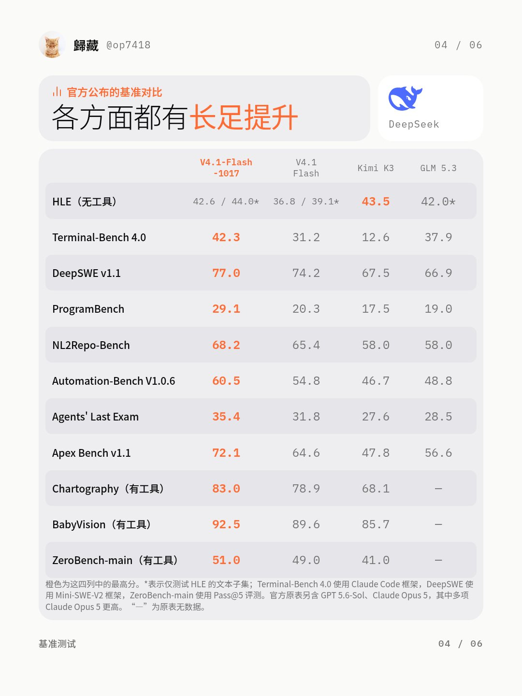

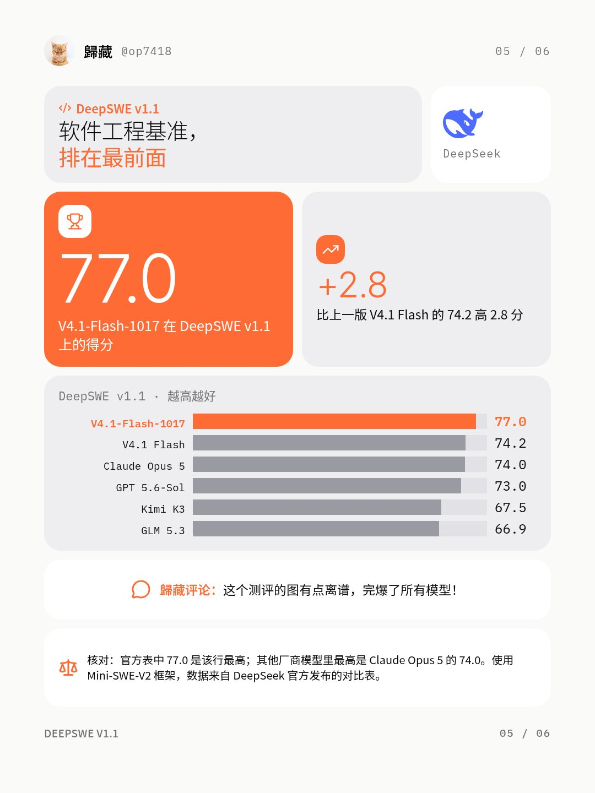

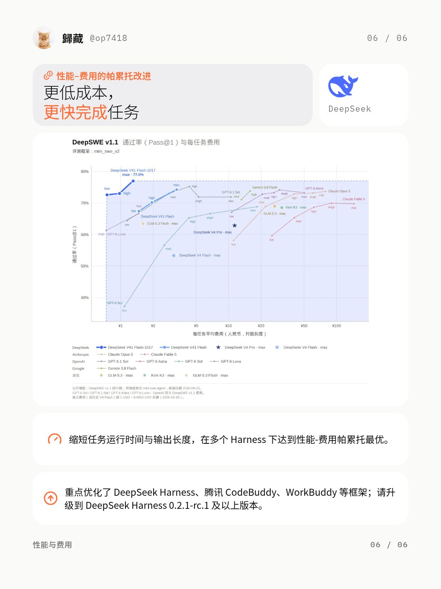

---

## 6

@杰尼龟说

发表于：2026-10-13 00:44

来源：微博

链接：https://m.weibo.cn/status/5353478667895056

已婚男士的忠告

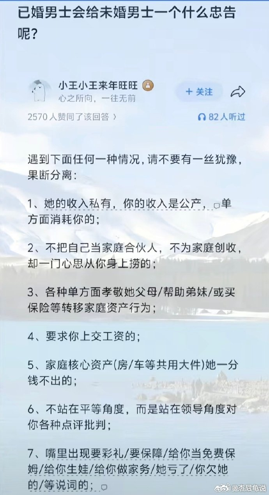

---

## 7

@_村西边老王_

发表于：2026-10-16 14:04

来源：微博

链接：https://m.weibo.cn/status/5354767197145756

很多人以为强势的女人只是性格强势，但其实这种性格强势还伴随着不承担责任的劣根性。也就是让你听她的，出了问题却怪你。而且性格强势的女人往往更加吝啬一毛不拔。可以说是垃圾中的战斗机。

---

## 8

@一起唱歌666

发表于：2026-10-16 14:04

来源：微博

链接：https://m.weibo.cn/status/5354767241975216

如何当好老丈人丈母娘？

        不管儿女，你总要准备准备。谁让你生的？

         一，颜值干预。

         二本小美女，比一个985四眼树墩子，好一百倍。颜值管理也很简单。不要近视眼，多喝牛奶长个子，皮肤不要长dou（华山医院皮肤科挺好的）

        二，积攒面积。

         能力有大小，机遇也不同。我还是建议亲家母多买一个小面积，留给姑娘傍身，以后也是个底气。

         三，学会说话。

         姑娘为人处世，要会让别人高兴。别人高兴了，就愿意帮忙，你日子就好过了。

          四，亲家母要是单身，也适当收拾一下。。我买单，包你满意。大不了，两家并一家。

---

## 9

@tombkeeper

发表于：2026-10-15 04:53

来源：微博

链接：https://m.weibo.cn/status/5354266351109875

以前说过，未来各国恐怕还是会选择《美丽新世界》而不是《1984》。

现在我比较肯定未来几年的 Soma 就是 AI 短剧。

---

## 10

@MingZh

发表于：2026-10-16 08:11

来源：微博

链接：https://m.weibo.cn/status/5354678515926525

为什么全世界都在加息，而中国却在减息，有金融大神科普一下吗？

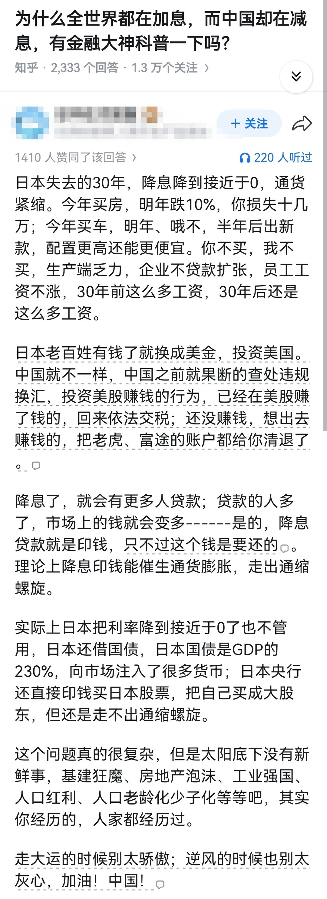

---

## 11

@高飞

发表于：2026-10-15 15:50

来源：微博

链接：https://m.weibo.cn/status/5354431551902457

\#模型时代\# Greg Isenberg：48 小时硅谷AI观察

我在旧金山待了48小时，见了不少亿万富翁、数据实验室，以及掌管着价值10亿至1000亿美元公司的AI创始人和高管。

以下是我的观察：

1. 听到了太多数据经纪人向AI实验室出售企业数据、每周赚进约200万美元的故事。我分不清这究竟是一个市场的开端，还是一场泡沫，也一直在想：还有哪些细分领域留有机会？我正在认真研究这件事。

2. 一次晚餐上，有人问在座的人：“如果下个月发布一个新模型，你的公司会变得更好，还是更糟？”半桌人都沉默了！我觉得，这是当下审视任何一家AI创业公司时，最值得问的问题。

3. 如今，人们挂在嘴边的目标是：12个月内做到10亿美元营收。我猜，这就是新的“独角兽”标准？但我很少听到有人谈留存。AI公司的收入来得快，去得也快。我觉得，接下来会看到不少营收惊人、留存却糟糕透顶的AI公司。

4. 很明显，我们正在经历计算机的重新发明。模型是CPU，harness（承载模型运行、调用工具和执行任务的框架）是操作系统，技能和插件则是应用。沿着这个思路看，更容易发现还有哪些空白值得填补。

5. 也许再过12个月，就会出现这样的智能体：观察你工作一周，然后无需任何指令，就能接手你的工作。屏幕录制、智能体记忆与本地模型结合起来，如今已经让这件事在技术上成为可能。

6. 智能体harness给我的感觉，很像新一代“GPT套壳”，这里说的是积极意义上的，尤其是面向垂直行业的产品。我聊到的优秀团队，都把模型视为可替换的部件。一位创始人向我展示了他们如何给不同任务分配不同模型：一个负责审美和视觉，一个更便宜的模型处理日常任务，另一个负责文本。

    他们优先使用可以跨模型迁移的提示词，而非依赖微调。测试输出效果时，他们会做A/B测试，观察用户实际如何使用结果：会不会修改、导出或分享？面向垂直行业的harness，基本由四部分构成：接入行业数据的连接器、由真正懂业务的人编写的评测、限定智能体操作权限的规则，以及供人审核结果的简洁界面。模型可能只占其中的20%。

7. 逆向工程和克隆软件的现象，比我以往见过的任何时候都多。人们正在反编译软件，再用智能体把它重建出来。有人向我展示了一整套大约10款应用的开源克隆版，全是他做的，而这些应用的原版每款都价值50亿美元以上。当软件变得如此容易复制，这究竟意味着什么？我和其他人都还在琢磨。

8. 我的判断是，价值会向数据转移。如果软件可以迅速重建，那么一家传统SaaS公司真正值得付费购买的，便是其中积累多年的客户数据和业务流程。有些SaaS公司，实际上是藏在软件外壳里的数据公司。

    这让我开始思考，该如何准确评估这些SaaS公司的数据价值。举个例子，假设我们过去按年度经常性收入（ARR）的两倍，收购那些走向衰落的SaaS公司，也许现在应该寻找更合适的估值指标。我还没有答案，只是把想法说出来。

9. 我感觉，相当一部分传统软件恐怕撑不到智能体时代，尤其是那些围绕用户在大量页面之间反复点击而设计的软件。

10. 我聊到的每家公司，都想把内部数据汇集到一处，再通过MCP（模型上下文协议）接入智能体。但真正查看数据时，他们才发现里面一团糟：同一个客户有五个版本的记录，过时的Slack频道堆在那里，还有根本无法检索的PDF。帮助企业清理这些数据，感觉会是一门很有空间的咨询生意！

11. 很多创始人正在为智能体开发基础组件，比如API、数据层和工具。我看到的一些公司，产品几乎没有用户界面，因为主要用户就是智能体。我非常看好为这个时代提供基础组件的创业公司。把它们理解为供智能体使用的“积木”，最为贴切。

12. AI实验室可以获得大量训练数据，但很难拿到智能体在企业内部执行任务失败的真实案例。谁掌握了这些日志，谁就拥有一项宝贵的资产。

13. 一位掌管大型消费互联网公司的人告诉我，下一场竞争将围绕记忆展开。最了解你、记得最多的模型会胜出，模型是否最聪明，没有人们想象中那么重要。

14. 物理AI被反复提起。我印象中，Astra是第一个让大家意识到AI真的能做计算机辅助设计（CAD）的模型。很多人也开始思考，“凭想法就能制造产品”的vibe manufacturing，究竟会是什么样子。一位机器人创始人的话一直留在我脑海里：“如今AI最难的问题，已经是部署问题，而非研究问题。”他们的机器人平时自主工作，遇到困难就呼叫人类，而每一次求助都会成为训练数据。

15. 网络安全公司正迎来好时候，如今做这类公司也确实很酷，尤其是那些负责安全事件发生后处置与恢复的公司。每一个能够访问企业系统的智能体，都为外部进入公司打开了一扇新门，而其中不少门就那么敞着。

16. 有些创业公司如今关掉后的价值，甚至比继续经营还高。一家已经停业的公司，如果保留了五年的Slack记录、邮件和代码，就可以通过授权使用这些资料获得收入。如果创始人开始把这笔潜在收益纳入关停时机的考虑，我一点也不会意外。

17. 人们开始讨论，如何在以智能体为主要用户的互联网上赚钱。感觉还处于非常早期的阶段，但如果互联网最主要的使用者变成了智能体，我们应该创办什么样的公司？

18. 我觉得，智能体保险快要出现了。一旦智能体犯下代价高昂的错误，保险公司在承保前，就会要求进行审计。

19. 好几个人说，他们最想招到的是有品位、又会编写评测的人。模型越来越擅长生成创意，难点因此转向了判断哪些创意真正出色。

20. 我观察到一个新趋势：创业公司拿到风投资金后，用这笔钱把创始人打造成内容创作者；公司创业失败，创始人便转做全职内容创作，再靠自有资金孵化其他产品。

21. 现在，想要获得足够大规模的用户触达，真的很难。为了吸引注意，创始人们在公交车上投广告，疯狂购买户外广告牌，还请知名DJ来办派对。这一点颇有当年互联网泡沫时代的味道。

稀缺的是注意力！Wispr Flow那位负责增长的人，因为分享用户生成内容（UGC）策略而走红，就是个很好的例子。人人都想知道其中的诀窍。我甚至觉得，在这个时代，真正懂得如何高效地把这类业务做大的人，全世界可能只有50个。

每次去旧金山，感受一下那里的氛围，总有收获。能在创业如此精彩的时期经历这样一趟旅程，我觉得自己非常幸运。很多时刻都让人觉得不太真实。

很高兴回到家，继续埋头做事。

下次再见！

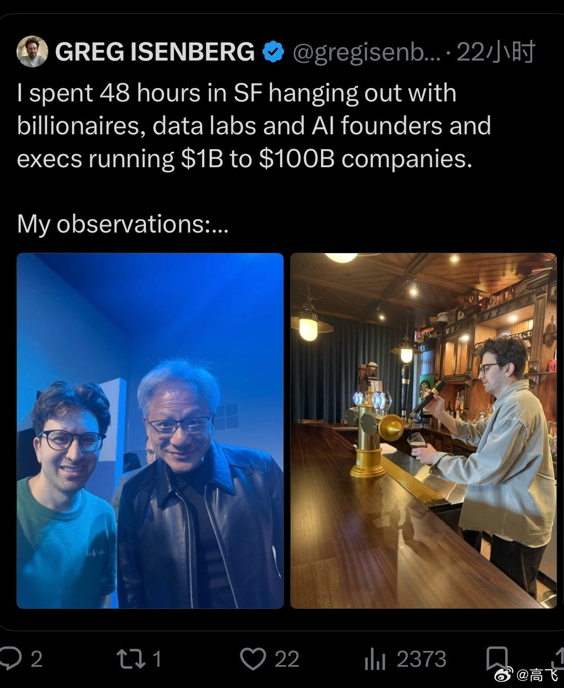

---

## 12

@何新老家伙

发表于：

来源：微博

链接：https://m.weibo.cn/status/5120832282296931

阴谋论偶感：电诈体制是现代版的新奴隶制度

电诈园体系的本质是典型的人身奴隶制度。

我一些年前曾经警示，未来人类前景，绝对不是各路公知描绘的自由民主经济繁荣的美丽新世界。有一种控制人类社会的暗黑资本力量Deep states，已经在试验各种方法，第一是要大规模地减少地球人口。第二是正在局部地区实验建立一种新奴隶制度的社会体制。

东南亚层出不穷的所谓电诈事件，以及被湮灭在欧美暗黑空间中的萝莉岛受虐童男童女事件，都不是简单碎片化的刑事案件，这是有组织  成体系的一条产业链，同时也是一种以直接暴力对于人性的毁灭和重塑，目标就是在实验建立现代奴隶制度体制。

近年这个世界所发生的一切诡异故事，可以认为是一种早期实验。人类正在适应以及麻木。

---

## 13

@海兰珠阿婶

发表于：2026-10-15 17:32

来源：微博

链接：https://m.weibo.cn/status/5354457147638435

？？？？？？？啥，这么逆天

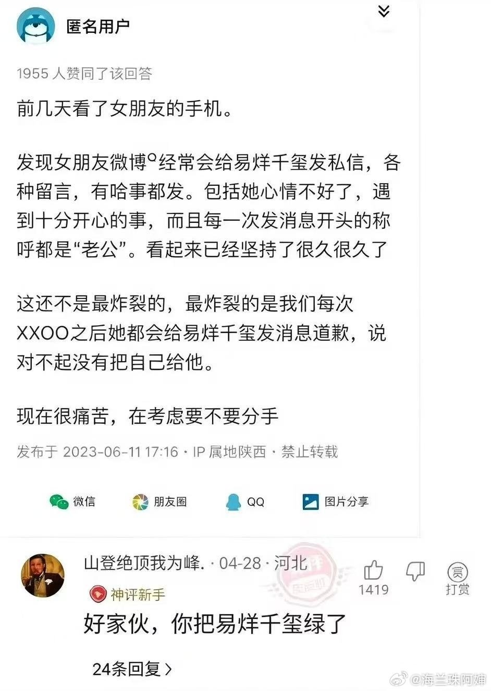

---

## 14

@宝玉xp

发表于：2026-10-15 17:39

来源：微博

链接：https://m.weibo.cn/status/5354459065483928

Meta 发布开放权重模型 Muse Spark Open：免费下载能商用，本地跑要两台 512GB 内存的 Mac Studio

Meta 10 月 15 日发布 Muse Spark Open，模型权重可以直接下载，按 Muse Model License 免费使用，商用也行。Meta 称它是“迄今最强的美国开放权重模型”。

Muse 系列推出以来，主力模型 Muse Spark 和三天前发布的 Muse Wonder 都只能通过 Meta 的产品和 API 用，开放权重的只有小模型 Muse Glimmer。这是 Meta 第一次放出大尺寸 Muse 模型的权重。

模型总共 8160 亿参数，处理每个 Token 只动用其中 420 亿，这种结构叫混合专家（MoE），算得快，但整个模型还是要全部装进内存。上下文 100 万 Token，能读文字、图片、视频和音频，输出文字，主打写代码和让 AI 长时间自己干活。

【能不能下载，能不能商用】

能下载。Hugging Face、亚马逊 SageMaker、Google Cloud Model Garden 和微软 Foundry 都提供权重。Hugging Face 上要先登录填申请表，写真实姓名、出生日期和完整机构名称，提交后不能改。

能商用。许可证允许使用、修改、微调、蒸馏（用它的输出训练别的模型）、再分发和出售，不收费。条件有三条。

第一，用了它的产品要在界面、文档、网站或设置菜单里显著标出“Built with Muse Spark Open”。

第二，遵守附带的使用政策：不能用于军事、武器、关键基础设施等高风险用途，不能在没有执业资格时提供金融、法律、医疗专业服务，也不面向 18 岁以下用户。

第三，卖模型接口的大公司要单独签协议。具体是：你把它或基于它改的模型通过 API 之类的方式卖给别人调用，而你的公司连同关联公司过去 12 个月总营收超过 2000 万美元，就要先通知 Meta、另签协议。算的是公司总营收，不只是这项业务的收入。

把它嵌进自己的 App 做功能、公司内部用、做研究，都不受第三条限制，公司多大都一样。Llama 当年的许可证门槛是月活 7 亿用户，这次换成了针对模型接口生意的营收门槛。

【普通电脑能不能跑】

跑不了。模型卡写的要求是：压缩到英伟达 4 位精度格式 NVFP4 的版本至少要 700GB 显存，原始 BF16 版本要 2TB。

Meta 说它针对两台 M5 Ultra Mac Studio 做了优化：每台最多 512GB 统一内存，两台连起来凑出 1TB，用苹果的 MLX 框架运行。官方没写在 Mac 上跑的是哪个压缩版本，也没给速度。

有服务器的开发者，SGLang、vLLM、TensorRT-LLM、llama.cpp 等主流推理框架都能跑，也可以用 PyTorch 和 TorchTitan 微调。

没有这种硬件，就调 API：Baseten、Fireworks AI、Groq、Modal、Nebius、OpenRouter、Together AI 提供接口，价格由各平台定，Meta 没公布。

【和其他模型比怎么样】

Meta 只拿它和开放权重模型比：美国的 Inkling（前 OpenAI CTO Mira Murati 创办的 Thinking Machines 出品）和英伟达 Nemotron 3 Ultra，法国的 Mistral Large 4，中国的通义千问 Qwen3.8、智谱 GLM 5.3、月之暗面 Kimi K3。以下成绩都来自 Meta 的模型卡。

第三方机构 Artificial Analysis 的综合智能指数，Muse Spark Open 39 分，Inkling 26，Nemotron 3 Ultra 23，“美国最强”说的是这一层。放到全部开放权重模型里，它低于 GLM 5.3 的 45 和 Kimi K3 的 44，和 Qwen3.8 的 40 接近。Artificial Analysis 开源榜目前排第一的是小米 MiMo-V2.6-Pro，46 分，Meta 的对比表里没有它。

单项领先的是调用工具和难题推理：测模型通过 MCP 协议调外部工具完成任务的 MCP-Atlas，89.2 分，对手最高 84.5；不借助工具做“人类最后的考试”（HLE，一套极难的跨学科考题），26.1 分，对手最高 22.2。

写代码偏弱：命令行任务 Terminal-Bench 76.4 分，Kimi K3 85.0、GLM 5.3 83.9；软件工程任务 DeepSWE 60 分，Kimi K3 68、GLM 5.3 67。

最突出的是防越狱。StrongREJECT 测的是模型被人诱导时会不会输出有害内容，分数越低越安全，它是 0.5 分，其他模型都在 60 分以上。Meta 说开放权重版额外做了安全训练。

和自家闭源模型比，Meta 三天前引用的 Artificial Analysis 数据里，Muse Wonder 52 分，Muse Wonder Full 56 分，Muse Spark Open 低一截。

原文：网页链接

官方博客：网页链接

模型卡：网页链接

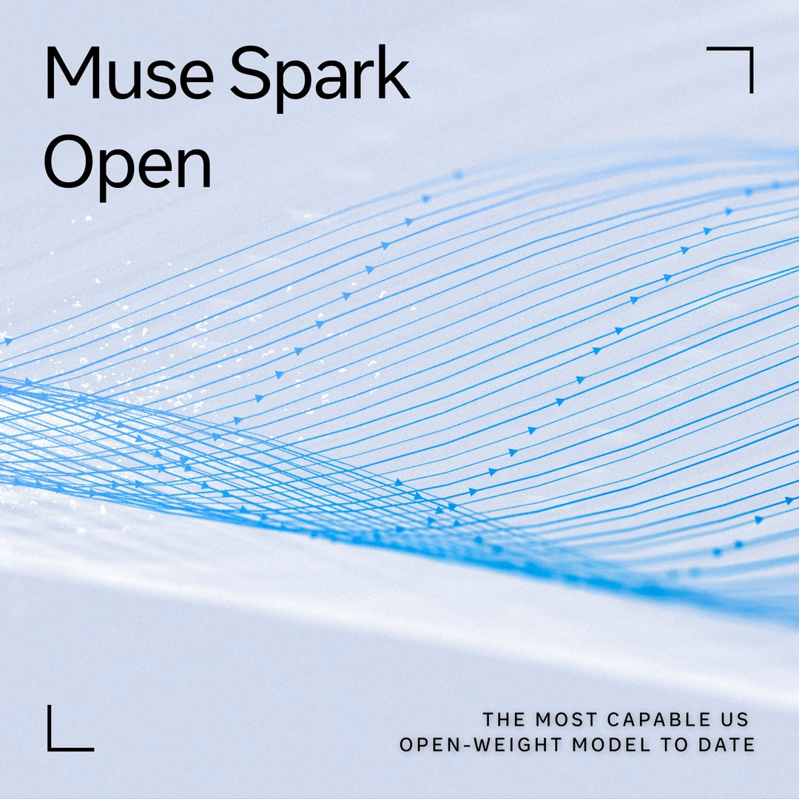

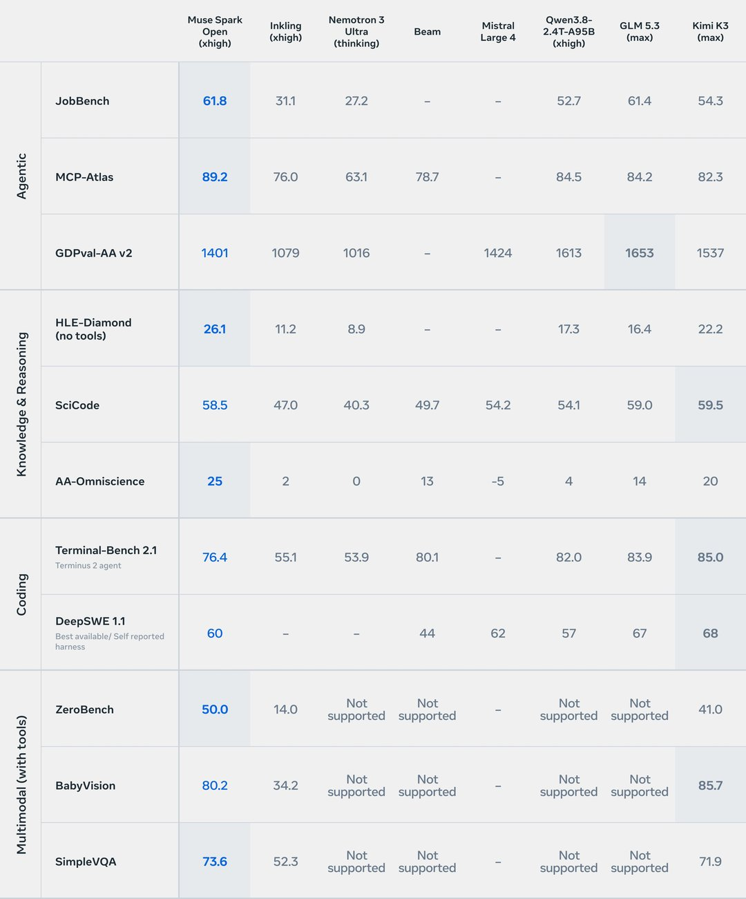

---

## 15

@宝玉xp

发表于：2026-10-15 18:41

来源：微博

链接：https://m.weibo.cn/status/5354474711548479

Cheng Lou 开源 Handwired：手写权重，把程序逻辑变成不用训练的神经网络

Midjourney 工程师、前 React 核心团队成员 Cheng Lou 开源了一个自称“玩具项目”的 Handwired：把程序里的 if-else 和循环改写成神经网络的权重。权重是手写的，不用训练，输出和对应的 JavaScript 程序完全一致，在浏览器里就能跑。

原理一行代码就能讲清。比如 result = a > 4 ? 10 : 12，在 a 是整数时可以改写成：

above4 = relu(a - 4) - relu(a - 5)

result = above4 × 10 + (1 - above4) × 12

relu 就是 Math.max(0, x)，神经网络里最常见的激活函数。a 大于 4 时 above4 正好是 1，否则是 0。两个分支都算出来，再用它挑一个。神经网络本质上就是一堆乘法、加法加上 relu，所以程序里的判断和分支，都能收进一个大矩阵乘法里。

很多人会问，神经网络的输出不是带概率、不精确吗？Cheng Lou 的回答是：训练出来的才这样，按程序逻辑手写的权重，同样的输入永远得到同样的输出。

他放了三个 demo。

第一个是 Mini OS，一个有三个窗口和程序坞的小桌面，拖动、缩放、层叠、滚动、文字输入、动画都有。打开浏览器开发者工具看，页面就是普通的网页元素，没有大模型，也没有扩散模型。驱动它的是一个 130 层、9909 个权重的“神经网络”，训练次数为零，在浏览器里用 CPU 实时计算。

第二个是实时搜索 10 万份 JSON 文档，每敲一个键重搜一遍。正则匹配、JSON 解析、高亮全是这种手写网络，再转成 WebGPU 代码放到显卡上并行跑。项目文档里的实测（Apple M5 Max + Chrome）：每次搜索 11 到 15 毫秒；浏览器自带的正则引擎一般 8 到 28 毫秒，遇到容易回溯的写法要 2 秒多。文档写明两者谁快说不准，所以页面把两个时间都列出来。浏览器不支持 WebGPU 时会退回 CPU，搜一遍要 13 秒。

第三个是会“学习”的相册。整个程序可微分，也就是能用训练神经网络的反向传播来调参数。你在左边画几个矩形当草图，右边的照片布局由一个小网络算出，它的 244 个参数随着你拖动实时训练。损失函数里加了一项对齐惩罚，照片会自己往一条线上靠，没有任何代码专门去对齐它们。参数很少，训练全在 JavaScript 里跑。

Cheng Lou 还设想，把一段 Handwired 程序接到 nanoGPT（Andrej Karpathy 的一个小型 GPT 训练项目）这样的模型上一起训练，模型既能写莎士比亚，又能精确执行那段程序。这个目前只是 README 里的设想，仓库里没有现成实现。

代码以 MIT 许可开源，demo 直接在网页上打开就能玩。想自己写，需要装 Bun，克隆仓库后从 template 目录的开关按钮示例开始，文档里有完整教程。

推文说“把普通 JS 代码变成神经网络”，容易让人以为能把现成代码丢进去自动转换。项目文档写的是：没有工具能把已有的 JavaScript 源码转成网络。你要用它提供的构建函数，把逻辑一句句写成比较、选择、加权求和这类操作。网络每次都要把所有操作跑一遍，不能提前退出，也不能跑运行时才知道次数的循环，所以常见的循环得改写成计数、树形合并之类的结构，文档专门用一章讲怎么改。所有数都是 32 位浮点数，每个值的取值范围要事先声明。

项目主页：网页链接

GitHub：网页链接

原推文：网页链接 宝玉xp的微博视频

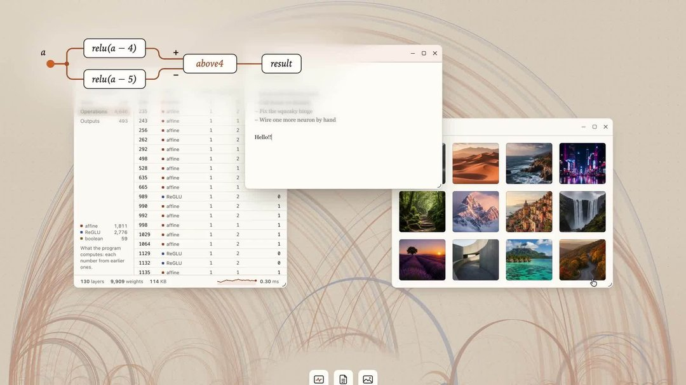

---

## 16

@i陆三金

发表于：2026-10-13 13:32

来源：微博

链接：https://m.weibo.cn/status/5353672147731700

这个真可以，作者用 Opus 5.5、Tripo、Blender 搓了一个非常精细的小王子 3D 场景

推特：x.com/Saccc_c/status/2109962425512734739

游戏：littleprince.dev i陆三金的微博视频

---

## 17

@朴实太太

发表于：2026-10-15 00:42

来源：微博

链接：https://m.weibo.cn/status/5354203184628182

我认识一个日本姐姐也是经常这样出国旅行。我们听她说她男朋友飞夏威夷过一个周末又回东京上班都觉得很不可思议。机票很贵、要飞8个多小时（东京飞檀香山），只是去一个周末？？我们的认知好像是必须要8天10天才敢飞远一点的地方玩。可是啊，人生其实并没有那么多“长假”，我们总是等一个合适的长假才出远门，等来等去，结果就是去的地方很少。我现在觉得像日本人那样，有假就走，很好啊，总好过我大部分时间被困在亚洲。不过图四的中国台湾人真的大惊小怪，去台北住两晚很够了好吗！！！

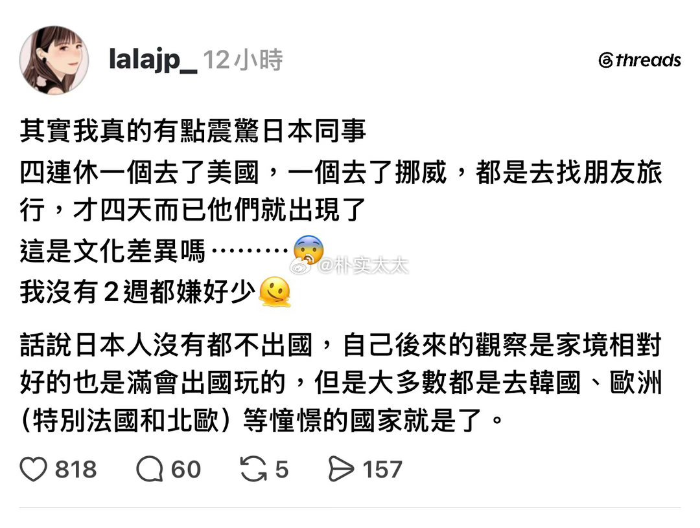

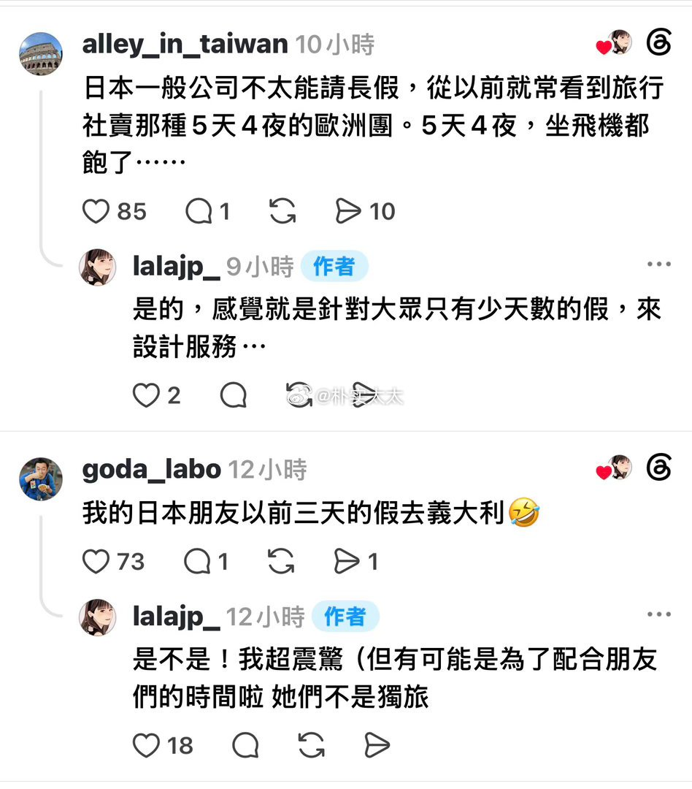

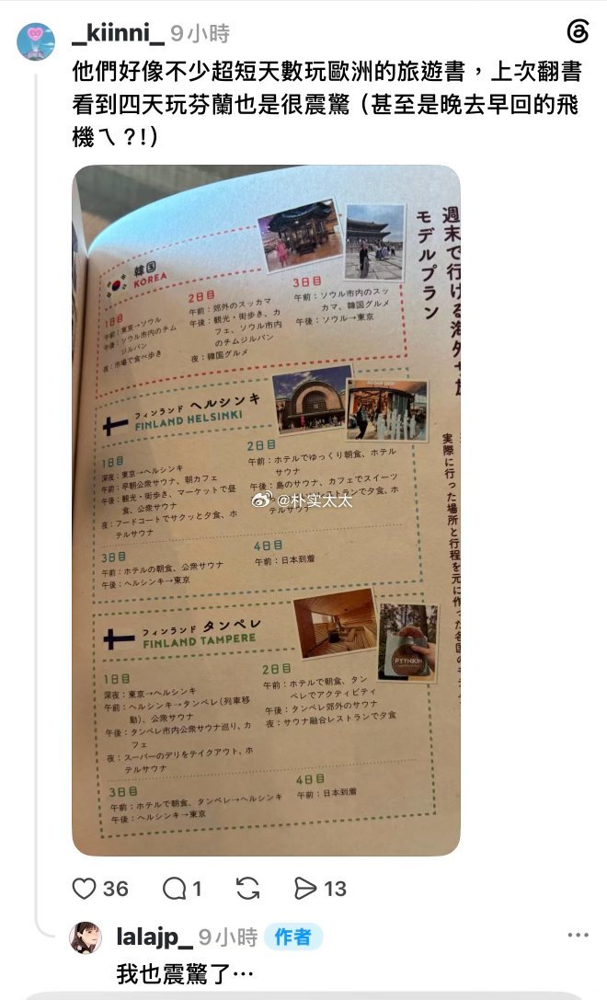

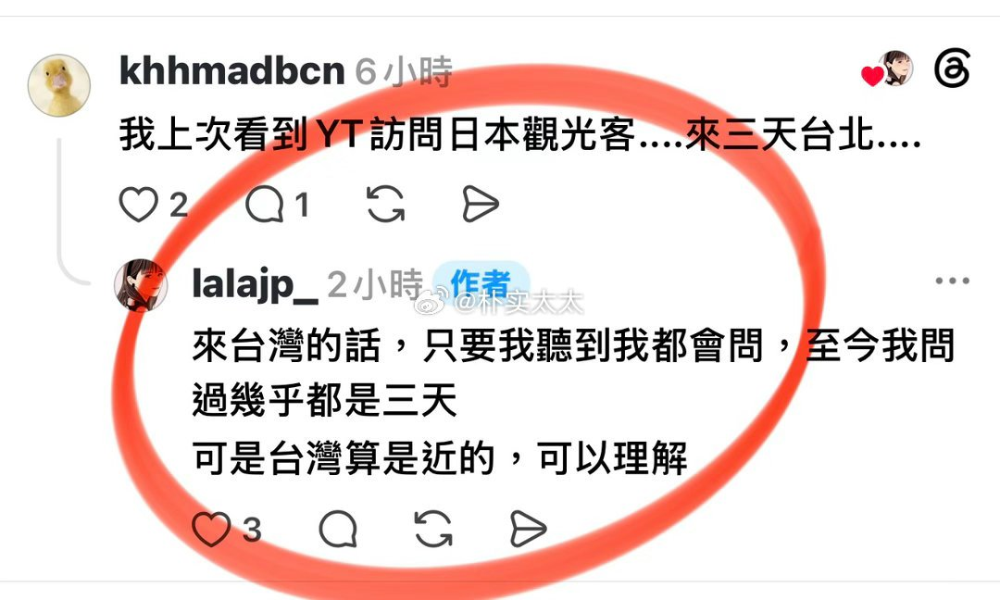

---

## 18

@观察者网

发表于：2026-10-15 04:20

来源：微博

链接：https://m.weibo.cn/status/5354257802592727

\#平台为何没拦住炸串摊主遭受的网暴\# \#消费纠纷为何让普通人承受如此重压\#【炸串摊主遭差评后轻生：一场消费纠纷，为什么让普通人承受如此重压？】一场关于炸菜分量的争执，最终与一名普通劳动者的死亡联系在了一起。

据媒体报道，四川宜宾高县33岁的摊主胡女士，在顾客跨平台发布差评、相关评论区出现大量负面评价后，于10月9日轻生离世。当地警方正在调查此事。

为什么一场普通消费纠纷，会让当事人承受如此沉重的压力？当争议进入互联网，普通人的求助和退出渠道，究竟在哪里？

胡女士的丈夫介绍，夫妻俩已经摆摊四年多。胡女士生前表示，小摊经营压力大，“每天睡眠不足6小时”，接连出现的负面评论让她感到遭遇了网暴。

对小本经营者来说，面对一条差评，他们的脑子里可能瞬间冒出很多念头——“以后的顾客会不会相信”“这门生意还能不能做下去”。这种担忧，不能用一句“做生意就要受得了批评”打发。

有人说，“碰到不符合事实的评价，自己澄清就好了”。此类声音忽略了澄清的成本，一个把大部分时间用于谋生的人，还有多少精力处理不断到来的质疑？回应一次争议，可能需要持续搜集证据、解释误解，具体到此事中，这位顾客在多平台发差评，那摊主还要去多平台回应，她一天连6小时都睡不够啊。

据中国新闻周刊报道，这位顾客在社交平台上发文称：“避雷某某铜锅洋芋，老板娘玩不起，嫌菜堆高了就不给加土豆。10块钱一份的炸菜，堆得多了就不让夹菜了。我买一份肯定要吃饱啊，玩不起开什么店子呢？后面直接就不给加土豆了，两份都没有加土豆，一脸高傲的样子，搞得好像谁欠你一样。” 随后，在相关贴文评论区出现了大量针对摊主的差评，胡女士曾在评论区回复解释。

摊主丈夫则解释，自选菜夹得多，添加的土豆就少，分量特别多时无法再加。胡女士曾公开表示，提供给该顾客的“两份炸菜份量对得起天地良心”。

消费者当然可以认为分量不足、服务不好。不能因为发生悲剧，就倒推出不该有差评，不然正常监督的空间何在？

然而表达不满应该对其方式负责。可以指出“没有加土豆”，但质问对方配不配开店则是另一个层面的话语。《河南商报》14日报道，涉事顾客也曾发文回应，称自己同样深感遗憾，但自己发布的仅是真实消费体验评价，不存在恶意，也没有煽动或捏造事实，不应因悲剧发生而遭到全网审判。目前，该内容已不可见。

这是顾客对自身行为的解释，其中关于事实与责任的争议仍应交由调查厘清。但她所谓“不应因悲剧发生而遭到全网审判”，放到轻生的摊主身上也适用，她只是正常做生意，突然就遭受了超出消费纠纷范围的公开指责，还要面对大量针对性的差评，甚至连自己是否适合开店、如何待人，都要面临“审判”。不能等到围攻落在自己身上，才意识到公开表达需要边界。

而这条边界肯定不可能靠网民自觉维护。争议经由平台传播，平台应当把下列问题交代清楚：相关内容在事发前获得了多少曝光，其中有多少来自系统推荐？评论中是否出现辱骂、造谣或集中攻击？当事人是否求助，平台又作何回应？

不能只让顾客和摊主站在聚光灯下，掌握传播数据、制定分发规则的平台，是否放大了冲突、有没有及时识别风险，都应当成为调查的内容。

《网络暴力信息治理规定》要求网络信息服务提供者建立健全网络暴力信息预警模型、发现存在网络暴力信息风险的，应当及时回应社会关切，引导用户文明互动、理性表达。还要求网络信息服务提供者加强对跟帖评论信息内容的管理、建立健全网络暴力信息防护功能、发现用户面临网络暴力信息风险的，应当及时通过显著方式提示用户，告知用户可以采取的防护措施。

本案中，平台是否存在履责不足？保护机制有没有抵达一个普通摊主？倘若当事人必须逐条截图反复申诉，甚至等到事情登上热搜，才有机会获得有效回应，那么保护的门槛就太高了。越是疲于谋生的人，越可能难以跨过这道门槛。

再往深处看，普通人需要应付的社会压力，在互联网时代大大增加了。一场发生在摊位前的争执，在以前可能只是几句口角的事儿，而互联网平台不仅会放大影响，还能吸引无关之人持续评价。这种压力不能简单按评论条数计算，普通网民留个言就走了，被评论者的整个工作生活却可能被争议占据，双方投入的时间和承担的后果都不对等。

随着AI时代的到来，这种不对等还有加剧的风险。澳大利亚网络安全监管机构eSafety曾警示，生成式AI可能被用于规模化制造辱骂、骚扰，并结合文字、音频与图像放大骚扰造成的伤害。

攻击性的内容生成得愈来愈快、愈来愈强，而受害者的防御力和维权的精力，却不会相应增加。将这种差距交给个人消化，无异于要求普通人用有限的身心，承担持续加强的维权成本。

面对不断复杂化的传播环境，普通人确实需要更强大的心理韧性，既要有自我消化的能力，也要善于保护自己、远离争议。这些心理训练未来或许也值得纳入基础教育中，在一定程度上提高所有人的应对、承受能力。

但“大心脏”不能成为正常工作、做生意的入场券，大部分人现在并没有那么强的心理承受能力，回应合理批评的能力可以锻炼，阻止恶意攻击的渠道入口也应该清楚明白。

对这场悲剧的反思，最终还是应当落在具体的问题上，在争议加剧时，平台能否尽早介入？发现恶意攻击时可否尽快阻断？其防护和求助机制真正管用吗？面对升级的形势，有升级的应对手段吗？

不能让疲于谋生的百姓，独自承受不断加码的精神压力。

---

## 19

@庄时利和

发表于：2026-10-15 04:06

来源：微博

链接：https://m.weibo.cn/status/5354254304280907

为啥跑步猝死，大多数都是男的？

马拉松的数据，男性的猝死风险是女性的6倍（已按参赛人数做了换算）。有朋友好奇原因是什么，最主要的就是中年男性的冠心病，被长时间高强度运动诱发。

中国男性的冠心病普遍比女性早发病7~9年，这一方面是与女性绝经前雌激素的保护作用有关，另外一方面与男性更差的生活习惯导致更重的危险因素相关，包括吸烟、高血压和血脂异常等。

所以这也部分解释了另外一个问题，为什么大家这几年看到的企业家心源性猝死，几乎都男性。

这里并不是说跑步不好，相反慢跑对大多数人来说都是一项健康的运动，可以但一定要知道自己的身体极限在哪里。对心脏要做哪些检查，可以参考图3。

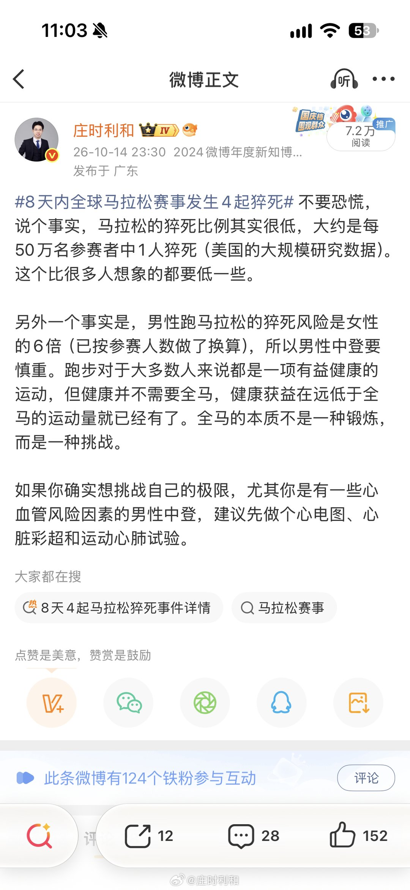

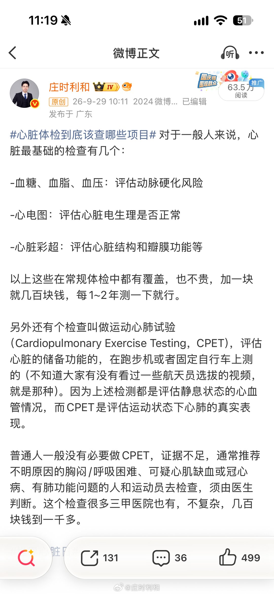

