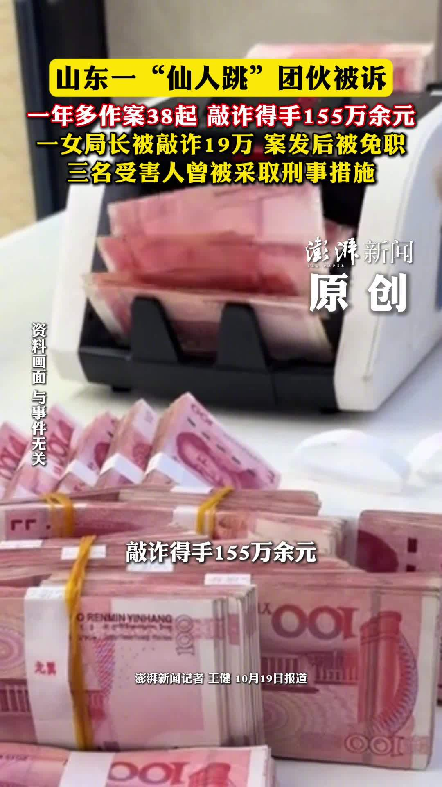
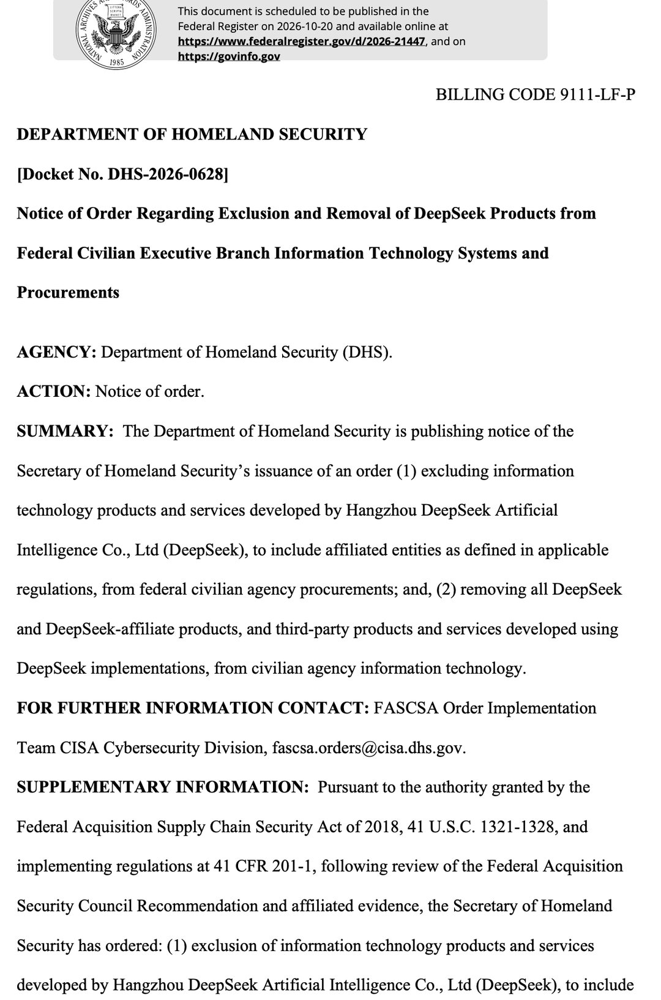

# 2026-10-20

## 1

@澎湃新闻

发表于：2026-10-19 03:49

来源：微博

链接：https://m.weibo.cn/status/5355699601408597

【\#仙人跳后报警被强奸多名受害人被抓\#】\#仙人跳后报警称被强奸威胁受害人\#一个以“00”后为主要成员、包括多名在校大学生在内的犯罪团伙，在短短一年多时间内，先后实施“仙人跳”38起，敲诈得手155万余元。其中，有三人因识破敲诈拒不支付钱款，“仙人跳”团伙成员报警后，该三名受害人被采取刑事强制措施。

山东省泰安市泰山区检察院起诉书显示，为加强对成员的控制，生于2001年的主犯陈某在敲诈得款后，以“洗钱”为由将犯罪所得资金集中统一支配。同时，陈某还伙同他人向部分成员提供“放贷”或“借款”，以此捆绑并驱使该部分成员持续实施犯罪。

期间，陈某为成员支付住宿、餐饮、整容、酒吧消费等费用，展示其经济实力，以达到激励与控制成员的双重目的，逐步形成以陈某为纠集者的13人恶势力犯罪团伙。

目前，该团伙已被起诉至法院。10月18日，一名受害人告诉澎湃，2026年3月开庭时他参加庭审了，法庭审理了4天，但目前尚未宣判。另一名受害人表示，他也收到了开庭通知，但他因有其他事情，未能旁听。这两名受害人均曾因“仙人跳”陷入刑案，最终检方以不构成犯罪为由，对他们不予起诉。

起诉书显示，这个团伙实施的第一起“仙人跳”案发生在2023年10月19日。被告人陈某、张某语（生于2006年6月）预谋后，由张某语假装醉酒引诱被害人欧某在济南一酒店发生性关系。后陈某、张某语以强奸未成年人为由报警相威胁，迫使欧某交付10万元。

此后至2025年1月，该团伙在短短一年多时间内，共实施“仙人跳”案件38起，其中8起因受害人意识到是敲诈勒索，未支付钱款。单笔敲诈金额最大的是15万元，最少的是1000元。

2025年1月3日，被告人陈某、王某霖、马某扬预谋后，由马某扬假装醉酒引诱被害人刘某在泰安市某酒店房间内发生性关系。王某霖、陈某分别扮演马某扬的闺蜜、闺蜜男友，以马某扬被强奸为由报警相威胁，向刘某索要20万元。刘某交付10万元后，陈某、马某扬又以发生关系后下体长痘为由，索要金额增加至30万元。

刘某因无力支付余款而报警，公安机关立案侦查，由此案发。

在实施“仙人跳”过程中，被告人还曾多次真报警以威胁受害人。

2023年11月28日，被告人陈某、张某语、程某婷预谋后，由张某语假装醉酒引诱被害人徐某在其家中发生性关系。后陈某、程某婷分别扮演张某语的哥哥、嫂子以张某语被强奸为由报警相威胁，致使徐某报警。双方到达派出所后被告人称未发生强奸，但离开后陈某等三人又继续向徐某索要并得款2000元。

2024年3月22日，被告人陈某、杜某琪、张某语预谋后，由张某语假装醉酒引诱被害人何某在泰安市一酒店内发生性关系，张某语随即报警称被何某强奸。陈某、杜某琪得知报警后建立了三人微信群，教授张某语如何应对公安问询，后张某语到公安机关虚假陈述，致何某被立案侦查并被采取强制措施。

2024年5月22日，被告人陈某、杜某琪、孙某怡预谋后，由孙某怡假装醉酒引诱被害人许某在泰安市一公寓内发生性关系，孙某怡随即报警称被强奸，并向公安机关虚假陈述。公安机关立案并对许某采取强制措施，期间许某家属向孙某怡、杜某琪交付10万元达成赔偿谅解，二人又将该款交予陈某。

2024年6月4日，被告人陈某、孙某怡、单某某（15周岁）预谋后，由单某某假装醉酒引诱被害人刘某在济南市一酒店内发生性关系。陈某、孙某怡分别扮演单某某的哥哥、嫂子，以强奸未成年人为由报警致刘某报警。公安机关受理后，刘某向单某某家属交付5万元达成和解。

2024年10月11日，被告人孙某怡、王某霖预谋后，由王某霖假装醉酒引诱被害人赵某在泰安市一酒店内发生性关系，王某霖随即报警称被强奸，公安机关立案侦查并对赵某采取强制措施，期间赵某家属与王某霖、孙某怡就赔偿金额协商，未能达成一致。在审判环节，赵某家属赔偿王某霖2万元。\#仙人跳团伙一年作案38起敲诈155万\#网页链接 澎湃新闻的微博视频

---

## 2

@2049年的世界

发表于：2026-10-19 16:19

来源：微博

链接：https://m.weibo.cn/status/5355888355574865

\#仙人跳后报警被强奸多名受害人被抓\#

最近这几年，一类新型犯罪变得突出。就是：犯罪分子把公权力本身作为实现犯罪行为的重要实施工具。

换句话说，如果没有公权力的介入，这类犯罪活动反而难以实施。

这种犯罪过去也有，但不突出。

随着扫黑除恶深入发展，原先的暴力传统犯罪受到打击而萎缩，这类新犯罪日益浮现。

犯罪分子敏锐洞察到了公权力的一些“白左”特质，自我感动式对某些人以身份政治为基础施加过度保护。比如诬告强奸基本没有成本，这些就可以用来套利，被他们发现了套利空间。

更大的危害在于，由于这类犯罪中，公权力往往作为被犯罪分子所利用的一环，直接出面执行了一些有悖于社会认知的司法行为。导致普通群众对司法力量产生不信任感甚至离心离德。这种潜在积累的社会风险，也是很值得忧虑的。

但面对这类新型犯罪，有些地方和部门现在还没有意识到问题的严重性和复杂性，还处于比较麻木的状态，被犯罪分子牵着鼻子走。

---

## 3

@互联网的那点事

发表于：2026-10-19 23:18

来源：微博

链接：https://m.weibo.cn/status/5355993762628847

美国国土安全部（DHS）要求：

所有联邦民事行政部门必须立即停止采购中国深度求索公司（DeepSeek）及其关联实体的所有软硬件与服务...

并要求立即从现有政府 IT 系统中彻底清除 DeepSeek 产品以及基于 DeepSeek 架构开发的任何第三方产品与服务。

