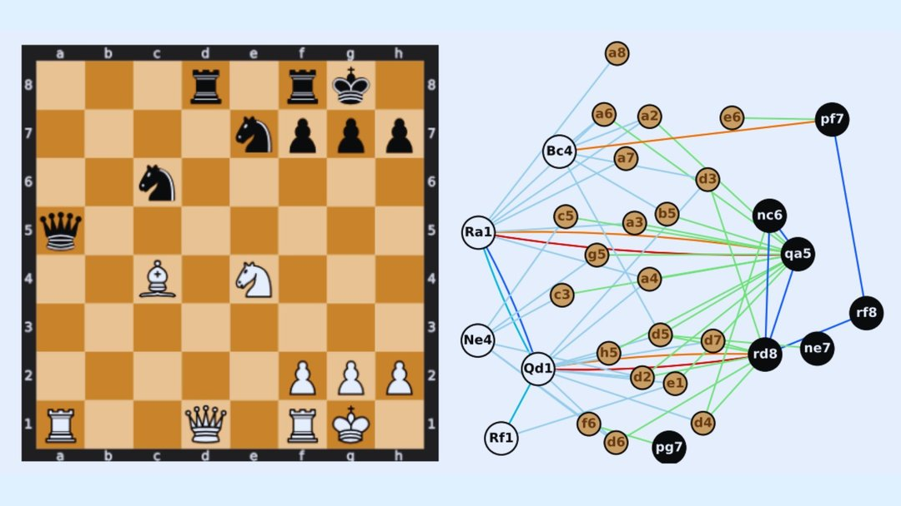

# 2026-10-21

@物理芝士数学酱

发表于：2026-10-20 13:05

来源：微博

链接：https://m.weibo.cn/status/5356201861974704

\#今天要来点人工智能吗?\# 

AI下棋比人类强，不仅因为算得更深、更快，还因为它能长期维持复杂局面，而人类更倾向于尽快把局面简化。

奥地利Complexity Science Hub (CSH)和意大利帕尔马大学的研究团队比较了：

人类高手之间的棋局vs顶级AI之间的棋局

结果发现：

当棋盘上出现大量互相攻击、互相牵制的复杂关系时，人类往往较早通过兑子（互换棋子）来降低复杂度；而AI则更愿意让这种复杂关系持续存在。

什么叫“紧张（tension）”？

文中举了一个典型例子：

我能吃你的棋子→你能吃回来

                             ↓

我还有别的棋子能继续吃→整个局面连锁影响

这种“能吃，但又不一定马上吃”的状态，在国际象棋中称为 tension（张力、紧张局面）。

很多棋手都会有一种冲动“太复杂了，先兑掉几个子再说。”

这会让局面变简单，更容易计算。

人类和AI的区别在哪里？

研究者认为：

人类

↓

复杂局面令人不舒服

↓

倾向于尽早简化

 

AI

↓

不在乎复杂度

↓

能够长期维持复杂局面

换句话说，人类经常会想：“局面太乱了，我先把这个问题解决掉。”

而AI没有这种心理负担。

对于AI来说复杂也行，不复杂也行，只看哪种变化更优。

“搜索更深”在棋盘上的表现之一，就是AI能更长时间承受和维持高张力、高复杂度局面。

研究者甚至指出：

人类与AI的差别不仅是强弱差别，而是处理复杂性的方式不同。人类会主动降低复杂性，而AI能够持续保留复杂性。

Artificial intelligence sustains higher strategic tension than humans in chess

网页链接

————————————

另外，今天标准国际象棋的初始摆法（RNBQKBNR）真的是最合理、最公平的吗？

法国巴黎-萨克雷大学物理学家 Marc Barthelemy 用 Chess960（菲舍尔随机棋）的全部 960种合法开局摆法进行了系统分析。

研究使用顶级棋力引擎 Stockfish 17.1 对全部960种初始排列进行评估。

Chess960 的规则是：

后排棋子顺序随机；

两个象必须落在不同颜色格子；

王必须位于两车之间；

满足条件后共有960种开局。

其设计初衷正是为了避免职业棋手背大量开局定式。

最重要的发现一：

几乎所有摆法都偏向白方

研究发现960种摆法中有956种（99.6%）被Stockfish评估为白方更优。

这意味着：先手优势不是标准开局特有现象，而是几乎所有国际象棋开局都存在。

所以如果有人希望通过随机化摆法彻底消灭先手优势，恐怕并不容易。

最重要的发现二：

标准开局并不特别公平

文章指出：

标准国际象棋布局：R N B Q K B N R（研究中编号518）复杂度约处于全部配置的 47%位置。算不上特别复杂或特别简单。

但在公平性（先后手对称性）方面：

它位于第91百分位，意味着对黑方相对不友好。

换句话说现在大家用的标准开局并不是最公平的开局。

最有趣的发现：

只换一个棋子，复杂度就能暴涨

研究发现不同开局的复杂度最多能相差约3倍。

最复杂的开局只是把标准布局最左边的

Rook（车）

↓

Bishop（象）

交换了位置。

仅改变一个位置，整体复杂度就成为全部960种中的最高。

这让研究者相当意外。

最公平的开局是谁？

研究得到：

Q N B R K B N R编号198。

其特点是

评估值几乎为0

不对称性也接近0

是最平衡的配置之一。

有趣的是，它和标准布局的区别仍然极小：

只是把最左边的

Rook（车）

↔

Queen（后）

交换了一下。

Not all Chess960 positions are equally complex.” arXiv preprint arXiv:2512.14319（2025）

