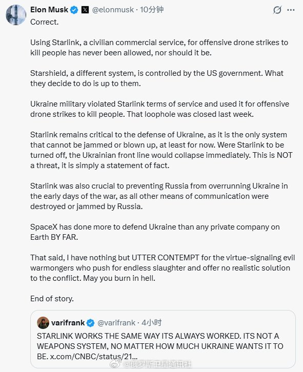
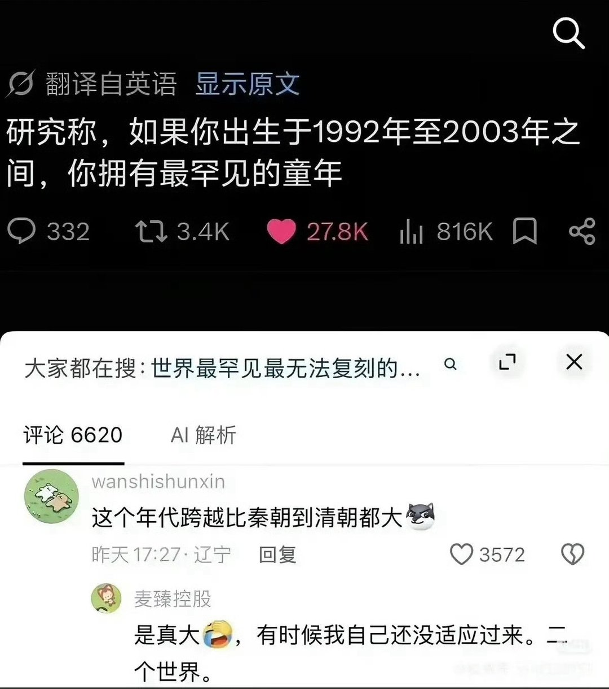

# 2026-10-25

## 1

@俄罗斯卫星通讯社

发表于：2026-10-24 18:57

来源：微博

链接：https://m.weibo.cn/status/5357740193220151

【\#马斯克称星链关闭乌前线将崩溃\#】针对X平台用户关于“星链一直照常运行、并非武器系统”的帖子，美国企业家埃隆·\#马斯克\#10月24日作出回应，明确区分了“星链”与“星盾”的性质，并披露乌军曾违反服务条款将星链用于进攻性无人机打击，相关漏洞已于上周封堵。

他指出：“利用‘星链’这一民用商业服务进行进攻性无人机打击以杀人，从来都是不被允许的，也不应该被允许。‘星盾’是另一个系统，由美国政府控制。他们决定怎么做是他们的事。”\#关注俄乌局势最新进展\# 

马斯克强调，星链对乌克兰防御仍至关重要，因为它是唯一无法被干扰或炸毁的系统，“如果‘星链’被关闭，乌克兰前线将立即崩溃。这不是威胁，只是陈述事实”。他同时表示，SpaceX在保卫乌克兰方面所做的贡献远超地球上任何一家私营公司。

马斯克在帖文最后对“道德作秀的邪恶战争贩子”表达彻底蔑视，称他们推动无休止的杀戮却提不出任何现实的冲突解决方案：“愿你们在地狱中燃烧。就这样。”\#乌克兰局势\#

---

## 2

@zhtttyzhttty

发表于：2026-10-24 16:26

来源：微博

链接：https://m.weibo.cn/status/5357702055986412

80后的感官可比90后要大多了，我举几个例子，90后是绝对没法感官到的，比如我是83年生人，我小时候在街边买一块烙饼，需要人民币和粮票同时给店家，没错，我真体验过用粮票的时期，而90后甚至没听说过//@史老柒:对我们80后震撼更大，我初一还写信呢，初二就去搜狐bbs聊天室了，初三开始打红警了//@魂殇之逝:我小时候家里还烧柴，压井水，热水得到镇上统一的锅炉去打，煤油灯，蓄水池。 随着我长大，自来水，交流电，电话线，网线一个个接入，石子路，水泥路，柏油路一遍遍重构，土房子，砖房子，混凝土楼房逐步更新，90后的体验确实变化巨大//@魂殇之逝:见证了饺子从一毛钱一个到一块钱一个，工资从50到5000的历史

