# 2026-10-30

## 1

@新浪科技

发表于：2026-10-29 14:51

来源：微博

链接：https://m.weibo.cn/status/5359490251361138

【\#EA裁员400人后办公室现状曝光\#：员工士气跌至谷底，管理层热衷于生成式 AI】

据游戏媒体 EuroGamer 今天报道，EA 上周宣布在旗下多家工作室裁员 400 人、取消部分项目，较为知名的 BioWare 遭到关停。

据报道，多名 EA 现任和前任员工透露，公司内部已经围绕裁员形成一种保密文化，大家都不清楚哪些人受影响，以及在团队成员离职后，剩余员工该如何继续工作。

其中一名前员工表示，她的同事在领英看到消息才知道被炒鱿鱼。EA 称这样做是为了保护隐私，但员工们显然有不同看法。一匿名人士认为：“我怀疑这样做是为了孤立那些被裁掉的人。我们可能需要一两周，甚至更长时间，才能重新理清头绪，弄清楚接下来该做什么。”

同时有消息人士透露，EA 的裁员方式十分了当：先将员工邀请进 Zoom 会议，但会议中的聊天功能被禁用，其他参会者也会被隐藏。然后公司会直接说他们需要离开，完全不给提问的机会。

匿名人士还透露，EA 如今比以往任何时候都更重视利润，而不是员工的福祉。另一消息人士则表示：“员工士气糟糕透了，我听到的说法是‘少做一些，把事情做得更好’。可实际感受却是，人手减少了，工作量却没有变化。高管对 Claude 等 AI 十分兴奋，这让我团队非常恼火。”

“最近那封关于组织架构调整的邮件，读起来就像是机器人写的。这家公司正在慢慢腐朽，管理层不断榨取每一分钱，剩下的我们只能担心如何养家糊口。”（IT之家）

---

## 2

@汪有

发表于：2026-10-29 14:15

来源：微博

链接：https://m.weibo.cn/status/5359481055872868

是不是麦当劳越密集，居民就越长寿！

今天@庄时利和 推测，麦当劳越密集的地方，居民就越长寿。

我经过一晚上的研究，做出本图表：收录了58个城市，麦当劳和居民预期寿命的关系！

图表里，城市的位置越往右，麦当劳就越密集；

越往上，居民活得就越长。

经过统计，我们发现，麦当劳密集的地方，居民确实就比较长寿！

（数据不一定百分百准，我们先参考下）

4座一线城市都在右上角，基本都能活到84岁。

而基本上每百万人都拥有15家以上的麦当劳。

而这些城市都有300家以上麦当劳！

北京深圳明显麦当劳更多，说明这俩城市不愧是美食荒漠。

三亚是个特例，三亚要超出表格右边不少，实际是每百万常住人口22.5家左右。

三亚是个旅游城市。

只有一百多万常住人口，却有27家麦当劳。

但三亚预期寿命并没有特别长，就是在80岁出头的正常发挥。

苏州是另一个特例，苏州的麦当劳并不多，却很能活。

苏州只有100多家麦当劳，大约1200万人口，但居民却能平均活到超过85岁，是最长寿的城市。

广东人民真的很喜欢吃麦当劳，纳入统计的广州、深圳、佛山、珠海都有很多麦当劳。

而且都很能活，基本都能活到84岁。

就算是惠州，大家平均预期寿命略低于80岁，也有很多麦当劳。

表格里没有做进去的是拉萨和西宁，因为太往下了。

它们都只有一两家麦当劳，人均寿命都是70多岁，不算很高。

这可能是因为医疗不太发达。

三线城市基本都没什么麦当劳，百万人麦当劳基本都在5家以下。

但发达地区的三线城市照样很能活。

比如宜昌、南通、扬州、嘉兴、芜湖、绍兴，没有很多麦当劳，也能超过平均水平。

重庆我没做进来，大家都觉得成都重庆差不多，但实则不然。

成都在图里中间偏上的位置，但重庆如果做进来，要很左下。

重庆每百万人只有2个麦当劳，平均年龄也低于平均，如果放在图里，基本上在南昌贵阳的左下。

重庆统计口径太大了，重庆名义上是个市，实际上是个省，约等于把市区和其他区域平均拉低了。

如果只看市区，应该和成都不会有很大差异。

这里不放进来，避免污染数据。

沈阳也没放进来，基本在大连右下，差不多。

总体上，中线密度是每百万人4.9家，中位数预期年龄略低于81岁。

以这两条线分为四个象限。

分别是：

第一象限：又能活又吃很多麦当劳

第二象限：能活我也不吃麦当劳

第三象限：没什么麦当劳但需要加强医疗资源

第四象限：不能活我也要吃麦当劳

最后祝大家不管吃不吃麦当劳都要很能活！

说明：

1.很明显相关性不代表因果，吃麦当劳并不真能延长寿命；

2.这里的数据看看就行，不完全准，很多地级市不公开最新预期寿命，数据有的来源于官方报告，有的来源于卫健委，有的来源于七普，年份也参差不齐，比如长春七普是79点几，数据有点旧了，但报告又说2025争取达到80岁。最后出现一些误差也很合理。

祝大家长命百岁！

（我也不知道我为什么这么闲做这种图

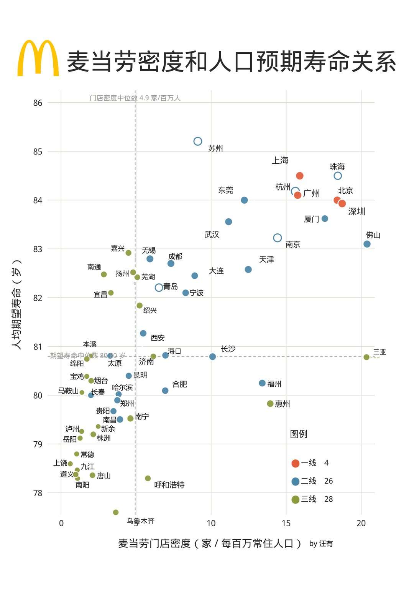

---

## 3

@宝玉xp

发表于：2026-10-29 21:47

来源：微博

链接：https://m.weibo.cn/status/5359594911827245

Claude 现在会在每次回答后自查对话安不安全：算力 Anthropic 出、不向用户收费，不额外收集数据，自称单条标记不会直接导致封号

似乎更多是为了防止蒸馏？

Anthropic 公布了一项叫“自我评估”（self-assessment）的防滥用技术：Claude 每回答完一轮，系统在后面追加一句简短指令，大意是“请反思这段对话是否安全”，Claude 再输出一份简短的安全评估，判断这段对话有没有违反使用政策的风险。

从 6 月 Claude Fable 5 上线起，这套机制就在线上运行，Fable 5 之后发布的每个 Claude 模型都带着它，覆盖 Claude 全球流量的很大一部分。

【跟用户有什么关系】

花不花你的钱：自查多用的是 Anthropic 自己服务器的算力，按它的估算，整体推理算力增加不到 2%。Anthropic 说这笔成本不向客户收费。

隐私：Anthropic 说自我评估不额外收集用户数据，它只读 Claude 回答时本来就在读的这段对话，也只在 Anthropic 按现有政策本来就能留存的流量上运行。签了零数据保留协议（对话不留存）的流量，目前不跑自我评估。追加的指令和评估结果都不显示给用户，也不会带进后续对话。评估里有一句理由，可能转述你的对话内容，Anthropic 按用户对话同等的数据规则管理它。

会不会被误封：被标记不等于违规。Anthropic 说评估只是“需要进一步审查的信号”，单条标记不作数。在一部分危害领域，标记每晚按组织汇总，同一个组织攒了好几条高优先级标记，才交给执法团队人工复查。自我评估本身只在事后标记，不会当场打断你的对话，当场拦截由其他安全分类器负责。

没问题的对话，评估只有一句“未标记”。被标记的对话，会写明涉及哪类危害、Claude 有没有拒绝、人工审查的紧急程度（1 到 10 分），外加一句理由。

【为什么这么省】

关键在 KV cache（键值缓存）。大模型读一段对话时，会给每个词算出一份中间结果并存起来，后面接着生成时直接调用，不用从头重读。Claude 刚回答完，整段对话的中间结果都还在缓存里，自查只需要再读一句短指令、平均多写约 10 个 Token。所以 Anthropic 那边增加的算力不到 2%。

另一种做法是“提示式分类器”：另起一个模型，把完整的安全政策和对话一起塞进去，让它从头读一遍再推理。这是 Anthropic 测过最准的自动审查方式，但每段对话的算力要贵好多倍，所以只用在需要细看的地方。作为参照，Anthropic 2025 年初的第一代“宪法分类器”（专门训练来识别特定危害的独立模型）要增加 23.7% 的推理成本。

打个比方：自我评估是让刚读完文件的人当场回答“这份有没有问题”；提示式分类器是另请一位审查员，把文件和整本规章从头读一遍。

【效果怎么样】

衡量标准就是那位贵的审查员。在 Fable 5 的真实流量抽样里，把误报控制在 1%（每 100 段正常对话误标 1 段）时，审查员标出的可疑对话，自我评估能抓到 78%；其中高优先级（7 分及以上）的能抓到 94%。

Anthropic 认为，训练主要教 Claude 怎么报告，它对“什么有害”的判断大多来自本身的知识。实验里把诈骗类或网络攻击类样本整个从训练数据中拿掉，这两类在线上流量里的检出率只从 83.3% 降到 82.1%、从 94.2% 降到 90.7%。模型越大越准：四个大小不同的测试模型，同样 1% 误报下，检出率从最小的约 16% 升到最大的约 96%。

传统分类器只能识别事先定好的几类危害。自我评估的标记里，约三分之一对不上 Anthropic 现有的危害分类。

把这些标记聚类后，发现了几类原有防线没专门覆盖的问题：违规蒸馏（套取 Claude 的推理过程，拿去训练别的模型）、提示词注入（藏在网页或文件里劫持 AI 的指令），以及 Claude 作为智能体执行了用户没授权的操作。

实际查到的案子：8 月，单个 API 客户触发了超过 10 万条儿童性剥削标记，儿童安全团队调查后报告给了美国国家失踪与受剥削儿童中心（NCMEC）。

9 月，它的标记牵出一个用 Claude Code 搭建并运行自动化恋爱诈骗的团伙，受害者有几十人，人工复查后相关账号被封。它揪出的组织里，一半以上在此前一个月没被其他任何检测手段标记过。

【局限】

拿来当场拦截，它不够强。Anthropic 用 24 个网络攻击任务做红队测试（模拟攻击者反复试探），被拦后攻击者可以换种说法重试。没有防护时攻击成功 19 个（79%），用自我评估拦截后还剩 13 个（54%），用提示式分类器拦截只剩 6 个（25%）。所以线上当场拦截交给其他分类器，自我评估只做事后标记。离线运行时攻击者得不到即时反馈，24 次攻击过程里有 21 次被它至少标记过一次。Anthropic 也说，专门冲着自我评估下手的攻击者很可能绕得过去。

它向那位贵的审查员学习，评测也用同一位审查员打分，审查员的盲区会原样传下来，评测发现不了。泛化实验只测了诈骗和网络攻击两类，都是 Claude 本来就知道有害的，换成 Claude 还没认识到的新型危害，效果未知。

拿它监督 Claude 自己的行为也还不可靠。一个有问题的模型可能在自查里一并隐瞒；还有研究发现，模型给自己上一轮的操作打风险分，会比给同样操作打得更低。

原文（署名日期 10 月 16 日）：网页链接

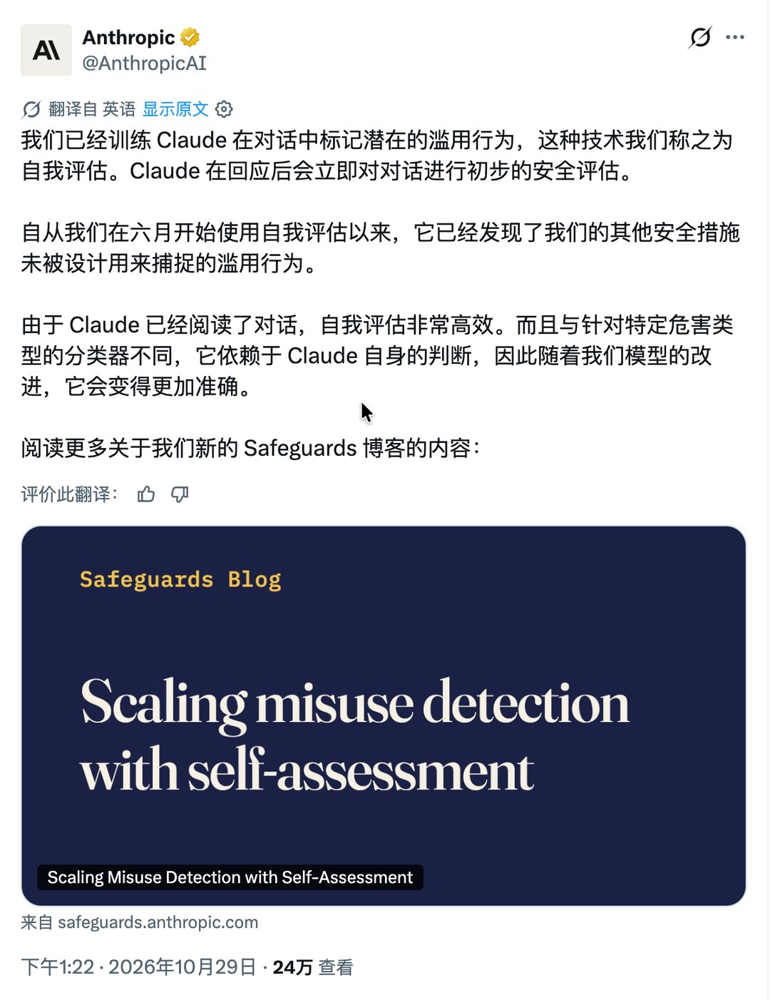

---

## 4

@挨踢牛魔王

发表于：2026-10-28 08:36

来源：微博

链接：https://m.weibo.cn/status/5359033280366314

Claude Code核心开发者Dwayne被claude code裁员了。

---

## 5

@贾林州大河之南

发表于：2026-10-29 13:35

来源：微博

链接：https://m.weibo.cn/status/5359471028866575

保险集体巨亏，谁巨赚呢？保险在5.15-6.30高位接盘了，谁撤退了呢？谁安排这次接盘呢？

希望有关查一查，给国家一个交代，给投资人一个交代。

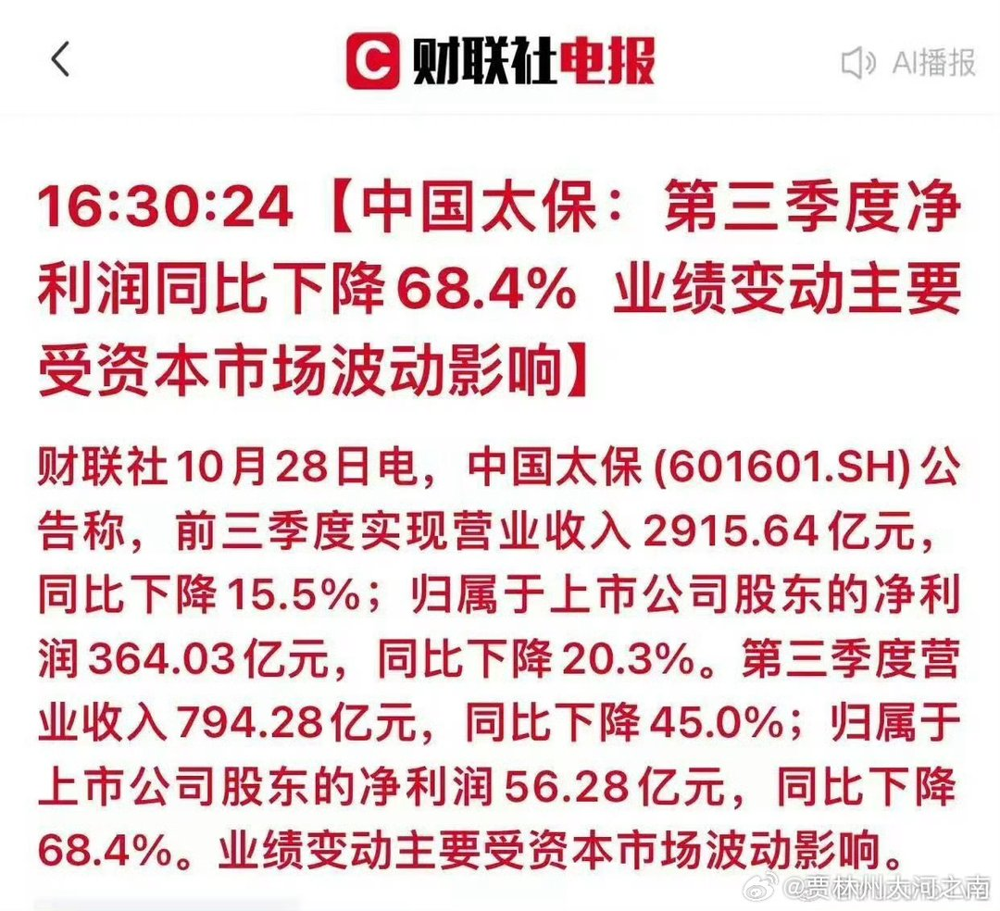

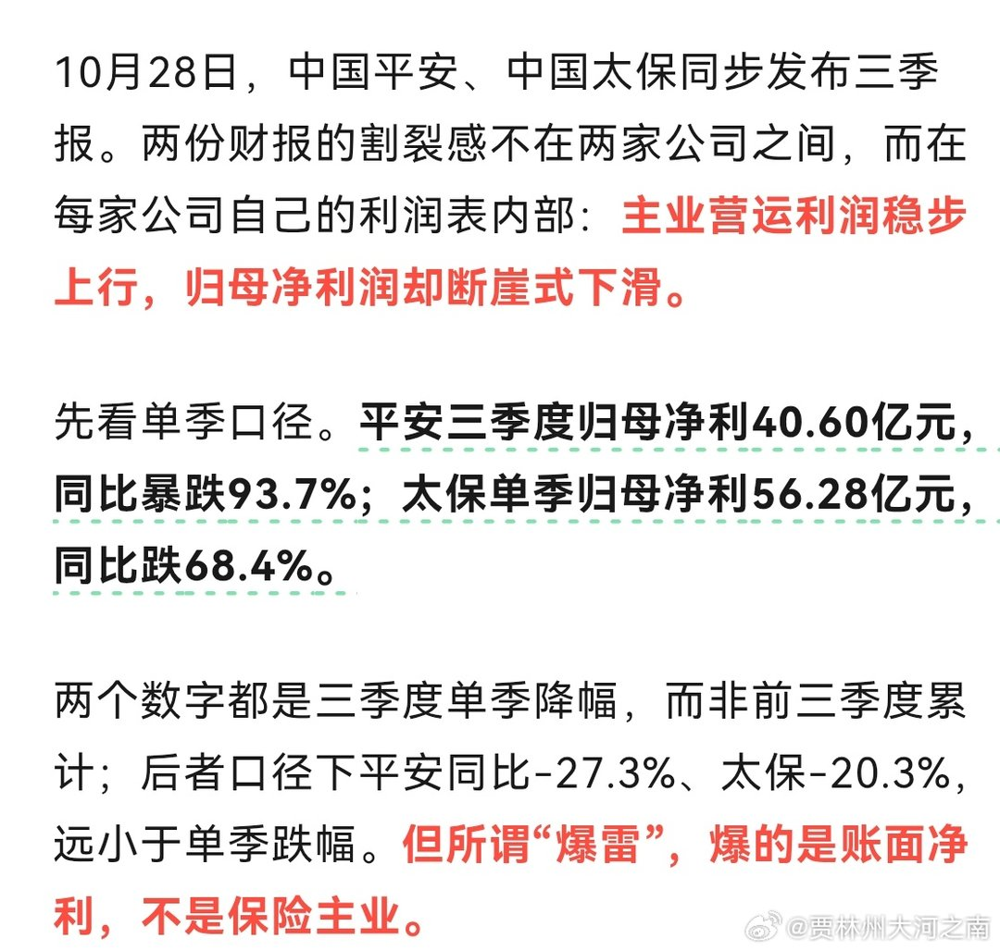

---

## 6

@后厂村长看大厂

发表于：2026-10-29 05:48

来源：微博

链接：https://m.weibo.cn/status/5359353386762354

这大概是大厂最尊重AI的一集就看东哥什么时候张罗着给上社保了

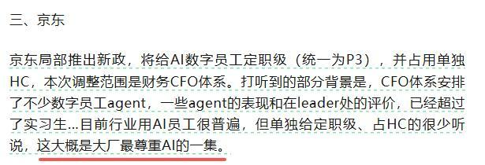

---

## 7

@宝玉xp

发表于：2026-10-29 17:21

来源：微博

链接：https://m.weibo.cn/status/5359527857751552

OpenAI 即日起把 ChatGPT Pro 各档和 Business Premium 的用量上限翻倍，原定明天的 Pro 200 降额取消，价格没提变化

Tibo 说，Pro 100、Pro 200、Pro 500 三档和 Business Premium 的所有用量上限翻倍，当天生效。Plus 不在名单里。

【我现在能用多少】

按 OpenAI 此前公布的倍数推算（以 Plus 为 1 倍）：Pro 100 从 5 倍变成 10 倍，Pro 500 从 25 倍变成 50 倍。Business Premium 是 Business 套餐里的高级席位，此前倍数官方没公开，只知道翻倍。

Pro 200 要分两种人看。

9 月 29 日前就订阅的老用户，原本 10 月 30 日起要从 20 倍降到 10 倍，现在不降了，Tibo 说你的 Codex 和 Work 用量“保持不变”，也就是继续 20 倍。

9 月底之后新订阅的用户一直是 10 倍，翻倍后也到 20 倍。

这样算下来，三档 Pro 每花 1 美元能用的量还是一样，买贵的不多送。帖子没提价格调整。

【dot 的额度怎么算】

dot 是 OpenAI 9 月底开发者大会发布的常驻 AI agent，有自己的云端电脑，能在后台长时间替你干活，Pro 和 Business Premium 送第一个。

上线时 OpenAI 给了第一个月的加长额度，dot 的用量和你平时的套餐额度分开算。

按 9 月 29 日上线算，一个月差不多到期，Tibo 说这个加长额度“暂时”继续给，dot 的用量也继续单独计算。“暂时”是多久，他没说。

来源：

Tibo（@thsottiaux）X 帖子，2026 年 10 月 29 日（读者提供原文）

28 天活动：INSIDE 网页链接

Pro 各档倍数和 10 月 30 日降额计划：OfficeChai 网页链接

dot 首月加长额度：Layer3 Labs 转述 OpenAI 帮助页 网页链接 （OpenAI 帮助页 网页链接 这次没能直接打开）

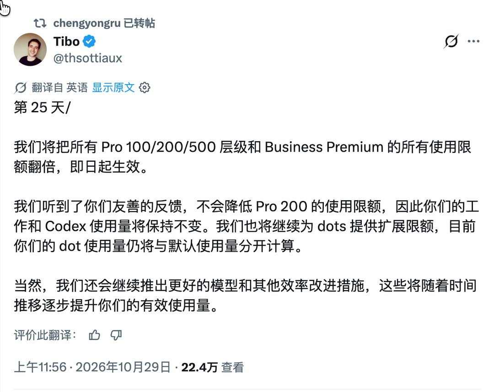

---

## 8

@ThyVoiceH

发表于：2026-10-28 13:07

来源：微博

链接：https://m.weibo.cn/status/5359101468218623

看得我鸡皮疙瘩都起来了，也终于明白了为什么第一句滕子京谪守巴陵郡。“微斯人，吾谁与归”

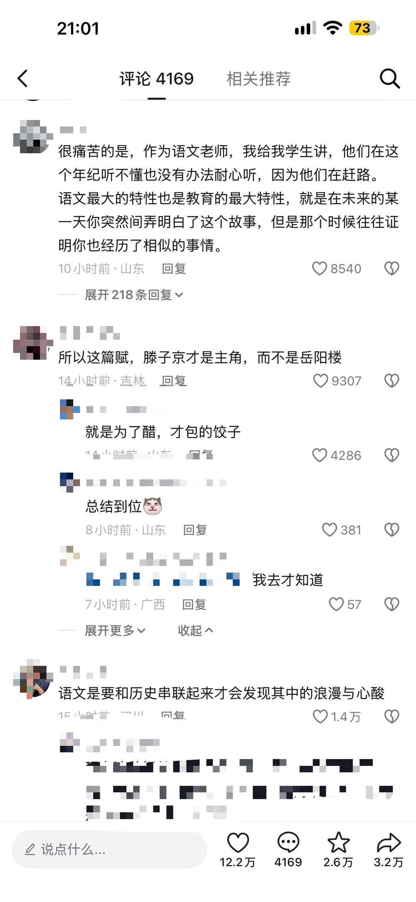

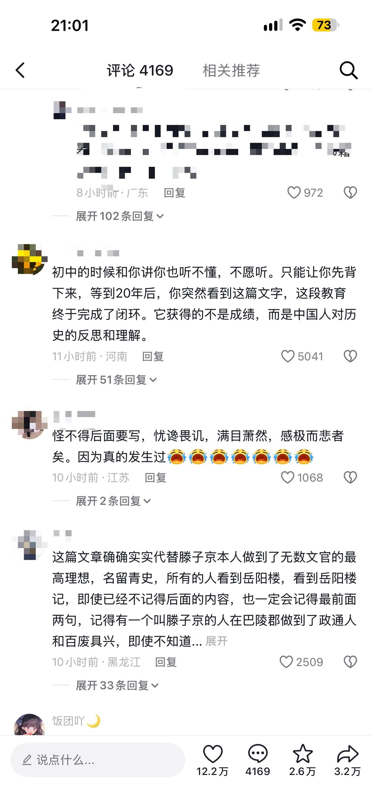

---

## 9

@史老柒

发表于：2026-10-30 08:26

来源：微博

链接：https://m.weibo.cn/status/5359630089718208

附议右边，不可能是巧合 //@就是尘:这么多怎么可能是巧合，就像我写书，有三个好朋友，一个姓刘一个姓关一个姓张，刘张都是大姓但是设定成这样肯定是致敬三国 //@宝树:日本类似欧美，没有张王李刘这种超级大姓，高田铃木啥的就算了，乃木这种姓....我感觉应该是小姓//@只谈风月猫:这问题不太一样……日本是从甲午到二战大大小小战犯太多了。看下面那个列表，有些只是中佐。到这个级别的战犯那覆盖姓氏面积太大了，要能全部避开反而是奇迹了。/@传奇雷鸟201802://@周天纹:就像我刚才举的例子，一个国产剧，主角姓张，姓王，没问题，但是他把江张王姚凑齐了，哪有那么多巧合啊//@鱼糕KUMA:虽然但是，都是姓一样，后面的名字看起来没什么关联。就算在日本姓一样也是很正常的事情吧

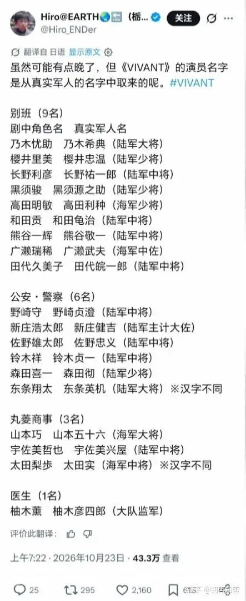

---

## 10

@斯图卡98

发表于：2026-10-29 23:39

来源：微博

链接：https://m.weibo.cn/status/5359623076315844

师夷长技以制夷

网友的评论，角度刁钻

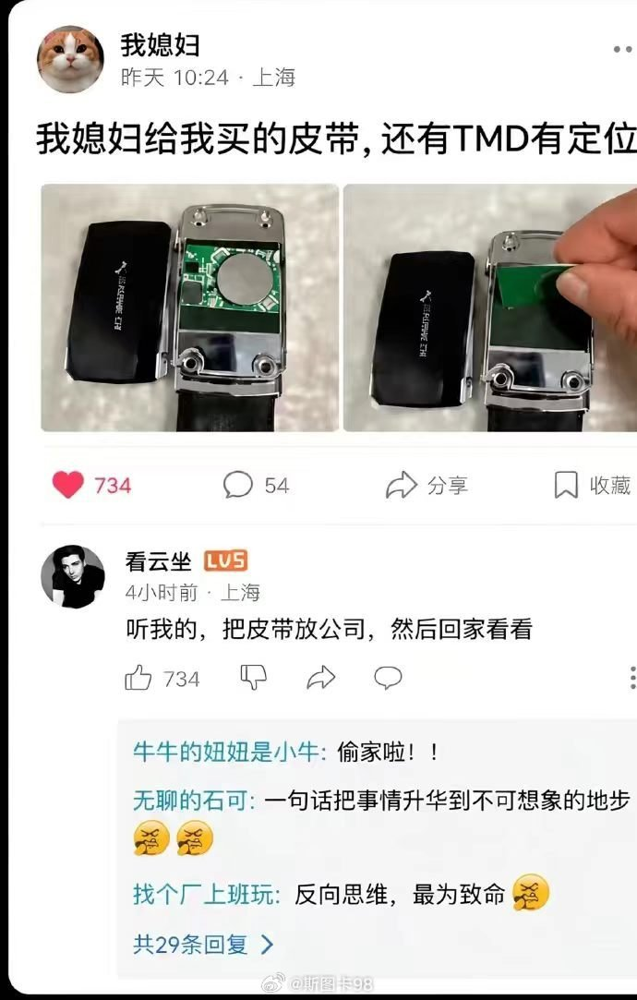

---

## 11

@挨踢牛魔王

发表于：2026-10-29 23:55

来源：微博

链接：https://m.weibo.cn/status/5359627136142853

opencode的dax怀疑算力过剩。

我觉得他说得不对。

就像比尔盖茨当初说电脑只要64K内存就够了一样。

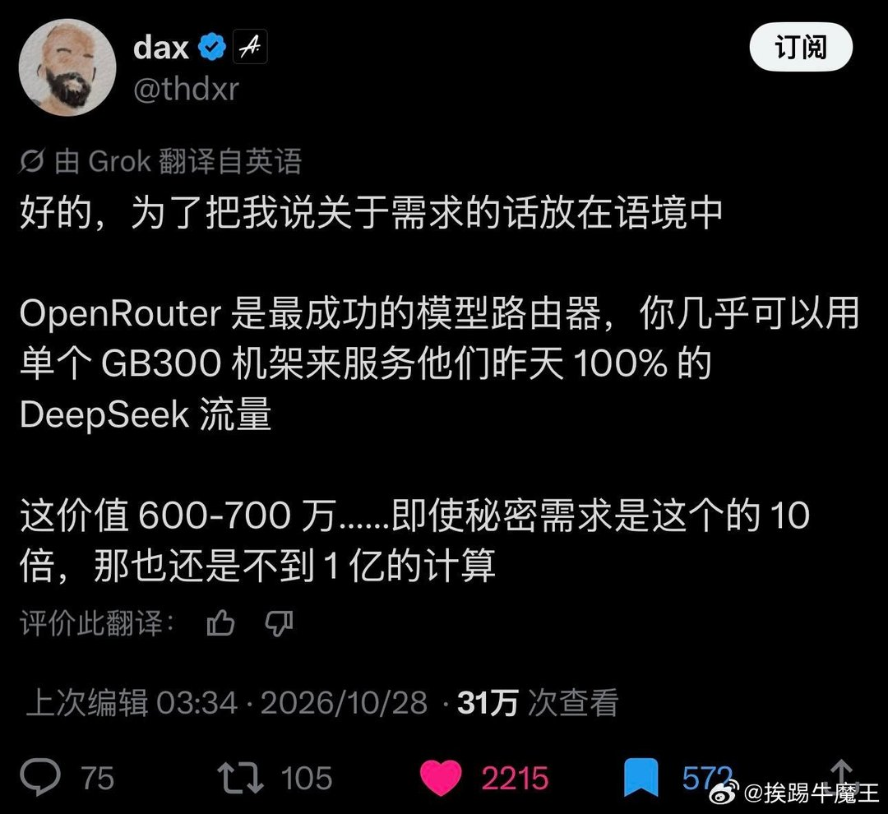

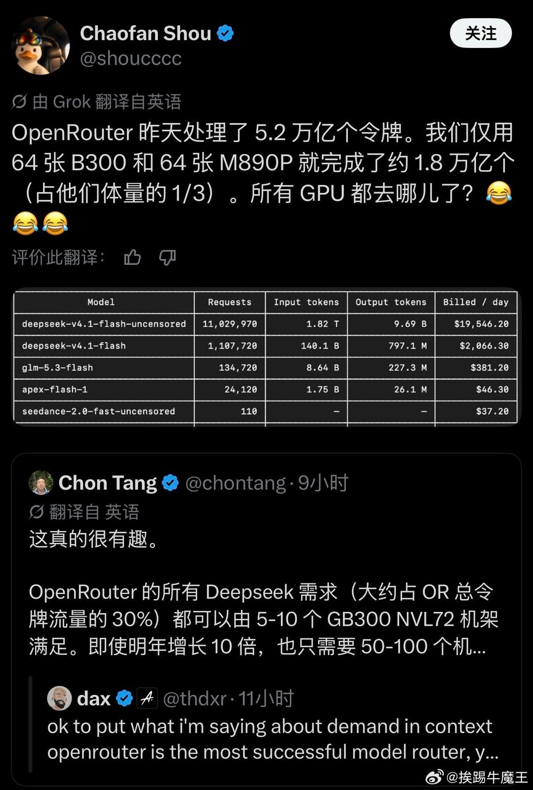

---

## 12

@飞象网项立刚

发表于：2026-10-28 23:37

来源：微博

链接：https://m.weibo.cn/status/5359260083948195

【存储芯片下跌只是刚刚开始】

今年我们经历了存储芯片大规模的上涨，这给半导体产业带来了虚假的繁荣，也严重打击了全球信息产业的发展。

今年以来，我已经发布过数篇文章，分析这件事情，对于说存储芯片短缺要延续到 2028 年，会一直出现短缺的情况，我是非常不同意的，这是一种无知的炒作，是资本为了挣钱搞的把戏。我相信每一轮存储芯片的炒作，一般都在 1 年左右，不可能长期持续，今年年底、明年年初，存储芯片大规模的短缺一定不是必然。

现在的市场情况基本证实了我的判断，存储芯片的大跌只是开始。

1.根本不存在一个人工智能高速度发展，带来大量存储芯片需求的市场格局。人工智能的发展确实带来了HBM的需求增长，但是这种主要用于数据中心的芯片，需求量增长是有限的，不可能长期持续的增长，数据中心建设基本完成之后，这种增长就会放缓。

同时市场针对 HBM 的需求，也会通过新建芯片厂扩大产能，满足HBM 的需求。

人工智能的发展对于存储芯片的需求有一定拉动作用，但是这种作用是逐渐释放的，是一个缓慢增长的过程，绝不可能出现突然的大幅度增长，长期保持高位。

2.存储芯片并没有特别复杂的技术，技术都是非常成熟的，传统存储芯片的生产企业主要是美光、三星和海力士。并不是因为技术多复杂。而是这个市场非常小，更多的企业进入，生存和发展都是问题。

这一轮存储芯片的大规模上涨，带动了更多企业进入这个领域，中国的长鑫科技和长江存储，趁这个机会上市，迅速扩大产能，其实扩大产能的，除了我们知道的这些企业，还有些配套著名企业的存储芯片企业，也在扩大产能。这样的一次炒作，会带来全球存储芯片产能的暴增。

3.存储芯片大规模的涨价，已经导致了产业面临着巨大损害，进入 4 季度，全球的手机出货量下跌了 20%，电脑的出货量基本上也是同比例下跌。这导致最大的芯片需求领域，不再需要更多的存储芯片。

这种情况下去，会引起整个经济的大幅度下跌，也会导致全行业面临危机，这种危机一定会传导到芯片企业。还维持高价，就是大家都别过日子了。所以存储芯片的下跌一定是必然。

4.今天存储芯片的市场，很大一部分是有职业炒家操控的，他们通过大量的囤货，造成了市场大量需求，存储芯片严重短缺的假象。但是这些职业炒家，并不是芯片的消费者，他们囤积的芯片，总是要销售出去。

最为微妙的事情是，存储芯片炒家并不完全都是自己的资金，存储芯片大量的资金都是贷款，这些贷款不仅是有利息，一般贷款的时间都是 1 年。到了年底，很多贷款需要还款。囤积在手中的芯片必须出货。

市场的需求下降，存储芯片生产制造能力的上升，囤货炒作需要出货，几股力量共同起作用，存储芯片市场不是要维持高价的问题，而是会被迅速干崩了，到明年年初，存储芯片又会是一片哀鸿，现在赚的钱又会被吐出来，这个过程会有若干炒芯片的职业炒家，最后会倾家荡产。

市场的发展对于存储芯片需求会逐渐增长，这是一个平缓的过程，大规模的上涨，一定不可能长期维持。那些存储芯片企业上市的高股价，炒股的人也需要小心。市场一崩，股价可能也很难支撑。

关于全球芯片的大趋势，中长期我从来没出过问题，因为是长期立足于产业，对产业生态非常了解的结果，短期影响的不是产业本身，而是炒家和资本的炒作，这个我当然没办法预测，因为他们要怎么干，不可能告诉我。

我知道面对这种情况，还会有人说，低端存储芯片价格会下来，高端不会，没有什么不会的，HBM 的需求根本没有那么高，而且 HBM 也就是 DRAM的一种，如果 DRAM 的价格崩了，HBM 也会崩。

存储芯片产业这种搞法，就是自己作死，因为逼出了中国的巨大产能，这个产能就是要把芯片长期搞成白菜价。

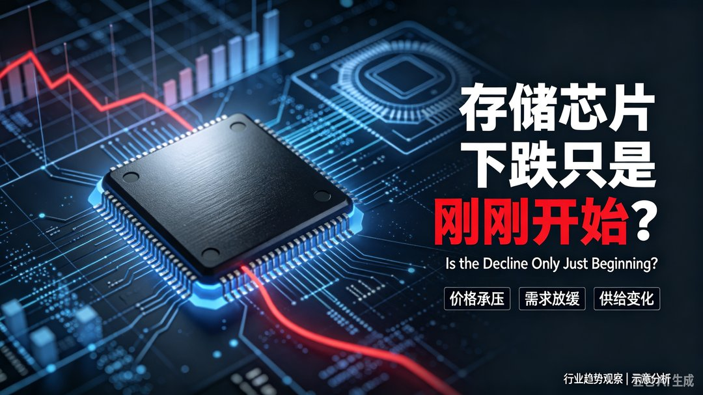

---

## 13

@南亚研究通讯

发表于：2026-10-30 08:26

来源：微博

链接：https://m.weibo.cn/status/5359628604147565

印力推“质量控制令”，反而伤害本国出口？

印度近年来密集推出质量控制令（QCO），名义上是提高产品质量，实际上却要求外国供应商接受印度标准局认证，并在获批前阻断相关进口。

外国供应商要得到认证，需要等待印度有关部门出境审厂，而审核基于的标准并不清晰。

作者认为，这些措施已成为不透明且高度自由裁量的贸易壁垒：限制化纤等投入品进口推高印国内企业成本，反过来削弱出口竞争力，最终损害就业和增长；限制制成品进口则推高消费者采购成本。

最终得益的只有印度少数国内垄断企业。文章梳理印度自2018年以来重新转向保护主义的轨迹，指出质量控制令正使其贸易制度倒退至自由化改革前的“许可证—配额—审批统治”。

在美国贸易压力上升之际，印度应立即取消质量控制令，避免出口商同时承受外部威胁和国内政策掣肘。南亚 印度 \#海外新鲜事\# 编译 | 印力推“质量控制令”，反而伤害本国出口？

