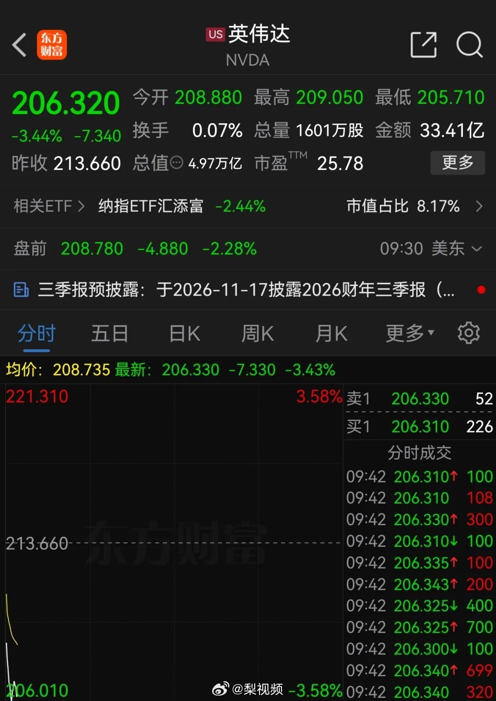

# 2026-10-31

## 1

@苏耷水

发表于：2026-10-30 15:11

来源：微博

链接：https://m.weibo.cn/status/5359857541580950

美国从巅峰时代到今天这样极端两极分化只用了三十多年，从那个能造土星五号火箭、能建造航天飞机、能制造隐形飞机，能维持十几个核动力航母战斗群、能诞生许多伟大企业的国家，滑到今天连个折叠手机都做不利索的国家，用了不到一代人的时间。

人类几千年的文明史，没有哪个国家能长盛不衰，没有哪个国家能一直维持上升期。我们这个牺牲了无数先烈换来的新中国，能不能走出这个周期律呢？

这几年有很多新闻，听起来不大，却让我们意识到国本已经有被一点点蚕食的可能，所以才会在微博上引起那么多讨论。讨论也一般没什么结果，一年年就这么过去了。谈论时政的博主，一旦流量足够大了，就要领到大结果销号了。明知没什么意思，却忍不住去看。

---

## 2

@梨视频

发表于：2026-10-30 13:52

来源：微博

链接：https://m.weibo.cn/status/5359837649047512

【\#英伟达市值蒸发1.1万亿元\#】北京时间10月30日，美股开盘后，英伟达股价下跌3.44%，报206.320美元/股，总市值报4.97万亿美元。月初以来，英伟达股价累计下跌超9%。据测算，英伟达蒸发市值约1769亿美元（约合人民币11766亿元)。（财联社）

---

## 3

@南山林雪萍

发表于：2026-10-30 23:34

来源：微博

链接：https://m.weibo.cn/status/5359984068264787

直流电，重回王的荣耀。130年前，位高名重的爱迪生的直流电，却输给了自己的助手当时名不见经传特斯拉的交流电。

然而出走的特斯拉，依靠西屋电气的资本，迅速走红。他独出心裁的交流专利技术，自此主导了人类的电力体系。

爱迪生的直流电则因此成为了小众流派，在工商业场合充当小小配角。尽管我们日常的充电宝和电池也在用直流电，但家用电的整个体系却是围绕着交流电而来。直流电就是流落民间多年的平民小王子。

然而，当算力中心正在成为火山般爆发的宇宙行业时，

它想重新推举直流电为王。

算力芯片越来越耗电，铜排越来越大，交流电越来越招人不喜欢了。

算力芯片是直流负载，中间很多电流设施也是直流。

而传统的电力架构从电网开始，就是交流电的迷宫。电流要经过 “交→直→交→直” 的来回转换，大量能量无故损耗。

AI 机柜功率飙升，常规24/48V的那些低压直流电设施就不得不抬升电流，而大电流带来的铜耗将使得成本暴增。

而且散热问题巨大，芯片铜排个个热情似火，谁也不想挨着谁。机房空间，需要不断放大。

于是800V机柜直流架构体系，呼之欲出。电压大幅度抬升了，电流就会降低，从而也能有效减少铜排的散热。

固态变压器SST，固态断路开关SSCB等直流家族都要跟上。

这个时候人们才发现一个令人难以置信的现象：围绕这套800V直流机柜的配套直流电气设施，四下空荡如旷野。

交流和直流这两个电力兄弟，原来差距这么大。

交流电体系拥有一座华丽宫殿，而直流电还住在一间漏雨的草房子里。交流点从变压器、断路器、过零点设备、机械开关等一应俱全。

而直流电虽然日常使用很多，但这些配套设备，却完全无法配齐。

交流电能够一统天下，在于它的安全性。交流电的电流为正弦波，具有周期性瞬间归零的特性。像普通标准50Hz的交流电，每10ms就会有一次降为0。

日常一旦出现短路或者故障的时候，机械开关就会切开。然而开关在切断电路的瞬间，电流会击穿介质形成电弧，依然处于通电状态。

此时，交流电的归零特点，就开始发挥真正断电的价值。当10ms电流为零的时候，开关断开形成的电弧就会直接熄灭，于是断电成功。

如果是直流电，由于没有过零机会，电弧就会持续导电，从而开关作用就像不复存在。这是个灾难。这也限制了直流电的发展。某种意义上，它被驱逐出电力的主力宫殿。

一百多年来，全世界为交流电歌唱。配电、开关、保护、计量、运维供应链，都是围绕“交流+过零熄弧”这套物理特性建立的。

直流电，也因此被冷落一边。在小众场合，找到自己的生存机会。

而现在，它终于要振臂一呼了。直流电建立“王的宫殿“体系时代，正在到来。

算力中心需要直流大网，这是简单粗暴的命题。

英伟达Rubin芯片NVL72的1个机柜，含有四个110kw电源仓。如此高的功率与散热，都要有一套完备的直流电设施。

而传统的48v标准直流设施远远无法满足。

因此，一整套围绕800V机柜的直流家族的电气设施，正呼之欲出。虽然娥眉初画，但在当下，只要跟AI相关的基础设施，都有大笔资金可以投入。

AI的刚性需求，正是建立直流大厦的最好时节。

直流电的变革并不仅仅限于算力中心，工厂建筑等用电大户也有心思。

与算力中心的直流需求来自用电侧有所不同，工厂的变革是来自供电端。

光伏储能的绿电，正在陆续进入工厂，就在车间外的墙壁一溜等候。不过，这些都是直流电。

而在车间内部，也有大量直流电场合。例如移动机器人AMR，和广泛的直流电机，传感器等。

直流对直流，本来是最高效的能量对接。

然而当光伏储能要进入车间墙壁的时候，面对的又是交流的变压器和断路器等一套体系。车间里有很多不同的电压需求。没有完备的直流电转换器，所有的切换都还是要靠交流电设施进行中转。

于是，绿电直流不得不变成交流，

交流再变直流供机器使用。这又会形成大量消耗。

当光伏和储能大量应用的时候，这些直流的供电侧，强烈呼唤一种直流转换体系。实际上有一些公司已经在行动。全球电气连接与自动化领头羊的德国家族企业菲尼克斯，在南京江宁的工厂已经开始使用固态变压器。

直流电先锋，正在开启行动。

同样在建筑端，也存在同样的光伏增加的供电端，所触发直流电变革。

中国拥有全球最强的光伏和储能技术，也拥有全球最好的电力电子工程师，自当主动引领这场变革的潮流。

要观察直流对直流的一个最好场合，就是看电动汽车充电站。从光伏发电形成的直流电，与充电枪，和车用直流电体系，构成了一个最完整、最典型的直流王国。

这是最能完整体现直流体系的一个典应用范行业。充电桩充电枪也是中国引领的最具优势的产业。

现在，人们希望做得更多。

当智算中心以摧枯拉朽地方式，带动直流电体系的变革之时，

工厂和建筑也会同时策应起来，高举直流大旗。

这将引发一场过去140年，所未曾有过的两军决战。爱迪生的体系，将再次挑战特斯拉的王者。

借助AI中心，借助光伏和储能，爱迪生直流时代卷土重来。

重塑直流生态的鼓声已经响起。

这让人想起来中国在2009年所发起的“百城千辆”的电动汽车计划。那是电动车挑战燃油车的一个胆大的尝试。

而这一次，直流电挑战交流电。

中国依然有最大的机会，率先完成直流电的全套生态体系。

一如在电动车获得大胜一样，中国可以在直流电宫殿实现王的荣耀。\#王的荣耀直流电\#

---

## 4

@梁斌penny

发表于：2026-10-30 23:39

来源：微博

链接：https://m.weibo.cn/status/5359985296933702

千万不能迷信A厂 code。。。干一个项目把机器干崩了。。机器恢复出来，看了下记录，真是鹰酱Code产品长期在好机器跑惯了，干之前根本不看机器配置能否承受，没想到遇到一个穷人，就拿一个1核1G的机器，也敢来许愿编程。。

