# 2026-11-01

## 1

@小互AI

发表于：2026-11-01 07:51

来源：微博

链接：https://m.weibo.cn/status/5360358103189493

一张客厅照片里的扶手椅，被 AI 补出了侧面和背面，变成一个能任意角度转着看的 3D 物体。

Speridlabs 刚开源的 Idol 就干这个：核心模型约 6.6 亿参数，8GB 显存的个人显卡就能试着跑，RTX 4090 上一张图约 19 秒。

先看官方演示👇

你相册里有没有哪件东西，想直接变成能转着看的 3D？

📸 一张图就够

照片、3D 渲染图、AI 画的概念图都能喂。它自己抠背景、找主体，再把没拍到的侧面和背面推断出来。

🎨 先画图，再变 3D

可以接在 AI 绘图后面用。官方例子：先用一句"向日葵黄的塑料机器人小鸭"画出图，再交给 Idol 变成能转动查看的 3D 对象。

⚡️ 个人显卡跑得动

完整流程峰值显存约 7.2GB。官方实测一张图（约 26 万个高斯点、50 步）：RTX 5090 约 14 秒，4090 约 19 秒，3080 约 46 秒。

✏️ 精细度自己选

输出从约 3.2 万到 104.8 万个高斯点可调，低档轻便好传，高档细节更多，同一个模型就行。

👉 网页就能先试

代码和权重按 Apache 2.0 开源，Hugging Face 上有在线演示，内置 90 多个案例，也能传自己的图。

说人话就是：

以前做一个能转着看的 3D 物件，得建模师一点点抠；现在拍一张图，AI 帮你把看不到的那一面"脑补"出来。做商品展示、游戏小道具，或者给 AI 画的角色做个能转的预览，都能先拿它起个稿。

要注意：背面是模型推断的，不是还原实物真实的划痕和铭牌；输出是 3D 高斯（.ply 文件），不是能直接做动画或 3D 打印的网格，要用还得再转。

32 个生成案例、显卡耗时表和本地运行命令，完整解读放评论区了👇

\#微博视频号迎新计划\# 小互AI的微博视频

---

## 2

@释不归

发表于：2026-10-31 23:56

来源：微博

链接：https://m.weibo.cn/status/5360352193677796

\#苹果Duo中国版被指偷工减料\# 

华强北拆机博主杨长顺拆解称国行版iPhone Duo缺少卫星通信模块、6GHz天线及射频组件、25W快充电路等，估算硬件差价约800至1000元。舆论发酵：部分网友据此直指苹果在中国市场“偷工减料”，认为国行定价性价比不足。

真的忍不了，杨长顺这套拆机带节奏的论调，本质就是拿频谱法规的硬性地域适配，包装成 “苹果偷偷减配、国行该便宜几千” 的噱头，煽动情绪收割流量，可耻，而且非常误导人。一次把事实讲清楚，别被有心人带歪：

第一，卫星通信模块。境外卫星通信在国内没有落地许可，不是苹果想装就能开放，参考星链，属于法规红线，装了也没法用，根本不是单纯省硬件。一个在国内完全无法激活、不能提供服务的模块，谈什么硬件价值？

第二，6GHz Wi‑Fi 天线与射频组件。我国 6425–7125MHz 频段已经划分给 5G/6G 蜂窝业务，不开放给 WiFi 免许可使用，美版这套 6GHz Wi‑Fi 射频硬件，拿到国内一样不能合规发射，不是苹果单方面砍掉，是频谱规划上就不允许启用。

第三，25W 无线充电电路。海外 25W MagSafe 用的 360kHz 频段，在国内划给航空无线电导航，无线电管理规定明确不允许便携式无线充电占用这个频段，不是苹果抠门不上电路，是这个频率碰都不能碰，强行上就是违规。

第四，很多人被他一句话带偏，说国行直接砍掉 UWB 超宽带天线和射频芯片。事实是国内 UWB 合规频段收紧到 7163–8812MHz，美版兼容 6.5GHz 那一套射频通路，在国内没有使用空间；国行保留了符合国内规范的 UWB 方案，不是直接阉割整个 UWB 功能，只是去掉了美版适配海外频段的那部分冗余射频链路，根本不是整套 UWB 芯片全砍。

所有这些差异，全部是不同国家无线电频率划分、业务许可、监管规则天然不同带来的区域版本适配，是全球所有手机厂商都在做的事，三星、谷歌、摩托罗拉全一样，不是苹果单独针对中国市场 “偷工减料”。

最离谱的就是他那句：少了这些组件，国行就该便宜几千。这句最具煽动性，但逻辑完全崩塌：一套在国内法规下根本无法启用、上线之后就是废件的硬件，除了增重，不存在对应的商品价值。你不能拿海外合法可用的功能组件，去折算国内版本的降价空间，这不是成本核算，是偷换概念。

拆机本来是很好的技术科普，本该讲清楚频谱管理、无线电法规、跨境设备版本差异。但他刻意回避监管前提，只单独拎出硬件缺失，渲染 “国行被区别对待、消费者吃亏”，精准踩大众情绪，制造对立，煽动民粹。

技术讨论可以有分歧，但是拿频谱法规当 “黑心减配” 的素材，刻意制造厂商和国内用户的对立，靠贩卖这种委屈感涨粉，不是一个拆机博主该做的事。普通消费者分不清无线电管理的复杂规则，很容易被这种看似专业的拆解话术带偏，误以为我们买到的版本是被单方面克扣、本该降价。

便宜当然是好事，谁不希望手机更划算？但不能捏造成本逻辑，拿合规适配的客观差异包装成宰客故事。频谱资源是国家无线电管理的公共资源，每一段频率给谁用、什么设备能用，都有明文规定，不是厂商想加模块、开功能就能随便做。

别把监管边界，当成商家宰人的证据。也别让好好的拆机评测，变成挑动对立的流量话术。技术要讲依据，科普不能带节奏。

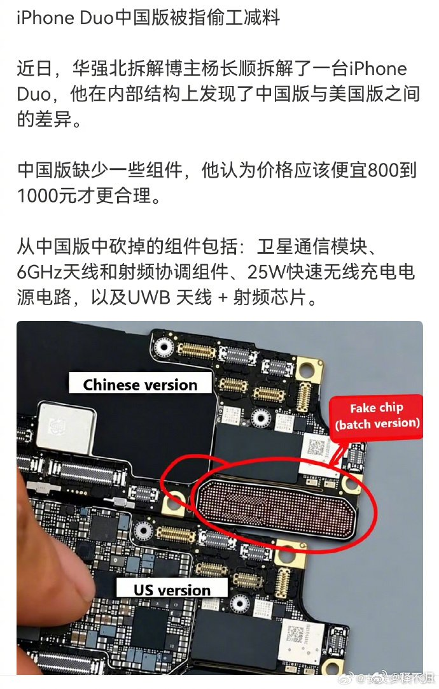

---

## 3

@向小田

发表于：2026-10-31 23:56

来源：微博

链接：https://m.weibo.cn/status/5360352029311526

10月31日，据悉OpenAI的目标估值下调了1500亿美元，降幅约10.7%。

原目标估值： 1.4万亿美元

最新目标估值： 1.25万亿美元

估值缩水： 1500亿美元（约合人民币1.06万亿元）

下调幅度： 10.7%

更值得关注的是，OpenAI连融资目标也大幅缩水了。原计划融资300亿美元，现在下调至200亿美元，削减100亿美元，降幅33.3%。

---

## 4

@梁斌penny

发表于：2026-10-31 23:37

来源：微博

链接：https://m.weibo.cn/status/5360347185415083

\#江苏反思2008年高考改革\# 这个话题我必须参与一下。

江苏是公认的高考改革“试验田”：3+X、3+大综合、3+1+1，再到2008年的“3+学业水平测试+选修等级”，最后才并入全国新高考。几乎每几届学生面对的规则都不一样，家长和学校只能靠加码应试来对冲不确定性。

08方案下，总分只有480，区分度低；物理化学不计入总分，只给等级，高校看不到分数。人家自然不爱招，名额就慢慢流向了其他省份。

江苏富裕，扛得住折腾，于是替全国探了路。我们江苏考生被折腾得够呛，好在底子厚，不至于太惨，换成别的省份恐怕真扛不住。希望全国教育界同仁记住我苏这次“伟大探索”。

好在现在改回来了。不过AI也来了，读不读大学价值也不大了，想学什么，抓住AI猛学，可能比很多大学都管用。以前我觉得苦难是最好的大学，现在改一下：苦难+AI，才是最好的大学。

---

## 5

@梅新育

发表于：2026-11-01 08:51

来源：微博

链接：https://m.weibo.cn/status/5360366905460037

【梅新育：舆论场上一些流行经济社会主张不合事实、逻辑且自相矛盾】

现在舆论场上一些流行经济社会主张不合事实、逻辑且自相矛盾，如宣称我们“投资过度”的，事实上我们固定资产投资去年开始已经下降了将近4%，今年前8个月降幅接近翻番，如果只看新建投资，2024年就已经下降了。

如宣称我们生产过度的，事实上自去年1月特朗普正式就职以来，美国制造业指数就一直高于我国、高于世界平均水平，今年以来这个领先幅度有扩大趋势，且今年以来伊朗和胡塞的许多做法是在这方面助力美国。

如主张扩大消费的，问题是前几年达到高峰的居民部门负债率是高风险且不可持续的，在居民部门和政府部门修复资产负债表的过程中，不能指望消费强劲增长，从全球经济运行角度看也不行。

如主张大力度加强福利以扩大消费、促进生育的，这完全颠倒了，社会保障、社会福利极度扩大，恰恰是二战之后发达国家和新兴工业化经济体普遍结婚率、生育率锐减而离婚率、LGBTQ、异质移民猛涨的关键原因，……

---

## 6

@史老柒

发表于：2026-10-31 11:18

来源：微博

链接：https://m.weibo.cn/status/5360161360187496

好图，存着留着以后用，潜伏这剧金句太多了，以后肯定用的上

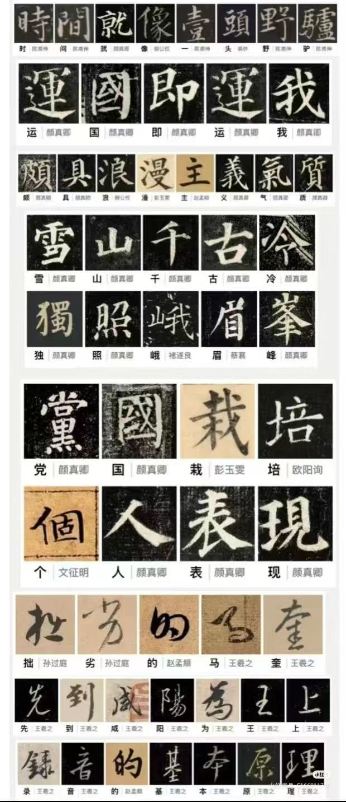

---

## 7

@明涛AI_ECON

发表于：2026-10-31 11:44

来源：微博

链接：https://m.weibo.cn/status/5360167845103668

用人部门要参与招聘过程才行，你不参与当然就不能怪招的人不好用。抽象地说，招聘选拔必然有两类错误；员工自己也要充分发送信号(signaling)，指望别人十分钟发现你的优点，就要琢磨好怎么表达自己。//@包特_ExpEcon:不光是招聘的问题，主要也是学习欧美快乐教育理念，家长和孩子都相信会不会干活不重要，能吃苦更是会导致吃苦，只有相信自己永远正确，错误都是别人的甩锅能力才是大男主大女主标配//@李子暘Lee:演讲比赛……//@高龄小兵兵:我们单位每年都有考编的内部面试，我们退二线的老主任就曾经说过，这哪是业务能力面试呀，这不就是演讲比赛嘛！说能把一个说成仨谁是大厉害我瞬间想到的就是总统选举

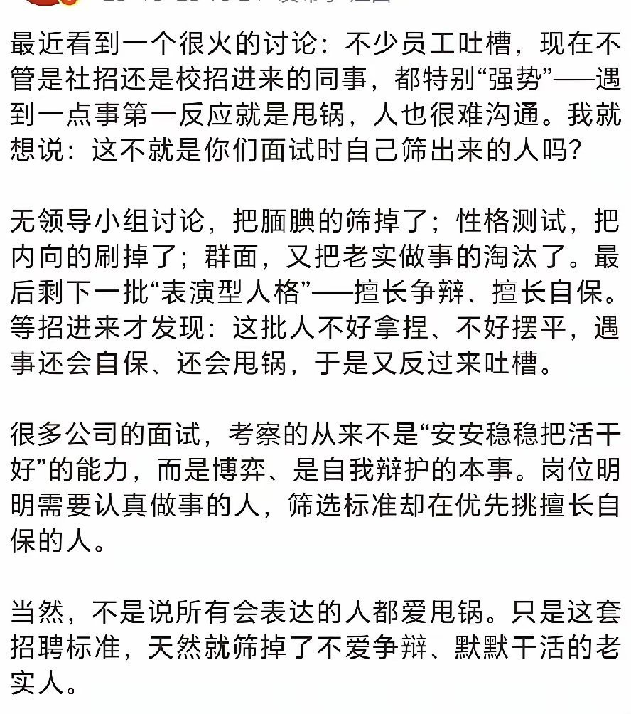

---

## 8

@风云学会陈经

发表于：2026-10-31 08:37

来源：微博

链接：https://m.weibo.cn/status/5360120894327923

比亚迪102万人，人均只造5辆车。感觉整个中国有些类似，看着人多效率不高，但是爆产能特别厉害

最近传出超过100万人，是有点震惊的，中国一共就几个公司超过100万。国家电网、中石油超过100万人，比亚迪是过百万的第一家民营企业，比中石化人还多。

但再一看，人均才造5辆车，又似乎有点少，丰田是人均29辆车，大众也有13辆。可是再看比亚迪的风格是“什么都自己造”（除了轮胎），这也还可以理解。

整个中国发展路线有些类似，什么都想自己造，不能的都要去搞研发突破制造。

如果再发展下去，假设年销量1000万辆，那不会等比例变200万人，说不定只增加20-30万人。这就是先把基础打好了，然后就爆产能了。现在102万人，肯定不只是为460万辆销量配置的，除了汽车，还有比亚迪电子、弗迪电池等很多业务。其实现在就被弗迪的二代刀片电池产量卡。这么多员工，是真的按销量全球第一的目标来安排的。

从比亚迪，就能看出中国为什么产能这么厉害了。因为各种产业规模都铺开很大，都配齐了。等到要上产能的时候，就效率提升很快了。产能产量翻倍，但人数增加不多，甚至有时制造业就业还减少了，机器效率提升更快。

等产量到了一定规模，又是全产业链，那垂直整合的威力就出来了。整个中国制造业垂直整合的大能已经展现得不错了，比亚迪还没有，业务还需要突破。等没有短板了，品牌和技术、全球市场都突破了，别家就发现，不可能对抗了，整个模式有独一无二的好处。

现在比亚迪的闪充网络就有点意思了，别家还真的不太容易对标搞出来。首先就不可能把员工人数搞这么多，不容易学着电机、电控、电池全部整合，需要的投资太多。

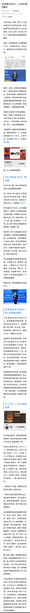

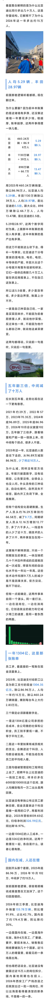

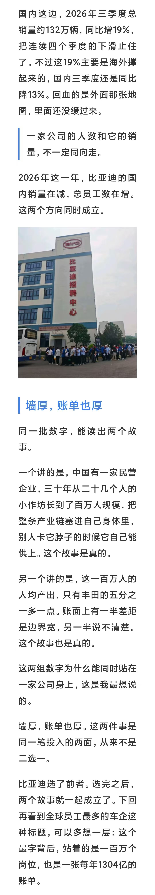

---

## 9

@升值计

发表于：2026-10-31 08:38

来源：微博

链接：https://m.weibo.cn/status/5360120949119380

张雪把他老妈拉黑了，给的理由是，总有些机构拿他妈做文章炒作，这些机构很傻逼。

其实这就是成年人的无奈，张雪的潜台词是，他妈很傻逼，因为如果他妈但凡顾及点儿子，完全可以停止这种采访，停止蹭张雪的流量，张雪要么是跟他妈联系沟通过，无果，要么是压根已经不信任他妈了，连沟通都没有。

但是儿子说自己妈妈很傻逼，这种话在咱们中国人的语境里，是不能说的，连想都不敢想。

一个妈妈，年轻的时候抛弃儿子，等到孩子功成名就了，来摘桃子不说，而且本身母子关系就尴尬，张雪是企业家，不是娱乐明星，甚至不是一个文化名人，他的形象是不容出错的，稍微给用户带来不好的观感，一句话说不好，直接影响的是真金白银的销量。

但是咱们中国人没有办法，母亲是一个不被批评的概念，《左传》第一篇，郑庄公掘地见母，就给我们讲了一个血淋淋的事实，母亲不爱孩子怎么办？

怎么办？雄才大略如郑庄公，能称霸诸侯，能射周天子的肩，能把亲弟弟玩弄于鼓掌之上，军国大事外交玩得风生水起，但是对他妈妈发誓不到黄泉誓不相见，最后还是只能掘地见母，互相给个面子。

---

## 10

@高飞

发表于：2026-10-31 08:49

来源：微博

链接：https://m.weibo.cn/status/5360123795998348

\#模型时代\# 

Richard Sutton：我对技术奇点持乐观态度的一个原因是，我已经看到它在过去50多年里逐渐逼近。1975年，当时我17岁，我写道：

“在人类能够最有效地辅助他的问题解决机制之前，他必须首先理解它。目前，他的理解非常贫乏。然而，一旦在理解大脑方面取得突破，进步将非常迅速，并呈指数级增长。一旦人类创造出比自身更高级的智能，这种智能就应该能够创造出比它自身更高级的智能，正如智力低于它的那个人类能够创造出它的智能一样。因此，智能水平将以令人难以置信的速度急剧上升，可能在几年之内就会发生。在突破后的几年内——而这一突破可能随时发生——人类要么会被他自己创造的、而他已无法理解的更高级智能甩在身后，要么他将变成那种智能，不再像今天所能想象的任何东西。”

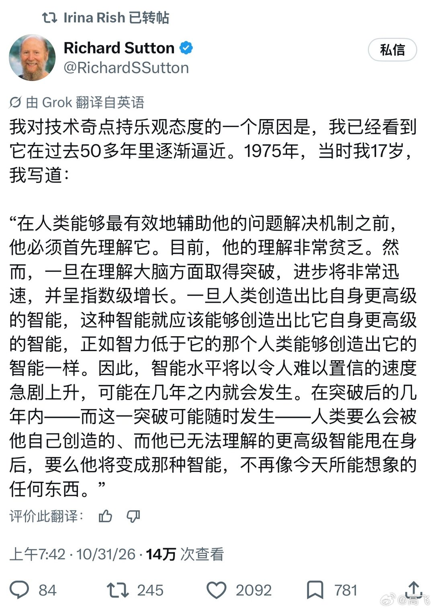

---

## 11

@看星星的Flora

发表于：

来源：微博

链接：https://m.weibo.cn/status/4987673441730579

如何区分一个人思维的高低，看他表达的清晰程度。

记得当时看双琴侠点评顶级小提琴天才蔡珂宜的演奏时说，无论节奏多快，能保证每一个音给得都非常清晰。

回想读书时遇到的数学天才，解题思路也是非常清晰。

这就是为什么我极其讨厌啰嗦，除了情绪发泄之外，还模糊了自己要传递的核心信息，讲得越多越乱套。

简洁，在绝大部分事情上，都是高级感的来源。

---

## 12

@明涛AI_ECON

发表于：2026-10-28 23:44

来源：微博

链接：https://m.weibo.cn/status/5359261899032883

徒弟改为大秘吧，否则对不上，体制内不认徒弟只认大秘，大秘可以带着走（不知道现在如何）。//@包特_ExpEcon:欧阳克就是流氓团伙头子，郭靖不当驸马片尾也是万夫长了，相当于正规军少将，只要他不辞职肯定上将起步，甚至元帅封王享受副国级待遇，比完颜洪烈级别都高～//@楚惜刀:要的是偏爱//@本来老六:欧阳克就是理所当然，他的确具备很多女人动心的要素，而他和段正淳的差距就是后者高明地不去强调这点，诱导对方自己发现或者说缓缓接受。财富聪明对黄蓉毫无吸引力，黄药师霸道之下其实她也渴望把控，郭靖是完美收纳器。那么有没有年轻的段正淳呢？杨过。//@好茶贪香又恋花://@胜利主义章北海:你会喜欢一个花花公子吗？//@后街僵尸乱咬人:问题是欧阳克比他差哪了？ 好的，现在的相亲市场，站在你面前的是： 西域顶级财阀白驼山庄少庄主 当朝太师、黑道实际掌控者欧阳锋的亲侄子 大宋朝廷通缉榜上的S级在逃人员 国家级非物质文化遗产"蛤蟆功"唯一指定继承人 拥有独立私人武装力量，手下全是死士 白驼山驻中原办事处主任，欧阳克

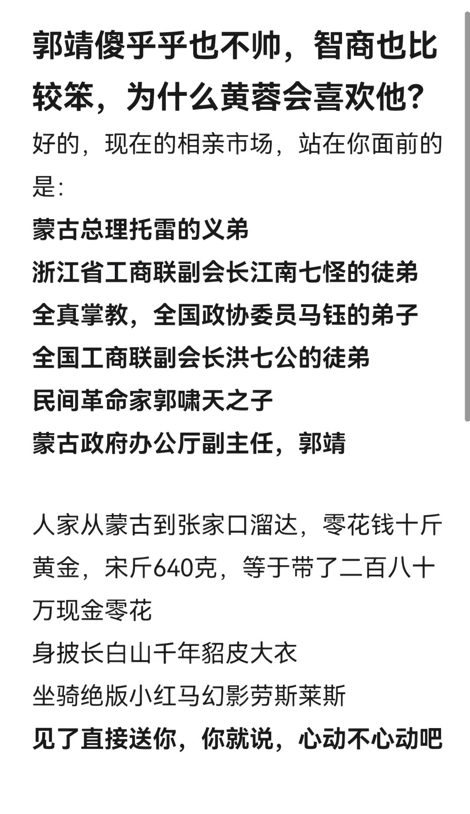

---

## 13

@宝玉xp

发表于：2026-10-28 21:31

来源：微博

链接：https://m.weibo.cn/status/5359228363211203

网友晒 OpenAI 软件工程师面试全流程：带回家项目会被逐行追问，部分人加考“用 AI 写代码”

Reddit 求职论坛 r/InterviewCoderHQ 上，用户 little_kwagga 发帖说自己刚面完 OpenAI 的软件工程师岗位，把流程拆开讲了一遍：

一通招聘官电话，两轮技术初筛，一个 48 小时的带回家项目，一场专门追问这个项目的面试，再加四轮现场面试。部分候选人还会多一轮，要求用 AI 编码工具解决一个靠手写做不完的问题。

这是一位匿名网友的个人经历，OpenAI 没有公布这么细的流程，不同团队、不同职级的面试也可能不一样。能对照的官方信息是 OpenAI 官网的面试指南：大致分初步沟通、技能测试、终面、出结果几个阶段；技能测试可能是结对写代码、带回家项目或技术测试；终面一般 4 到 6 小时，见 4 到 6 位面试官。

【每一轮考什么】

招聘官电话：主要聊背景，但发帖人被问到“你觉得 AI 会往哪走”。发帖人建议提前读一遍 OpenAI 章程（Charter），这是 OpenAI 2018 年发布的使命文件，核心是让通用人工智能造福全人类。官网面试指南也建议读，并写明会看候选人跟公司使命和价值观合不合。

技术初筛：同一天两轮，各 60 分钟。编码题是做一个“带版本的键值存储”，可以理解成一本能记住修改历史的字典：同一个词条改过很多次，你要能查出它在任意时刻的值。系统设计题是一个容错的任务调度系统，负责按时派发任务，某台机器挂了，任务既不能丢，也不能重复执行。

带回家项目：48 小时内做一个能真正跑起来的东西。发帖人拿到的是分布式 webhook 投递系统。webhook 是网站之间互相通知的方式，比如你付款成功后，支付平台会主动给商家网站发一条消息。题目要求发送失败时自动重试，重试多次仍失败的消息放进“死信队列”，相当于邮局存放无法投递信件的柜子，留着之后处理。

技术深挖：面试官事先看过你的项目，自己列好一张问题清单，带着你逐行过代码，追问每个选择和决定的理由。

现场四轮：

编码第一轮是“渐进式多阶段”题：题目分几段放出，前一段做出能跑的解法，下一段才开放。发帖人拿到的是 token 级的流式比对器。token 是大模型输出文字的最小单位，大致是一个词或半个词，模型回答时就是一个 token 一个 token 往外吐。这道题要边接收边比对内容的变化，记录每一步状态，还要能回滚到之前的状态。发帖人的经验是先尽早做出一个正确的版本，再一步步改进。

编码第二轮偏系统方向，考状态管理、并发和内存效率，还问到 Python 的生成器、异步写法和迭代器这些语言底层机制。

系统设计题是“设计 ChatGPT”。面试官关心的是 GPU 怎么分配、流量忽高忽低时怎么自动加减机器、多台机器之间怎么协调。发帖人提醒，除非面试官特别要求，模型推理那一层可以当成一个黑盒，不用展开。

行为面问的是技术领导力、影响多个团队的架构决策、压力下怎么让大家达成一致。发帖人说要讲具体的取舍，空谈沟通技巧的回答不管用。

【新增的 AI 编码轮】

发帖人说，这一轮还在测试阶段，只有部分候选人会遇到：给你一个现成的代码库，外加一个大到靠手写做不完的问题，要求你用 AI 编码智能体完成。AI 编码智能体指能自己读代码、改代码、运行命令的 AI 工具，比如 OpenAI 的 Codex、Anthropic 的 Claude Code。这一轮怎么评分，发帖人没说，OpenAI 官方也没公开介绍过这一轮。

OpenAI 官网面试指南里有一句相关的说明：不同面试对 AI 工具的要求不同，有些形式有意允许使用，有些要考你不靠 AI 独立解题；准备材料里会写清楚，拿不准就提前问招聘官。所以同一套面试里，可能有的轮次不许用 AI，有的轮次专门看你怎么用 AI。

发帖人在帖子最后问，有没有人专门准备过渐进式多阶段这种题型，什么方法有用。

来源：Reddit r/InterviewCoderHQ 用户 little_kwagga 的帖子《OpenAI Software Engineer Interview 2026》；OpenAI 面试指南 网页链接

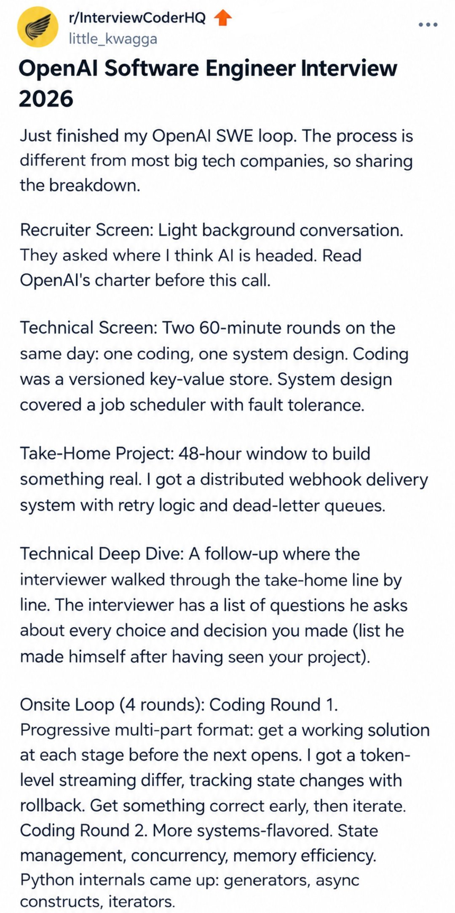

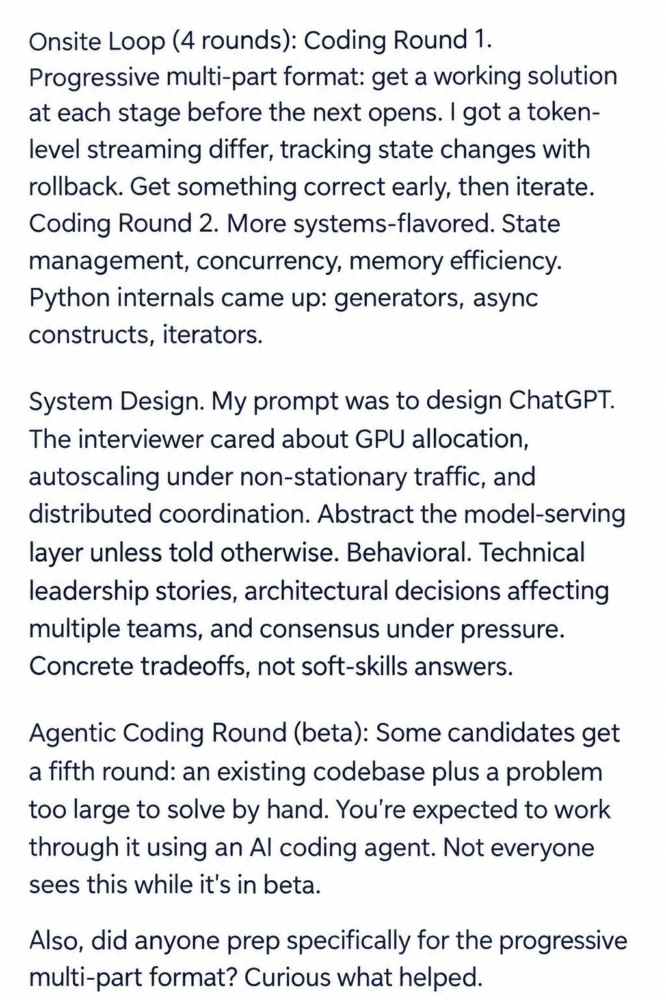

---

## 14

@RevengeRangers

发表于：2026-10-27 19:51

来源：微博

链接：https://m.weibo.cn/status/5358840788812396

有一年的腾讯安全会议上，我公开提出过，指纹、声纹、虹膜、人脸、甚至DNA数据这些生物识别特征具备不可修改的特性，一旦丢失，就是史诗级灾难。但是那个时候有专家提出的是生物特征具备唯一性，这些很安全，不可复制不可篡改。这特么才几年，加上AI加持，黑客可以轻而易举的复制和伪造这些数据，更重要是你特么还不能像改密码去修改这些，搞不了，后续还会影响各行各业，并且影响久远。未来%100的会放弃这种生物识别的认证方式，会催生出新的认证方式。

---

## 15

@李建秋的世界

发表于：2026-11-01 08:53

来源：微博

链接：https://m.weibo.cn/status/5360368490906689

黑石告诉投资者，Anthropic上市后可能无法立即获得投资级评级，预计主要评级机构将给予其“较高档”的垃圾级评级。

据英国《金融时报》援引知情人士报道称，黑石向Anthropic最新一笔630亿美元芯片融资交易的投资者传达了这一信息。若评级落在垃圾级，Anthropic为逾8000亿美元的算力计划融资前景将更加复杂

有意思了

---

## 16

@36氪

发表于：2026-11-01 08:53

来源：微博

链接：https://m.weibo.cn/status/5360368223519096

【奥特曼：PC上装内存太浪费，最好留给AI数据中心】

「从全球资源配置的角度来看，让每个人把紧缺的 DRAM 囤在自己电脑里大部分时间闲置，是『相当糟糕』（quite terrible）的安排，内存应该集中到云端数据中心去。」

话都说到这份上了。

本周四在接受 YouTube 频道 Cheeky Pint 的采访时，OpenAI CEO 山姆・奥特曼（Sam Altman）全程喝着啤酒，气氛轻松地聊了聊 AI 大模型的本地推理，以及由此延伸出的家用电脑内存不足的问题，不经意间爆典了。

我们知道，目前全球 AI 浪潮引发的内存涨价，已经让 PC 和手机的价格暴涨了一圈，个人消费者早已难以承受。与此同时，各家内存大厂的产能扩张还要等一阵子。就在前沿 AI 公司吃下内存大头的同时，他们却已经开始讨论起个人电脑中的内存是否得到充分利用。

奥特曼提到一个假设，即人们能够在自己的电脑上运行本地人工智能，这些电脑可能是他们已经拥有的，也可能是因为 AI 大模型技术兴起，他们想要组装的。他认为这是一个糟糕的想法。

「从全球资源分配的角度来看，让每个人都把全球有限的 DRAM 内存闲置在自己的电脑里，而使用率只有 5%，这其实非常糟糕，」奥特曼说道。「如果你想在这种资源供应极其紧张的环境下工作，那么在云端就应该尽可能提高资源利用率。但不知为何，很多人的直觉却恰恰相反。」

如今，OpenAI 的主要业务基于在大规模数据中心运行的闭源模型，他为自家商业模式的辩护引发了 AI 社区的一片争论。

\#氪君领读\# ：

1、AI 正在引爆漏洞潮

2、智力爆炸与科学发现的代价

3、市场调节，到 AI 时代玩不转了？

4、个人智能体怎么定价？

详情请阅读：网页链接，本文来自 “机器之心”，作者：泽南 。

---

## 17

@李子暘Lee

发表于：2026-11-01 08:53

来源：微博

链接：https://m.weibo.cn/status/5360367767391532

我也一直纳闷儿，这是为啥呢？//@看客9955:拥有着整个星球 唯二的军事实力。工业总产值是西方所有国家的总和，还多。还是一副哭哭啼啼受害者的样子。哪里出了问题？ //@李子暘Lee:军国主义已经在日本泛滥了……搞宣传的，瞧瞧你们忽悠出多少傻子。//@栟山:有多少日本人能有这样的认识，军国主义已经在日本泛滥了，我们应该保持高度的警惕，才是主流。

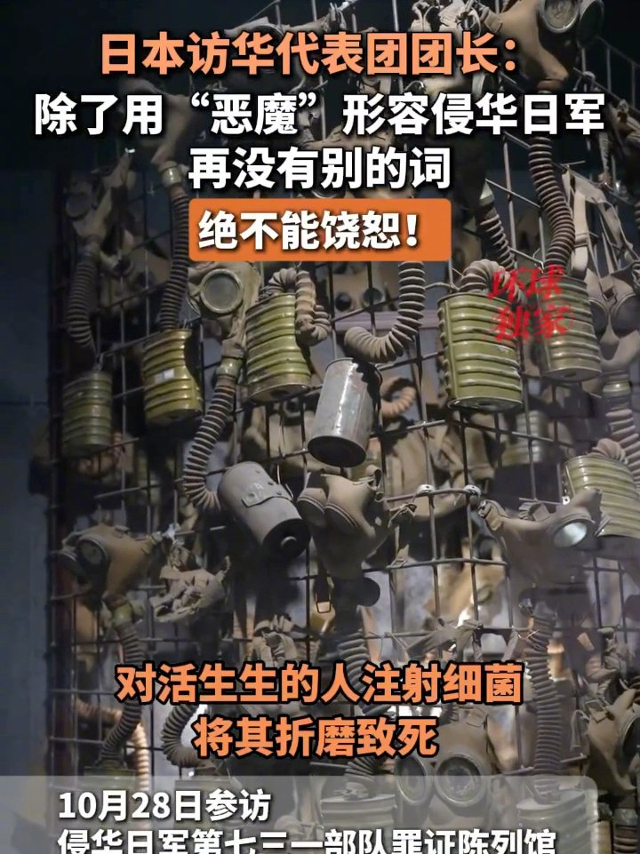

---

## 18

@汪有

发表于：2026-11-01 11:53

来源：微博

链接：https://m.weibo.cn/status/5360413589638266

前两天我发了图一，说麦当劳密集的地方人均寿命也更长。

来了好多人骂我。

说什么“相关性不等于因果”“不可以错误归因麦当劳让人长寿”。

我：？？？

我啥时候说麦当劳让人长寿了，我正文明晃晃说了“相关性不代表因果”，这帮人看都不看就来喷了。

网上真的很多人自己学个知识，就假设别人都不知道，看到某个地方能显示自己懂这个点，到处说。

其实我写那条微博的时候本来还想，没必要注明“相关性不代表因果”，大家肯定都知道。

就为了防杠加了一句，发现加了也白加。

而且来喷我的人基本符合关注列表定律。

这些知识就是他们一生中能接触到的最高深的知识。

好比这些人经常在我评论区喷《意林》。

我已经二十年没看过意林了，可能意林就是他们永恒的创伤。

他们读过最能伤害他们的作品。

图2，我之前做过一张图，叫“哈尔滨为什么那么大”。

哈尔滨市辖面积真的很大，放到其他地方一对比，大极了。

发出来以后，好多人又来说：那是因为墨卡托投影！越往北的地方在地图上就越大！哈尔滨根本没有那么大！只是显大！

一条微博简直把所有懂墨卡托投影的人引诱出来了。

但有没有可能我也懂墨卡托投影。

如果细看可以发现：我截图用的是谷歌地球。

为了消除墨卡托投影的影响，我是在地球仪上截的图。

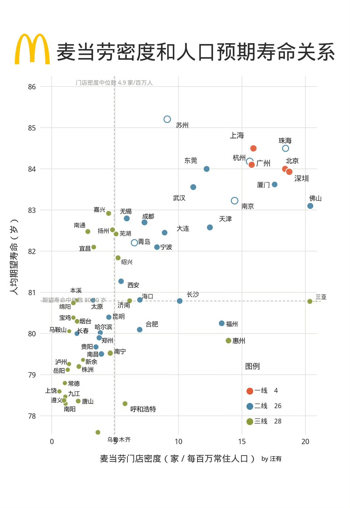

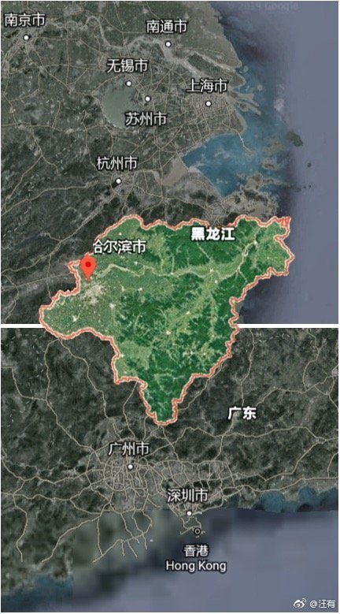

