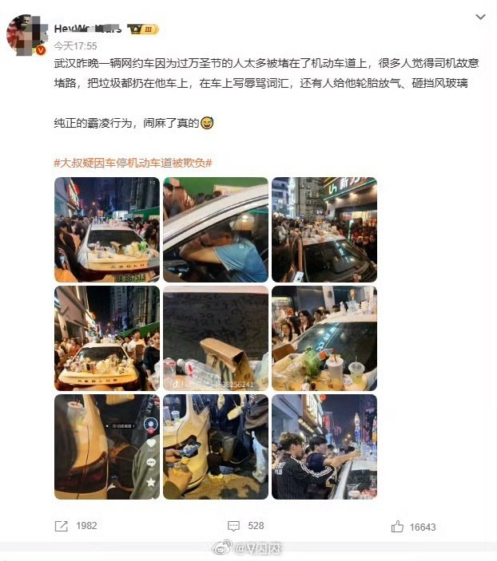
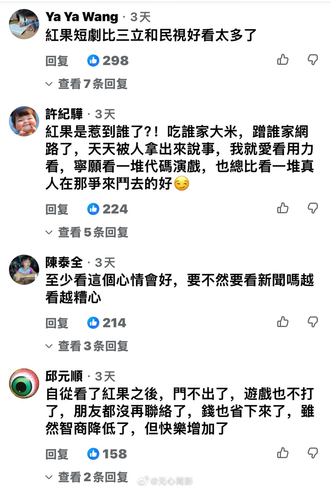
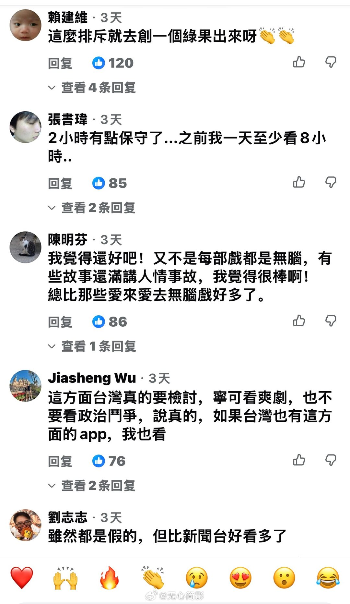
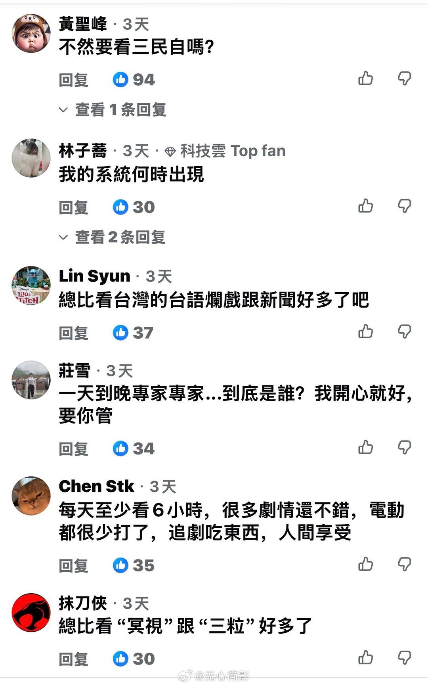
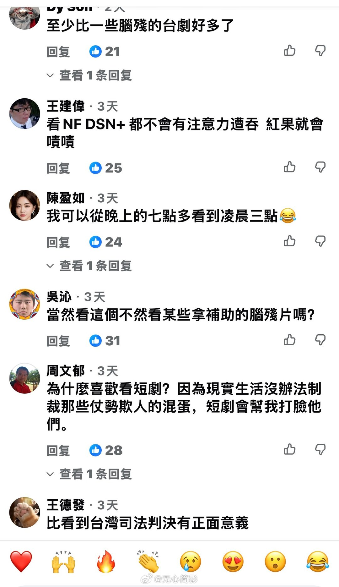
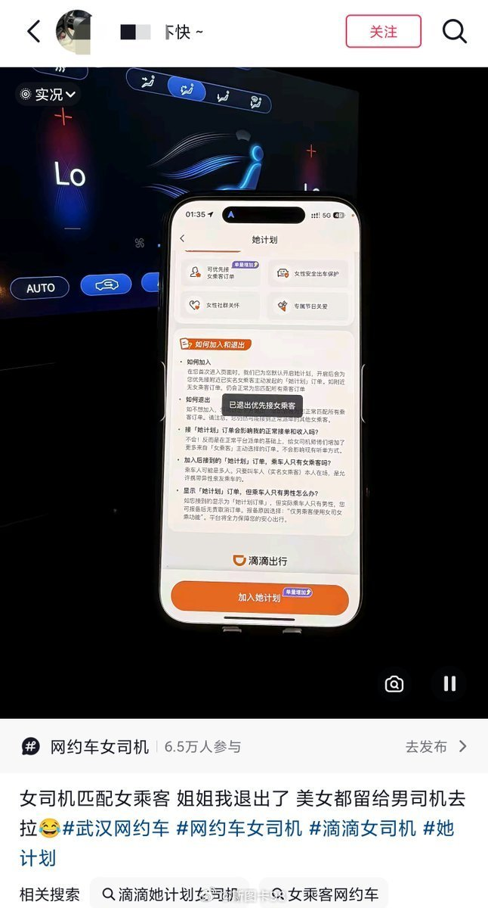
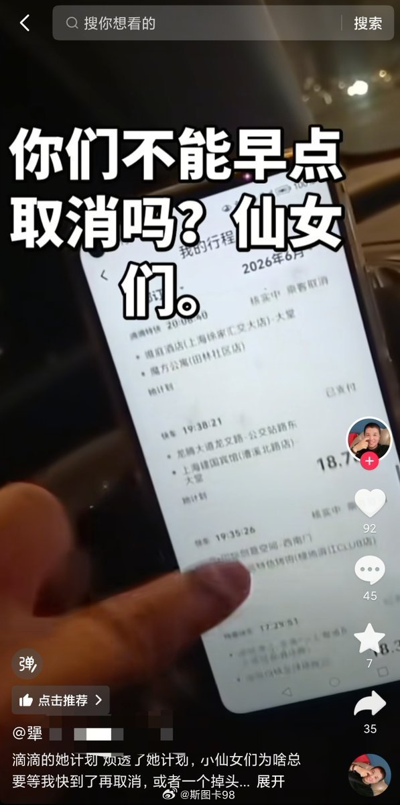
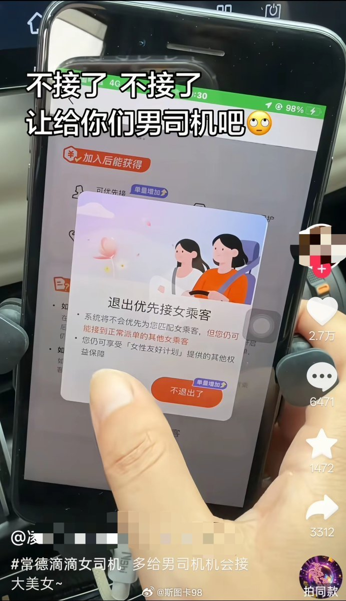

# 2026-11-02

## 1

@物理芝士数学酱

发表于：2026-11-01 15:01

来源：微博

链接：https://m.weibo.cn/status/5360579708716099

\#今天要来点物理吗？\# \#电力系统\# 走进科学~\#今天要来点计算机科学吗？\# 

德国输电运营商长期发现欧洲电网频率会每60秒出现一次短暂下跌。这种现象不危险，但非常规律，像时钟一样准时，因此引起了研究人员的兴趣。

现在发现：

原因不是发电厂，也不是单个用户；而是大量大型电池储能系统（battery storage systems）。

这些电池设备通常会在每分钟开始时检查一次自己的充电状态（state of charge）；

由于全球有很多这样的设备同时执行检查，会导致电力消耗出现同步的小尖峰，从而在电网频率上留下可测量的“60秒周期信号”。

Original publication: 'One-minute frequency disturbances from unintended synchronization in cyber–physical power systems', Nature Energy 2026, DOI: 10.1038/s41560-026-02144-0

虽然规模电池系统是主要原因之一，但显然，对于任何执行cron任务且拥有同步时钟的其他计算机化系统来说，情况也是如此。 尽管听起来有些奇怪，但在 Linux 发行版和其他软件中，为 cron 任务添加 0-59.999 秒的随机延迟，实际上反而有助于稳定电网。

主要“问题”在于同步时钟，以及太多开发人员将“整点”作为任务调度的默认设置。

大规模部署的系统在完全相同的时间执行某项操作从而引发问题，这一现象系统管理员早已知晓数十年。针对各种任务调度程序，现成的解决方案早已存在。然而，缺乏经验的开发人员和维护人员仍然习惯性地将“整分钟”作为默认设置。

软件工程行业一次又一次地经历着这种现象，时而吸取教训，时而又重蹈覆辙。

---

## 2

@V闪闪

发表于：2026-11-01 23:20

来源：微博

链接：https://m.weibo.cn/status/5360705310034052

\#中国女生借卫生巾震撼外国网友\#月经羞耻这种话题舆论是不是近些年生生制造出来的？

以前谁特么没事会觉得在公共场合公开说卫生巾、借卫生巾，购买卫生巾是令人羞耻的事？不就是女性生理期的必需品吗？大型商超和普通小卖铺的货架上一直摆放啊，有什么需要遮掩的？怎么后来就变成一种反对社会迫害的反抗行动？是没事找事吗？

硬生生造出一个没有现在拒绝月经羞耻的社会活动前，全社会就在压制、不允许公开说月经，说出口就很难为情？这不就是岁月史书给现实化了吗？

---

## 3

@新浪科技

发表于：2026-11-02 08:30

来源：微博

链接：https://m.weibo.cn/status/5360715490922072

【\#古尔曼称苹果将砍掉非触屏高端MacBook\#\#苹果将淘汰非触屏MacBookPro高端款\#】苹果上周推出首款触屏 MacBook Pro，采用 M5 Pro/M5 Max 芯片。不过如今，苹果仍在销售今年 3 月推出的 M5 Pro/M5 Max 版 MacBook Pro。根据知情人士的消息，这种产品定位互相冲突情况不会持续太久。

彭博社记者马克 · 古尔曼透露，苹果计划在 2027 年推出第二代触屏 MacBook Pro 时，将现有笔电阵容的非触屏高端 MacBook Pro 全部淘汰。14 英寸 MacBook Pro 基础款机型将升级 M7 芯片，并换用全新轻薄机身设计，但不支持触控。

与现款 MacBook Pro 相比，触屏 MacBook Pro 的售价要高出 400 美元（IT之家注：现汇率约合 2,668 元人民币），这中间涨的价格足以让非专业消费者感到压力。1,999 美元（现汇率约合 13,335 元人民币）的基础款 MacBook Pro 仍然是苹果专业产品线的入门之选，它相比 MacBook Air 提供素质更强的屏幕、更全面的接口以及更强性能。（IT之家）

---

## 4

@V闪闪

发表于：2026-11-01 23:42

来源：微博

链接：https://m.weibo.cn/status/5360710927517241

\#武汉万圣节砸车赔偿\# 万圣节这种事情，且不说是美式文化的引进，二战后，🇺🇸军队驻地的国家地都喜欢过，就是今天国内都市年轻人喜欢从这种节日里找到情绪宣泄口，积极参与这种活动来发泄身上的青春期骚动，也该遵守社会公德。

可是这一天恰恰是国内某些过万圣节的群体要趁机撒疯的日子，目的就是以这是节日的借口，在公共场所堵路，不遵从社会道德，甚至要跨过法律门槛，借机破坏社会秩序，制造混乱。

而且如果没有相关法规限制这类活动的底线，这种节日以后每年发展下去，大概率会被某类人或力量给予利用煽动，或者发生意外伤亡事件，成为引爆颜色的引子，都是有可能发生的。

\#武汉万圣节砸车追责\#

---

## 5

@有个梨GPT

发表于：2026-11-01 13:56

来源：微博

链接：https://m.weibo.cn/status/5360563484889337

站桩分为急性站桩和慢性站桩两种。

慢性站桩的主要目的，是象鸡头稳定器那样，稳定人体从头顶到骨盆的位置，「尾闾中正神贯顶」就是这个意思。

人的正常站姿骨盆是有点前倾的，不管是军姿、舞蹈或体操训练，均如此。但慢性站桩采用腿微曲的办法让骨盆可以不前倾也不后倾。

为什么要这样，主要是让脏腑的血流通畅，脊椎不承力，这是基础姿势；进阶的则是配合呼吸，抑制交感神经兴奋，提升副交感神经兴奋，即移动自主神经系统的平衡点。

今天武当袁师懋道长在b站上说了一句名言：你都修身养性了还做什么计划表，你理解这句话就理解了慢性站桩在干什么了。

++++

但马步桩不一样，虽然最终是一样的但是它走的路线不同。马步桩也不是能通过膝盖弯曲程度逐渐增加，或者靠墙静蹲逐渐提高时间练出来的，马步桩是个急性站桩训练。

急性的意思是什么？就是从一开始就保证大腿和地面是平的。当然它还有三步半、膝盖和脚尖方向的要求，具体可以看袁师懋道长的b站视频，这个姿势一学就会没有花头。

但是这个站不久啊，呲牙咧嘴20秒就要倒了，没错。但是正确的练法就是这个呲牙咧嘴的感觉，要多坚持5秒，无论如何要多坚持5秒。

实在坚持不下去怎么办？放弃对上半身姿态的要求。上半身前倾，甚至整个上半身折弯下去到和大腿平行的程度。这会减少膝盖为支点、大腿肌肉发力时、身体负载的力矩。换句话说这不是一个四平马步，但是大腿一定要平，扛不住就身体前倾，要的就是不择手段的「多坚持5秒」。

++++

只要你掌握这个技巧，两天之内突飞猛进超过30秒甚至能做到1分钟都是可能的。

为什么要这么做？因为，这个训练坚持的最后5秒-10秒是最重要的，就像抗阻的力竭一样，它首先会给大脑一个强烈的刺激，疯狂提升交感神经兴奋，心率和呼吸；然后，结束后马上站起来，这个时候大脑突然失去血压，中枢神经会立刻叫停交感神经兴奋，同时副交感神经强力反弹，在很短的瞬间全身血管放松，肢端和内脏立刻得到大量血流灌注，身体彻底放松。

当然这样做要求练习者没有心脑血管疾病，至少深蹲下去5分钟快速站起来没有不良反应，切记！

如果你刚开始练习，你做两次基本上就会马上扛不住困意立刻睡过去，因为大腿肌肉的无氧坚持产生大量腺苷，这是导致困意最重要的物质。

我前天第一次尝试这种「多坚持5秒」训练法，晚上八点左右，练了两次，然后直接扛不住困意倒在床上睡了一个多小时。昨天和今天开始习惯了一点。不过今天在星巴克扎了两次一分钟的马步，加上喝了一杯蒸汽奶，也差点睡过去。

++++

不要以为这种邪修是背离道家站桩的初衷的，并不是，只是这是非常暴力的一个方式，也是两个直接和迅速提升「副交感神经活动」全面放松的方法之一。另一个是温热刺激，39-41度水温的泡热水澡或者泡脚。

以上都是有（运动）医学证据的，最后祝你邪修「急性马步站桩」的体验愉快，进步神速。

\#唐人日记\#

---

## 6

@无心简影

发表于：2026-11-01 13:50

来源：微博

链接：https://m.weibo.cn/status/5360562033657212

台湾媒体转载大陆专家文章，想劝台湾人少看“红果短剧”，结果被喷了 300 多评论：“比台湾三立和民视好看多了” ，“不然要看審勃羊嗎？”

---

## 7

@斯图卡98

发表于：2026-11-01 23:37

来源：微博

链接：https://m.weibo.cn/status/5360709585078267

滴滴打车原本想出个“她计划”讨好女性群体

没想到弄巧成拙

让原本网络上喊的girls help girls

变成现实里的girls hate girls

