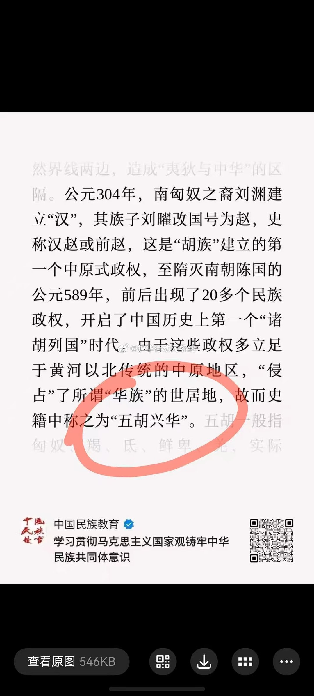
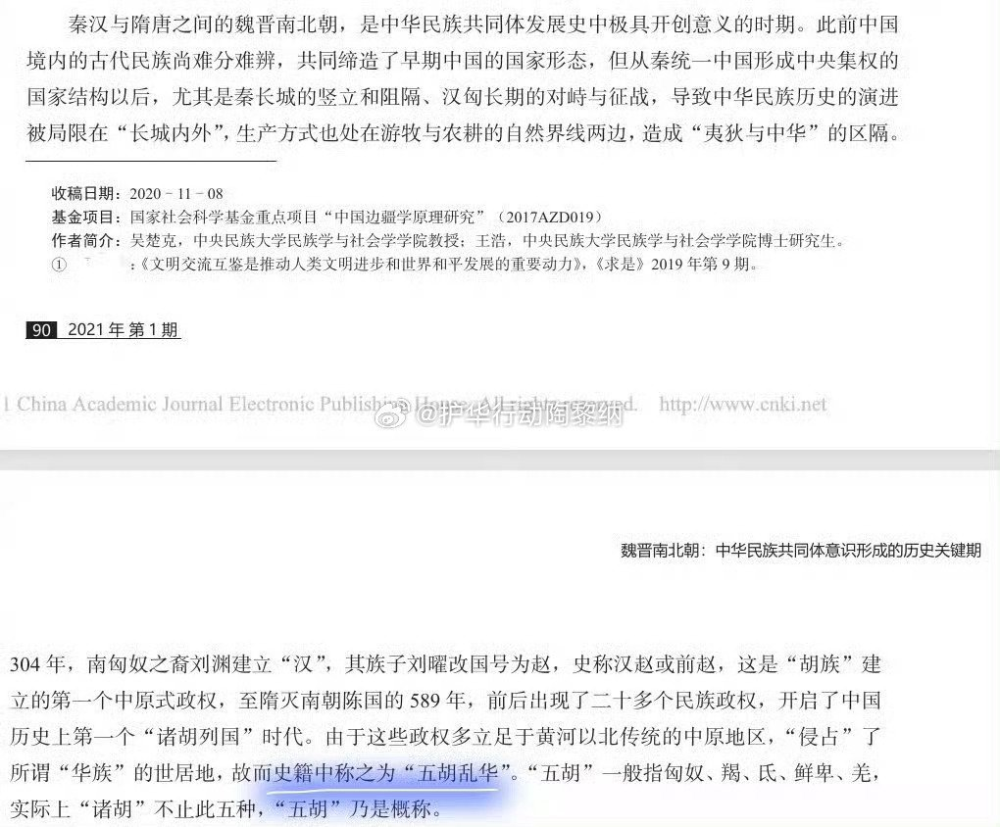
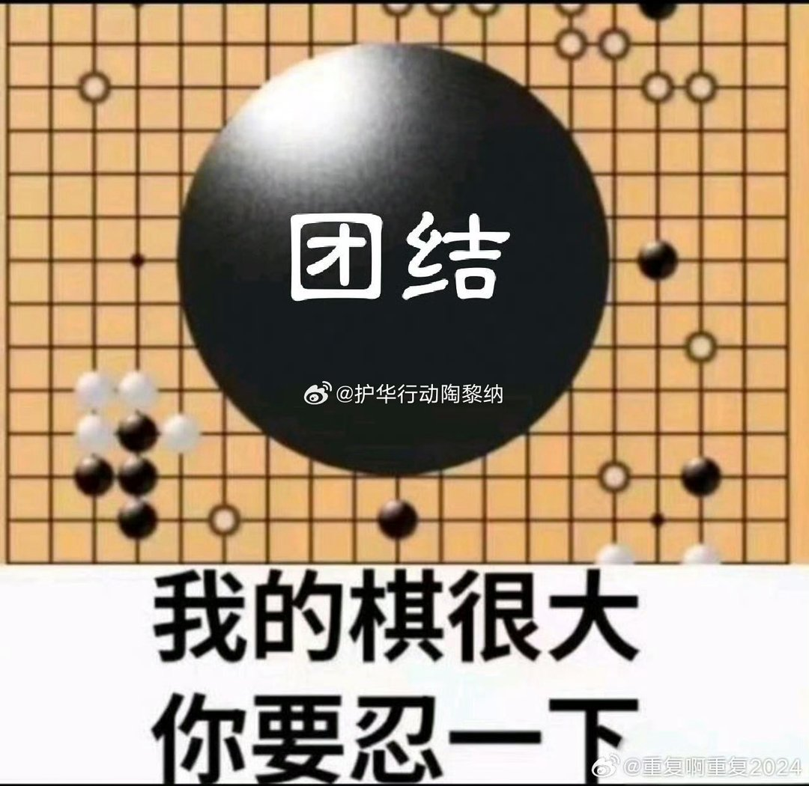

# 2026-11-03

## 1

@杨帆教授

发表于：2026-10-30 08:03

来源：微博

链接：https://m.weibo.cn/status/5359749907354448

杨帆评论

《经济学人》最新一期文章也说中国股市是个罕见例外，提出了一个非常扎心刺骨的灵魂拷问：

“如果这个国家正在赢得未来，那为什么它的股市投资者们却如此沮丧？”

咱们很多人看宏观叙事，总习惯把“产业打赢了”直接等同于“投资赚到钱了”。

过去几年，新能源、光伏、动力电池、智能硬件、AI 开源，无论从产能规模、出海速度还是技术迭代来看，中国产业链在全球都打出了堪称恐怖的统治力。

但在二级市场的 K 线图上，全球主要股市都在轮番刷出历史新高，唯独这里的股票市场成了一个全球罕见的痛苦例外。

这种反差撕开的，是所有股民和创业者必须补上的一堂硬核金融常识：

国家的产业竞争力，和股民的资本回报率（ROE），在底层从来不是同一套账本。

西方资本市场的底层设计，是一台极致偏向股东回报的提款机。

美股科技巨头哪怕赚了钱，也要把大笔现金拿去回购注销股票、分红给二级市场，优先维持高净资产收益率和股价泡沫，

它们追求的是维持高利润率、筑高专利墙，用资本溢价去奖励持股的人。

而中国产业叙事的底层逻辑，是一台把全要素生产率推向极致的“工业扩张机器”。

任何一个行业一旦被证明有前景，海量的产业资本、地方政策和创业团队就会瞬间涌入；

大家拼的不是谁给股东多分红，而是谁能以最快的速度把成本打穿、把价格卷到极限，把全球竞争对手直接挤出市场。

这种极致的性价比和产能过剩，给国家赢得了全球市场份额，给消费者赢得了极致便宜的商品，但唯独留给上市公司本身的，是薄如刀片的利润率和永无止境的资本开支。

股市在不同体系里的使命从第一天起就截然相反：

一个是拿来给居民沉淀财富、享受资本复利的资产池，

另一个在很大程度上，是承担为实体经济输血、分担创新风险、以低成本进行产业重资产融资的资本工具。

当你把辛苦积攒的积蓄投进去，你以为自己是在分享产业升级的红利，

实际上你的每一分钱，都在作为高强度的研发耗材和产能补贴，被无声砸进了重构全球工业版图的超级熔炉里。

看懂了这个巨大的结构性错位，你才会明白那种沮丧到底从何而来：

世界正在被中国制造重塑，但制造奇迹的功臣们，却不得不承受资本市场上最漫长的一场脱钩。

---

## 2

@EricTsui

发表于：2026-11-02 17:54

来源：微博

链接：https://m.weibo.cn/status/5360985675925630

//@蘸盐:破案了。原作者写的是“五胡乱华”，被《中国民族教育》小编改成“五胡兴华” 查看图片 //@蘸盐:中文系有不少深耕中国史的学者，立场偏保守、认同中华文化脉络，讲不出“五胡兴华”这种批话❶匈奴前赵把大量汉人百姓掳往平阳，分配给匈奴贵族作为依附人口、奴婢。❷羯族后赵大规模强制奴役汉人，征发数十万汉族百姓大修邺城宫殿台榭林苑，“时暴雨，漳水暴涨，死者数万人”。羯人是“国人”，享有特权；汉人称为“赵人”，法律地位不对等。国人可随意欺凌汉人，地方官吏不敢管束。石勒石虎征战各地时经常屠城，屠戮俘获的汉族军民，“坑斩士女，鲜有遗类”。❸鲜卑后燕、南燕大量掳掠汉人作为依附户、营户，专供军队和贵族驱使。❹匈奴胡夏征战关中、陕北，经常屠城，俘获汉族士兵、平民，常常大规模坑杀。由于沉重的民族压迫，汉族不断发起反抗异族的起义，最著名的冉闵“灭胡令”，还有后赵梁犊起义，河北汉人王午、吕护、苏林起义反赵，并州张平招纳十余万汉民武装自保，以及汉人著名的“乞活军”，还有各地汉人起义配合东晋北伐等等。把这段历史说成“兴华”，不敢苟同 查看图片

