# 2026-11-04

## 1

@装老师有毒

发表于：2026-11-02 16:51

来源：微博

链接：https://m.weibo.cn/status/5360969796289591

据界面新闻，关于徽剑父亲养子拿50万，签谅解书的情况是这样的：

1、这50万，是主犯赵冰的母亲筹集的。

一个农村妇女，不知哪里搞到的50万。

2、2024年底，两名壮汉找到徽剑父亲养子的老家，养子已经中风，行动不便，听说徽剑死亡，吓得当场瘫倒。

养子的儿子在外地打工，赶回老家，与族里长辈一起，将徽剑骨灰从死亡地带回村里，办丧事，操办了七天。

所有费用都是养子家出的。

3、丧事过后，养子儿子又外出打工。

不久，赵冰家又联系养子，谈起赔偿与谅解事宜，并准确报出养子儿子打工地址，这让他感到害怕，考虑到家人安全，这才同意。

养子儿子特意把见面地点约在他打工所在地的派出所，完成了谅解书的签署。

11天后，一审宣判，赵冰获死缓。

但最终，谅解书并未被法院采信。

\#明明是恐怖组织为何只称电诈\#

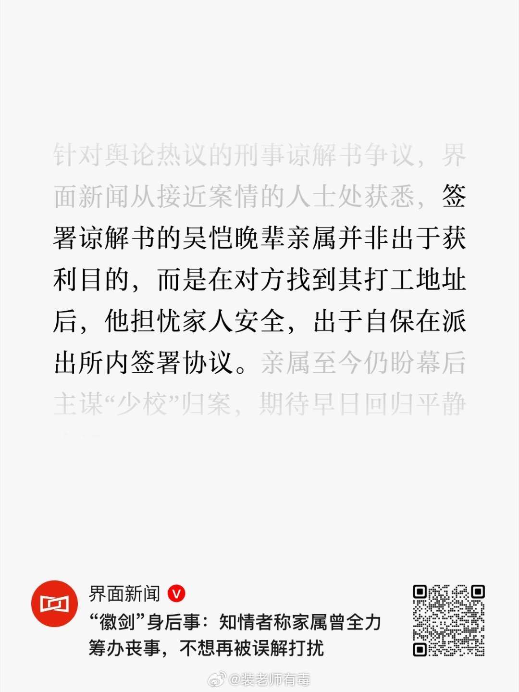

---

## 2

@以史为鉴V

发表于：2026-11-03 06:31

来源：微博

链接：https://m.weibo.cn/status/5361176298917059

\#九寨沟情侣被打伤情\#

“你的社保在殴打你”

这条评论让我一下没绷住……

\#热点观点\#

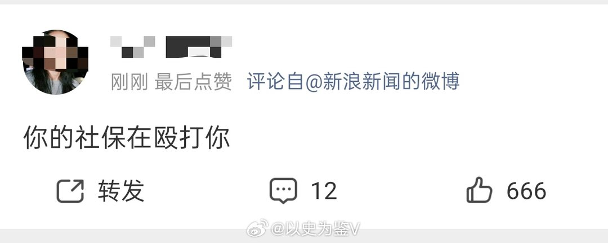

---

## 3

@院子里的主任

发表于：2026-10-30 01:21

来源：微博

链接：https://m.weibo.cn/status/5359648573230190

徽剑之死，我的一点想法。

普通人千万别效仿徽剑，更不要惹黑恶势力。当下大环境不好，到处是戾气重的底层，这就产生了很多亡命徒，这类人为了区区几百块敢活生生打死人。如果雇主出钱，他们什么事情不敢干？追求正义是美德，但珍惜生命也同样重要。

第二，无论是谁，最好要有亲人跟朋友。徽剑父母双亡、未婚无子女，他在极力保护别人，自己却没有身份保障。他失联了没人报警，遇害了没人发讣告。如果徽剑有亲人朋友，虽然不能保证能躲避追杀，至少死后不至于被人做局污名。

其三，普通人要慎做孤胆英雄，真看不惯犯罪集团的所作所为，就把掌握的线索交给侦查单位，别独自硬扛犯罪集团。一个人的力量太单薄，也太危险。

事实上，迟到的远不止正义，还有幕后真相。

---

## 4

@李亚玲

发表于：2026-11-03 15:27

来源：微博

链接：https://m.weibo.cn/status/5361311131373036

//@中医马小平:没有权利资源的律师都做的小，收入也不高，还挺苦逼的。//@心医林霖:不要一杆子打死所有律师，你说的那些，能为权贵和恐怖份子辩护的律师，有很多之前都是从体制内出来的，当了几年检法人脉打通，利益同盟建好了。才出来开的顶级律所。那是内外手眼通天，什么案都说的上话。与普通小律师们完全是两回事儿。为什么国内法学白左化这么疯狂，就是白左化之后，这个群体与罪犯们可以成为利益共同体，靠吸血普通人的精元发家至富，没有庞大的非法利益在推动，怎么可能那么疯狂的白左化。在普通人眼中的罪犯与毒犯，其实就是他们这个群体的白手套。将民脂民膏源源来断的送到他们手中洗白，变为他们自己的。这就是为什么，他们天天喊着与西方法学接轨的原因。

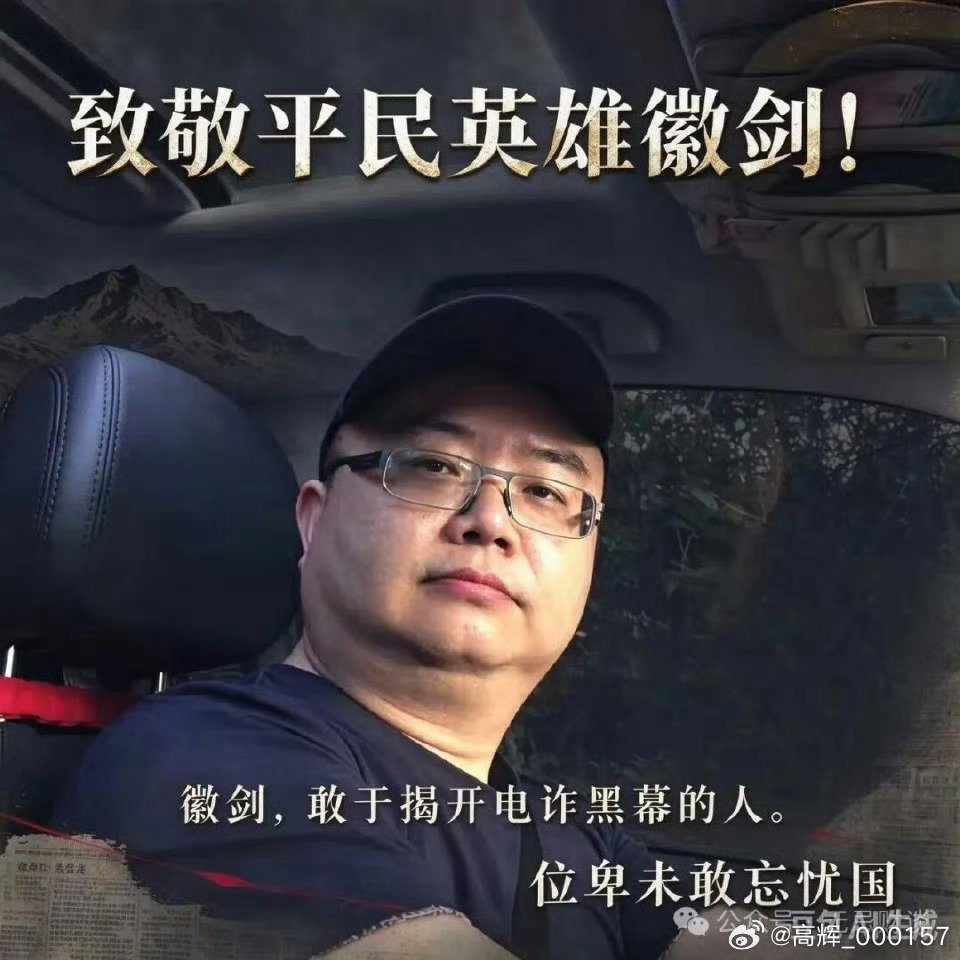

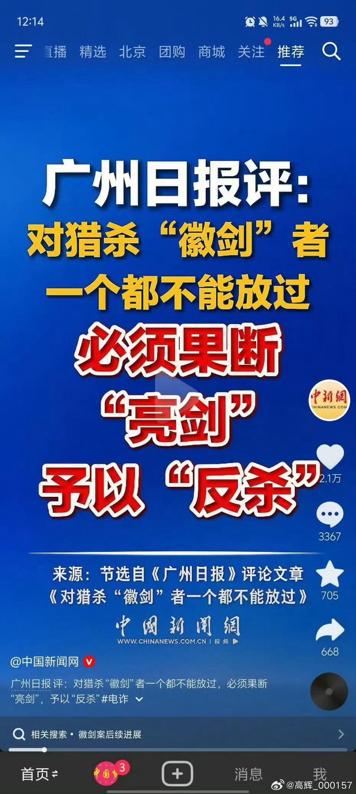

---

## 5

@宝玉xp

发表于：2026-11-03 15:24

来源：微博

链接：https://m.weibo.cn/status/5361310313484329

OpenAI 应用 AI 工程负责人 Wulfie Bain 在 X 上发帖，教想加入自己团队的求职者写简历，总结成四条：

1. 写短

2. 删掉无关经历

3. 写成果，不只写做了什么

4. 让人能快速扫到重点

Bain 在 OpenAI 带领面向创业公司的应用 AI 工程团队。之前自己创过业，当过CTO，毕业于牛津大学。更早在波士顿咨询公司（BCG）做过招聘。

Bain 说自己前后看过几千份简历，所以这些建议对咨询等其他行业也适用。

这是 Bain 关于申请 OpenAI 的系列帖第三篇，团队还有新职位即将开放。

讲建议之前，Bain 先说了两点。

第一，能找到内推最好。

内推就是由公司内部认识你的员工把你推荐给招聘方。没有熟人就只能网上投递，Bain 自己就是在网上投简历进的 OpenAI。

第二，简历没法完整展现一个人。

它的作用是证明你有相关经验、能把事情讲清楚，让招聘方愿意约你聊一次。

四条建议具体是这样：

1. 写短。

最好一页，但内容是否相关比硬凑页数更重要。简历本身就在展示你会不会写、懂不懂取舍。

2. 删掉无关经历。

每条经历都要写清楚跟这份工作有什么关系，不相关的就删。Bain 举例说，自己也为高中时的成绩骄傲，但现在找工作时它们通常用不上。

3. 写成果，不只写动作。

只写做了什么，读的人看不出这件事值不值得做。Bain 的例子是：只写"重新设计了一个 AI 智能体的架构"（智能体指能自动完成任务的 AI 程序），说明不了价值；写"把响应时间缩短 2 秒，客户满意度因此提高"，才是成果。做销售的，就写带来了多少收入。

4. 方便快速浏览。

把重要内容加粗，每段经历下把最有说服力的证据放在第一条。招聘方要在一大堆简历里很快判断该约谁面试。

Bain 说，表达清楚、经历相关、拿得出成果，这三点在整个申请过程中都重要。后续还会继续发建议。

来源：x.com/wulfie_bain_/status/2117600605774458880

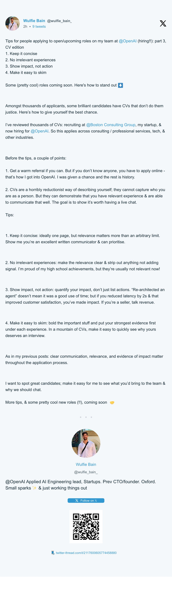

---

## 6

@凤翅金盔泛妖光

发表于：2026-11-03 07:08

来源：微博

链接：https://m.weibo.cn/status/5361185509083332

彼得大帝的饮食\#历史知识\#\#微博兴趣创作计划\# 

身高2.04米的彼得大帝，饮食糅合了俄国普通农民和欧洲的习惯。他身材高大，食量和酒量都惊人，但日常饮食却十分朴素。他的宴会又以肆无忌惮著称。彼得改革也改变了俄国的传统饮食，其特点是宫廷和贵族的饮食完全从拜占庭式转向了欧式。

彼得非常节俭，在日常生活中喜欢简单的俄国家常菜。他鄙视精致的饭菜，常说：“如果人的身体只剩下肚子，又能为国家做什么呢？”

彼得最爱吃用牛奶（斋戒日用杏仁奶）煮的珍珠大麦糊，皇后叶卡捷琳娜一世经常亲做大麦糊来取悦丈夫。彼得喜欢珍珠大麦，大力在军队中推广，至今大麦糊还是俄军的主食。他也爱加很多肉的酸白菜浓汤、肉皮冻和各种凉拌菜。

他不太吃白面包，经常吃粗黑麦面包。早餐习惯是吃拌葵花籽油的萝卜丝或腌黄瓜，还有大麦糊。但是在欧洲旅行时，他爱上了欧洲奶酪和牡蛎。虽然是俄国海军的创始人，彼得却厌恶吃鱼——仅仅是闻到鱼腥味就会让他感到恶心。

在欧洲旅行时，彼得吃了土豆和三明治，非常喜欢，回国后开始推广。他也爱上了喝咖啡，回国后在贵族中推行欧式咖啡。

彼得改革了俄国的餐桌礼仪，强制推行使用叉子和餐巾。在彼得大帝之前，古罗斯人用手抓食物吃，用勺子喝汤。即使在大贵族家，也是用手从公用大锅里抓肉，或用刀叉起来吃。彼得大帝制定了严格的文明用餐礼仪，1717年颁布了礼仪规范书《青春之镜》，规定必须使用欧式刀叉和餐巾。

彼得大帝为教导贵族使用刀叉，会亲自示范。他自己的餐具放在特制的餐具盒里随身携带，吃饭时拿出来使用示范。和他一起吃饭还上手、不用餐具的人，会被罚款和殴打。

彼得改革前，俄国人习惯在吃完饭后用桌布边角或自己的袖子擦拭手和胡子。彼得强行推行了餐巾，礼仪规范《青春之镜》里严格规定：“不得用桌布擦手，必须用餐巾擦手，不得直接上手擦嘴。”

古罗斯时代，贵族在宴会上吧唧嘴、对着汤吹气、啃完骨头往地上丢，还有随地吐痰，都是正常现象；在彼得时代，这些一律禁止，一切按照欧式礼仪来。

彼得从欧洲带回了新作物种子和幼苗，并在各地推广种植。他从荷兰带回了土豆，分发到各地种植。但在彼得时代，土豆还不普及，只是少量种植，供应皇家宴会。土豆当时是稀罕物，要撒上白糖吃——当时的白糖也是稀罕物。

彼得还从荷兰引进了向日葵，但当时榨葵花籽油并不多见。向日葵一直被用来装饰庄园，葵花籽做零食吃，直到19世纪葵花籽油才大量普及。在俄国南部的阿斯特拉罕，彼得命令开始种植爱情苹果（西红柿）和蓝苹果（茄子）。

彼得引进了欧洲的香草和蔬菜。在彼得之前，俄国菜中只有莳萝、欧芹和辣根调味。彼得下令在皇家药草园种了芹菜、菠菜、鼠尾草、龙蒿等香草和各种绿叶沙拉菜，这些蔬菜以前都被当作杂草。

彼得的改革彻底改变了俄国人的饮食习惯。过去沙皇宴会的礼仪和烤天鹅、烤猞猁等大菜全部被废止。从留里克王朝时代传承数百年的菜谱遗失，一种说法是彼得下令销毁，一种说法是毁于拿破仑入侵时的莫斯科大火。

彼得喜欢方便的食物，从德国引进了三明治：切片的黑麦面包涂上厚厚的黄油，再放上一片腌咸牛肉、烤火腿片或奶酪片就可以吃了。三明治成为彼得宴会上必不可少的开胃菜，升级版是抹上厚厚的一层黑鱼子酱。

传统的俄式炉是土石结构，食物放在陶罐或铸铁锅里，在炉膛里烘烤几个小时，俄式卷心菜汤和大麦糊就是这样做出来的，效率比较低。彼得大帝从欧洲带回了铸铁明火炉，这样可以煎牛排和鸡蛋，还有煎饼和熬酱汁，也可以快速地做汤。

古老的俄式炖菜其实是用炉膛的温度烘出来的，使用明火炉后变成了真正的炖菜。明火炉使用后，汤的品种多起来，也可以做小份的菜了。以前那种菜放在大锅里端上来、众人用勺子分着吃的共餐制，变成了按人数上菜的分餐制，餐前冷盘开始流行。

俄国原来只有软质的凝乳奶酪，彼得开始从荷兰大量进口硬奶酪和腌凤尾鱼。彼得喜欢一边吃硬奶酪配牡蛎，一边喝啤酒和伏特加。

根据现代医学分析和历史记载，彼得大帝患有严重的慢性酒精成瘾。他在青少年时期（16—17岁）就开始经常大量饮酒，这主要受到他在莫斯科德国人聚集区的伙伴们影响。

据同时代的人记载，身高2.04米的彼得每天可以喝下30—40杯葡萄酒，还混着泡茴香的伏特加一起喝，而且不醉。他需要每天靠喝酒来维持惊人的精力。

尽管他自己酗酒，彼得却认为平民百姓酗酒对国家不利。1714年，他设立了著名的醉酒奖章：由铸铁制成重约7公斤大铁牌，上面有铭文“醉鬼”。大铁牌锁在酗酒者的脖子上，要戴上一周才能取下来，类似中国的枷号示众。

彼得的宴会是强制性的，受邀宾客如同受酷刑。彼得20多岁时就设立了一个私人团体，叫作“醉酒玩笑教宗”，专门组织宴会。这个团体1692年成立，持续运作了三十余年，直至彼得去世。

表面上看起来，“教宗”像是组织宴会、活跃气氛、拿宾客开玩笑的酒友会，但实际上是组织严密、制度化的亲信机构，用来打击传统旧贵族和敌对势力，同时监督群臣、笼络亲信。“教宗”刻意模仿教会组织架构，故意用荒诞粗俗且亵渎神明的形式考验人的忠诚。彼得重用出身卑贱的人，要敢于亵神才能让他信任。

“教皇亲王”是组织名义首脑，由彼得的心腹尼基塔·佐托夫担任。他的头衔又长又粗俗不堪，脏活全以他的名义来干。

“凯撒亲王”是事务首领，由贵族费奥多尔·罗莫达诺夫斯基担任。在宴席上，彼得授予他沙皇的权威，过分的事情都由他下令执行。而彼得本人只担任“执事”，隐身在暗处观察。

“枢机主教团”是组织核心，由彼得最亲近的核心圈子成员担任。一些高级外国外交官和大贵族也有“枢机主教”的名义，但他们却是被监视、管制和戏弄的对象。

“醉酒玩笑教宗”组织的宴会不是普通的酗酒，而是精心策划的心理考验、对敌对势力的羞辱，就是一场权力的游戏。

要加入“教宗”，就意味着成为皇帝最亲信的人。候选人必须接受考验。“教宗”不考神学知识，而是考酒量。候选人会被剥光衣服，接受盘问：会不会喝酒？能喝多少？喝葡萄酒还是伏特加？通过考核后，候选人受“洗礼”——不是用水，而是头被浸入啤酒或葡萄酒桶里。

在圣诞节和谢肉节等重大节日时，“教宗”负责组织滑稽巡游。数十辆雪橇在雪地里行进，拉车的除了马，还有驴子、狗、猪、山羊甚至熊。“教宗”成员在雪橇上用锅碗瓢盆、猪尿泡和哨子奏乐，唱用宗教圣歌改编的下流小调。彼得用这种近乎伤风败俗的丢脸行为来定义自己的亲信——他的亲信必须不是虔诚的教徒和守旧的人。

巡游队伍会停在守旧贵族或神职人员的家门口，“教宗”成员闯入屋内，以索要食物和酒水的名义，把主人的仓库洗劫一空。反抗者就是皇帝的敌人，就是叛国。其实去谁家“抢劫”，彼得早就定好了名单，就是借机敲打自己的敌人。

彼得宴会喝酒是强制性的，不喝酒则被视为犯罪。彼得用鹰杯罚酒，一鹰杯为1.25升葡萄酒或伏特加。如果宾客喝酒划水、逃席，或仅仅是不顺眼，彼得就授意“教宗”成员按住违规者，强迫他一口气喝光鹰杯中的酒。喝了鹰杯常常导致酒精中毒。当时的外交官记载，在彼得的宴会上，宾客因过度饮酒而亡是司空见惯的事情。

彼得大帝酷爱嘲弄神圣古老的传统，尤其爱戏弄守旧的老年贵族。他喜欢开化妆宴会，宾客们要扮成熊、鹿、山羊。年老体弱的贵族们被扒光衣服，装扮成丘比特，戴着翅膀和弓箭，瑟瑟发抖地在冰天雪地中跳舞。冻死正好合彼得的心意；没冻死，还有下一次。

虽然看起来很疯魔，但“教宗”其实是彼得的高效统治工具。通过强迫旧贵族光屁股、用下流小调嘲弄宗教仪式、醉酒后丑态毕露，彼得大帝打破了旧贵族阶层和教会的神性，从而更容易推行他的西化改革。

酒精会让人丧失理智。彼得大帝酒量惊人，他常常清醒地看着宾客们喝得忘形。人在酩酊大醉时，说的话有可能是真心话，“教宗”成员会把这些话记下来给彼得看。

通过强迫所有人参与这些亵渎神明、疯狂的仪式，彼得大帝将他的核心圈子紧密地联系在一起。加入“教宗”的人在传统社会里属于离经叛道，他们就别无选择，只能铁了心追随彼得。

后来斯大林模仿了彼得的这套做法，但是他没有彼得的教宗配合，更孤家寡人一些。

酗酒的生活方式，加上繁重的体力脑力劳动（彼得喜欢干手艺活，精通铁匠、木匠、粉刷匠等手艺），损害了他的健康。他的胃、肝和泌尿系统都受到酒精的伤害，最终导致他52岁英年早逝。

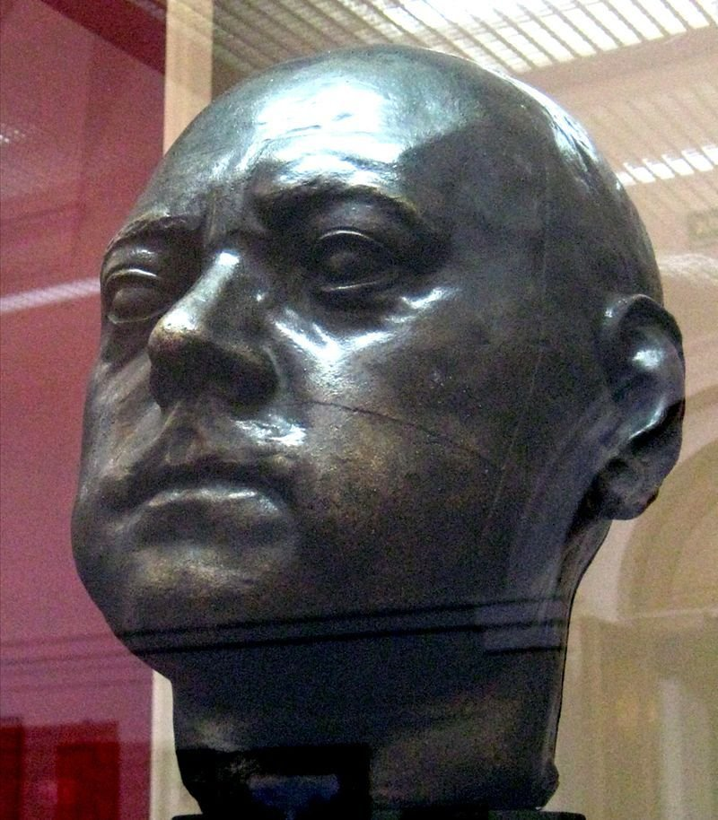

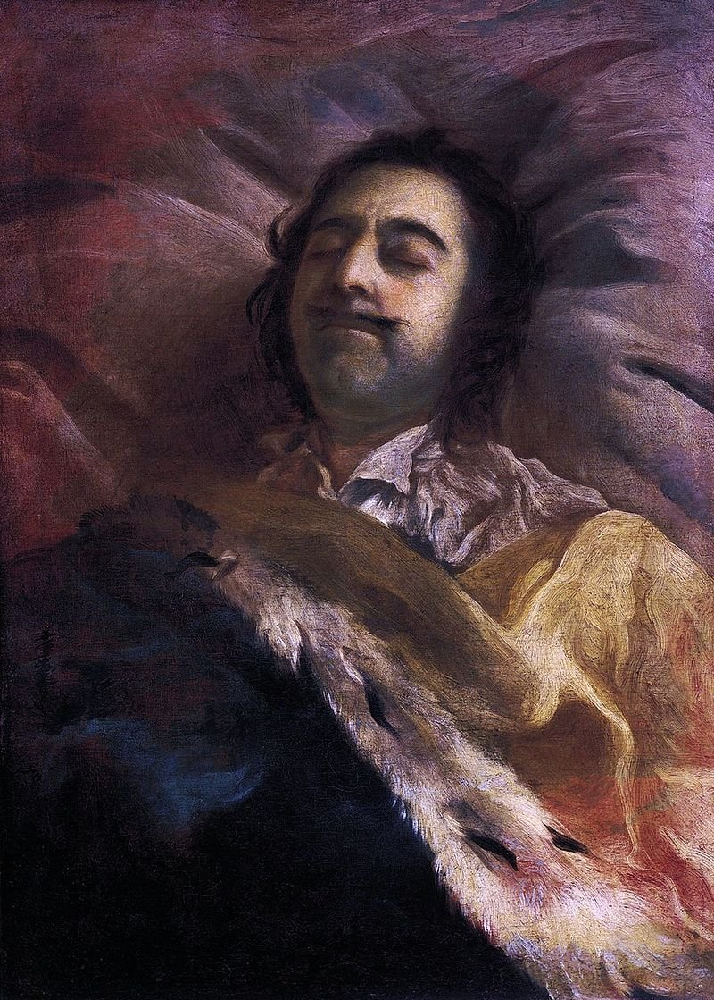

---

## 7

@顾扯淡

发表于：2026-11-02 06:51

来源：微博

链接：https://m.weibo.cn/status/5360818831232342

偷偷吐槽（明着）

小红书和短视频网站上面一些推荐食物的帖子感觉就和舌头好像是坏掉了一样，各种必吃店，宝藏摊子，神仙颜值打卡点，绝大部分真心不咋样。

我算是不信这种的用户，但挨不住老刷到，有时候碰巧路过，看排队人不多我也会试试看，然后实际感受都不是不好吃，而是难吃或者完全对不起价格…

虽然也有不错的，但是不太行的概率很高。

就感觉做攻略的人和土鳖一样，也不像是广告，就是只吃过这个，就说好……

---

## 8

@观察者网

发表于：2026-11-02 15:08

来源：微博

链接：https://m.weibo.cn/status/5360943858452576

\#DeepSeek提出超级智能体概念\#【这次DeepSeek和硅谷团队形成共识？】\#DeepSeek公开下一代智能体架构构想\# 日前，DeepSeek旗下Harness团队发布长文，公开下一代智能体架构构想，提出Super-agent（超级智能体）概念。而硅谷也在类似的路线上发力。

按照DeepSeek设想，未来的AI将不再局限于传统聊天窗口，而是能够跨会话保留记忆、同时处理多项任务，并在不同应用和设备之间自主调度，逐步从一个需要人类不断发出指令的聊天工具，转变为一个可以长期在线、自主工作的智能助手。

DeepSeek指出，现有Agent架构难以有效支持多任务并行和团队协作，问题之一在于Agent与单一人工会话绑定过深。用户每增加一项任务，就可能需要新建对话、补充背景，甚至亲自协调不同AI之间的工作。AI看似承担了大量工作，实际上用户仍然是那个忙于切换窗口、管理上下文和监督进度的“调度员”。

而未来的Super-agent，DeepSeek认为，应当成为一个持续运行的整体，能够跨会话保留上下文，同时调度多个执行单元并行处理复杂任务，各项工作之间互不干扰。

为此，DeepSeek设计了由Router（路由器）和Worker（工作节点）组成的双层架构。Router作为长期在线的“主脑”，负责接收用户指令、理解需求和分配任务；具体工作则交给拥有独立上下文和运行环境的Worker执行，完成后再将结果反馈给Router。

此外，DeepSeek还提出将AI的计算能力与执行环境分离，让云端Agent能够调用用户本地设备的文件和运行环境；通过事件驱动机制，让AI在后台持续执行任务，同时保持前台响应能力。用户不必等待一项任务结束，就可以继续交代新工作。

Super-agent架构一经提出，迅速引发关注。不少开发者认为，这正是下一代AI应用应该具备的形态：用户只需提出目标，AI便能自主拆解任务、调度资源并持续推进，而不是每一步都等着人类发出指令。

这并非一个全新的技术路线。今年早些时候，美国硅谷的AI公司AFK推出了名为Comma的开源个人智能体。

他们将Comma定义为一款无需对话即可运行的个人智能体，用户的工作、记忆和背景信息可以在电脑、手机、云端环境、应用程序及连接设备之间持续延续，而Comma会将用户目标拆解为具体任务，通过持续运行的Agent循环推进工作，直到任务完成。

在架构上，Comma采用Lead Agent（主智能体）+ Subagents（子智能体）的设计，与DeepSeek提出的Router+Worker模式颇为相似。

用户始终只需要与一个长期在线的主智能体交流。它负责理解需求、拆解任务，再将具体工作分配给不同子智能体。每个子智能体拥有独立的运行环境、上下文和工具，可以同时执行不同任务，彼此之间不会相互干扰。

用户不必为每项工作单独创建聊天窗口，也不需要反复向AI解释背景。主智能体负责记住用户及团队的长期需求，子智能体则像一支随时待命的工作队伍。

在执行能力方面，DeepSeek提出，未来Agent的计算能力与执行环境应当分离：云端负责思考和调度，本地设备则提供实际执行能力。

AFK Comma也推出了类似的功能。其通过名为Salix的组件连接Mac电脑，允许AI读取本地文件；在用户开启相应操作权限后，还能修改文件、运行命令，甚至将任务交给Codex、Claude Code、Pi或Kimi等编程智能体执行。

在具体使用中，Comma将用户需求转化为Tasks（任务）。简单问题仍然可以通过聊天直接回答，复杂工作则进入独立任务流程。系统会检查自身工作成果，并判断任务是否完成。任务分为进行中、待审核和已完成三个状态，只有涉及需要人类作出决定的环节，才会进入审核阶段。

Comma还引入了名为Loops的功能。简单来说，Loop是一段由智能体编写的小程序，可以持续监控邮箱、代码仓库或信息源，只有发现需要处理的事项时才唤醒AI。按照AFK的介绍，在没有触发任务的时段，这类监控不会消耗大模型Token。此外，Comma还支持定时生成工作简报，主动向用户汇报进展。

虽然DeepSeek提出的Super-agent架构还只是一种构想，Comma也仍处于早期阶段，二者并不能在所有环节上都简单画等号，但从中已能看到未来AI行业的发展方向。

过去，AI行业的核心竞争集中在基础模型上，企业比拼参数规模、推理能力、训练成本和性能表现。而随着模型能力不断增强，竞争焦点正逐渐延伸至任务拆解、长期记忆、跨平台协作和实际执行能力。

如果说过去人类是在学习如何使用AI，那么Super-agent时代，行业追求的将是让AI主动适应人类的工作方式，逐渐把人从频繁操作软件、切换窗口和管理任务的琐事中解放出来。

让人少给AI打工，或许才是下一代AI应用真正要实现的目标。（@观网财经）

---

## 9

@齐都督

发表于：2026-11-01 12:13

来源：微博

链接：https://m.weibo.cn/status/5360537610228188

二十余年如一梦，此身虽在堪惊。

---

## 10

@李楠或kkk

发表于：2026-11-02 04:47

来源：微博

链接：https://m.weibo.cn/status/5360787656803241

DeepSeek 发 superagent 这玩意真的不错，所以，我们怒喵自己用的 Agent 集群开源了。

基本上就是统一任务池，多 agent 集群做 worker ，统一上下文（你自己注册一个agent给你拉所有相关信息）。

类似 Claude 内部工作方式的创业公司版本。

接下来大家怎么玩你们自己决定吧，比如底层原来我们用的是头条的 deerflow ，现在可以换成 DSH 或者别的什么 bot 。

类似的项目好像不太多，而且会太复杂，我们这个的好处就是足够简单，界面足够 cute 。

地址：

网页链接

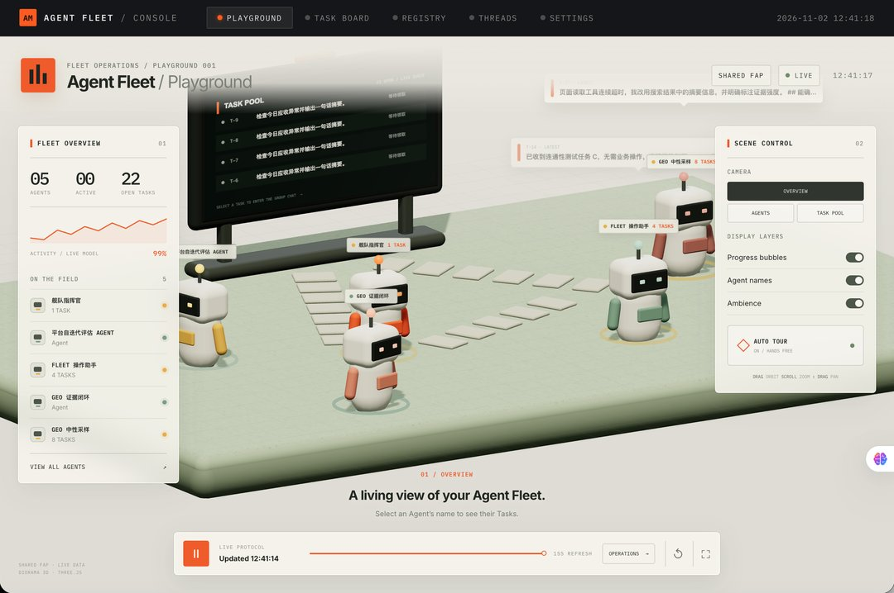

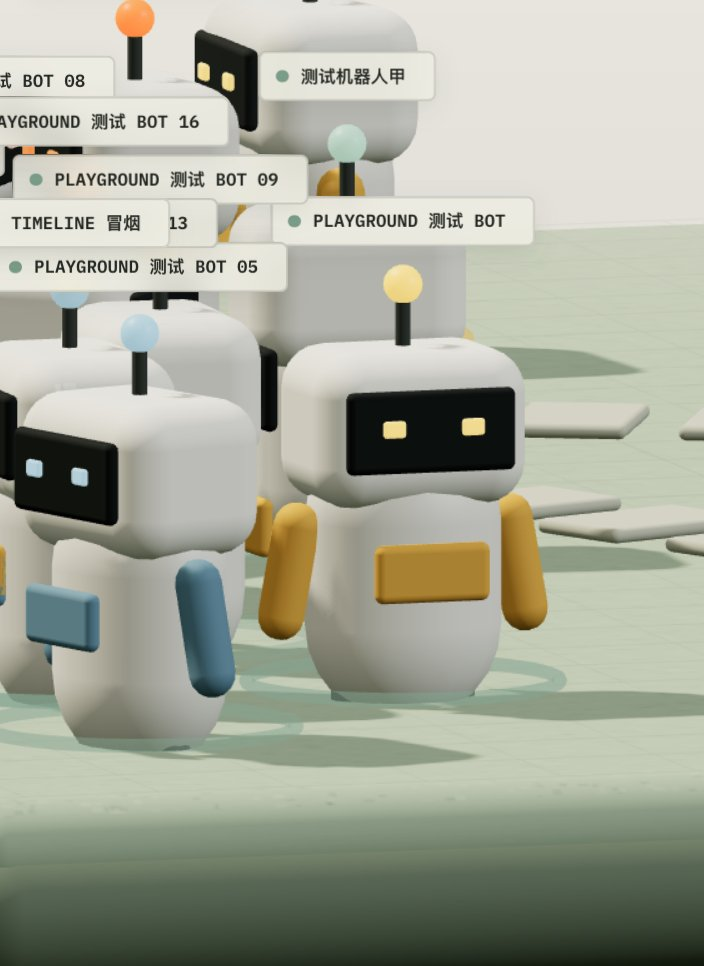

---

## 11

@洋务先驱张之洞

发表于：2026-11-01 03:07

来源：微博

链接：https://m.weibo.cn/status/5360400209023668

能把售票交给大麦，说明就是认可把航展当演唱会卖、把飞机当明星来吸粉（宰）的套路嘛…………蒸馍，你不服气？//@Ds走近哈佛:搞交通管制区能理解，搞劝返点就实在太无脑了！有票就进场看场内视角，没票场外看场外视角，这不是很正常的吗？难不成还觉得能把飞行表演都罩起来让人看不到？典型的外行，把航展当演唱会搞的套路，今年有的乱了！

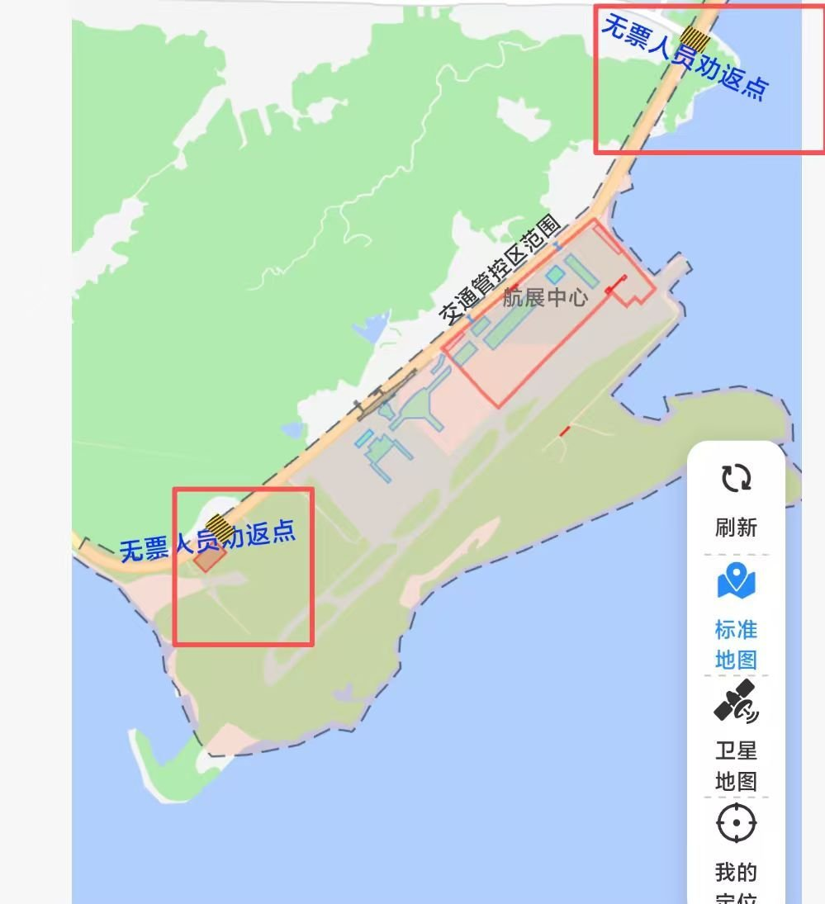

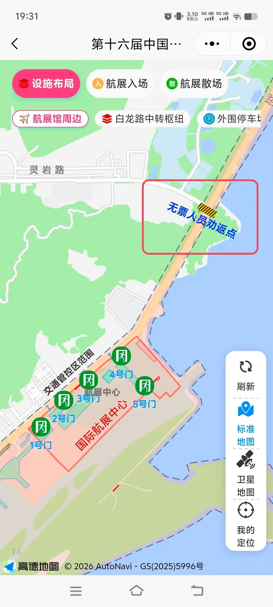

---

## 12

@明涛AI_ECON

发表于：2026-10-31 11:36

来源：微博

链接：https://m.weibo.cn/status/5360165928832845

MS Copilot给我的解释我觉得很有道理：你11年前调研时，大概是2014年前后。那个时期全国正在严厉打击医闹。而且很多地区信息传播慢；网络舆论弱；医调会公信力相对较高。现在情况不一样。很多纠纷会经过微信群；短视频平台；自媒体；网络维权群体。先形成舆论认定。再进入调解。这时候调解难度远大于2013年、2014年。因为双方争的已经不是赔偿数额。而是“谁是坏人”。//@明涛AI_ECON:我昨天到宁波调研，在车上还和司机在聊，11年前我调研宁波市保险创新综合试验区，对他们探索建立的独立第三方推动的医疗责任保险非常推崇，没想到11年了，近年来最恶劣的医疗纠纷就发生在宁波。 查看图片 //@陈如是说:我的立法、社会和医院，对医生的履职/职业保护非常的欠缺。把矛盾往就诊室里一扔，维住稳了。当然，这也不光是医生，很多行业都一样。比如某友，最近几年连续挨了两个处分。很不甘，跟我说，莫名其妙被安排做几个子公司的董事，事前从未征求本人意愿，履职期间没有任何报酬，董事会上只能按照组织指示发表意见，但是子公司出事了，一定要拿董事出来给监管交代，反倒是子公司总裁副总裁部门总经理毛事没事。权责利不统一，我们的时代特色。

