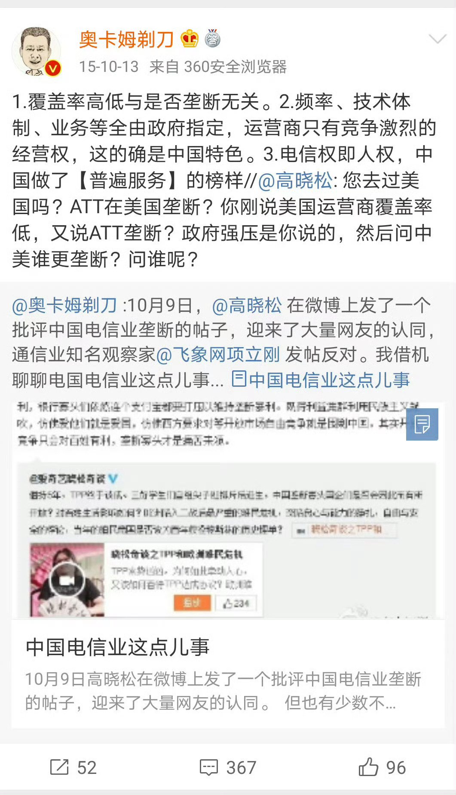
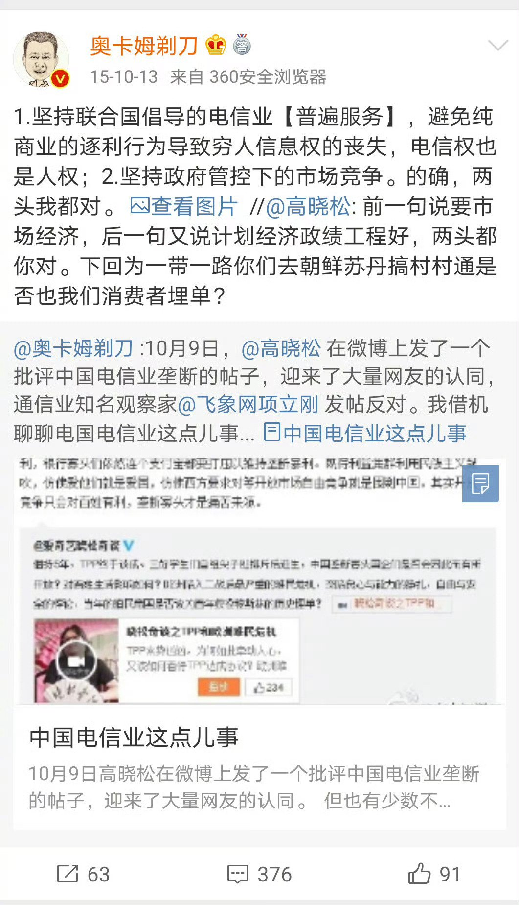
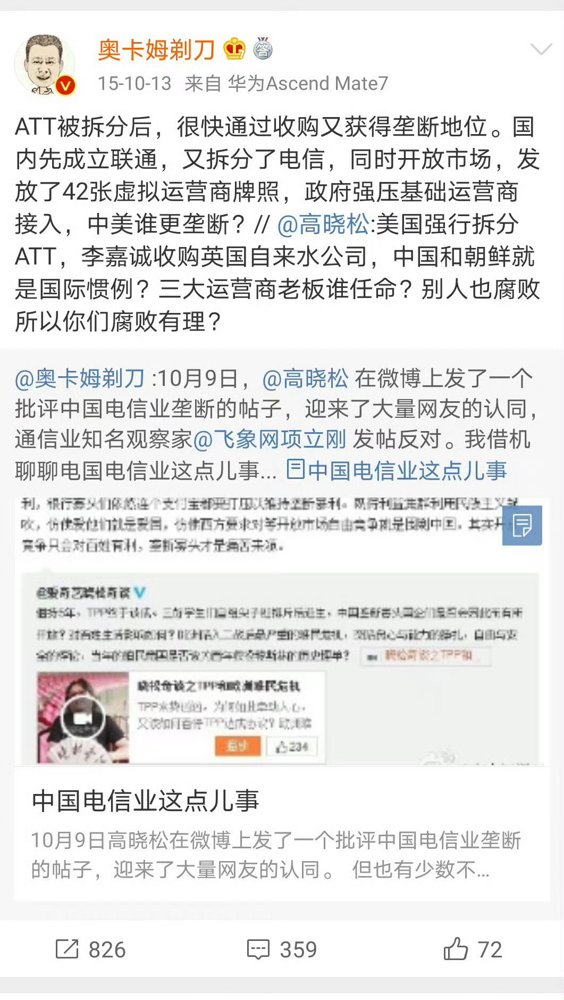
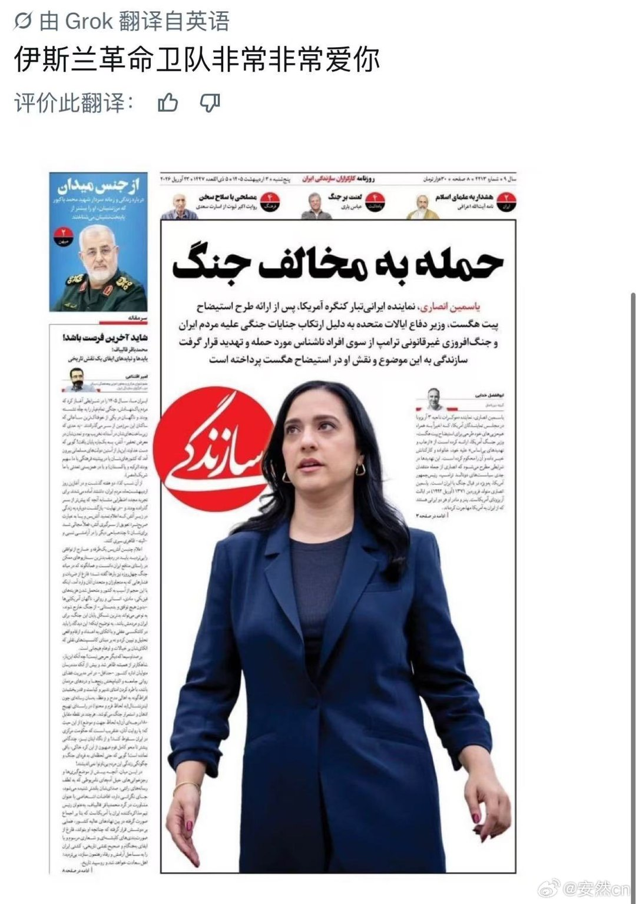
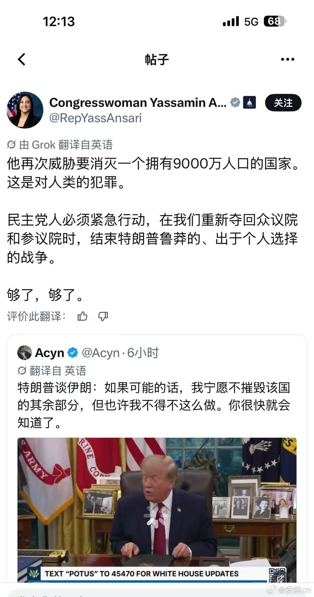
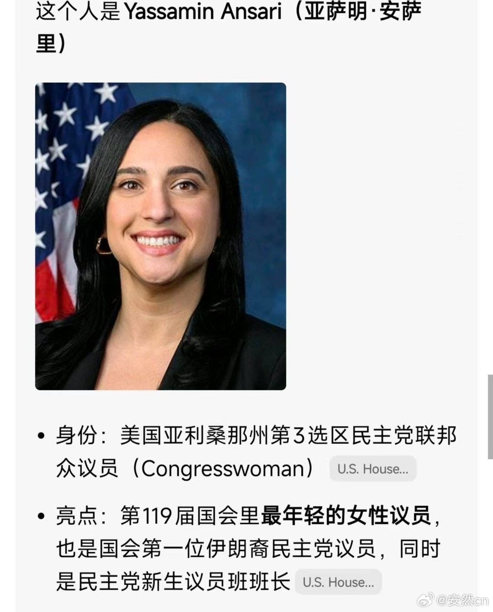

# 2026-11-06

## 1

@陈生大王

发表于：2026-11-06 11:57

来源：微博

链接：https://m.weibo.cn/status/5362230453340979

未成年人不要看这条。

.

这条是讲学习的重要性💕。

.

看到一条日本新闻，内容相当复杂，有性，有欲望，有汁水横流。一位女孩叫澄香，父母都是医生，但经常对她语言暴力，从小叫她肥猪，说她搔首弄姿。

她一怒之下！于是！决定！……高中就辍学去卖春。她离家后给母亲打电话，母亲说，哦，那就去吧。但父亲态度则完全不同，他很震惊地说，啊！卖春吗！那赚的钱也太少了吧！

总之她去卖春了。澄香辗转两家店，选择落脚在东京的吉原。吉原是一个著名的风俗街区，也是泡泡浴激战区。

很多人可能不知道什么是泡泡浴，就是你坐着不动，女士一丝不挂，跪在旁边伺候你泡澡，再用身体当海绵，在你身上绕啊绕，缠啊缠。

日本的法律是，泡泡浴里可以手口如瓶，巧舌如簧，但实际很多人都会兵戎相见，反正就是让对方呕吐出来作为结束。

澄香做了一段时间，觉得不行，人还是要读书。于是她开始重新学习，边卖边学，然后去参加高考，直接考上了日本顶尖的庆应大学，并且是最难考的法学部。

这相当于一个高中辍学、在洗头房上班的小妹儿，稍微孜孜不倦了一下，就考上了顶尖985。应届高考生看完都哭了。

澄香考上大学，也跳槽去了更高级的泡泡浴，每月能赚约13万人刀。

突然疫情来了，学校转为线上课程。店铺还专门帮她安装了Wi-Fi，这样她就能一边在浴室里哐哐上大哥，一边在休息室里哐哐上课。两边都认真上，两边都认真搞。

店长还会给她买饭团，同事也迁就她的上课时间挪动排班。澄香很感谢她们。

澄香读大学时，也在准备考律师资格，日本通过率很低，只有4%左右。她要应对课业、工作，还要准备考试，人都要忙疯了。

这时候发生了一件神奇的事。

店里给每人准备了一个账号，用来写充满💕诱惑力💖的日常，发点半露扔的自拍，吸引客人来店里消费。

澄香反其道而行之！天天分享新学到的法律知识，自己不理解的法律问题，怎么复习考试等等。

这种做法吸了一批特殊的顾客，各种各样的律师、大型企业的法务。

这些顾客会专门带着法律教材、参考文献来找她。大哥们上完床就开始上课，又当猛男又当爹，真是一次完成男人的所有梦想。

澄香甘之如饴，客人在意她的三点，她只在意知识点，她甚至会请顾客给自己布置作业，下次见面时再检查。

在采访里她说，有些客人瘾大，120分钟的服务时间都不够讲课的，他们会连续订两三个时段，在单间里滔滔不绝。

有的律师大哥来，甚至搞都不搞，就是纯讲课，不传播体液，只传播知识。奋力在小小的风俗店里点起明亮的烛光。

所以你看啊，颅内高潮对人多么重要。

澄香也高兴昏迷了，她说就像有了一群私人的法律教授。

她顺利通过了律师第一轮笔试。这时她的熟客大哥们不乐意了，这么难你都考过了，怎么还在这里给人搓澡呢，你应该专心学习啊。

于是一些熟客干脆买下她的时段，但要求她不去店里，就待在家里读书。

她根本不用到店里，一天营业额有时都能高达4.5万人刀。

看来救风尘于水火，真是男人们一种激烈的道德满足。

大学毕业后，澄香过上了暂时的双面生活，她在律师事务所当助理，也同时在泡泡浴上班，也就是又做法律工作，又做法克工作。

但是一个挫折来了，澄香在司法考试的论文中失利，于是她决定转向考行政书士，通过率也不高，只有15%左右。

澄香觉得，两份工作太耽误学习了，于是果断决定！

离开律师事务所！

专心专意给人搓澡！

骗你的，她给人搓澡也不专心。

她在泡泡浴中的人设，转成S女王，经常玩S和M游戏的朋友应该知道，有一种玩法叫捆绑和放置。

澄香给大哥们蒙好眼罩，像捆猪蹄一样捆在椅子上，然后喝令他们不准动。大哥们爽疯了。她就趁机在旁边赶紧看法律书。

你看，真正喜欢学习的人，在哪里都能找到机会学习。你还好意思找借口吗。

澄香只用三个月准备就顺利考过了。现在她已经离开泡泡浴，独立开公司做行政书士，公司地址选在东京高级办公区域。

但她作为新人，想在法律界崭露头角，应该怎么办。

她选择和律师们打成一片。

但这里的打，就是字面意义的打，她开始在网上和律师吵架，专门吵法律问题，寸步不让，一脸要把你们这些老东西嘎了祭天的样子。

她也大方公开自己在风俗业的经历，一举获得大量关注。她又胜利了。她接到很多夜场、风俗女郎的法律业务。

同时，她自身的专业能力，也让她得到农地转用、可再生能源项目、婚前契约这种和风月完全无关的法律工作。

她手里已经有10名员工，其中9成是夜场出身。她希望帮她们找到新的职业支持。

写到这里，是不是突然显得很有社会意义，很正能量？

但是在采访里，澄香说，她很擅长处理婚姻的法律问题，因为她三次结婚，三次离婚，已经很有经验。

她那么忙，哪里有时间结婚呢。

原来，当年那些大哥哐哐花钱支持她的时候，她在交友软件上刷到一位男士，对方大她15岁，在外企工作。

她觉得对方不错，就直接约出来，联合银座的妈妈桑把对方灌醉，带去登记结婚了。

这段婚姻维持了5年，直到离婚对方都不知道她在做泡泡浴。

这是一个很难总结的故事。也很难说清，澄香是好人还是坏人，人都是复杂的，但她必然是一个猛人，在兵荒马乱中悍然崛起。

如果要说重点，大概有两个。

一是学习真的很重要。

二是，如果当年她父母没有一直霸凌打压她，她也许会拥有另一种完全不同的生活。

.

.

.

（第一次写这种日本离谱新闻，大家喜欢看吗）。

（喜欢的看话，坐在后面的朋友，请挥动你们的双手好吗）。

---

## 2

@奥卡姆剃刀

发表于：2026-11-06 17:57

来源：微博

链接：https://m.weibo.cn/status/5362314552283313

有网友呼吁清理虚拟运营商，这份心情我完全理解。

在很多人的印象里，虚拟运营商几乎和电信诈骗画上了等号。

但这件事的前因后果，值得掰开讲清楚。

虚拟运营商试点大概始于2014年，前后一共批复三十多家。

当年推动这件事的大背景，是全社会一边倒的声音：三大运营商垄断、信号差、资费贵，必须引入民间资本打破垄断。

在当时的舆论环境里，这几乎是政治正确，谁敢提出不同意见，谁就是人民公敌。

我当年的看法和主流舆论截然相反：国内三家基础运营商的网络覆盖、速率、服务水平放在全球都是第一梯队，彼此之间的商业竞争早已白热化。

这个观点在当年引发巨大争议，不少人骂我是被运营商收买的黑心专家。

当年我还曾就电信业是不是垄断这个话题，和高晓松在线争论了一整天，在业内动静不小。

我的核心观点：电信行业的国家管控，不是逐利式的垄断，而是基于公共安全的基础设施管控。水、燃气、通信，都属于国计民生底层支撑网络，准入门槛必须严格。

其次，三家运营商的竞争很惨烈，开学季的市场争夺必打群架，大年初一都得摆摊。

放眼全球，成熟经济体的全国性运营商大多就是3–4家：美国3家、日本4家、韩国3家，我们三家的格局，本身就是兼顾效率和公平的合理选择。

还记得曾经有位局级领导问我，如果沃达丰进入国内，是不是就能打破运营商效率低下的问题？当时我心里挺感慨，连这级别的干部，都有这样的认知偏差。

当年民众呼声太高，政府只能顺势推出了虚拟运营商。

但这里有一个绕不开的硬现实：自建一张全国通信网络，烧钱是天文数字，不是民企能承担的。所以虚商只能租用三大运营商的网络资源，靠低价套餐吸引用户。

成本下不来、售价又要压低，商业模式天然很难持续。一部分虚商就慢慢向灰产倾斜，170、171号段迅速沦为电诈重灾区，整个赛道口碑彻底坏掉。

很多时候，一件事是全民情绪推着往前走，最后发现这条路走不通，代价却要整个行业和全民承担。这种事并不少见。

行业科普本就需要懂技术、懂产业的人站出来讲真话，可这类声音太少，还常常挨骂。

这些年我在通信行业，打了不少逆风局，也被误解和骂得很惨。

现在复盘看，我当初的判断，都是站得住脚的。

---

## 3

@安然cn

发表于：2026-11-06 17:57

来源：微博

链接：https://m.weibo.cn/status/5362320240806865

美国选了一个伊朗裔议员，结果就产生了戏剧性效果。。。

伊朗战争，似乎就变成了美国国内的总统和伊朗裔议员之间的“战争”。

当然，川普的针对伊朗的言论，也是很有问题的，伊朗毕竟是一个国家，那么多的人口，怎么能说摧毁就摧毁的，这种言论只会减分。。。

