# 2026-11-07

## 1

@郝瑞

发表于：2026-11-06 10:26

来源：微博

链接：https://m.weibo.cn/status/5362322663277151

让 Grok Bot深挖了下那个教电路的博主，挖到宝了。。   有这么多高级的交互式教程网站。。。

- 教电路的：electronics-101-six.vercel.app

- 教互联网协议的：protocol-explorer-alpha.vercel.app

- Arduino ： learn-arduino-red.vercel.app

- ESP32：  learn-esp32.vercel.app

- 野外求生，甚至还教钻木取火的。。  backcountry-101.vercel.app/?lesson=bowdrill

大佬是这位 -》  x.com/DilumSanjaya  

需要自备 🪜

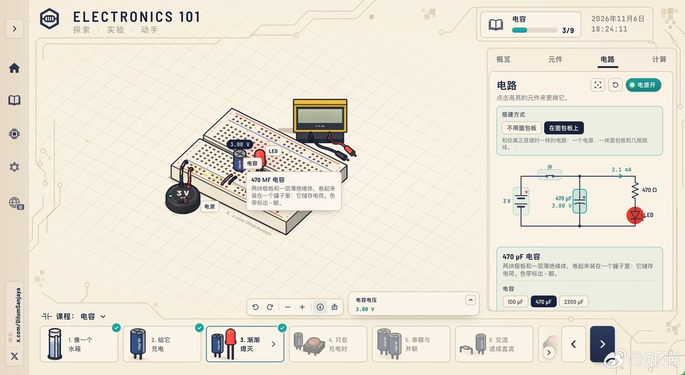

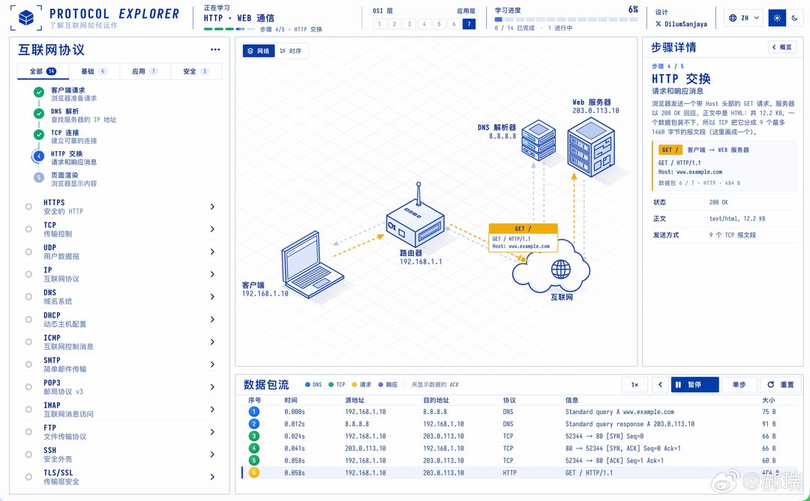

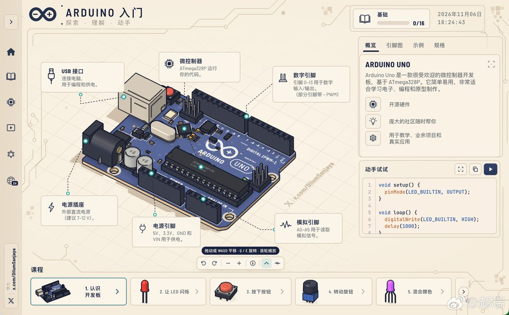

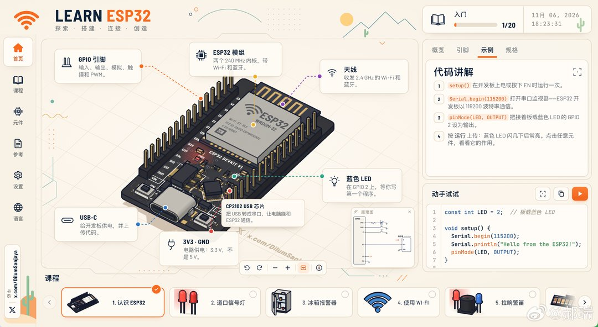

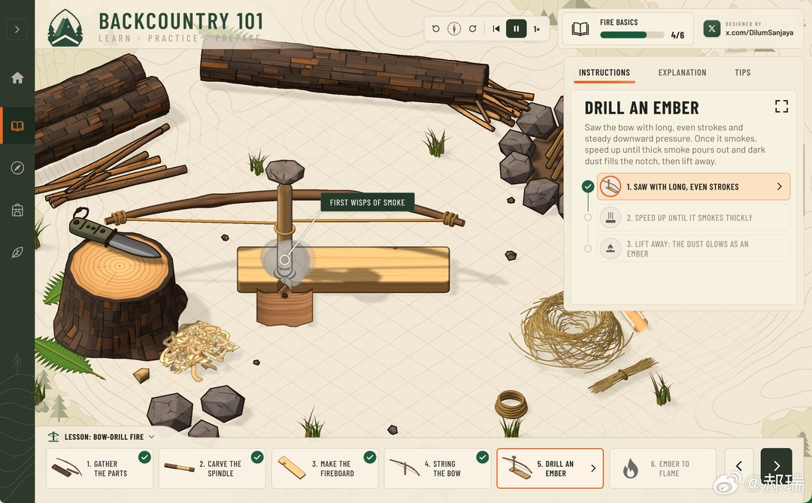

---

## 2

@宝玉xp

发表于：2026-11-06 18:33

来源：微博

链接：https://m.weibo.cn/status/5362445197248175

Ramp 数据：企业用的 AI 越来越多，花的钱 8、9 月几乎没涨，Anthropic 上市估值预期降到 1.2 万亿到 1.3 万亿美元

美国企业财务软件公司 Ramp 的最新数据显示，企业消耗的 token 还在猛涨，但花在 token 上的钱从 8 月起基本停了。7 月企业 token 支出比上月涨了 42%，8 月只涨 1%，9 月只涨 0.2%。

拿 Ramp 的周度数据算，从 8 月初到 10 月中，企业用掉的 token 多了约 65%，花的钱只多了 1.5%。

这组数据由 Ramp 首席经济学家 Ara Kharazian 发布，TechCrunch 11 月 6 日做了报道。这时 Anthropic 正在准备 IPO，而投资者给它的高估值，前提是 AI 收入继续高速增长。

【对用 AI 的公司和个人：同样的活，花得更少了】

钱没涨，主要因为 AI 变便宜了。9 月 OpenAI 发布 GPT-6 Sol 和 Luna，API 价格直接砍半：Sol 从每百万输入 token 4 美元降到 2 美元。Anthropic 同月发 Fable 5.1 和 Opus 5.5，招股书说 Fable 5.1 让常见任务成本降了约 25%，Opus 5.5 每个任务的成本比 Opus 5 降了约 40%，一部分靠降价，一部分靠模型更省 token。

Ramp 统计的 OpenAI 和 Anthropic 综合单价，9 月下旬到 10 月下旬一个月就从每百万 token 0.76 美元降到 0.56 美元，降了 27%。

企业自己也学会了省钱。Kharazian 说，AI 用得越熟的公司，越会给员工设预算，默认不让长任务跑最贵的模型，再用路由工具把活分给更便宜的小模型。

还有更便宜的选择冒出来。TechCrunch 提到一个叫 Jev 的模型，来自前 OpenAI 研究员 Almeida 创办的 TypeSafe AI。它不生成文字，只在开发者事先设定好的几个答案里选一个，并给出把握有多大，适合“是不是垃圾邮件”“这条命令危不危险”这类判断题。它的输出 token 免费，输入按十亿 token 计价。Vercel 的数据显示，Jev 上线两周，它的 AI 网关上就有 35% 的付费团队在用。Kharazian 说：“很多 AI 用途只需要一个简单的是或否。”

再加上 Meta、英伟达和一批中美开源模型在抢企业客户，Kharazian 认为现在是买方市场。他从企业那里听说，OpenAI 和 Anthropic 推的企业长约基本没有逼客户多花钱，签了还能拿到折扣。

【花钱最多的那 1% 公司，开始不往上加了】

Ramp 此前发现，企业花在 OpenAI 和 Anthropic 上的钱，80% 来自最舍得花钱的 1% 公司。这批公司 7 月人均每月花 9873 美元，8 月掉到 8568 美元，9 月回升到 9568 美元，仍比 7 月低 3%。

普通公司离这个数差得很远：排前 10% 的公司人均每月 813 美元，中位数公司只有 15.7 美元。Kharazian 说，软件、金融行业对 AI 编程有大量需求，但诊所、汽车经销店未必需要每人每月花上万美元。

10 月有回暖：截至 10 月 23 日那一周，token 支出比一个月前同一周涨了 8.9%，token 用量涨了 37%。Kharazian 仍认为增速放缓的压力很大。

【对 Anthropic IPO 意味着什么】

在 Ramp 截至 10 月 23 日那一周的数据里，Anthropic 拿走了企业 token 支出的 60.5%，价格战首先打在它身上。

Anthropic 11 月 2 日更新的招股书里，三季度收入 169.6 亿美元，比二季度的 115.6 亿涨了 47%，增长仍然很快。招股书同时写明，这个季度用量增长带来的收入，被新模型降价和合同折扣抵掉了约 6 亿美元。

投资者的估值预期一路下调。据彭博社 11 月 6 日报道，10 月初投资者讨论的估值高达 2 万亿美元，10 月中投资者说明会后降到 1.4 万亿到 1.5 万亿，周四纳斯达克 100 指数单日暴跌 6.4% 后，部分潜在投资者在谈的是 1.2 万亿到 1.3 万亿。消息人士说还没有最终决定，Anthropic 不予置评。

借钱的成本也可能变高。据《金融时报》10 月 30 日报道，黑石作为 Anthropic 一笔芯片融资的基石投资者，告诉参与这笔交易的投资者它预计 Anthropic 上市后的信用评级是 BB 级，属于“垃圾级”里最高的一档，而黑石之前的说法是 2027 年前能拿到投资级。这只是黑石的预测，评级机构还没出结果。

OpenAI 也在降预期。《金融时报》10 月 31 日报道，OpenAI 这轮融资目标从 300 亿美元降到约 200 亿，投前估值从 1.4 万亿降到 1.25 万亿。

【这份数据代表谁】

Ramp AI 指数覆盖 8.5 万多家用 Ramp 公司卡和付款系统的美国企业。token 用量和支出这组数据，只来自其中接入了 Ramp token 支出管理工具的公司，Ramp 自己说这批公司比整体样本更偏科技。Kharazian 对 TechCrunch 说，AI 支出几乎全部来自风投支持的高增长科技公司，它们一起放缓，就会一起拖累 AI 公司的收入。

员工自己掏钱的个人账号、不用 Ramp 的公司，都不在统计里。

Notion 联合创始人 Akshay Kothari 10 月 22 日发过 Notion 自己的数据，每周 token 用量一路往上，每百万 token 成本一路往下，配的话是“tokens go brrr. costs go ahhh”。

投资者押注的是下一个像 AI 编程那样能大把花钱的新用途。OpenAI 的 Dots、xAI 的 Grok Bot、Meta 的 Muse 都是这个方向的个人 AI 助理。Kharazian 认为个人助理的经济产出不如编程，撑不起持续的高速增长。

原文：网页链接

Ramp 报告：网页链接

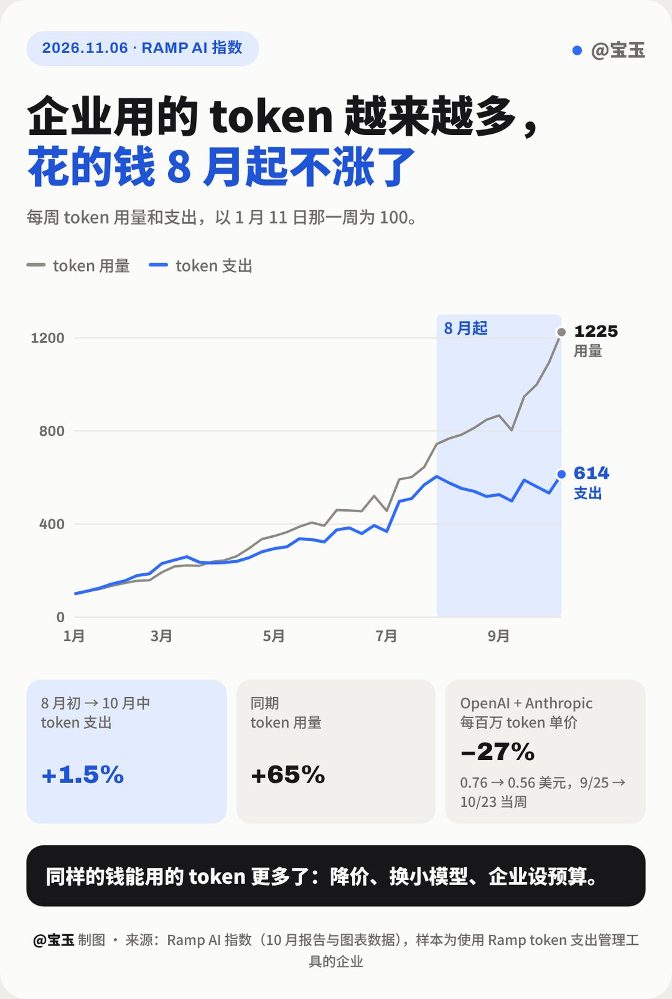

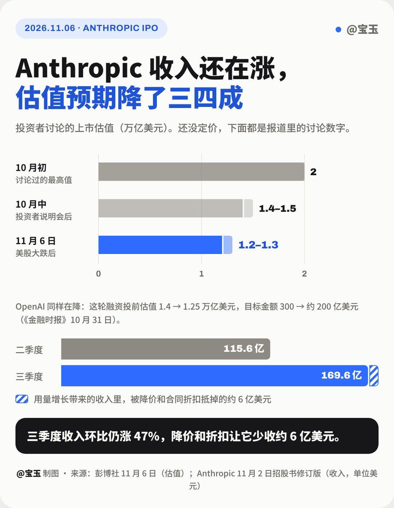

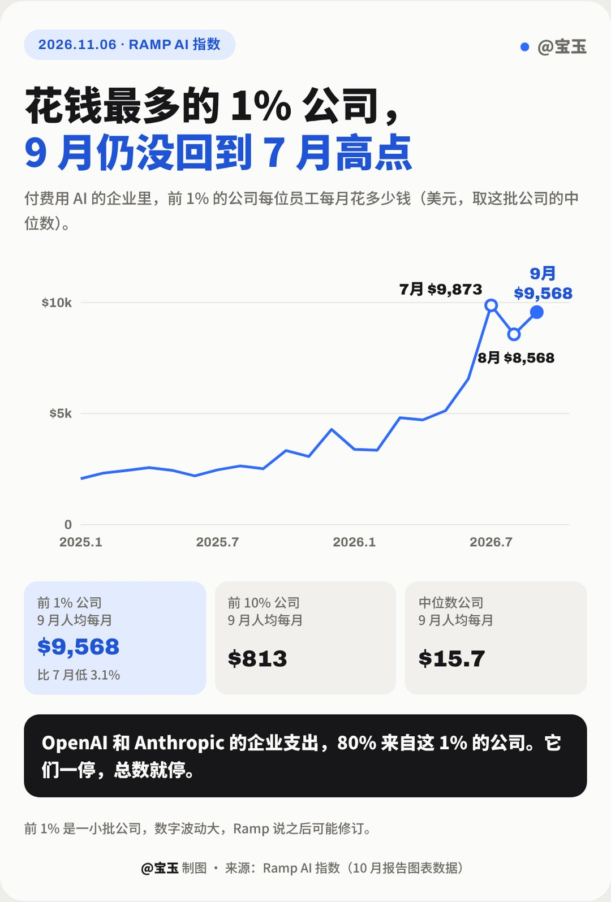

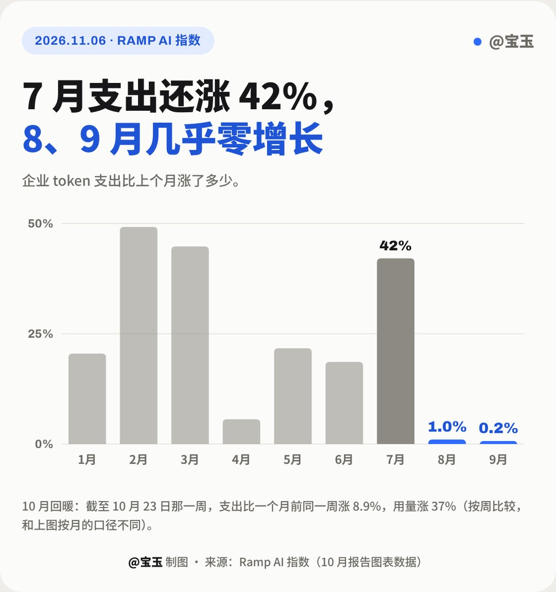

---

## 3

@包容万物恒河水

发表于：2026-11-06 14:57

来源：微博

链接：https://m.weibo.cn/status/5362390683878015

🔻还有一些帐号因为一些震荡反弹就对美国的情况表示乐观。

🔻10年期美债收益率还在4.8%上方，30年期5.26%。

🔻美国柴油柴油6.26美元一加仑，9月22日创下6.53的纪录，比一年前贵69%。汽油4.10美元，是有记录以来最贵的选举日油价。

🔻美国新云厂商已失去进入债券市场的渠道，这话不是我说的，是马斯克说的：“过去几周，债市对除AI数据中心外没有实质收入的公司几乎完全关闭。”

🔻CoreWeave的2031年债券收益率一度15.76%，CDS隐含的五年违约概率63%，股价从高点回撤67%。前五大上市新云合计债务610亿美元，同比翻两番，另有180亿美元经营租赁。它们的借钱成本15%，数据中心的净租赁回报13%。

🔻Anthropic + OpenAI 的估值将继续下滑，黑石在630亿美元芯片融资的投资人说明会上改口，预计 Anthropic 上市后只有BB级，离投资级差一档，OpenAI这一轮，估值从1.4万亿砍到1.25万亿，融资额从300亿砍到200亿，到10月30日实际锁定的承诺只有110亿。

🔻五大云厂三季度自由现金流合计负318亿美元，第一次转负。今年前10个月，AI相关债券发行6550亿美元，同比翻倍。

🔻Gartner算过一笔账：美国数据中心到2030年需要8.5万亿美元累计收入，才能覆盖已经宣布的支出和融资成本，同期能归因于数据中心的AI收入，不超过3.6万亿。

🔻缺口4.9万亿美元。

🔻这一切建设的资金究竟从哪里来？

🔻网上的 AI 嘉豪们即将领教流动性枯竭时会发生什么，因为似乎没人记得，也没人经历过 2008 年，更不用说 2000 年了。

🔻美国科技圈的人似乎不明白这一点。仅仅靠不断向全世界宣称你已经实现了 AGI、并且正在迈向 ASI，并不会让钱就这么神奇地涌进来。

🔻市场上将看到清算的发生，也许某一天，一家新云公司还在，他们的 CEO 告诉你一切都好，第二天他们就没钱了。

🔻别自欺欺人了，OpenAI 和 Anthropic 在这方面也不能幸免。就等着看吧，等到美国人真正经历一次经济下行、企业进一步限制它们的 token 用量时会发生什么。

🔻顺便说一句，共和党人本来该希望这事早点爆掉，而不是晚点，这样在2028年大选前还有一年多时间让局面回升，拖到2028年才爆就来不及了。可现在已经11月，离2027只剩不到两个月，这个窗口关得比他们想的快。民主党新议员1月就职，桑德斯说44个选区里有43个投票支持暂停AI数据中心建设。

🔻2008年发生的就是这种情况，奥巴马把麦凯恩打得落花流水，雷曼倒了之后，麦凯恩的民调数字一天比一天难看。

🔻能怎么办呢？

🔻都怪马杜罗。

\#美国10月非农远超预期\#\#海外新鲜事\#\#热点聚焦\#

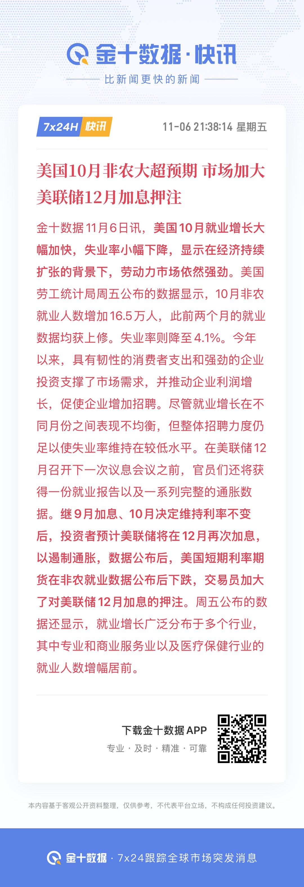

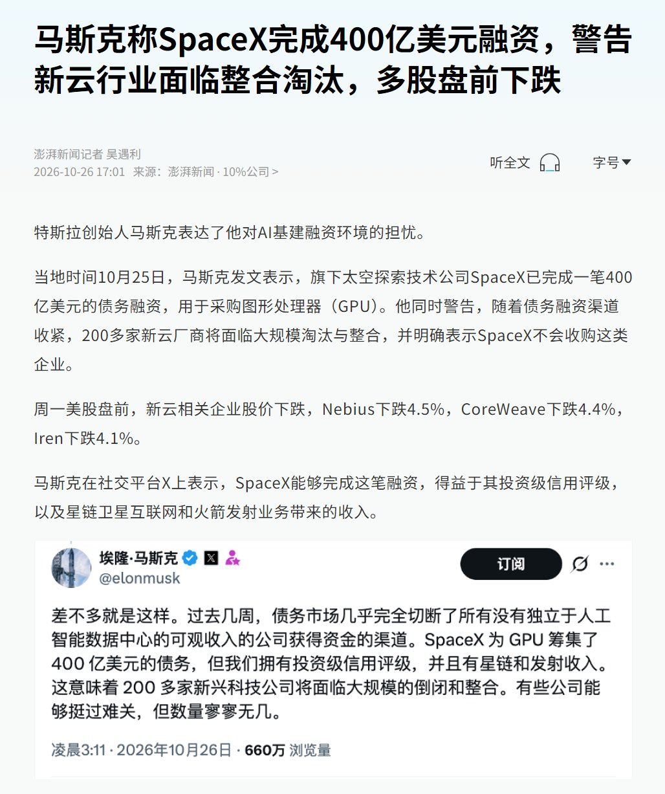

---

## 4

@蘸盐

发表于：2026-11-06 17:46

来源：微博

链接：https://m.weibo.cn/status/5362433277560582

1990年6月，河北省委副书记、省长岳岐峰调任辽宁省委副书记、代省长（要等翌年辽宁省人大开会确认后才是正式的省长）。两省相邻，岳轻车简从，只带了一名秘书和一名司机，直接从河北开车前往辽宁（按当时1986年中办国办文件，新省长赴任，已经明确禁止省政府派人到省界迎送，也不能去外省境内接人）。路上在辽宁境内小饭馆吃饭时，因为先上菜的问题，邻桌当地警察吹胡子瞪眼找麻烦，秘书与其争吵，结果连岳省长一同铐了岳岐峰后来跟梁晓声讲过这事，梁晓声1993年写《九三断想》把这事写出来了。但是没提涉事警察判刑什么的。

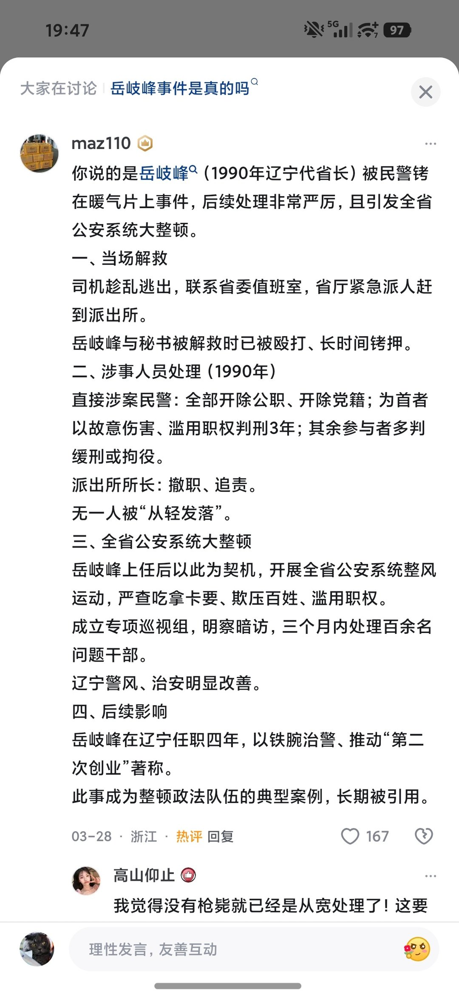

---

## 5

@包容万物恒河水

发表于：2026-11-06 17:05

来源：微博

链接：https://m.weibo.cn/status/5362422967960660

🔻其实就是卖的不好。

🔻预定很多，卖的一般，远不及预期。

🔻该车型曾被宣传为传统皮卡的竞争对手，但最终因其沉重、棱角分明的设计而仅在少数市场销售。

🔻直到 2023 年末才开始向客户交付 Cybertruck。根据 Kelley Blue Book 的数据，该公司去年在美国仅售出 20,237 辆 Cybertruck，较 2024 年的 38,965 辆下降 48%。在这款皮卡推出之前，马斯克曾预测年销量将达到 25 万辆。

\#特斯拉将逐步停产Cybertruck\#\#海外新鲜事\#\#热点聚焦\#

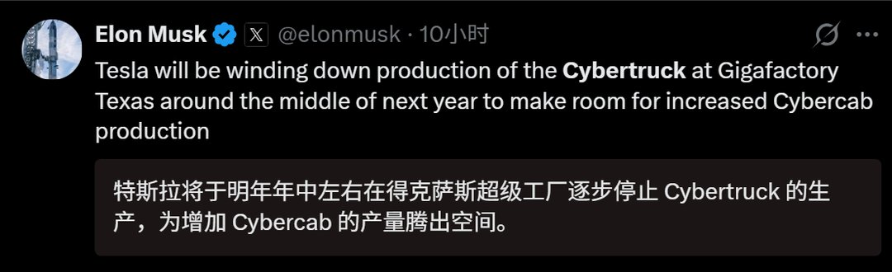

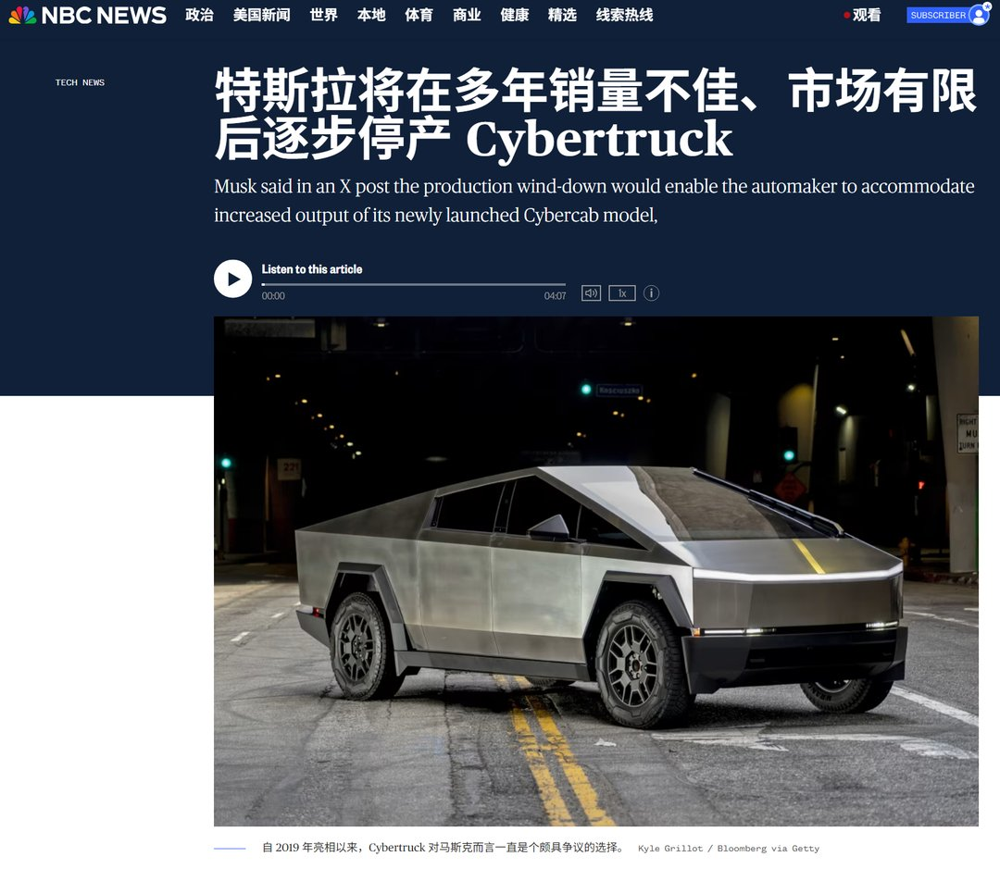

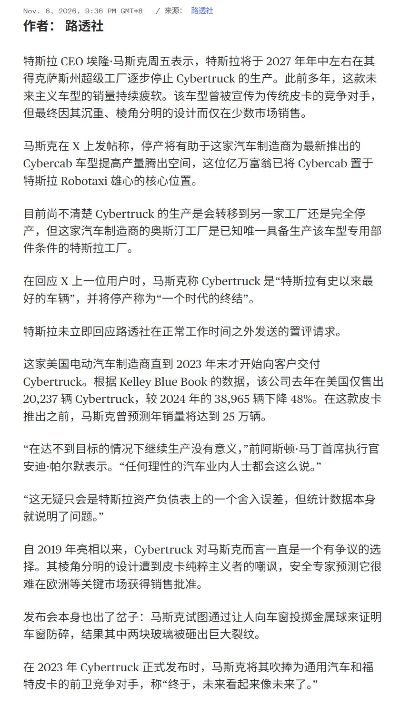

---

## 6

@申典启

发表于：2026-11-06 13:59

来源：微博

链接：https://m.weibo.cn/status/5362376115224908

【阿典大闹南非的FNB银行】

昨天我在比勒陀利亚办理纳米比亚签证，发生了一件事，我酝酿了一天，决定还是讲出来，因为并不是我的错。

事情是这样的，办理纳米比亚签证，需要交签证费用，使馆要求我们去制定的一家银行FNB（first nation bank）办理。

操作并不复杂，你先从使馆走到这家银行（直走15分钟就到），在银行里找到一个工作人员，告诉你如何操作就行了，你只要带着现金过去就可以。

我就按照这个指示，到了FNB银行。

刚进入银行大厅，我看到两个穿制服的黑人胖大姐坐在边上的椅子上聊天。

于是，我非常礼貌的上前说：“excuse me （打扰一下）”我刚说完打扰一下，只见这个黑人胖大姐（目测年龄40岁，不像是柜台，感觉是清洁工，具体我也不是特别清楚）直接打断我，指着旁边的座位：“到那边等！”

我感觉有点不爽，黑人胖大姐非常粗鲁，当下我没有反应过来，过了几秒钟，我渐渐感觉到不爽。

（我看了看周围，除了她俩，并没有其他穿制服的工作人员，我想着除了问她，还能问谁？

我看了看表，时间已经是11点50，使馆关门的时间是12点半，所以我必须抓紧汇款后，把汇款收据交到使馆，才能拿到我的签证。）

于是，我借着这个理由发作了。

我对黑人胖大姐说，你讲好了没有？！我忙着要去汇款给纳米比亚使馆，你还在这里闲聊。

黑人胖大姐估计平时在这家银行工作（应该算铁饭碗），觉得自己非常了不起，用非常强势的口吻说，NO（第二声）NO（第二声）NO（第四声），我还没有说完话，你不要插嘴！

我直接走到她面前，用手指头指着她（我最讨厌别人用手指头指人，看到路人吵架的视频指人，我会觉得指人的人很没素质，但是此刻我觉得这是最容易侮辱到她的方式。）一边指她一边说，刚刚我说打扰一下，我很礼貌的对你，是你对我很粗鲁……

就在我们俩越吵越大声的时候，银行大厅的柜台都听到了，先跑出来一个黑人小哥，它态度比较好，就当和事佬，来劝架，反正意思就说都不要吵了。

黑人小哥过来，胖大姐更狗仗人势，更凶了，胖大姐越凶，我越用手指指着她。

随着声音越来越大，

出来了一个白人女子（听口音是俄罗斯的，应该不是南非白人），态度严肃，仿佛是大佬杀出来的感觉，周围的黑人纷纷让道。

 只见这个白人女子用眼睛死死盯着我，说，你现在给我出去！

我说，你谁啊。

她说，不管我是谁，你现在还我出去！

（这里插播一个知识点，在南非，普通黑人对白人有一种骨子里的自卑感，他们叫做“基因压制”，当地华人告诉我，当地三个模特在户外拍照被一群黑人混混遇到，2个黑人模特被强奸了，而那个白人模特没有被强奸）。

我冷笑了一声，说，为什么？因为你是白人？

她没有回答，再用眼神死死盯着我，就一直瞪着我。

我当时差点笑了，我也用眼睛瞪回去。

我说，拜托，现在已经不是纳粹白人政府时期了，你们（白人执政）的时期已经结束了，我出生在中国，我们没有做过白人的奴隶，我们不怕白人，你瞪我没用～

（这个白女一股她是白脸别人就会怕她的气势，非常搞笑，以为中国人也吃白人刷脸这一套）

她看瞪我没有任何作用，然后装模作样的去报警，一直在那里点手机。

我被旁边的一个老头（黑人保安大叔拉住），保安大叔说，别吵了，有话好好说嘛，然后给双方台阶下……

保安大叔把我拉到了大厅旁边的ATM处，告诉我，这里是汇款的地方。

当时周围人都盯着我们，保安大叔感觉帮我也不是（小红书上，大家都说，这个保安会帮人汇款，反正最后看情况给保安几块钱小费就是了）。

我对保安说，你帮我操作，我给你小费。

保安大叔从犹犹豫豫迅速站到我后面，告诉我如何操作，大概2分钟，汇款完成。

在银行事情完成，但是我还是没玩过瘾，我又走到了大厅。

大厅了那个最开始的黑人胖大妈消失的无影无踪，只剩下那个白妇女和黑人小哥。

我装模作样的掏出背包里的纸笔，走到白女身前，看着她问，你叫什么名字，我要到你们银行总部投诉你！

她说，我为什么要告诉你我的名字，我要报警！

我说，我有权利投诉你，你不尊重客户，你非常不专业。

接着白女跑到马路边装模作样的打电话，就是不理我。

黑人保安大叔在后面拽着我说，你看时间，已经12点10分了，你不去大使馆就来不及了！抓紧去吧，12点半就关门了！

我看了看手机，确实快来不及了，先跑回使馆把签证拿到手，回来再对付他们。

我一边往使馆走，一边回头骂，我待会再回来，我要投诉你们，白女则在旁边假装一直打电话……

一回头，我要笑死了，我一个人疯，周围一群人要陪我演，把这家银行搅的鸡犬不宁。 南非·比勒陀利亚

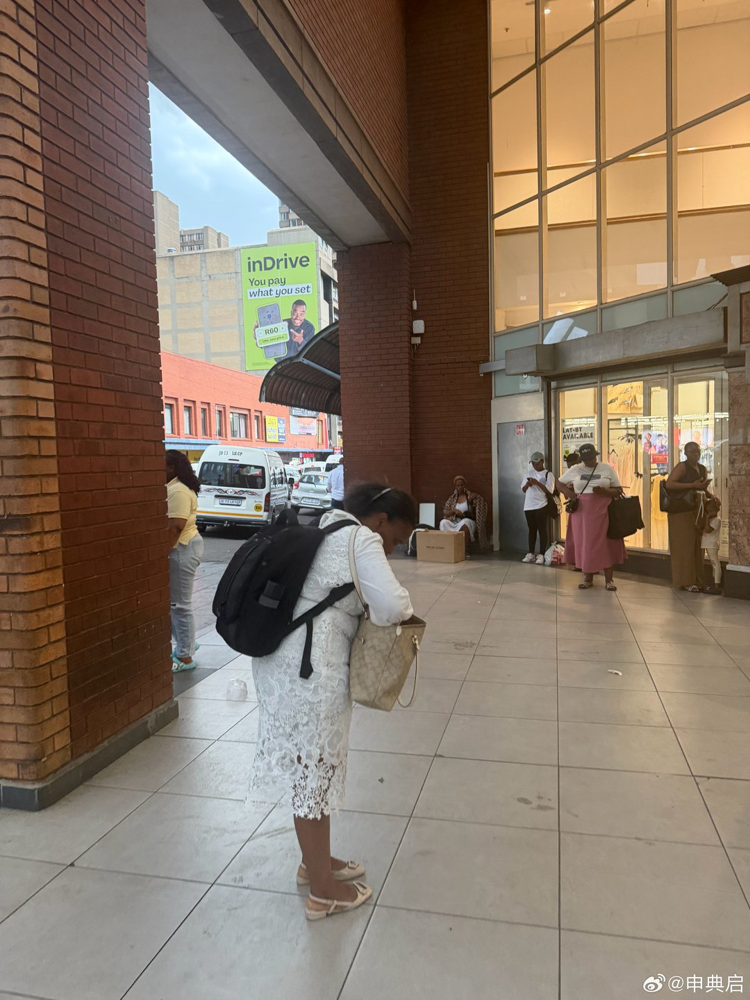

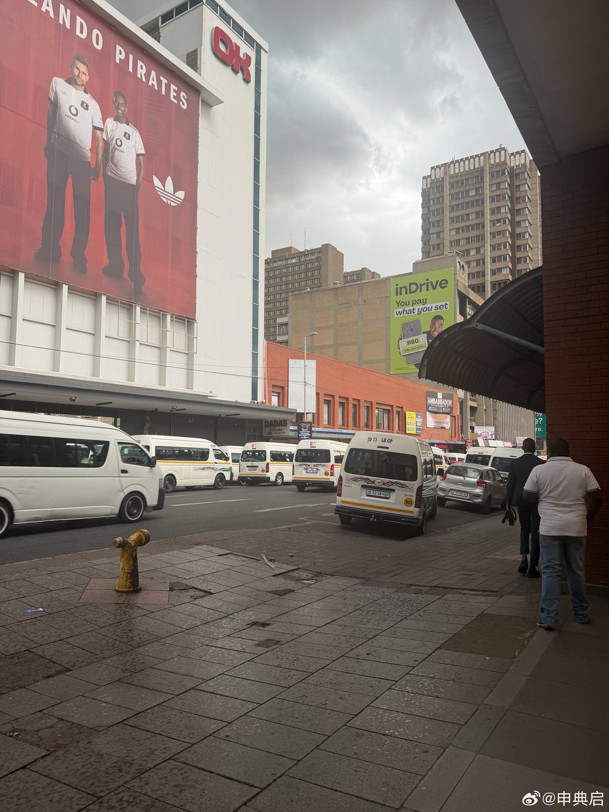

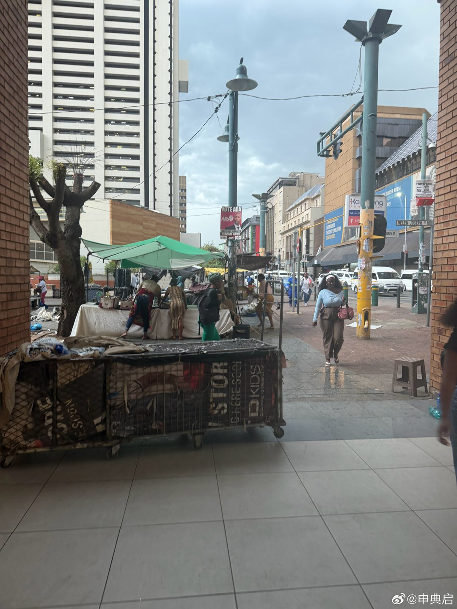

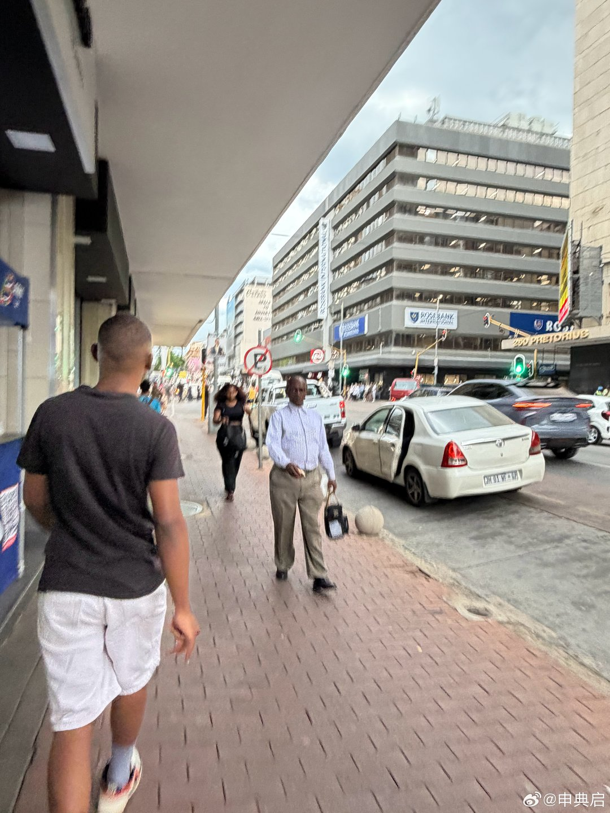

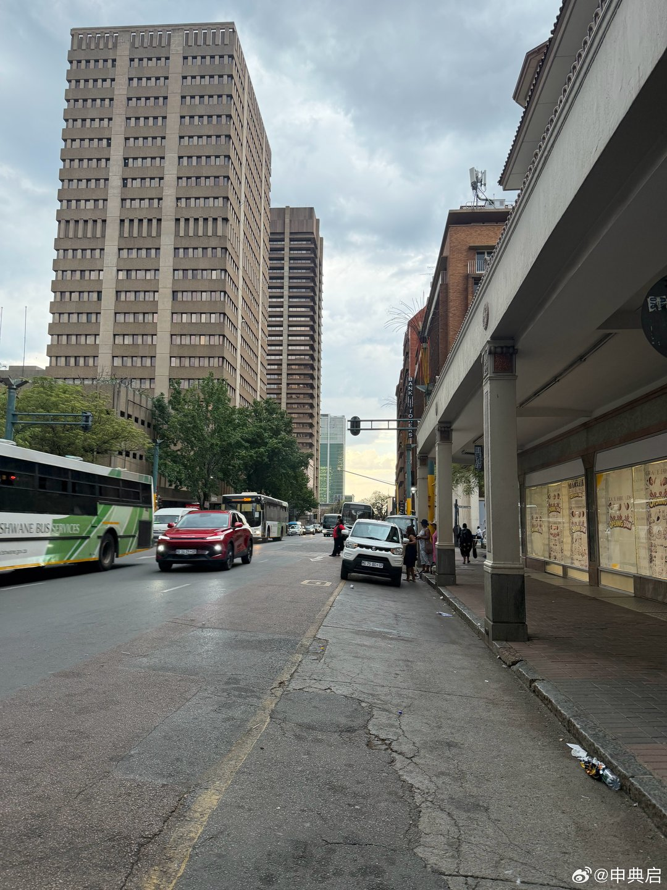

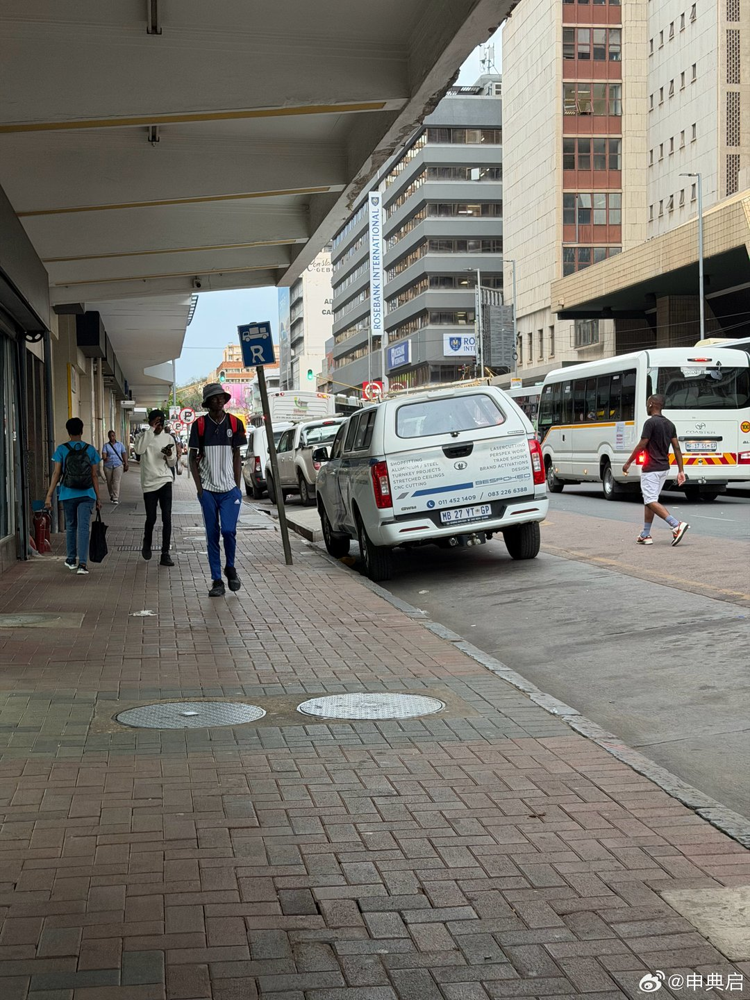

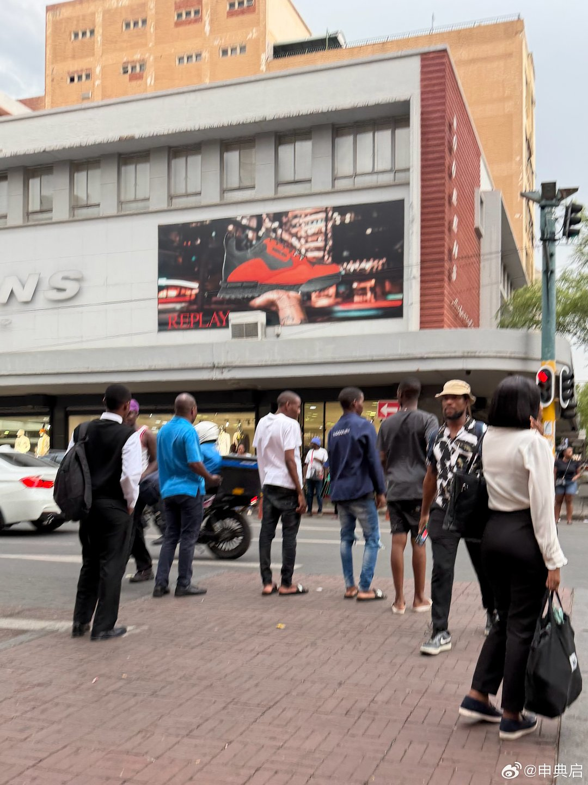

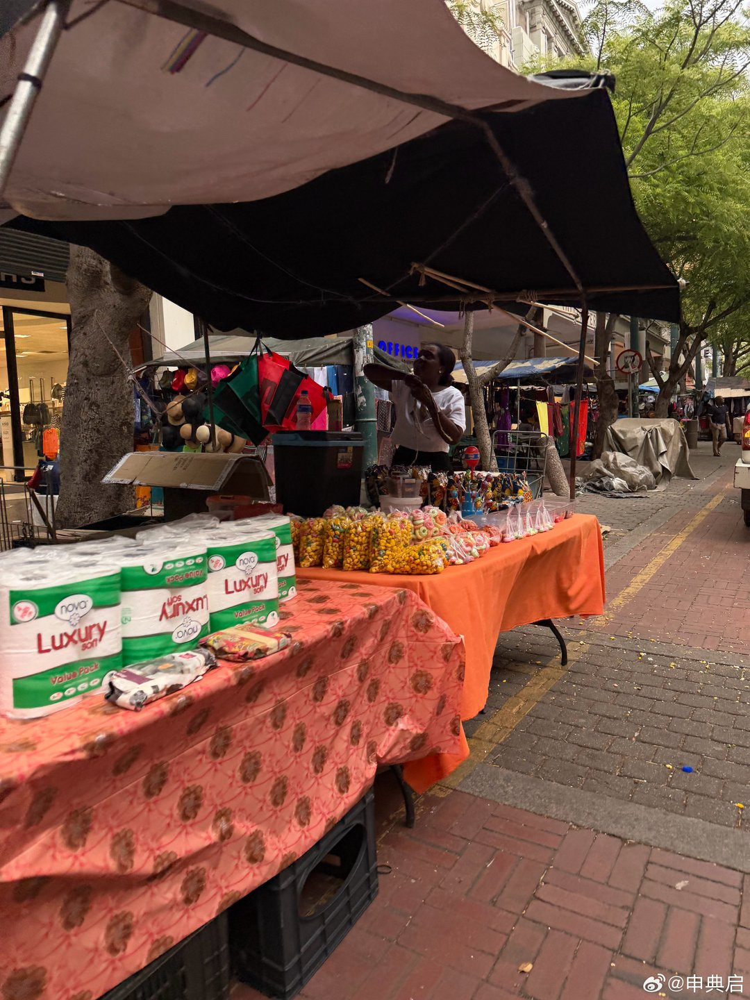

---

## 7

@汪有

发表于：

来源：微博

链接：https://m.weibo.cn/status/5216216206807663

隔壁非常危险。

请大家多发微博，保护个人隐私——

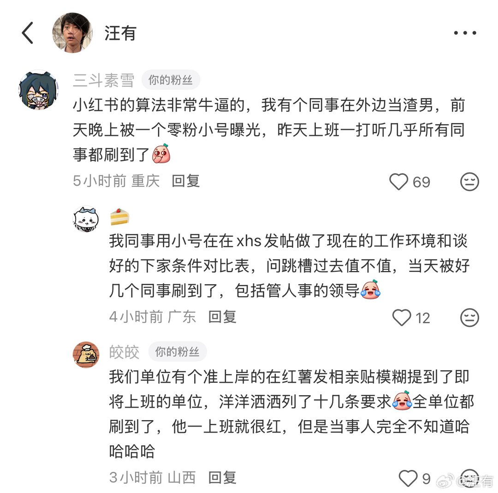

---

## 8

@平原公子赵胜

发表于：2026-11-06 10:52

来源：微博

链接：https://m.weibo.cn/status/5362329164452120

中期选举一失败，万斯这小子彻底不演了。

他发挥他畅销书作家的文笔，痛心疾首、声泪俱下写了一篇长文，大意是“我们失败在哪里”？“自MAGA运动以来，总统先生一共犯了哪些错”？

他毫不遮掩地说，这次不是我们输给民主党了，也不是我们准备不够充分，而是“2024年支持特朗普的人，现在支持民主党了”，“我们政策上犯下了重大的错误，以至于美国人民愤怒了、失望了”。

“我们失利的原因就是这场战争……每个人都知道我们为什么输了”。

他的意思是，我们背叛了我们的初心，我们卷入了和我们美国无关的战争，让我们的孩子替别人去送死，我们没有做到“美国优先”，而是“以色列优先”，我们和伊朗打仗，造成了巨大的经济消耗，提高了美国的物价……那些美国蓝领家庭对我们失望了，不再支持我们，不是虚伪的民主党做的有多好，而是我们做的太差了，错误太严重了。

白宫4日上午召集政府官员开会，要求在中期选举后统一信息发布口径，但万斯依然坚持了自己的独立表达。

看出来了没有，他已经不想和懂王这艘破船共存亡了，起初他本来就反对对伊朗开战，反对的亲以色列，反对处处听内塔尼亚胡的指示……但没有办法，他不能公开讲，他得保持和懂王表面上的一条心。

虽然在上半年，万斯代表美国和伊朗谈判期间，他就公开表达过对以色列的不满。

他曾经声色俱厉，言辞激烈，指着以色列和内塔尼亚胡的鼻子臭骂一通，他指责以色列正在试图操控美国政治，说以色列表现出了“怪异的恐慌”和“歇斯底里”。

"如果我是以色列政府的内阁成员，我可能不会去攻击我在这个世界上仅剩的唯一强大盟友。"

"在过去三个月中，以色列三分之二的防御性武器是由美国人制造的，并由美国纳税人的钱支付。"

他对那些以色列的右翼强硬派嗤之以鼻，说：“你们以色列是个900万人口的国家，你们不能永远指望靠杀戮来解决你们所谓的安全问题……”

万斯从来不支持以色列，也从来不支持进攻伊朗，结果那段时间特朗普根本不听他的，懂王被卢比奥、海格赛斯这些亲以派马屁精包围了，满脑子都是一夜之间摧毁伊朗的幻想，每天面对的都是粉饰出来的大本营战报……一点冷静、理智的声音都听不进去。万斯那时候既不能反对特朗普的政策，也不能在公共场合唱反调，他只能靠边站了，一个畅销书作家、MAGA网红出身的副总统，长时间被搞得销声匿迹，长时间不发声、不表态，几乎所有人都看出他和特朗普貌合神离了。

中期选举的结果证明，万斯的预感是对的，这是一场错误的战争，懂王和共和党因此丢掉了自己的基本盘……虽然特朗普还是总统，但两院全部被民主党拿下，接下来，美国政治已经进入垃圾时间，什么都做不了了，懂王的政令一个都没法推行，而懂王的战友和幕僚们，将会遭遇不断的政治报复，曾经轰轰烈烈的MAGA运动，实际上已经失败了。

万斯得考虑自己未来的政治生命了，他在长文中，既表达了对特朗普旧路线的批判，也提出了自己的新思维，他提出了所谓的“四项任务”，也就是——结束伊朗战事、聚焦民众生活成本和通胀问题、坚持“美国优先”、改变美以关系。

也就是说，他已经开始拿出自己的“执政纲领和路线”了。

你看，我就没看错他。

这小子是个天生的投机者。

万斯的出身和经历很能打动美国年轻人，他是被美国“普世价值”摧毁童年的一代人，他从小父母离异，母亲在六十年代价值观的熏陶下，抛家弃子，酗酒放荡……万斯痛恨六十年代以来的性解放，也痛恨着六十年代以来的嬉皮士价值观。

万斯的导师，是耶鲁大学的华裔学者、“虎妈”蔡美儿，这位蔡美儿写过三本书，其中分别叫做《帝国时代：超级强国如何成为世界主宰及失败的原因》、《着火的世界：输出自由市场民主是如何造成种族仇恨和全球动荡的？》……讲的那套理论，很受拥护“孤立主义”、“美国优先”的红脖子欢迎。

万斯也痛恨“国际化”、“资本化”摧毁了美国的工业产业、白人蓝领的生活方式，他和特朗普一样，试图恢复“孤立主义”，和国际资本断开联系，逆全球化，专注于美国自身。

但他这个人又是“身段灵活”的，他并不反对有色族裔，他为了能够获得更多的政治资源，甚至娶了一位印度裔老婆，举办过印度传统婚礼，他老婆曾是铁杆的民主党人……政治需要他是什么人，他就可以是什么人。

2016年的时候，他还是个讽刺特朗普的毒舌建政人，到了2024年，他已经是特朗普忠实的舔狗了，连特朗普都讽刺他“小子的马屁拍得不错”……但万斯脸不红心不跳，这样的人是非常可怕的。现在，他又是特朗普错误路线的批判者了。

万斯的真实想法，其实很早之前就已经表达过了：

“我认为特朗普应该做的是，如果我给他一个建议的话：解雇行政州的每一位中层官僚、每一位公务员，用我们的人取而代之。”

这段话昭和味儿十足，他的意思是——“权贵只晓夸门第，忧国此中真无人；豪阀但知夸积富，社稷彼心何尝思”。

“这些美国政坛上的老B登，无论是共和党还是民主党，都该爆金币……给我们年轻人腾出位置了”！

你看他，年轻、才40出头、文笔不错、立场灵活、野心勃勃、相比那些政客老登，他很受美国年轻右翼欢迎，他站在特朗普身边的时候，满脸都写着“彼可取而代之也”。一派生机勃勃万物竞发的境界，很有精神，好样的，不丢份。

这是懂贼的失败，不是万奉先的失败，这甚至是他最好的机会。

“大丈夫生于天地间，岂能郁郁久居人下”？ 平原公子赵胜的微博视频

---

## 9

@南山林雪萍

发表于：2026-11-07 07:46

来源：微博

链接：https://m.weibo.cn/status/5362529938964801

国外矿山企业更懂ESG吗？国外矿企为什么比中国同行在勘探矿山更规范？其实，这也并非都是道德使然，而是基于一个老常识：有钱能使鬼推磨。

这两天跟一个矿山EPC工程建设的管理层交流，才真正理解这个道理。

国外矿产公司显然比中国企业，更愿意投资做ESG和社区融入。

然而二者的行为差异，在于是否得到了资本的回报。

彭博展望2028年，铜矿会出现大的缺口。205年矿铜矿的缺口有2000万吨，占比整体需求的40%以上。因此大家都在加速开辟开。

即使是宁德时代，也感到这种紧迫性。今年3月份它成立了矿产资源公司，四下找矿。镍钴锂和磷矿，已经基本锁定。然而，宁德时代在消耗了全球40%的锂矿的时候，同时也是铜矿的大户。

一个铜矿的开采周期大概17年。

前期至少有5年时间的勘探。

国外的矿产公司，只要发现了一座矿山，就可以在市场上进行融资。

从卫星遥感察觉到有电磁异常，到无人机飞一圈确认矿山的电磁波动。

这是勘探矿山的初步开始。此后要进行浅地面探槽的挖掘，一直到最终基本确认有矿的“详查报告”。

这个周期，基本上是五年时间。而详查报告是一个分水岭。

此后，搭建矿厂，建立可开采的金属矿产的通道，至少还要三五年的时间，才能开始挖出令人欣喜若狂的铜。有的时候运气不好，矿山可能品味很低，或者完全不如原来的推断。

这意味着即使矿山施工完毕的时候，依然可能是一个令人沮丧的糟糕矿山。一个矿山能够开采出金矿、铜矿出来，真是要靠很多的运气。

但西方对矿山开采，有着非常成熟的资本一路护航。从遥感卫星感觉异常开始，一个矿产公司就可以通过这样的信息开始获得融资。

此后的每一个循序渐进的进展，都可能刚获得进一步的投资。上一个阶段扎实的工作，将是下阶段的融资的有力支撑。而周边社区的情绪安抚，和详尽的地理环境保护，都是加分项。国外的资本，为这样一个步步为营的勘探推进工作，给出积极的评价和买单。在详查之前，一个公司可以建立不同的里程碑，融资甚至可以十多次。

即使没有真金白银的矿石出来，矿企也有资金来源。这使得国外企业在勘探期，都很规范。无论是ESG，还是社区融合，都做的非常慷慨。这些ESG，本身也是资本愿意投入的关键组成部分。

然而中国资本的看法，完全不同。

在详查报告之前，中国资本不会对这样的进程有任何估值的意愿。有了详查报告，矿山就可能卖出去给别人经营。或者更可行的是，企业自行建设矿厂建设完毕，大量矿石开始白花花黑花花地卖出去。到了有明确收入的这一步，中国资本就会开始进入大量加持。

前期三到五年的勘探，对于中国矿企而言，毫无资本估值可言。于是矿企自然会将加速这个不增值的过程，大量粗枝大叶的操作就会出现。跟社区的互动与融合，都是完全赔钱的事情。

这也意味着，矿山所在政府，有可能更容易将矿山勘探权交给国外企业，而非中国。这并非由于太多的偏见，或者权力威慑的结果，而是一个经济性的选择。

中国不得不在全球去找铜矿。这个地形包括了美洲，澳洲，和非洲。

全球铜的储量大概10亿吨，其中智利1.5亿，秘鲁8500万吨。往上走是墨西哥和美国加起来有1亿吨。这属于典型的斑岩型形地带的分布。澳大利亚1亿吨。俄罗斯8,000万吨。

中国差不多4100万吨，排在第第七的样子，低于美国。而哈萨克斯坦也有2,000万吨。这是一个重要的争夺地。

探矿是一个孤苦孤苦伶仃的事情。

而当矿厂已经建立，开采开始之后，任何一家公司都愿意做好ESG和有效融入居民社区。因为好的周边环境，也能使得矿厂更顺利的运营。

而在这之前，国外企业和中国企业不同的行为表现，不过是资本性格的差异性所所造成的。各种行为准则，其实都是按照资本的口味所调教出来的。\#全球矿产攻防战\#

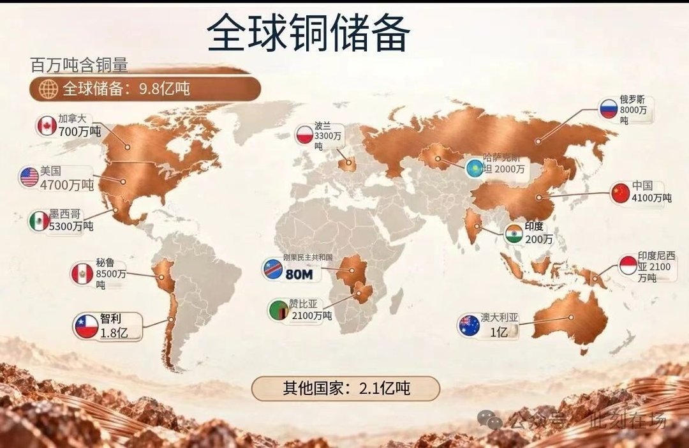

