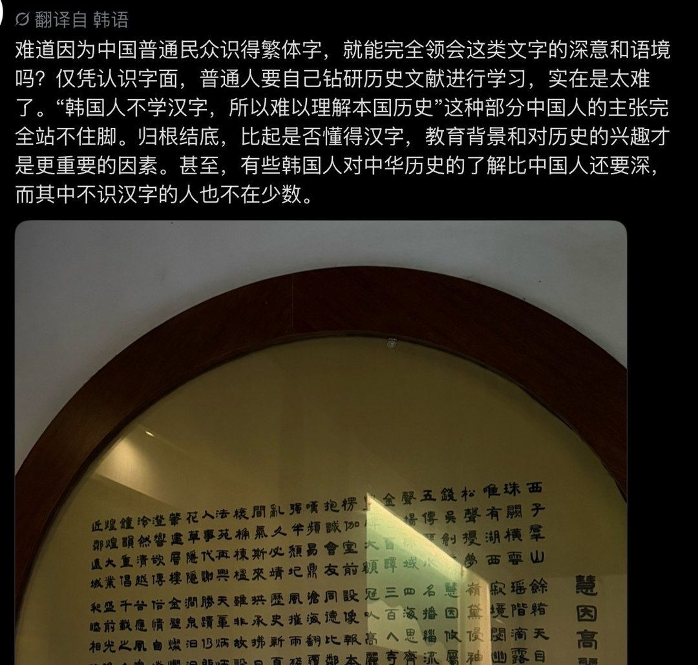

# 2026-11-10

## 1

@苏耷水

发表于：2026-11-09 14:38

来源：微博

链接：https://m.weibo.cn/status/5363473192064051

//@蘸盐:韩国是两个极端。大多数年轻人对汉字汉文包括背后文化典故是真一窍不通。而朴卡卡“新村运动”遗漏下来的那些旧两班后裔，本贯宗家，书院山主什么的漏网之鱼，对汉文和中华文化典故的了解又真是超过了“破四旧”之后的好几代中国人韩国一些居住在乡间、树大根深的两班士大夫家族后代，至今还用全套的中国古代儒家丧仪，包括属纩，饭含，小敛，大敛，五服（斩衰、齐衰、大功、小功、缌麻），虞祭，祔家庙，小祥，大祥，禫祭（守孝满二十七个月后除去孝服）等等。以至于有中国学者要研究中国古代传统儒家丧仪（通过朝鲜王朝《国朝五礼仪》保留下来的中国传统古礼），要专门去韩国，比如庆尚北道的安东市PS，为什么前面我要专门点一句“破四旧”呢，就是1966年“破四旧”是真正的一次对中国传统文化的彻底的断舍离。“破四旧”之前，1954 年杨立三葬礼，1961年陈嘉庚葬礼和梅兰芳葬礼，包括1964年雷锋烈士灵柩迁葬仪式，是这种风格的→→ 查看图片

---

## 2

@六神磊磊

发表于：2026-11-09 14:38

来源：微博

链接：https://m.weibo.cn/status/5363473167156285

黄仁勋这个事，搞得很多营销号博主一直观望，都吃不准第二落点，因为太复杂了，套中套中套，明明一个轨，套了不知几层套，出出了西直门立交桥的既视感。

原本的两性叙事，迎头撞上“芯片叙事”，几大流量池疯狂对冲；继而还撞上“爱川叙事”和“国际地缘政治叙事”，内外对冲，左右对冲，男女对冲，戍卒叫，函谷举，一团乱。

试想，假如有这么一个人，秉承主流积极婚恋观，厌恶婚外情，恨渣男，但是却又很牵挂中国芯；然后很讨厌西方，但是又喜欢川普；很喜欢黄仁勋、马斯克这种科技强人，但是又很希望美股大跌。那他在这个事上一定会感到模块宕机、进程锁死，觉得语言模块不够用——今天到底姓不姓黄？咱先批谁？

