# 2026-11-11

## 1

@宝玉xp

发表于：2026-11-10 19:31

来源：微博

链接：https://m.weibo.cn/status/5363909298487396

其实现在软件开发的瓶颈早就不是如何构建出来专业软件了，而是其他方面。

【一个是如何更好的让 Agent 用你的软件】

我的绝大部分专业工作已经不再依赖于软件，而是给 Agent 一个指令，让它去帮我完成，比如视频剪辑。

这就意味着像视频这种这么复杂的软件操作界面，在 Agent 来说是几乎没有价值的，让 Agent 去通过 GUI 操作软件是低效的，Agent 最友好的方式是 cli、MCP和代码。

【另一个是如何让人类更好的去预览和微调】

以前的软件做这么复杂都是因为需要人去全程操作，但是当我们把这些繁琐的操作叫给 Agent 之后，人需要做的只要去检查 Agent 完成后的结果，以及对结果进行标记、评论和微调。

所以如果你要做一个视频编辑器，不要再做一个这么复杂的界面，一个视频播放器能看到生成的结果，一个可以用来标记、评论的工具配合就足够了。我觉得哪里生成的不对，标记一下、写两句评论就可以了。

这一点连 Manus 都没想明白，他们新版本的视频生成功能还是在配合一个复杂的 Timeline 视频编辑器。

【还有一个就是如何更好的满足用户个性化的需求】

以前的软件设计，只能取最大公约数，照顾绝大数人的需求，所以像一些巨无霸软件 Office、CapCut 都很专业，需要操作手册才能用明白，一些个性化的需求也很难满足。

但现在不一样了，Agent 让制作软件成本很低，所以人人都在做自己的个性化软件，比如我看到向阳就在做自己的录频软件，就是为了满足很多他自己的需求：美颜、虚拟主播。

这种长尾需求是真实存在的，以前没办法，成本太高，现在很多人自己动手，但更多的人即使有 AI 也没有这个能力和足够的 Token 来做这个事情。

这意味着未来的软件，功能上会原子化，软件的能力会被细分拆解到一个个 cli 的命令、MCP 的调用上，Agent 根据需要做的事情，用脚本当胶水，按需组合出来需要的功能。

软件提供的是原子化的能力，不再需要复杂的 UI，只要让 Agent 动态生成就足够了。

【最后一点，当人人都能做软件，怎么才能把你的软件卖出去？】

这是个思考题，我也没答案，我也卖不出 😂


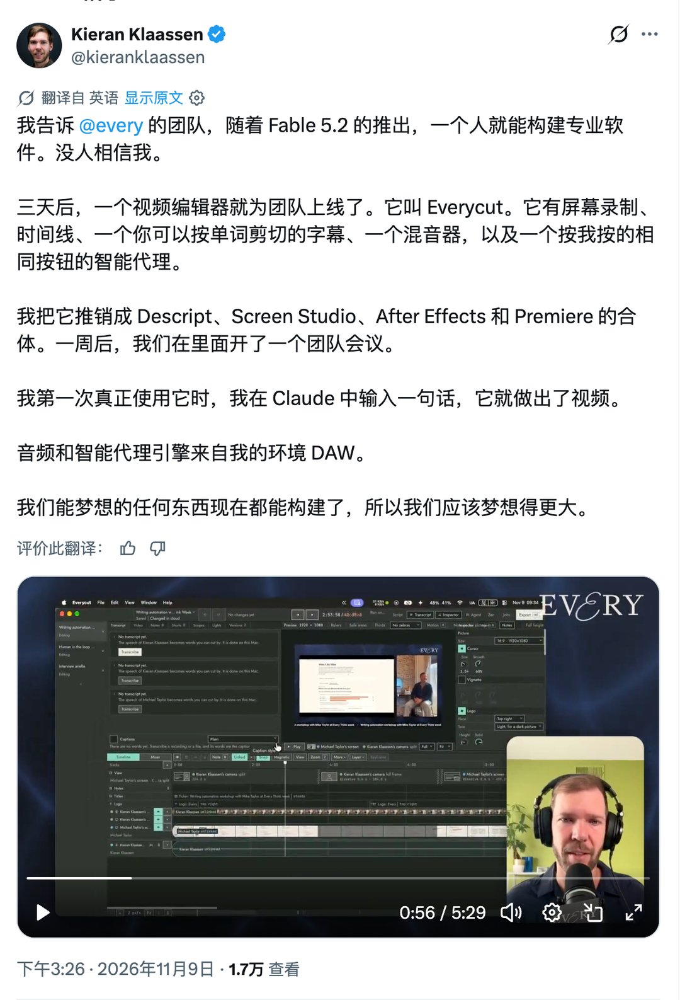

---

## 2

@宝玉xp

发表于：2026-11-10 18:45

来源：微博

链接：https://m.weibo.cn/status/5363897595068794

Lenny 最新科技就业报告：产品经理岗位四年来最多，工程师岗位停止增长，设计岗位创新低

Lenny Rachitsky 11 月 10 日发布了 2026 年下半年的科技就业报告，这是他做的第五份。结论是：AI 时代产品经理需求最旺，工程师需求停滞，设计师处境最难。

先说这些数字怎么读。报告用了两套口径不同的数据：

• 开放岗位：来自 TrueUp，统计全球 9000 多家科技公司正在招的职位数，反映公司“想招多少人”。

• 实际招聘：来自 Live Data Technologies，统计美国有多少人从别的公司跳槽入职某个岗位，雇主不限于科技公司，反映“真招进来多少人”。最近一两个月的入职记录还在补录，数字之后会往上修。

两套数据经常对不上：招聘启事越来越多，真正入职的人却在变少。Lenny 的解读是，公司的需求在涨，但招到合适的人越来越难。

【产品经理】

开放岗位是近四年最多的：现在有 7303 个 PM 职位，比 2023 年 3 月的低点（4171 个）多 75%。从 2023 年初算起，PM 岗位涨了 56%，工程岗位涨 43%，数据分析涨 18%，产品设计和用户研究都在下降。

实际招聘就平淡很多。过去 12 个月美国招了约 3.26 万名产品经理，和 2024 年初相比少了 4%。这已经是几个核心岗位里最好的成绩，同期工程师少 17%，设计师少 26%，用户研究少 36%。

PM 在产品、工程、数据科学、设计、用户研究这五类岗位的招聘里，占比从 2021 年的 16% 升到 21%，是唯一占比上升的岗位。

所以 PM 的“吃香”是相对的。机会比其他岗位多，但整体还没回到高峰：2025 年美国 PM 招聘人数比 2022 年少 35%。

【工程师】

这是报告做到第五期，工程开放岗位第一次停止增长。2024 年涨 29%，2025 年涨 15%，过去一年只涨 2.5%，现在的 65351 个比今年 3 月还少。

实际招聘降得更多。过去 12 个月（2025 年 5 月到 2026 年 4 月）美国招了约 11.3 万名软件工程师，不到 2022 年高峰（23.9 万）的一半，从 2022 年起每年都在降。

工程师内部分化明显。过去一年，前线部署工程师（FDE，派驻到客户那里、把产品接进客户业务的工程师）开放岗位涨到原来的 4.6 倍，现在约 1450 个；安全工程师涨 34%，平台工程师涨 30%。前端工程师少了 51%，Android 少 47%，iOS 少 46%。

Lenny 认为，AI 让小团队里每个工程师能管的范围更宽，前端、移动端这类细分岗位就被合并了。FDE 的暴涨里，也有一部分是“售前工程师”之类的老岗位换了名字。按 Live Data 的统计，今年美国招 FDE 最多的是 Palantir（至少 151 人）、Google（122 人）和埃森哲（50 人）。

好消息有两个。一是科技公司的招聘专员岗位创了纪录，现有 2715 个，是 2023 年 6 月低点（688 个）的近 4 倍，Lenny 认为这可能预示工程招聘会重新加速。二是工程师仍是招人最多的岗位，2025 年美国招了 12.08 万名工程师，是产品经理（3.4 万）的三倍多。

【我是设计师】

全球科技公司现在只有 1924 个产品设计开放岗位，是有记录以来最低，比一年前少 28%，只比 FDE 岗位多几百个。实际招聘也一样，过去 12 个月美国招了约 1.26 万名产品设计师，不到 2022 年（2.76 万）的一半。

PM 和设计的差距越拉越大。现在每 1 个设计岗位对应 3.8 个 PM 岗位，今年 3 月是 2.6 个，2023 年初是 1.9 个。按实际招聘算，过去 12 个月美国每招 1 名设计师，就招 2.9 名 PM。

用户研究跌得更厉害。过去一年美国只招了约 1800 名用户研究员，比 2022 年的 5300 人少 66%，全球科技公司只剩 108 个开放岗位。Lenny 的推测是产品迭代越来越快，团队更愿意先上线再改；Listen Labs 这类 AI 工具也让非专职人员能自己做用户研究。

【不管哪个岗位，招聘启事里都写着 AI】

两年前，PM 招聘启事里最常提的技能是 SQL、Jira、AWS 和 Python。现在排第一的是“LLM”，出现在 11% 的 PM 启事里；SQL 9% 排第二，Claude 5% 排第三，Cursor、OpenAI、MCP 也进了前八。

工程师启事里，Python 仍是第一（29%），LLM（12%）刚超过 Java（11%）。设计师启事里，Figma 仍是第一（37%），而且三年来还在涨；Claude 今年春天升到第二（现在 13%），超过了 CSS，Cursor 也超过了 CSS。

【岗位往湾区集中，远程越来越少】

全球科技公司的开放岗位里，14.9% 在旧金山湾区，约每 7 个就有 1 个，创下纪录；湾区开放岗位数比一年前多 43%。核心岗位更集中：PM 和设计约四分之一在湾区，工程约五分之一，占比都比 2022 年翻了近一倍。

可以远程的岗位只剩 14.4%，也是最低纪录，2022 年底是 21%。工程的远程比例从 25% 降到 14%，设计从 34% 降到 19%，PM 两年来稳定在 21% 左右。

2025 年起，湾区的 PM、工程、设计开放岗位已经多于全球的远程岗位，现在是 21.8% 对 14.5%。四年前，远程岗位数量是湾区的近两倍。

报告的第七条结论是：科技行业整体就业增长很快，但增长主要在软件相关岗位之外。这部分只对付费订阅者开放，具体是哪些岗位，目前还看不到。

原文：网页链接

招聘数据：网页链接


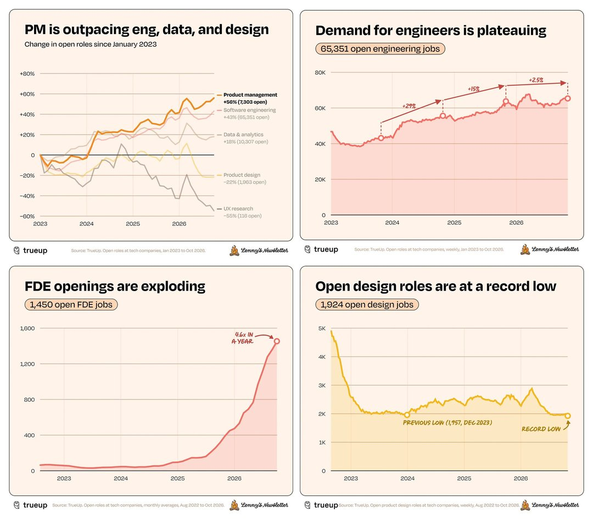

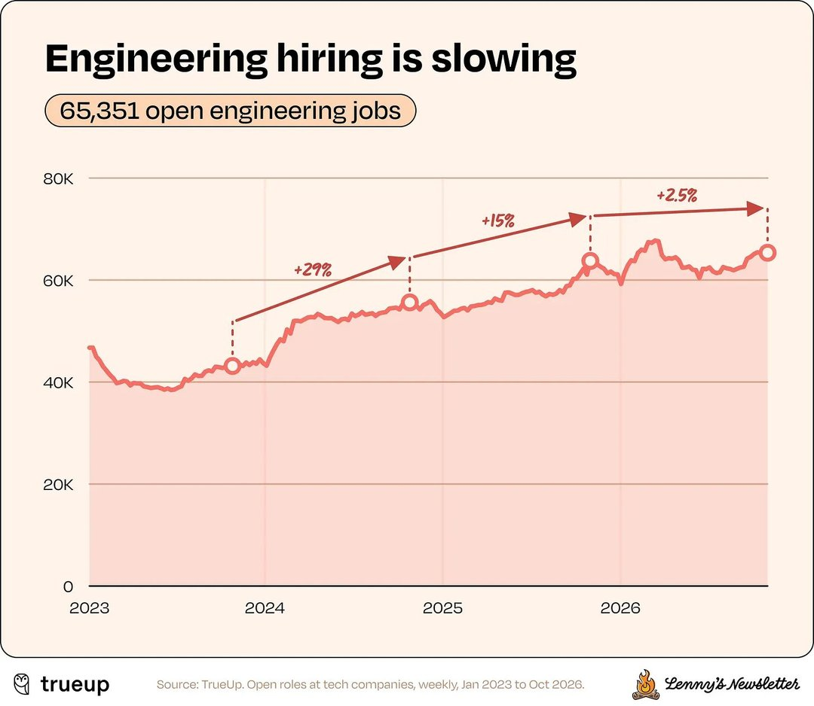

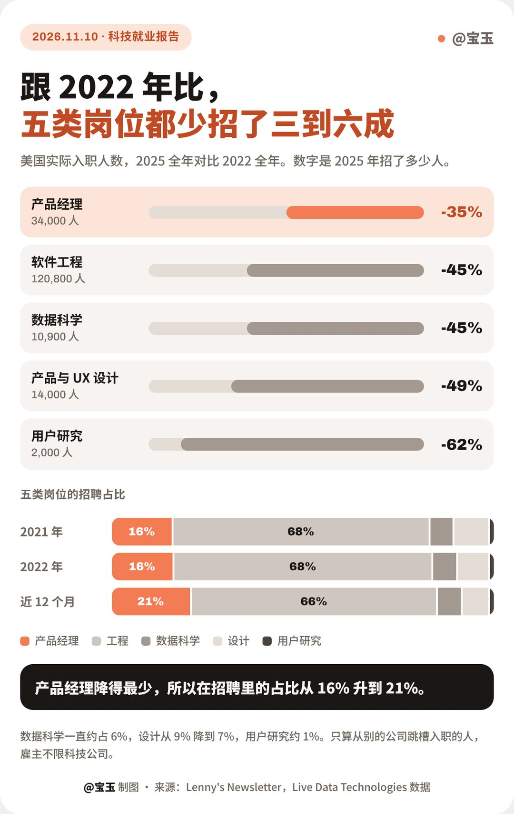

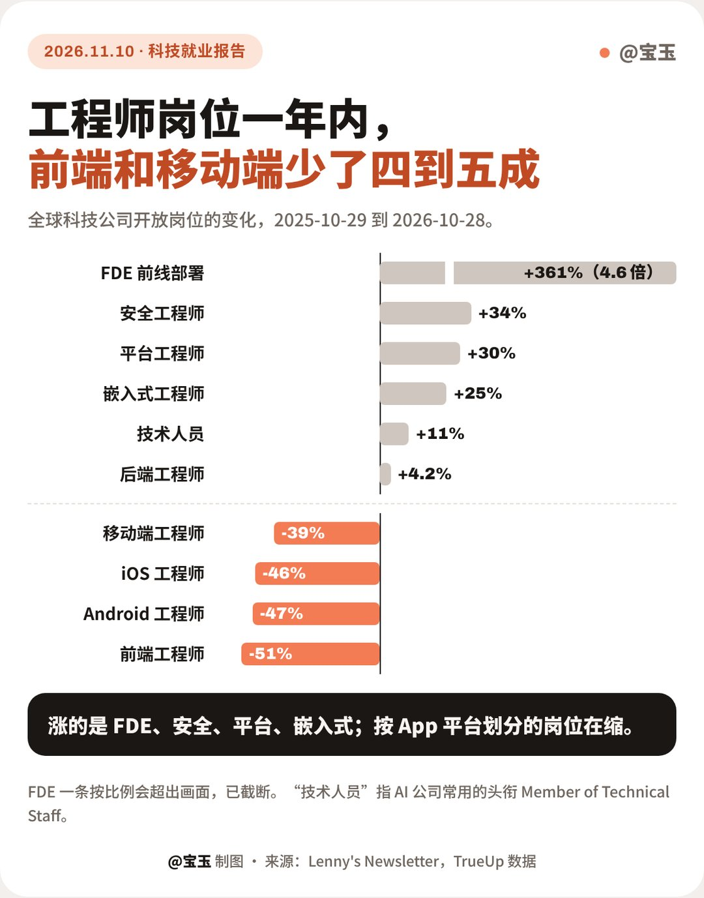

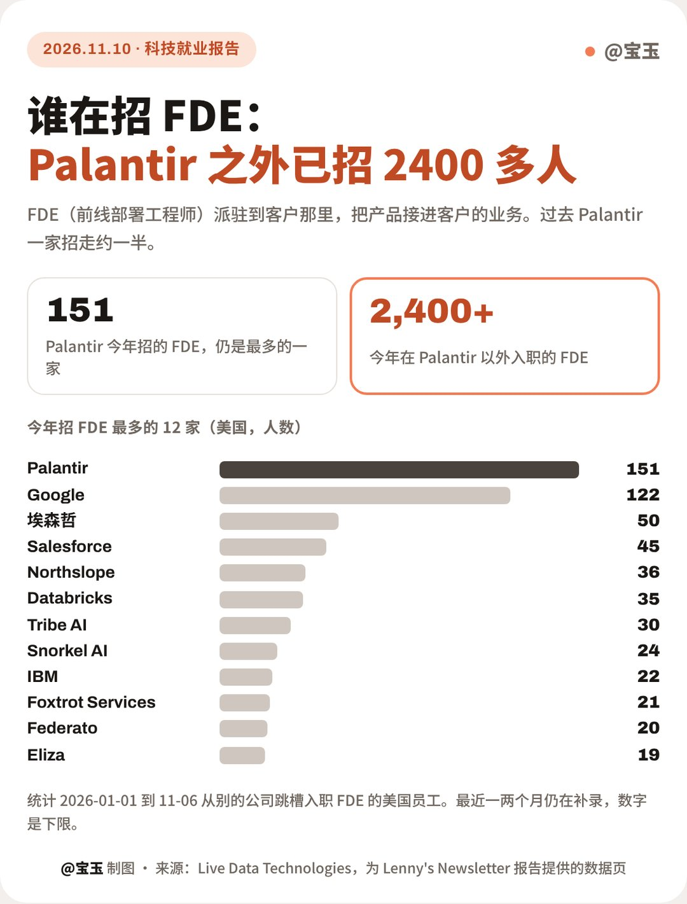

---

## 3

@宝玉xp

发表于：2026-11-10 18:15

来源：微博

链接：https://m.weibo.cn/status/5363890240095574

Claude 加了白板和表格，所有付费套餐可用（测试版）；仪表盘改名 Claude Data 正式上线

Anthropic 11 月 10 日给 Claude 加了两种能跟同事一起改的新内容：白板 Claude Whiteboards 和表格 Claude Sheets，所有付费套餐都能用，目前是测试版。10 月上线的仪表盘 Claude Dashboards 同时结束测试，改名 Claude Data。这些功能今天开始分批推送，账号里暂时没看到属于正常。

【谁能用、怎么开】

三样都要付费套餐，网页、桌面和手机 App 都能用。没有专门的入口，在对话里直接说要什么就行，比如“做个招聘预算表”。Claude Data 要先连一个数据源，比如数据仓库，或者 Salesforce 这类客户管理系统。

Team 套餐三样默认全开。企业版的白板和表格默认关闭，Claude Data 从 11 月 19 日起默认打开，管理员可以在 Organization settings > Artifacts 里随时改。

OpenAI 9 月底推出的 ChatGPT Space 也是让人和 AI 一起改同一份文件，但只给 Pro、Business 和企业版，Plus 用户用不了。Claude 这次最便宜的付费套餐 Pro 也在范围内。

【跟原来的 Artifacts 有什么不同】

Artifacts 是 Claude 在对话旁边做出来、能接着改、能分享的成品。文档、幻灯片和设计 10 月已经正式上线，团队可以一起编辑。这次多了白板和表格两种格式。

白板适合开会时理思路。把一个还很乱的计划口头讲给 Claude，它排成一张带时间线、负责人和日期的白板，同事可以实时一起改。官方举的例子是复盘会：每个人往板上贴想法，Claude 按主题归类，再给每个人起草待办事项。框住白板的一块区域，可以只针对这一块提问。讨论完，Claude 能把白板转成文档或幻灯片，也能导进 Lucid、Miro 接着用。微软的 Whiteboard 里也有 Copilot，能在板上出点子、给便签归类、写总结，前提是有 Microsoft Copilot 许可证。

表格一句话就能生成，带多个工作表、公式、格式和下拉菜单，比如活动跟踪表、招聘预算。Claude 每改一处，会把改动框出来，方便你看它动了哪里。Claude 以前也能生成 Excel 文件，但要下载下来另外打开；Sheets 留在 Claude 里，你、同事和 Claude 可以一直在同一张表上改。官方说现在只有基础功能，需要完整的 Excel 功能，可以导出成 .xlsx 或 CSV，或者用 Claude for Excel 插件，也能转到 Airtable、Asana、monday.com、Smartsheet 继续做。

【Claude Data 多了什么】

官方解释改名的原因是，企业用数据早就不止做仪表盘。新增的几项里，最实用的是“认证查询”（测试版）：数据团队把“活跃用户”“收入”这类指标的算法定下来，大家做图都用这一套，图表上会带“已认证”标记，避免两个部门拿着不同的数字开会。

另一项是“实时分享”（测试版）：同事打开你分享的仪表盘，看到的就是最新数字，哪怕他自己没连这个数据源。他只能看到结果，看不到底层数据，也只能跑你批准过的查询。

此外，Claude 能根据指标起草图文并茂的数据故事，或者带旁白的讲解短视频，你审过之后再发出去。仪表盘还加了缓存，打开更快，每个仪表盘可以单独设刷新频率；改动有记录，能看到谁改了什么、退回到之前的版本；也能套用公司的设计规范。

【在 Claude 里直接用别的软件】

同一天，交互式连接器也升级了。连接器支持的话，可以把整个工具在对话旁边打开，或者全屏用，登录的是你自己的账号。比如打开一个 Confluence 页面，让 Claude 改，改动直接出现在页面上；打开 Box 里的文件让 Claude 修订，两个版本并排对比后再决定留不留；在 Adobe 里让 Claude 修照片，或者编辑、涂黑 PDF 里的内容。Claude 动手前要你批准，跟平时批准连接器操作一样。

首批支持的还有 Notion、HubSpot、Asana、Canva、Dropbox、monday.com 等，Figma、Harvey、Shopify 正在接入。这项功能在网页版和桌面版所有套餐分批推送，前提是你的账号已经换成新版 Claude，也就是 9 月起把聊天和 Cowork 合并的那一版。

Anthropic 还预告了 Claude Meetings：把 Claude 拉进会议记笔记，边开会边更新团队正在改的文档，没给上线时间。

官方推文：网页链接

白板、表格和 Claude Data：网页链接

交互式连接器：网页链接

总览：网页链接 宝玉xp的微博视频


---

## 4

@股票投资人黄祖斌

发表于：2026-11-06 09:50

来源：微博

链接：https://m.weibo.cn/status/5362313612755439

为什么大多女人执着于老公上交工资呢？

两江总督

两江总督

工程师

5787 人赞同了该回答

曾经有一个辅警描述，

处理上百次家庭纠纷，一般都有一个共同点，

1.男生工资上交，

2.男生说话时有点软绵绵，缺少一种正常男性在遇突发事件时，特有的气质，还在退一步海阔天空。还在口口声声地表明自己的立场，只要老婆能痛改前非，自己还是有”男子汉大丈夫的宽宏“，反正可以把处理事件的民警和辅警，都无地自容。

3.约30%的男生还会向辅警诉苦，即我工资上交，没有其他不良行为，她为什么还要出轨？

个人认为男生的责任是很大的，明摆的一条坎坷路，还是要铁头去走，估计还是攀比心在作怪，即在男同学当中，”你们没有想到噢，我也是有老婆的人！“

题主的案例，我并不怪女生，已经是非常非常明确的信号，还没有有所打算，还在想办法试图说服女生金盆洗手，如果还没有结婚，可能对你来说，反而是好事，现在还来得及，之前的那些损失就是小儿科。

核心就是一点，女生任何看似怪异的行为，包括坚决不松口的高额彩礼，男方父母婚后明确不能来串门的，内心就是没有看上你。

发布于2026-08-24 15:23


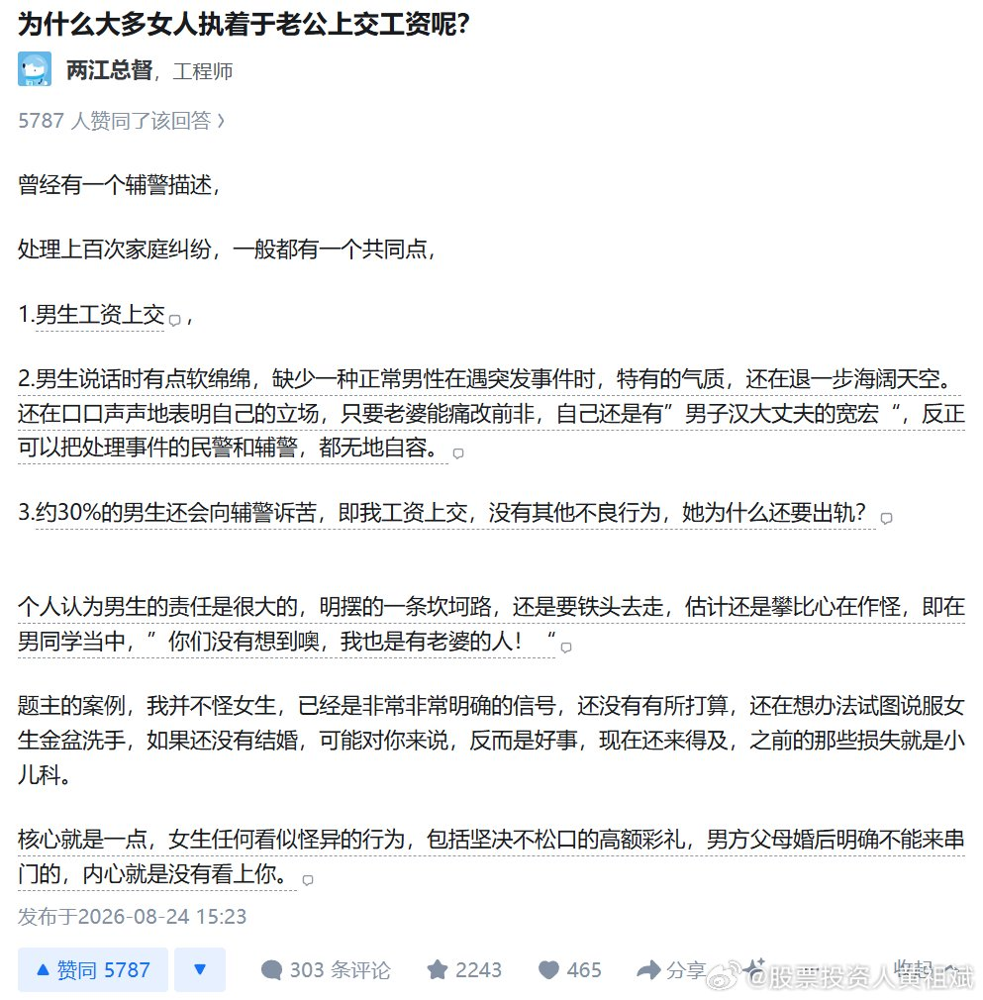

---

## 5

@当代拿破仑的素描像

发表于：2026-11-10 16:51

来源：微博

链接：https://m.weibo.cn/status/5363868945612923

这是一场大规模叛乱

摘要：这些共和党议员试图摧毁的不是海格塞斯，他们真正试图毁灭的，乃是特朗普在共和党内部的权威，这才是最可怕的。

特朗普最信任的国防部长海格塞斯，即将面临弹劾。值得注意的是，发起弹劾的人并非民主党，而是共和党议员托马斯梅西。

更为重要的是，相当一部分共和党人将会加入弹劾，据共和党德州参议员泰德克鲁兹表示，“目前有足够的票数驱逐海格塞斯。”

这实际上是一个非常重要的政治事件，毕竟，这些共和党人表面上针对的是海格塞斯，实际上则瞄准的是特朗普本人。

要知道，特朗普依然在为海格塞斯坚决背书，并威胁那些试图弹劾海格塞斯的共和党国会议员不要掺合。

在这种情况下，如果有足够多的共和党国会议员敢于不顾特朗普警告走出来，弹劾海格塞斯并把他赶走的话，那么将是特朗普党内政治权威的灾难性打击。

这实际上意味着，特朗普对于共和党的权威在中期选举后已经是外强中干、一落千丈，其权力也将在未来遭受日趋严厉的苛刻限制和挑战。

一旦出现这种情形，那些摇摆的追随者如万斯、卢比奥等人，将会不得不随局势恶化而进一步与总统疏离，在这个过程中，甚至更多、更危险的共和党人反叛也将无法避免。

从某种意义上来说，此次弹劾对于特朗普，乃是仅次于中期选举的命运时刻，如果他不能干净利落的压制住共和党人的反叛（勉强镇压都不行），都将是他个人难以想象的可怕政治灾难。


---

## 6

@包容万物恒河水

发表于：2026-11-10 15:34

来源：微博

链接：https://m.weibo.cn/status/5363849647620974

🔻GPT-Image 的生图之王地位可能不保：Seedream 5.5 真能做到非编辑区域像素级不变，下面是连续编辑 100 次后几个模型的结果对比（每次手表上只加 1 秒）

🔻一致性逆天。

🔻via Alisa Qian

\#AI新大陆\#\#海外新鲜事\#\#热点聚焦\#\#微博视频精选大赏\# 包容万物恒河水的微博视频


---

## 7

@汪有

发表于：2026-11-10 04:07

来源：微博

链接：https://m.weibo.cn/status/5363676809005914

之前我有一场演讲，讲的是如何面对AI冲击。

我建议多看书，因为书里有大量AI里别人查不到的知识。我举的例子是诺兰，在他的传记《诺兰变奏曲》里讲过：

他当时拍摄《敦刻尔克》，心想我在网上就能查到很多历史资料，结果一查啥也查不到，网络资料内容质量极差。

诺兰后来猜测，随机在书里翻到某个知识点，在网上能查到的概率可能只有1%。

他的朋友跑去图书馆，随机取了10个知识点，只在网上搜到1个。

我举这个例子，来说明AI的世界非常匮乏。

很快，我的观点就在评论区得到了验证。

好多评论区网友来问：

你这个故事AI根本没查到，是真的吗？


---

## 8

@阑夕

发表于：2026-11-10 15:03

来源：微博

链接：https://m.weibo.cn/status/5363841791692124

你的上限决定了你能用到的模型上限。//@Zodzod_张浩:一个书名就完全改变了结论，他们不是不知道，他们只是根据你掌握的信息情况给你适当的反馈... 评论配图 //@Zodzod_张浩:很有意思的是，同样的博文我问了 claude 和 gpt，第一版的时候我隐藏了关键书名，两个 AI 都没找到出处，并且给的是最泛泛的回答。但我提示了一下书名之后，都精准找到了内容并给了我精准的延展和后续。结论是，即便是 AI 时代，再好的模型，也只对那些掌握关键信息和关键技能的人有效。如果你没有掌握，那么这个生产力工具和你关系不大。 查看图片 //@东东枪:转发微博


---

## 9

@挨踢牛魔王

发表于：2026-11-10 14:59

来源：微博

链接：https://m.weibo.cn/status/5363840797905072

天气越发冷了，例银迟迟未发。

家中日子过得紧，忙碌月余不得歇息，又想着给稚子添几件寒衣。

那闽城的王大善人，最是怜贫恤老，待去他家谋一个“行菜”的职事，领一件黄马褂，租一头驴，拎着食盒给人传菜，好歹有一些嚼用。

再不济，就找宿迁城的刘富商，刘富商心善，最是见不得穷人受苦。

去他家做个“步传”，给人送信送货，距离虽然远些，但是可得碎银若干。

也不知道谁走漏了消息，杭城的马员外送来了银钱，只需要摇摇头，张张嘴，便可拆借到银钱。

至于印子钱，待明年开春，例银发下来，再行偿还。

这个寒冬，便就算是渡过去了。


---

## 10

@信号与噪声001

发表于：2026-11-10 23:28

来源：微博

链接：https://m.weibo.cn/status/5363968891160705

Anthropic 重新定义“地区限制”，11月12日起生效史上最绝户封号规则🤡🤡🤡

1. 人在国内：哪怕你是纯正美国人，落地中国直接禁蹬 Claude

2. 人在美国：只要你是中国公司员工，肉身在硅谷也照样封禁

3. 挂美国壳：出海注册美国子公司？股权穿透查到实控人是中国背景，API 全盘封杀

4. 云厂商连坐：Claude Code、官方 API、甚至第三方云平台和代理商渠道一锅端


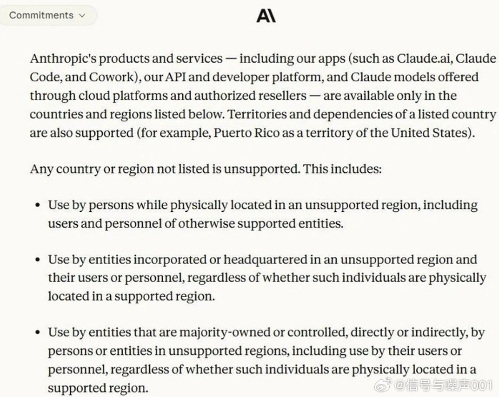

---

## 11

@karminski-牙医

发表于：2026-11-10 22:40

来源：微博

链接：https://m.weibo.cn/status/5363956958364253

MiniMax-H3-Image, 6小时前刚刚发布! 官方直接发X说原生直出 1600 万像素 (注意这个是原生的哦, 不用ComfyUI走超分辨率放大, 不会丢细节), 并且它文生图和图像编辑合并在了一个模型里, 最多能同时输入 16 张参考图. 

更牛的是官方给的速度是不到 10 秒出一张 4K 图 (当然这个速度没写硬件, 但估计要H100以上了), 比主流方案最多快 5 倍!

但是! 这玩意的 DiT 主干足足有 33.1B, 还是稠密参数! 比 FLUX.2 [dev] (32.2B) 还大! 是 Qwen-Image 2.1 (7.1B) 的四倍多! 那它咋做到出图这么快的?

来, 学习时间到了:

首先这个模型, 每个图像 token 是 `32×32` 像素的 (16 倍下采样 VAE + DiT `2×2` patch), 而 FLUX.2 和 Qwen-Image 2.1 每个 token 是 `16×16` 像素的, 所以这些模型生成一张 2K 图 (`2048²`) 大约是 16,384 个 token, 算力刚好处于甜点区. 但如果硬上 `4096²`, token 数会暴涨 4 倍变成 65,536, 注意力部分计算量直接暴涨 16 倍, 小显卡根本算不动了.

而 MiniMax 这个"粗描"也是有说法的, 它 VAE 先做 16 倍空间压缩压成 24 通道潜空间, 进 DiT 后再做一次 `2×2` 打包, 这样一个 token 直接处理 `32×32` 像素. 

这么算下来, 它出一张 `4096²` 的 16MP 大图, 序列长度正好是 **16,384 个 token**, 这些黑魔法搞下来, 它输出一张 16MP 图用的 token, 和别的模型输出一张 2K 图是一样的! 

那聪明的同学肯定要问了, 这么搞不会图片很糊吧? 别急, 它还把传统的 CNN 解码器换成了 24 层 ViT 解码器, 靠解码器把细节搞回来. 而跑过图像大模型的同学都知道, 解码其实运行一次就行了, 所以速度影响不大.

还没完嗷, 光减 token 还不够, 它还砍了步数. 原版 Qwen-Image 2.1 默认要跑 40 步, FLUX.2 也要跑几十步, 而 MiniMax 放出来的直接就是 6 步蒸馏版, 而且不用 CFG (每步只跑 1 遍前向, 原版 Qwen-Image 2.1 开 CFG 每步要跑 2 遍).

更有意思的是仓库里那个 12MB 的 `pdd_fused_heads.safetensors`, 它替换掉了 transformer 原本的输出层, 给这 6 步各自配了一个专属输出头. 不过官方没解释原因, 我猜是因为总共就 6 步, 每一步的噪声水平差别极大, 让每步有自己的输出头, 蒸馏起来更容易贴合.

另外, 它还是个修图模型, 最多支持 16 张参考图. 参考图会兵分两路: 一路进 H3 自带的 Qwen3-VL 文本编码器 (约 33B) 去理解语义, 一路过 VAE 变成潜空间 token, 最后和文字一起拼成一条序列喂进 50 层单流 Transformer. 官方模型卡还放了个案例, 它甚至能先做题然后再画图 (直接把中文逻辑推理题目做出来再写成英文, 然后画图!)

这些组合拳搞完, 如果按同一张 `4096²` 图来粗估 DiT 的理论计算量的话, MiniMax 6 步加起来大约只要 8~9 PFLOP. 哪怕对比同样蒸馏到 8 步, 而且参数只有 7.1B 的 Qwen-Image 2.1 Turbo, 理论计算量也要约 25 PFLOP, 差了将近 3 倍. 这就是这些黑魔法取得的结果了.

但是注意, 它虽然省算力, 但一点没省显存容量. 目前 DiT 权重是 66.3GB, 加上外挂的 H3 文本编码器又是 66.7GB (仓库里甚至没打包文本编码器, 需要直接从 `MiniMaxAI/MiniMax-H3` 里拉取), 光这俩 BF16 权重加起来就超过 130GB 了, 80G 的卡都塞不下, 所以如果单卡不太行只能运行更小的量化版本.

还有, 它和主流生图模型一样非常依赖长英文 prompt, 短指令效果不是很好, 所以官方还配套发了一个 17.9GB (NVFP4) 的本地扩写模型 `MiniMax-H3-Image-PE`... 全家桶搞下来是真·显存富哥玩具了.

最后说下怎么跑, SGLang、vLLM-Omni、diffusers 和 ComfyUI 都已经 Day-0 支持了. 多卡官方推荐开 Ulysses 序列并行, 把单张图的序列切到多张卡上降延迟, 比如 4 卡 vLLM-Omni 可以这么跑:

```bash

vllm serve MiniMaxAI/MiniMax-H3-Image --omni --host 0.0.0.0 --port 8000 \

  --num-gpus 4 --usp 4 --text-encoder-tp-size 4

```

一会我给大家本地测一下量化版本效果怎么样, 敬请期待~

\#HOW I AI\#\#MiniMax-H3-Image\#


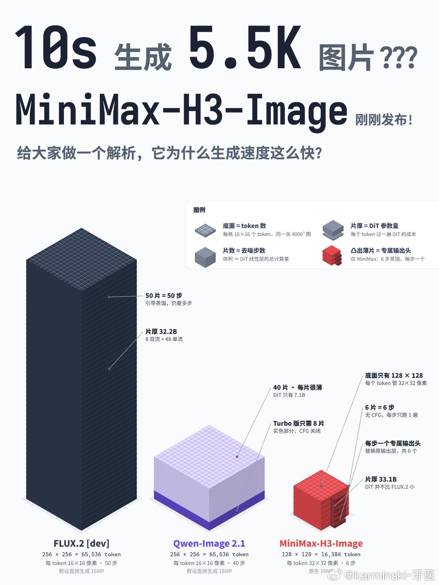

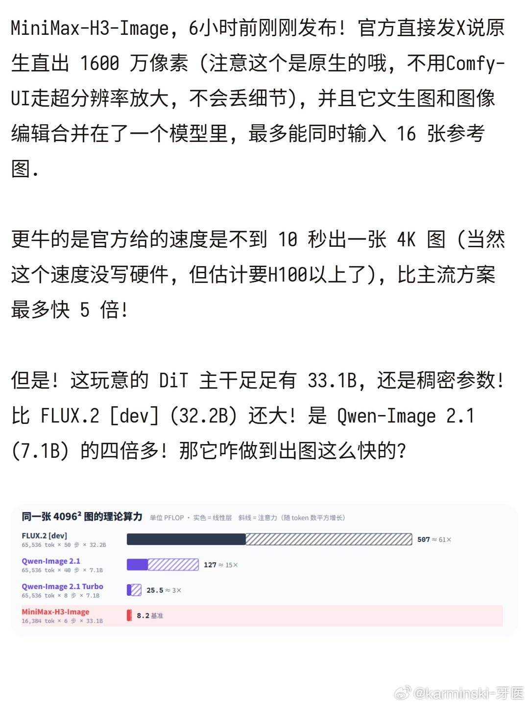

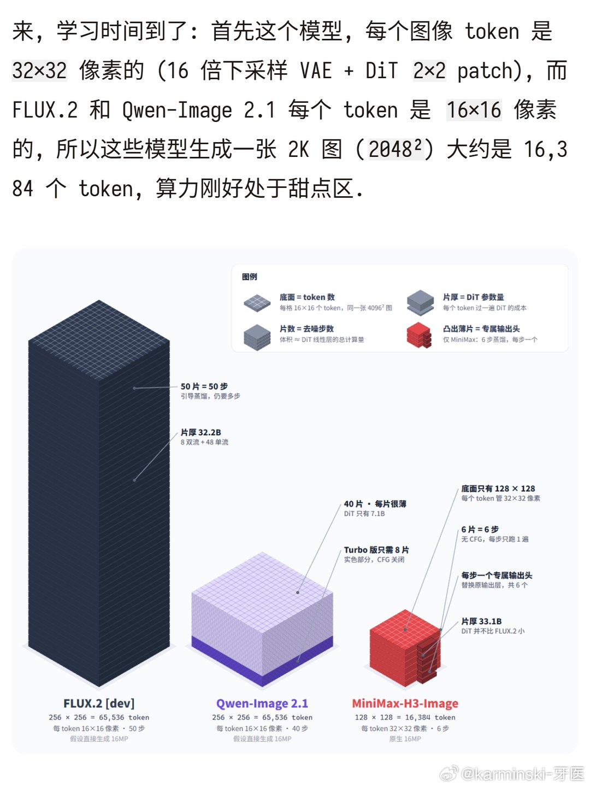

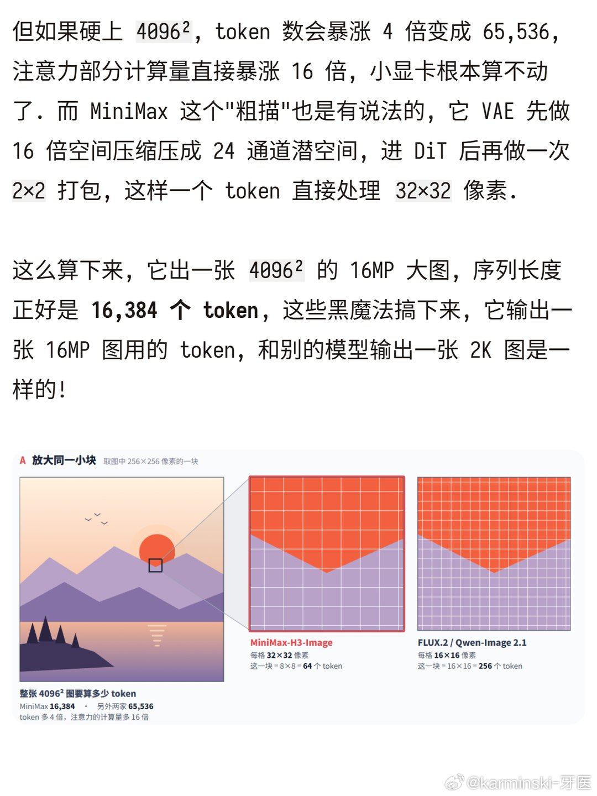

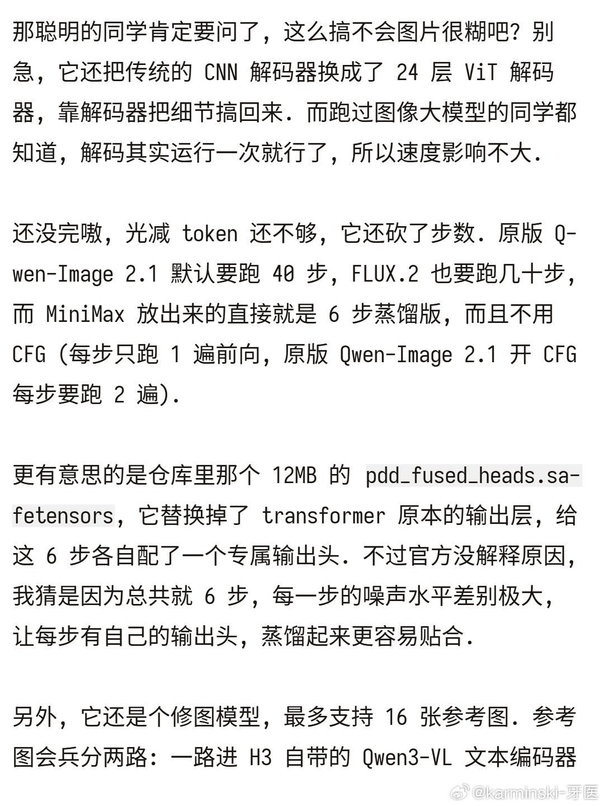

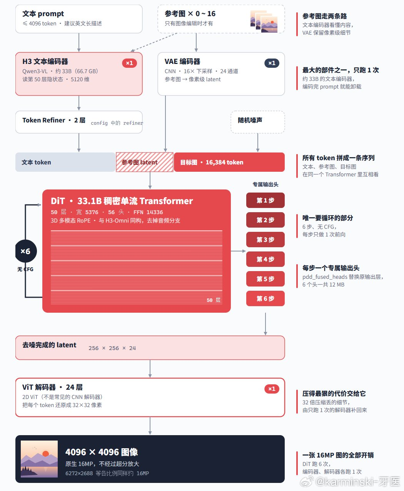


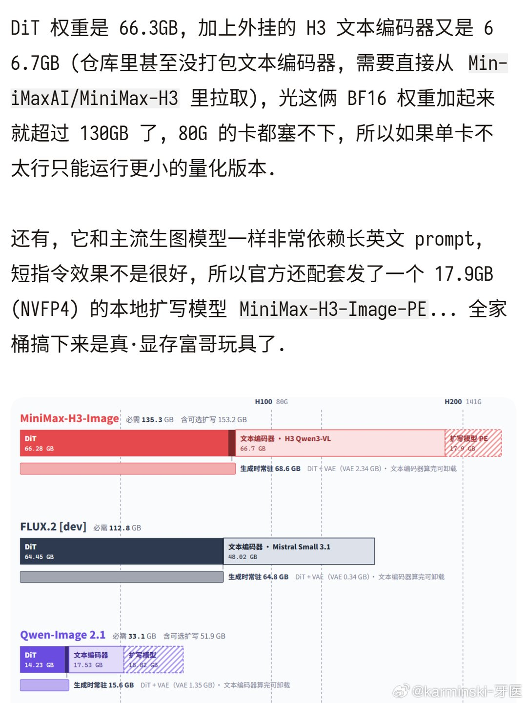

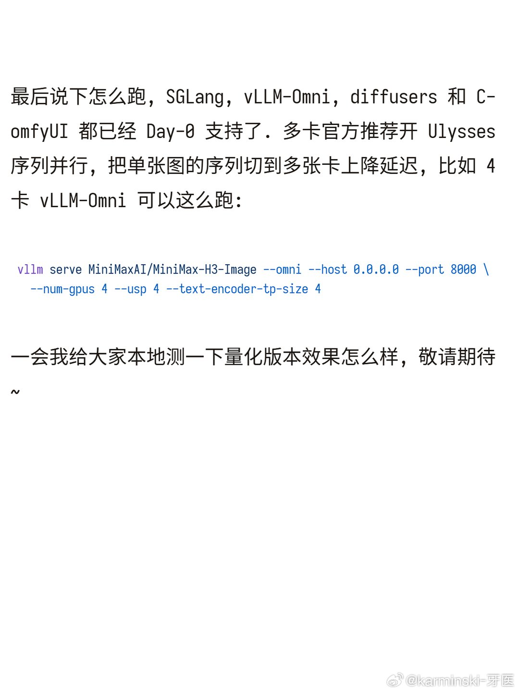

---

## 12

@塔列郎

发表于：2026-11-11 19:45

来源：微博

链接：https://m.weibo.cn/status/5364152215274998

Dario的老婆Cami Clark也是奇人呐！

19岁：大学辍学。

20岁：嫁给了64岁的建筑师。

23岁：离婚。

31岁：投资房产失败破产。

32岁：和24岁闺蜜Michelle Capocefalo一起创办面向女性的黄色网站Eddice。认识爱泼斯坦，争取从爱泼斯坦那里融资，结果把爱泼斯坦都整烦了说我在出差没空下次一定。

33岁：开启和时任Google CEO的Eric Schmidt三年恋情，说是女友，但是应该是小三儿或者是情妇。

36岁：被Schmidt介绍给Dario，开启跟Dario 8年恋情。

44岁：跟Dario结婚。


---

## 13

@蘸盐

发表于：2026-11-11 19:45

来源：微博

链接：https://m.weibo.cn/status/5364152149217439

“在绝大多数人都是文盲的时代，习惯即具有法律的效力，一种行为重复三四次后即可成为新的惯例，以后大家都要遵守”

1621年3月31日，西班牙国王腓力三世在马德里去世，终年 42 岁。法国大使巴松皮埃尔（Bassompierre）的回忆录中，记载了腓力三世的死因：西班牙哈布斯堡王朝的宫廷规矩极其严格，移走取暖炭盆（brasero）是专门官员的职责；那天该官员不在，国王没法叫人把滚烫的炭盆挪走，只好坐在炭盆旁边长时间烘烤，闷热出汗，最后诱发重病，自己把自己热死了当然了，当时哈布斯堡长期近亲通婚，腓力三世本身也是体质偏弱，当时医生为了抢救他采用的放血等疗法反而加重体力消耗和脱水，加速了国王的死亡

宋朝仁宗年间，有次仁宗对身边近臣说：“昨晚睡不着，很饿，想吃烧羊。”近臣说：“何不直接下旨让人取来？”仁宗说：“我听说宫里但凡索要一次，外面就会当成固定成例。我怕从此以后，他们每一夜都要宰羊，随时等着我要。长年累月，杀的羊就太多了。怎么能因为我一时饥饿，开出一个永久的惯例呢？”

再比如，明初朱元璋定都南京时，将长江里时令鲜美的鲥鱼纳入太庙的“荐新”祭品，这本身并不算离谱，毕竟南京离长江很近，获取方便。但朱棣迁都北京之后，“荐新”的旧例并没有随之调整，而是形成了一条固定且严苛的运输链条：每年五月十五日，必须在南京明孝陵用鲥鱼先行祭祀；然后立刻装船，经运河日夜兼程运往北京，限定六月末抵达；最终要赶在七月一日用于北京太庙的祭祀，之后才供皇帝御膳。

问题在于，鲥鱼是极娇贵的时令鱼，出水即死，死后极易腐坏。为了保鲜，朝廷动用了庞大的资源，首先鲥鱼出水后即使用猪油覆盖，加冰冰镇，快船驿递，沿途每三十里设冰窖补充冰块，船只昼夜不停。即便如此，等送到北京时，鲥鱼大多已经腐臭。沈德符记载，到万历年间，鲥鱼冰船「然实不用冰，惟折干而行，其鱼皆臭秽不可向迩。余于夏月北上，曾附其舟，几欲呕死。」

沈德符还记载一事：某太监调任南京守备太监后，责问厨子为何不做鲜鲥鱼，厨子答曰“每顿必进”，太监验看之后惊问：「其状颇似，但何以不臭腐耶？」弘治初年，皇帝打算取消这个进贡，宦官进言说这是祖宗定下的祭祀重典，于是就没能废掉。后来嘉靖年间，有官员再次上疏请求停免鲥鱼贡，竟然被治罪。

清代宫中和王府也有类似情况，比如金寄水回忆说，睿王府饽饽房，每天要固定做24碗奶酪，雷打不动，主子里没人喝也要做。

还有，曲阜孔府的规矩也学皇宫，叫做“有例不可减，无例不可添”。比如清代祭孔，曲阜县官员要提前两天在奎文阁院内习礼演礼，轿夫在一旁候命，不可远离。有一次轿夫无事可干，就拔周围的草。这一拔就形成了惯例，以后奎文阁院一旦长草，就通知县衙的轿夫来拔草

还有一次是，孔府内厨的厨役买菜回来，走到内宅门想起买的菜不全，就把菜篮子放在内宅门旁边，又回到街上去买菜。看守内宅门的门役闲极无事，就把豆芽菜给掐了。这以后内宅门门役掐豆芽菜就成了惯例。有次上炒豆芽菜，有头有根，孔府老太太们生气，厨役理直气壮地说是因为门役没掐豆芽菜，结果老太太把门役训斥了一顿


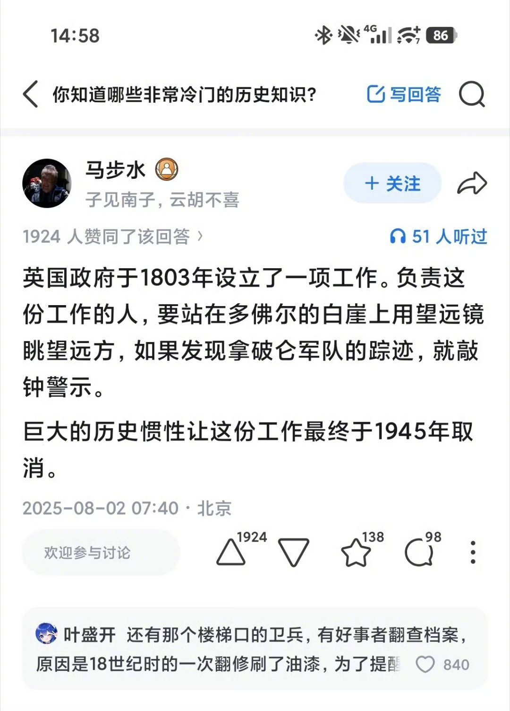


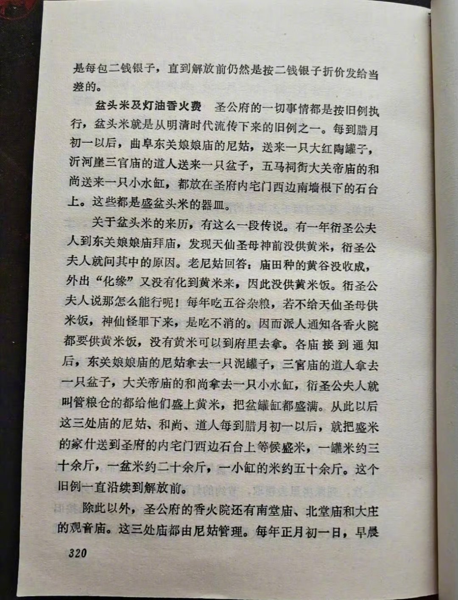


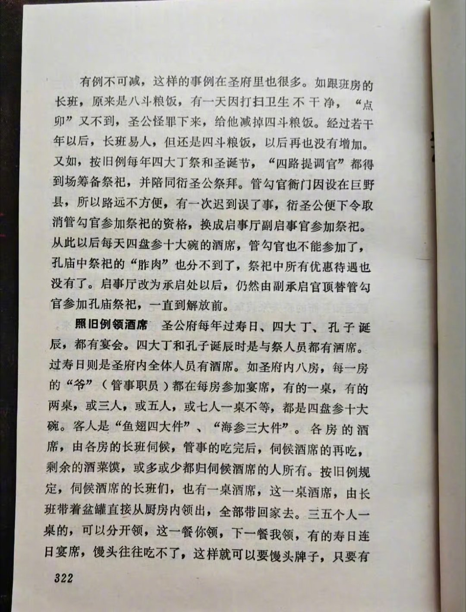

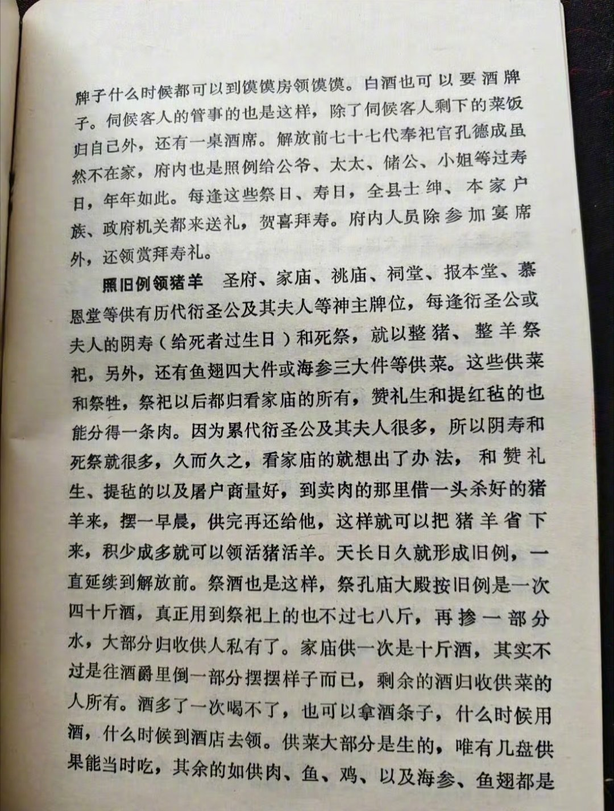

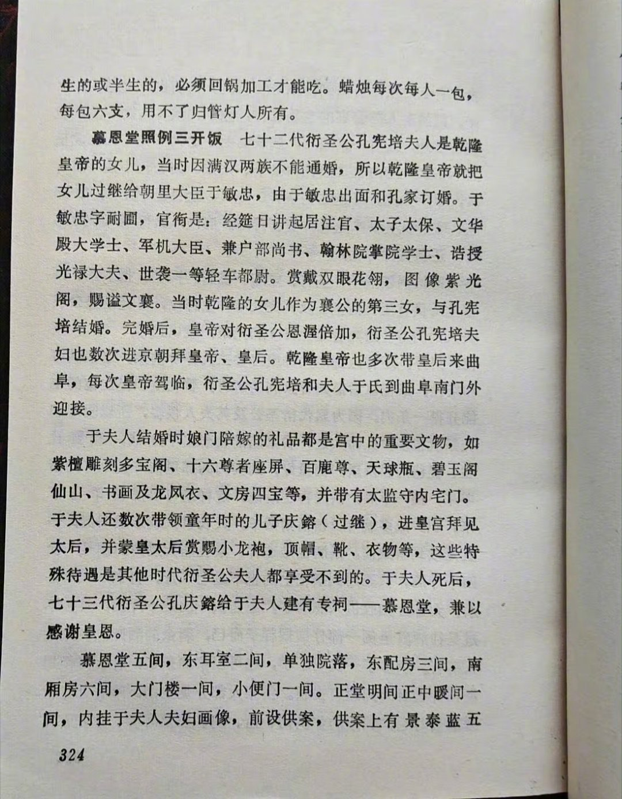

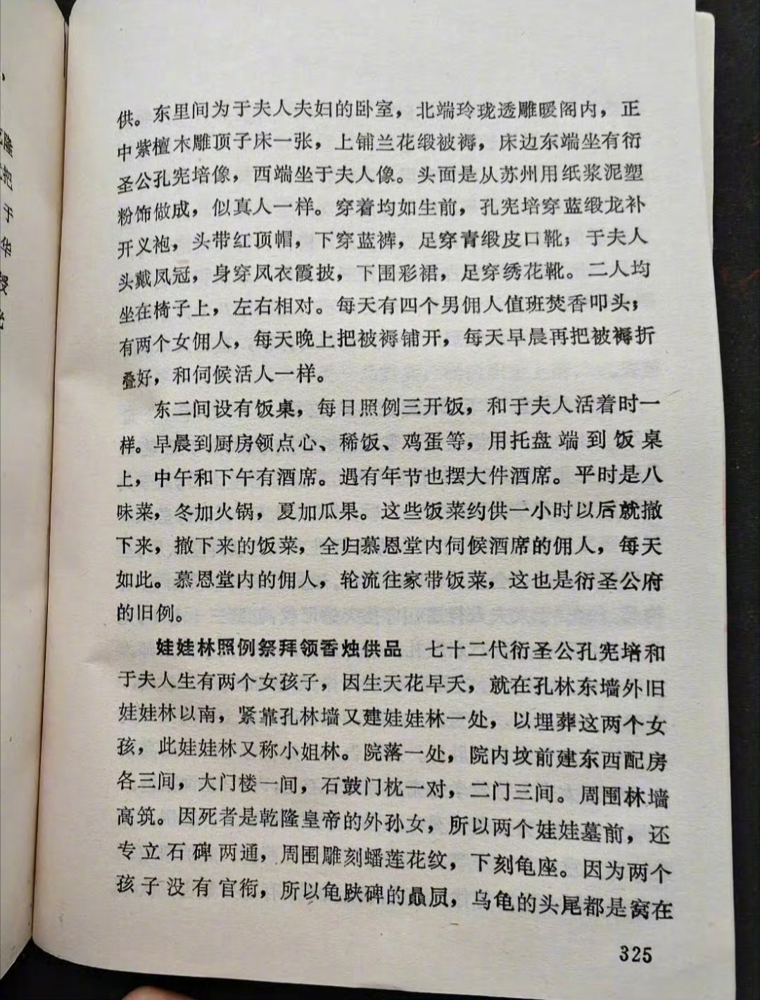

