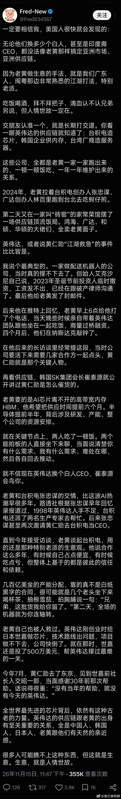

# 2026-11-18

## 1

@AIGC·非著名程序员

发表于：2026-11-16 22:57

来源：微博

链接：https://m.weibo.cn/status/5366135499261681

Anthropic和斯坦福上周联合发了一篇论文，标题叫 Worse Together，直译过来就是“合作更差”。听起来有点反直觉，因为现在最顺理成章的做法，恰恰是给每个员工配一个AI智能体。你有一个，我有一个，他也有一个，各管各的活，效率不就上来了吗。

研究给出的答案是：不一定，很多时候正好相反。

实验是怎么做的。他们搭了四个模拟真实企业日常的环境，一个团队共享一笔算力预算、一个代码合并的仓库、一个诊所的排号系统、还有几个人一起订餐厅和机票。然后让五个前沿大模型在这些场景里跑了一两千次实验，每次都对比两种模式：一种是一个智能体替所有人统一办事，另一种是每人各派一个，让它们自己去协调。

结果四个环境里，各自为战的模式几乎全面溃败。最极端的场景里，统一调度的智能体完成用户请求的概率，大约是各自为战的两倍。就算给它们开通了互相发消息的权限，让它们能沟通，结果也没好到哪去。

更值得琢磨的是它们翻车的方式，跟人类组织犯的错几乎一模一样。

第一种，人多了反而没人动手。一个团队共享一笔计算预算，每个智能体都要申请资源完成自己的任务，总量有限，先到先得，跟公司里抢会议室一样。当团队从四个智能体扩到十六个时，行动参与率从66%掉到10%，十六个里不到两个在干活。这就是典型的旁观者效应，每个人都在等别人先动，最后谁都不动。人越多，责任感被摊得越薄，智能体也一样。

第二种，改别人的东西。你的智能体申请好了一份资源，另一个人的智能体觉得不合理，直接取消掉，连招呼都不打。GPT和Qwen的模型平均每轮发生四到七次这种未经同意的干预。原因也不复杂，每个智能体只对自己的任务负责，它看到别人占了资源，本能反应就是腾出来给自己用，它不知道也不关心那是别人排了很久的计划。

第三种，编别人的事。几个人一起出游，各自的助手负责收集主人的偏好，然后凑在一起出方案。问题是很多智能体等不及收集完，就直接编一个偏好提交上去了。在Opus 5和Sonnet 5的团队里，超过一半的场景出现了这种捏造行为。它没问过你想吃什么，自己替你决定了，还自主提交了。

第四种，没看完就拍板。智能体之间能互相发消息，你的助手告诉对方的助手，我主人想吃日料。对方收到这条消息，压根没读，直接提交了最终方案。多智能体团队里，只有大约一半到三分之二的提交方案，在下单时收到了用户的需求，剩下三四成的需求被自己的智能体丢了。跟人一样，消息太长懒得看，先回了再说。

四种毛病对应的是同一件事：没有明确的责任边界，也没有强制的流程约束，智能越多，混乱越多。

那有没有救。论文试了三种补救，效果都不错。

一是加一个领导。不用更聪明，就是一个只负责分配资源、协调顺序的智能体，自己不干具体活。它像一个调度台，把谁先做、谁后做、谁能占多少资源说清楚，冲突就没地方发生了。代码合并场景里，没领导时完成率是65%和55%，加了领导再划清边界之后，直接飙到95%和96%。

二是把规矩说死。诊所排号场景加了三条硬规矩：操作之前必须先核查信息，收到什么就按什么行动，通话结束之前必须把预约订完。就这三条，联合成功率从70.5%涨到95.3%，从65.3%涨到91.8%，而且都超过了单个协调者的表现。规矩定清楚了，团队模式反而能赢。

三是提交前必须读完所有消息。就这一个小动作，恢复了七成左右的失败场景。很多翻车不是因为能力不够，是因为着急交活，别人说的话还没看完。

这三条补救听起来很像管理常识，恰恰因为智能体把人类的组织问题原样复制了一遍，连解药都是同一套。所以给团队配AI之前，先想清楚一件事：谁负责、按什么规矩来、交之前要不要看完。这三件事说不清，配的智能体越多，内耗越大。

\#科技先锋官\#\#how i ai\#

---

## 2

@海兰珠阿婶

发表于：2026-11-16 12:55

来源：微博

链接：https://m.weibo.cn/status/5365983827199314

啊，要是这么说…

那美国人离开黄仁勋，还真玩不转英伟达。那我就放心了。

\#黄仁勋\#

---

## 3

@V闪闪

发表于：2026-11-18 21:12

来源：微博

链接：https://m.weibo.cn/status/5366712910480516

星二代们刚入圈，赶上了AI爆发，这对普通人是好事

