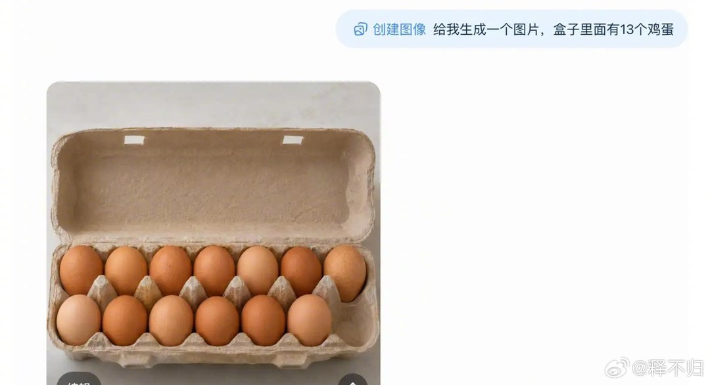
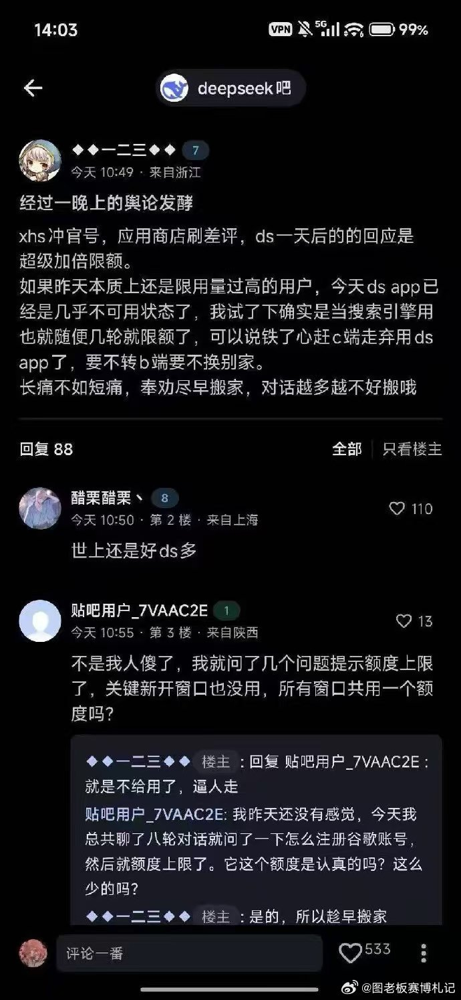
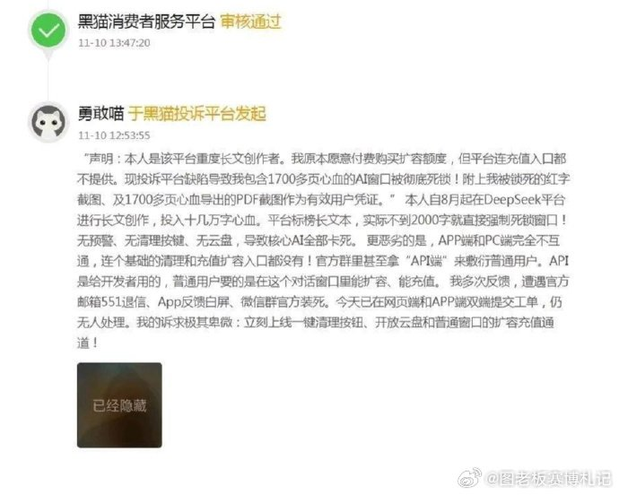
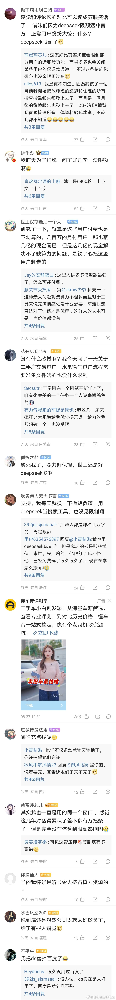
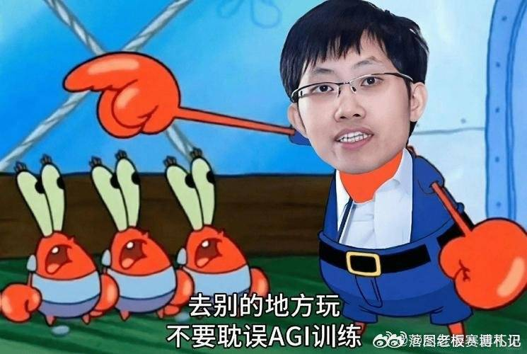
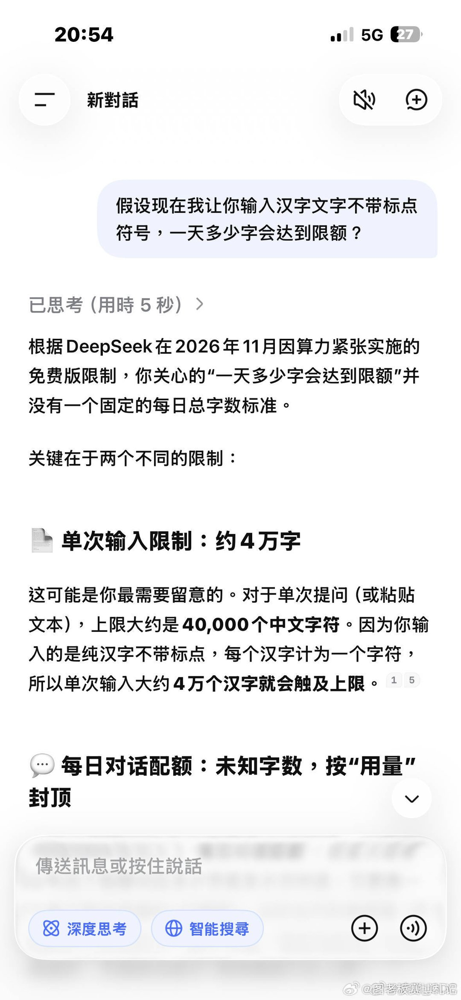
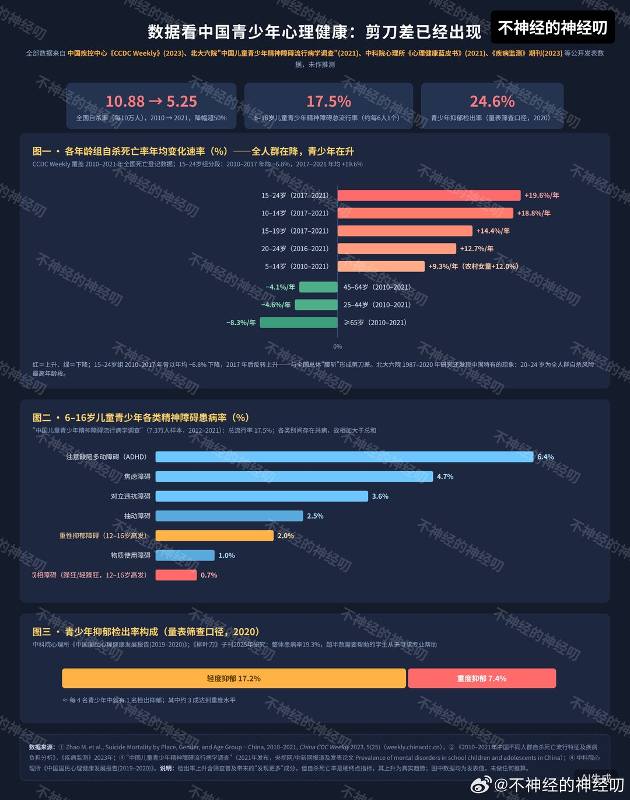
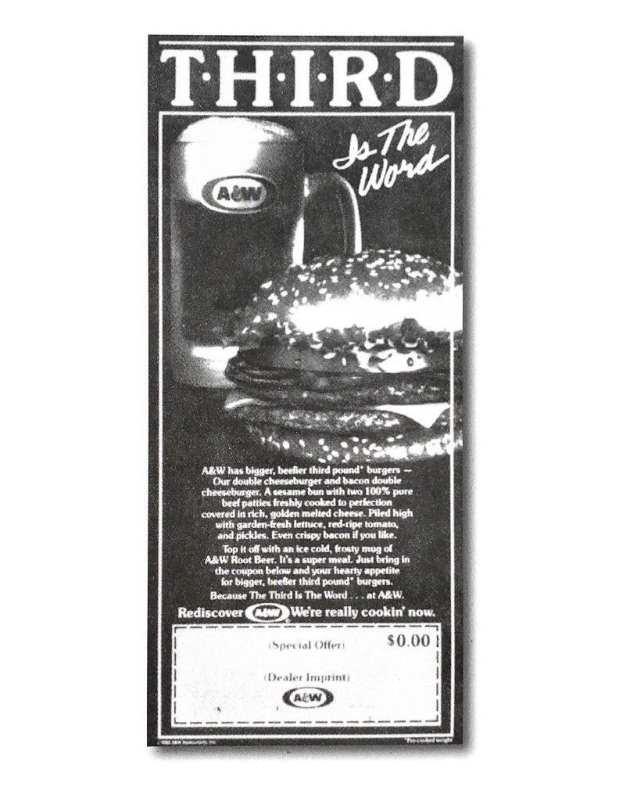
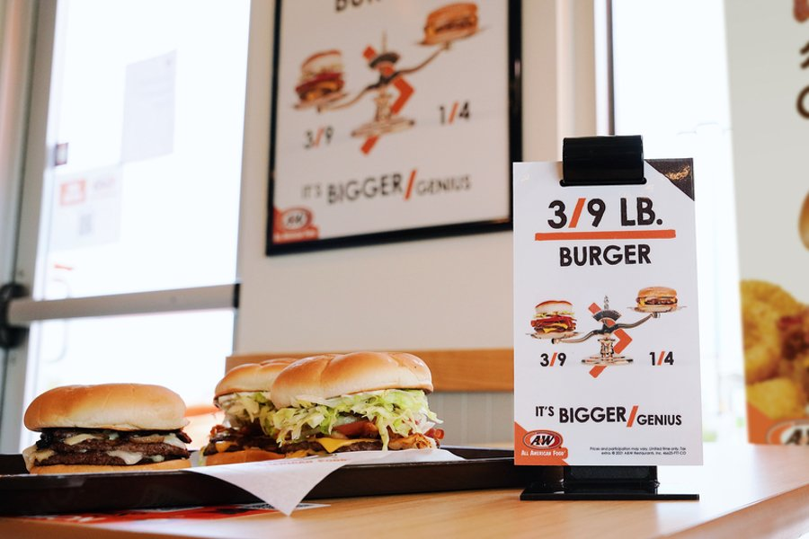

# 2026-11-19

## 1

@释不归

发表于：2026-11-18 14:34

来源：微博

链接：https://m.weibo.cn/status/5366733678314924

\#豆包画不对13个鸡蛋\#\#豆包画13个鸡蛋反复出错\# 

真正训练过AI的应该知道，不能只靠一句 “盒子里有 13 个鸡蛋”，提示词要锁死： 白色纸质蛋盒，蛋托一共 15 个凹槽，其中 13 个凹槽放鸡蛋，另外 2 个凹槽是空的，清晰可见，逐个可数，不要多余物体，写实照片，俯视角度，不要编号，鸡蛋排列整齐，严格一共 13 枚鸡蛋，不多不少。

嗯，这不就画出来了！

豆包认识数字 13，但“文生图”的画图 AI 只会画 “一小堆鸡蛋”，没有数数的脑子，它能画鸡蛋长啥样，却没法老老实实盯着数到第 13 个就停手。这13个鸡蛋的问题，不只是出现在豆包，其他AI生图模型也可能出现类似问题。

关于画多个鸡蛋的问题，在去年的CVPR 2025上，研究人员就发表了相关文章《Make It Count》，该文章研究的正是这个问题，论文里的例子甚至也是“一盒鸡蛋”。而这个问题也是计算机视觉领域一个专门的研究课题，目前也有解决方案。头部的一些模型已经解决了这个问题。

所以，我认为这不是普通网友真实遭遇的问题，是涉足AI领域的人士故意搞出来蹭热搜的，不过确实让他蹭到了。

---

## 2

@塔列郎

发表于：2026-11-18 17:06

来源：微博

链接：https://m.weibo.cn/status/5366771836259435

在清末，所有靠哄人开心的要钱打赏的都是下九流，乞丐、妓女是，唱大鼓的也是，相声、京剧也是。大鼓多是暗娼，相声多黄段子当儿子，地位最高的是京剧，但金主扔一把钱在舞台上，规矩是角儿们一样要和龙套们一起抢钱，然后磕头谢赏。

下九流之间也有鄙视链，金文声说，说相声的见了妓女也得叫声姐！建国初期，相声演员和妓女每个星期必须到派出所报到，属于社会不稳定因素。

旧社会说相声是撂地为生，讲究“平地抠饼，对面拿贼”，收入“刮风减半，下雨全无”，比乞丐强不了多少。据侯宝林女儿回忆，父亲在台上学大姑娘要女婿，台下女观众高呼：“损根子，积点德吧”！当年有人在报纸上列举相声大王“万人迷”李德钖，侯宝林师父常宝臣、师叔焦少海等十多位著名相声艺人的去世是损阴德遭报应，对侯宝林触动很大。

侯宝林先生自己回忆：

“是不是解放后相声一帆风顺了呢？也不是。曾有一度曲艺的场子里没有相声。

相声节目捅了个漏子。有两位说拆唱双簧的，到一个工厂去演出，演出什么呢？俏皮话带反正话，就是“我是狗尾巴花，我是花尾巴狗”一类的。当时工厂领导一听：“噢，别演了，别演了，同志们！咱们不听这个这对我们改造世界观，改造思想没好处，我们唱革命歌曲。给钱请他们走吧。”

所以，在前门箭楼新曲艺场所没有相声，我们是在别的杂耍园子演出。

这时孙玉奎同志去找我，酝酿成立一个相声改进小组，发起人有比我们高两辈的刘德志（智）先生，同辈有孙玉奎、罗荣寿和我。通过这个小组把在北京的所有相声演员凑在一起。

当时老舍先生刚从美国回来，住在北京饭店，我们几个人就去拜访他：“听说您过去很喜欢相声。”他说：“对，我从小就听相声。”“您也写过新相声？”“哎，写过。”“我们现在成立了北京相声改进小组，请您帮我们编写相声，我们的水平低。”老舍先生慨然应允。前后一共写了二十几段相声，所以我们的翻身仗打的快极了。

可以说解放后新相声的奠基人，就是老舍先生。当时著名学者给我们帮忙的还有语言研究所的所长罗常培先生，研究元明清戏曲的吴晓铃先生等。在这个阶段，我们相声改进小组对相声的贡献是很大的，我们全体演员，也就是小组的成员；都作出了相当大的努力，使相声纳入正轨。回想起来，解放以后相声这样受群众喜爱，应该说，这是几十年的苦斗酌胜利，是大家共同努力的结果。我跟大家—起也做了自己应当做的工作。

　　粉碎“四人帮”以后，相声脱颖而出。这时候的节目，水平低一点也不要紧，因为全国人民对“四人帮”的行为看在眼里，恨在心头，而相声演员就集中表达了这些情绪，所以受到了全国人民的好评。

后来，继续出了些好节目，也出了些坏节目。现在有位艺术家就这样说：“什么三翻四抖，别来这套了，都老掉牙了，现在用不着了。现在只要你把人民的心里话一说，就鼓掌。”你说的那人民是什么呀？你说的心里话是什么话呀？是有利于社会主义的话吗？你受了—种社会思潮的影响，把一些牢骚变成了相声……我说这叫火上加油。

近几年听到了不少群众的反映，现在“反正话”、“俏皮话”又来了，而且拿人家父亲、母亲、妻子开玩笑的又来了。已经进入艺术圈的相声，现在有的演员又要把它拉出去，我们三十年前扔掉的东西，有人又把它拾了起来，甚至认为是“突破”，是“创新”。

回头路是走不得的。这里我说一段旧事。大约在七十年前，有位评书艺人叫陈荣启，小时候学相声。说相声他捧哏的时候多，老得挨骂。他跟别人说：“说点好的行不行？咱不就为吃饭吗？不就为喂饱肚子吗？我的上三辈，下五辈，我的爷爷奶奶、兄弟姐妹都骂进去了，我不就为吃这顿饭哪？我不干了，我饿不死，我改行。”后来改说评书。

这是七十年前陈荣启先生的志气。难道说我们今天的思想水平还不如那时的陈荣启先生高吗？为什么又把这个互相谩骂拿起来了？自尊自重这句话谁都知道，可有的人认为无所谓，钱是要紧的。想起来很使人痛心。”

---

## 3

@图老板赛博札记

发表于：2026-11-18 22:15

来源：微博

链接：https://m.weibo.cn/status/5366849640071633

\#图老板的赛博札记\#

---

## 4

@不神经的神经叨

发表于：2026-10-25 06:29

来源：微博

链接：https://m.weibo.cn/status/5357914340720677

为什么现在的孩子的心理越来越脆弱了？

我的大学同学是一所著名的精神心理中心的非著名医生，这两天他看到我在外面游山玩水的照片，内心颇为不忿，又是嫉妒又是羡慕说他都快累死了，他说不光他快累死了，他感觉他们全院都快累死了。

他说今年精神病人数量暴增，一方面有些不合规的私立精神病院被取缔了，另外一方面病人的新增数量也开始暴涨，他们作为当地著名的精神病院，随时随地都是满负荷状态运行，再这么下去精神病人没治好，医生们倒先要精神崩溃了。

可能很多人对一个科室普通门诊一天 800 的量没什么概念，但是医生看病人是需要花时间的，一个科室的医生就那么多，分配到病人身上的看诊时间就非常少了，这就是大家经常碰到的，病人话还没说完，处方已经开出来了，医生喊下一个了，因为真的看不完，本来应该下午 5 点钟下班的，活生生拖到晚上 9 点。

大家都知道目前经济下行期，每个人的日子都不好过，不开心、没钱花、工作压力大、社会内卷，精神出点问题也很正常，但是他接下来却说了另外一个让我意外的话题，那就是青少年孩子这些年来精神出问题的比例大幅增加。

作为一个临床一线精神科医生，他这些年接诊的孩子不计其数，有大有小，精神出问题的大部分集中在小学高年级到初中高中这个阶段，他对教育现状非常失望，觉得我们这代人是把孩子培养成了潜在的精神病患者。

他自己家里面有两个孩子，我也有个孩子，年龄都差不多，这个话题我太能共情了，因为我的孩子在五六年级的时候情绪也不好，包括现在也时常觉得学习压力大、烦躁，莫名其妙的就在家里面发脾气，以前我通常是以镇压的方式解决问题，现在我已经决定改变了。

因为我能切身的体会到孩子的精神压力有多大，学习压力有多大，来自家长、学校、社会的压力有多大，不是他们现在心理变脆皮了，而是他们小小的身体、小小的内心压根扛不住这巨大的社会压力。

我女儿告诉我，她们班上的同学不止一个人手上有割腕的伤痕。她说她寝室里面有一个同学是去年抑郁症休学一年才回来的，我说，你怎么看这些割腕的同学？她说割腕好痛的，她才不会做那样的事情，我说是这对的，有什么事情，爸爸妈妈和你一起解决。

大家可能时常都会在网上刷到一些青少年悲剧案例。我作为一线医生，我听到的悲剧案例更加触目惊心，这些案例发生在我工作的区域，也发生在我居住的小区，甚至还有悲剧就发生在我同事家里。

事情发生以后，我都不知道怎么安慰他们，因为平心而论，如果这事情发生在我们家里，我也是接受不了这种天塌了一样的打击。

今天一大早，我就查询了相关的资料。用 AI 总结成了一幅青少年心理疾病的发病率及自杀率的图，我贴给大家看看。（图一）

通过这些年来我们国家加强对于心理疾病的干预和治疗，成年人的自杀率有所下降而未成年人的自杀率却在上升，这个真的需要引起我们每个家长重视了，孩子并不是想不开，也不是自己过于脆弱，而这是一个比较严重的公共卫生问题了。

我自己也处于养孩子的关键阶段，我和所有家长一样，都望女成凤，我也几乎踩过所有家长都踩过的坑，而现在我在不停的学习，不停的反思，不停的改进与孩子相处的方式。

在我看来，为什么现在孩子的心理压力大，心理疾病高发，自杀率也在飙升？我个人觉得有如下原因：

一、被压缩的神经发育窗口与“错配”的放大效应。

我不是经常开玩笑的给大家说，我们千万不要和一群前额叶没发育好的“半成品”儿童较劲。青春期大脑边缘系统（负责情绪唤起与奖赏）成熟较早，而前额叶网络（负责抑制控制与长远规划）的成熟则持续到二十岁以后。这种发育不同步造成了正常范围内的冲动性与情绪波动，但也意味着环境压力在这一窗口期具有不成比例的致病权重。

中国的情况叠加了独特的结构性维度，一项覆盖约150万人的Meta分析显示，我国儿童青少年抑郁症状总体患病率达26.17%，2015—2024年的合并患病率（23.3%）显著高于2000—2014年（15.4%）。农村青少年抑郁患病率（29.5%）高于城市（23.6%），留守儿童、非核心家庭与经济支持不足构成了额外的风险叠加。这意味着，神经发育的普遍脆弱性，正在被社会经济分层以极不均匀的方式放大，农村留守女童成为了自杀和抑郁患病率最高的群体。

二、家庭：从“保护性容器”变成压力的“二次放大器”。

家庭本来是孩子的庇护所，但现在却变成了压力放大器，过度保护、过度卷入与高控制型教养，与青少年焦虑、抑郁存在稳定的正相关。

现在不少家长的“爱”是以过度控制往往以“高期待”“为你好”的形式出现，使青少年在道德与情感上难以反抗——拒绝父母的“付出”本身就会引发内疚。

很多孩子在学校压力已经很大了，回到家以后还要承受父母的唠叨和指责，有些看似是关心实则是问责，孩子压力会变得更大而无处发泄，最终选择一跳了之。

不少家长回家第一时间问的是成绩，问的是学校排名，而不是问他在学校开不开心，有没有交到朋友，饭量好不好，睡眠好不好，孩子觉得自己只是家长的学习机器。

三、教育竞争：不是“压力大”，而是“耗竭性无意义感”。

当前青少年置身于一种“内卷”之中：投入持续增加，边际回报却持续递减，而“退出”在文化与家庭层面几乎不被允许，孩子必须有出息，必须优秀，必须超越父辈，不然就会被认为是不努力、不认真、不孝顺、不上进。

现在的学业竞争不断提前，竞争前置，幼儿园学小学的内容，小学学初中的，初中学高中的，加上普职分流的焦虑，以及一考定终身的高考模式，都不停的在消耗孩子的身体和心理。越减负，负担越重。

与此同时，教育的高投入并不一定有高回报，目前就业竞争越来越激烈，名校毕业生也并不一定能找到一份待遇丰厚的工作。这些孩子们看到自己的哥哥姐姐用心考试、用心读大学，毕业以后还是家里蹲，难免内心也会有想法。

四、数字时代，孩子们缺少与大自然和同伴的连接。

不少像我家那么大的孩子，回家以后要么就是在做作业，要么就是在玩电子产品，他不愿意出门，也不愿意运动，身边的同学要么在补课，要么在写作业，也缺少交流的空间，小区里面的公共空间都是小学低年级和幼儿园的孩子在玩耍，稍微大一点的孩子都足不出户

他们也和我们一样，沉迷于网络上的虚拟社交，沉迷于可以刺激多巴胺分泌的游戏短视频，这个不能单纯的怪孩子，就像有时候孩子说的，你能够安排比玩平板更好的活动，我会不愿意参加吗？但是我们家长也真的没有那个条件。

长期缺少户外活动，缺少阳光照射，缺少和同龄人的交流排解自己的负面情绪，情绪问题堆积在那里越来越严重，最后就导致了更严重的问题。

我个人也在反思我和我的孩子相处的模式，我以前更多的是以一个说教者的姿态出现，现在我想多一点时间当一个听众，我不说，听他说，我不会直接把我认为好的东西，就强加给他，有时候我认为好的东西，对他来说反而是一种压力。

我希望做家长的都有所改变，是现在的孩子更脆皮，心理更脆弱，而是当前的环境比我们当年更容易让人产生压力，我也希望老师们不要把孩子作为 KPI，孩子能考上名校固然是好，但孩子健康成长却意义更重大。\#情感热点创作激励计划\# 

教育的目的是培养社会的接班人，而不是培养未来的精神病人。

---

## 5

@tombkeeper

发表于：2026-11-19 12:26

来源：微博

链接：https://m.weibo.cn/status/5366937523587971

1971 年，麦当劳推出了含四分之一磅牛肉的汉堡。这是麦当劳最成功的产品之一，至今仍在销售。

1985 年，另一家快餐公司 A&W 为了和麦当劳竞争，针锋相对地推出了含三分之一磅牛肉的汉堡，并且和麦当劳的四分之一磅牛肉汉堡定价相同。

A&W 还为此投入了很多资源展开了名为“Third Is the Word”的市场宣传。然而三分之一磅牛肉汉堡的销量却低于预期。

于是 A&W 委托市场研究机构调查原因。据说一些消费者提出疑问：

为什么我要花同样的钱，买三分之一磅的牛肉，而不是四分之一磅？

为什么我要花同样的钱，买三分之一磅的牛肉，而不是四分之一磅？

为什么我要花同样的钱，买三分之一磅的牛肉，而不是四分之一磅？

——不少美国人觉得四比三大，所以四分之一磅比三分之一磅多。

这件事在 A&W 当时的老板 Alfred Taubman 的回忆录和 A&W 官方博客里均有记载。

A&W 在 2021 年推出了名为“九分之三磅汉堡”的营销活动，意思是：“你看，九总归比四大了吧？”

