# 2026-11-23

## 1

@城南科学家

发表于：2026-11-23 19:58

来源：微博

链接：https://m.weibo.cn/status/5368506035995991

跟商K关系不大。明显感觉到今年9月份开始，传统行业更艰难了…

买房人的出价能力，也下降了…

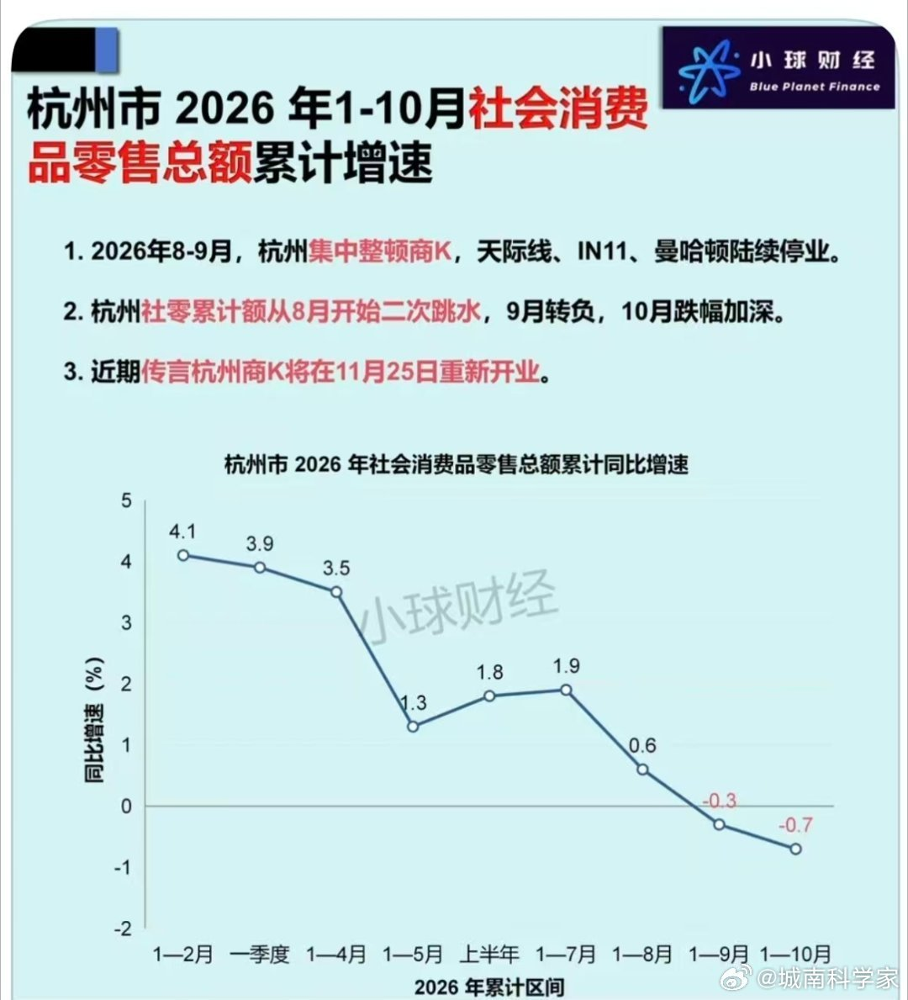

---

## 2

@幻想狂劉先生

发表于：2026-11-23 19:58

来源：微博

链接：https://m.weibo.cn/status/5368502661679365

做这种模板式的文本它的优势相对于人类是神明碾压级别的。人类的科研竞赛很快就会成为灯泡大赛，首先就从理工科开始，因为理工科特别是工科论文的写作高度模版化，去苛求文本的纯洁性既无必要又无可能。谁脑袋上冒的灯泡多，经得起验证的实验和数据多，谁就主宰了未来。//@joy小铁匠:现在提供招标文件，有条理的输入自己的想法，做出来工程技改方案简直惊艳，迭代上十次，绝对能蒙过客户。我已经试过好多次了。有专业技能的人依托AI建立一人公司未来可能是一个方向。

---

## 3

@蘸盐

发表于：2026-11-23 19:58

来源：微博

链接：https://m.weibo.cn/status/5368500123863249

个人感觉还有一种可能

就是之前校保卫处为了帮学生出气，确实跟媒体说过拉黑这个司机

但没想到全网舆情汹汹，还关联到旧社会、修鹰坟什么的，把校党委、校团委、校领导班子给吓得缩卵了

于是赶紧想办法否认之前说过的禁掉司机的话

所以就看潇湘晨报拿得出拿不出当时跟校保卫处的电话录音喽

（按照现在记者采访工作留痕要求，应该不会没录音吧？）

（万一潇湘晨报真拿出录音来对线，那就还有一计献给广西民大，就是推脱给校保卫处“不了解情况”，“系临时工”，“已辞退”什么的）

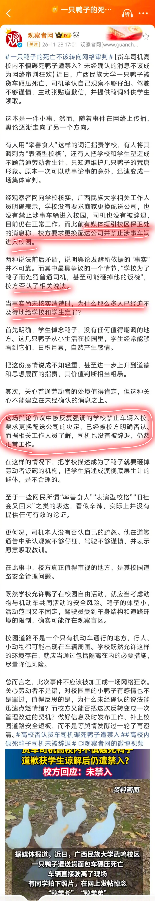

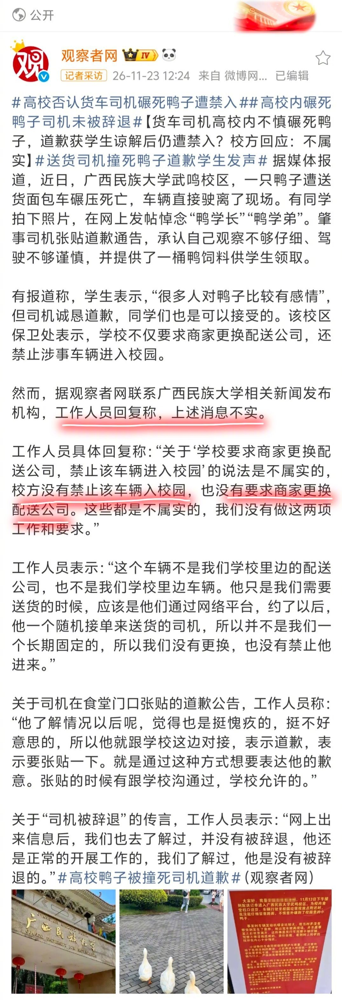

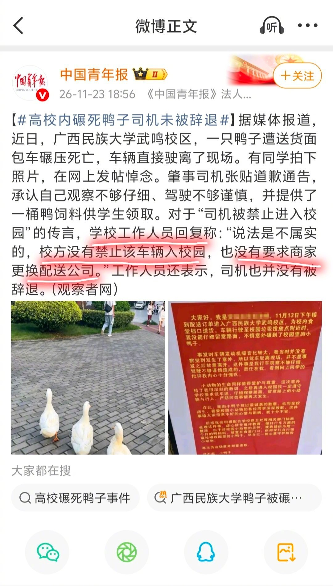

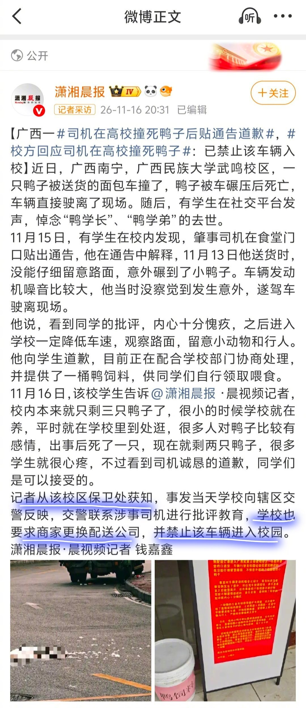

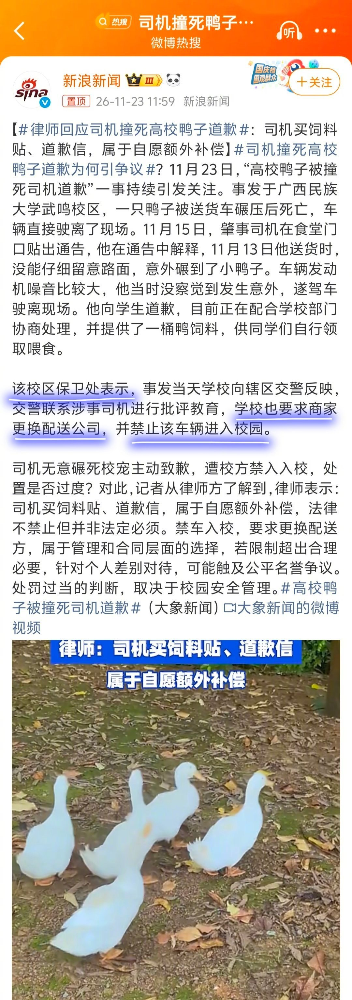

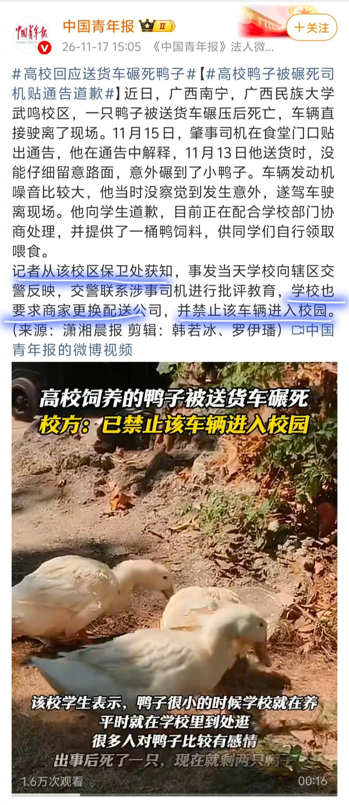

---

## 4

@李楠或kkk

发表于：2026-11-23 18:58

来源：微博

链接：https://m.weibo.cn/status/5368497746217950

过去 40 年，“跨越国界拼出高效率”是真正的金矿。

而未来 20 年，可能是“安全优先”。

小米，平头哥国内设计，海外代工，或者模型国内开发海外训练，都是又想吃海外制程，又想吃国产替代。。。最后政策的大棒砸下。。。

其实 TT 美国，英伟达特供，供应链洗墨西哥制造，都是反复出现的的失败案例。。。

金矿，已经变成了地缘上最危险的地震带。

---

## 5

@程序员那些破事

发表于：2026-11-22 23:35

来源：微博

链接：https://m.weibo.cn/status/5368319206752844

国外工程师总结的vibe coding的结果，您怎么看？

---

## 6

@信号与噪声

发表于：2026-11-22 16:17

来源：微博

链接：https://m.weibo.cn/status/5368209185181334

Ed Yardeni：

“我们预计（美股）会有回调。它已经演变成修正。我们不认为这会导致熊市，仅仅是因为我们没有看到迫在眉睫的衰退。

恐惧在于，更严格的出口管制将降低芯片需求并压低其价格。如果是这样，那么该行业估值倍数的下降很快就会伴随着盈利增长放缓，甚至盈利直接下降。

我们还没有放弃圣诞老人行情，但我们正在将年底标普500目标下调至7,500。这将是从去年年底6,845.50点上涨9.6%。

我们明年标普500的区间是7,650至9,000。我们预计该指数将在2027年底收于8,500至9,000之间。我们坚持我们对咆哮的2020年代的预测，到2029年达到10,000。

也许马斯克能想出办法收购Nvidia并聘请黄仁勋来管理它。Nvidia的前瞻市盈率仅为8.1倍，就好像它仍然只是一家游戏公司。不过话说回来，马斯克得找到3.02万亿美元来完成这笔交易。那将和把人送上火星一样疯狂。”

---

## 7

@包容万物恒河水

发表于：2026-11-22 21:31

来源：微博

链接：https://m.weibo.cn/status/5368288125125264

🔻笑爆炸了。

🔻CBS的布伦南：“特朗普总统说黄仁勋应该官复原职。而你说英伟达董事会需要引入外部人士。”

🔻贝森特：“嗯，黄仁勋现在就是外部人士了。”

🔻布伦南：“你是说你认为黄仁勋回去执掌公司会是个好主意吗？”

🔻贝森特：“我认为我们得看看责任到底止于何处。你知道，公司底层那些对违规行为负有责任的恶意行为者，到底是什么情况。”

\#特朗普发APEC合照配文GOAT\#\#热点聚焦\#\#海外新鲜事\#\#微博视频精选大赏\# 包容万物恒河水的微博视频

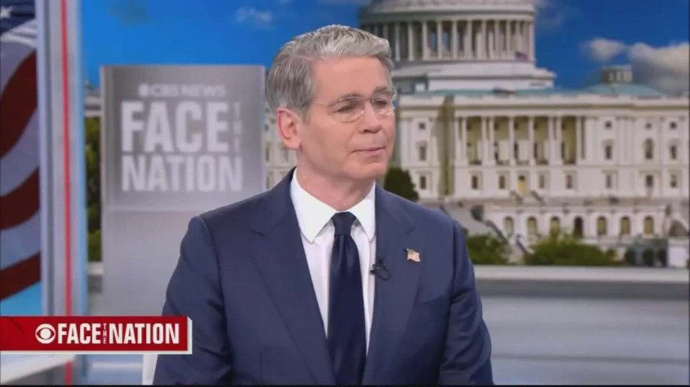

---

## 8

@信号与噪声

发表于：2026-11-22 15:19

来源：微博

链接：https://m.weibo.cn/status/5368194518223673

BCA：2029 年超大规模云服务商的折旧费用（6300 亿美元）预计将超过今年全部运营收益（5700 亿美元）。除非这些公司大幅增加收入，否则它们的利润将令人失望

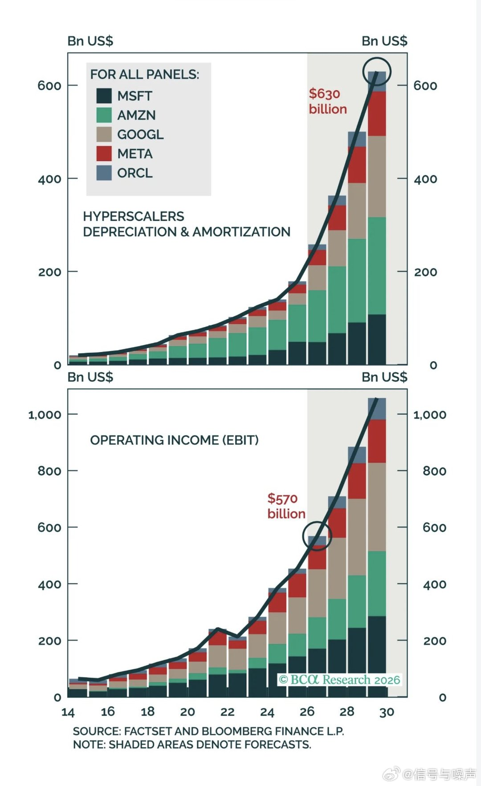

---

## 9

@一个坏土豆

发表于：2026-11-20 21:06

来源：微博

链接：https://m.weibo.cn/status/5367556955177710

未来两年的中美关系会相对很平稳，因为美国被逼无奈、特朗普四面楚歌内忧外患，实在是没得选了。

很多人说特朗普最大的特点就是不靠谱，三方和平宣言两天就得变卦。

我还真不这么认为，如今的特朗普但凡有辙，也不会和现在一样一点辙都没有。

剩下的两年，特朗普丢掉了财政权和立法权，就剩下一个孤零零的否决权，他也不敢轻易作死了，否则2028年大选共和党四分五裂会接着输，到时候民主党要清算，他连一丁点自保的资本都没有。

他现在可算是明白了，所谓的最伟大总统就是个天大的笑话，除了忽悠自己，谁都忽悠不了。

本来特朗普想得很美，绑架马杜罗之后，雷霆打击伊朗，5月份的时候威风凛凛的出访，结果他没有搞定人家，还被人家给搞定了，一头扎进了泥坑里。

现在两党都形成了一个逻辑闭环，就是因为特朗普乱打仗，最后收不了场，被选民抛弃了。

所以特朗普现在甚至不惜抛弃了内塔尼亚胡，也不敢搭理沙特的求援，未来美国大概率会对伊朗低调收场，特朗普随便找个理由，说伊朗承诺不发展核武器，然后草草宣布胜利，算是给自己留点颜面。

而欧洲这边才是特朗普最大的麻烦。

在特朗普看来，欧洲的那些小国是成事不足败事有余，根本不是什么盟友，而是要占美国便宜的拖油瓶。

非要说他们是盟友，他们也是民主党的盟友，而不是他特朗普的盟友。

所以一直以来，特朗普都是把欧洲当成他割韭菜、薅羊毛的对象。

结果现在好了，形势比人强，中期选举输了。

欧盟一蹦三丈高，嘴角的笑都压不住了。

11月4号美国出的中期选举的结果，欧盟立马紧锣密鼓的开始了行动。

11月18号，欧盟就提案要给乌克兰追加450亿欧元的援助；

也就是在同一天，英国宣布要给乌克兰追加2.6 亿英镑的军援，里面含上千架远程攻击无人机，这可是英国单独出钱。

两边赶巧在同一天高调宣布出钱，为啥？

这就是赤裸裸的打特朗普的脸，说你小子也有今天，你不要单方面宣布俄乌停火吗，你不是逼乌克兰割让领土吗？你不是不让我们上桌谈判吗？现在你还得瑟吗？

而泽连斯基呢？

好家伙，那更是和打了鸡血一样兴奋，已经忍不住了，找到机会就埋汰特朗普。

泽连斯基在英国访问，火力全开，猛烈批评特朗普和马斯克。

泽连斯基说：

马斯克给星链限速，这是一个巨大的错误，会造成大量的乌军伤亡；

我感受到了背叛，特朗普并没有保持中立，他站到了另一边，不是站在我们这边，这令人痛心。

特朗普说乌克兰该换新总统，恕我直言，乌克兰领导人该由乌克兰人民自己选，特朗普和马斯克，他们两个人都没有资格来决定乌克兰总统的去留。

泽连斯基又说：特朗普现在的做法，本质是在逼迫乌克兰向俄罗斯屈服投降。

泽连斯基现在简直就是在整个欧洲满场跑，到处庆祝，庆祝啥，当然是民主党又杀回来了。

11月19日，泽连斯基在德国柏林接受采访，记者问他：特朗普在深圳APEC说普京是朋友，你怎么看？

泽连斯基做了一个鬼脸，然后苦笑、摊手，接着就下台走了。

这一举动立马引起全场共鸣，所有人鼓掌哄堂大笑。

11月17日，乌克兰又袭击了克里米亚大桥，19号又对铁路桥进行了补刀。

所以未来的俄乌局势将会怎样？

欧盟和乌克兰现在信心十足，就算特朗普以后的两年动用否决权停掉美国的援助，泽连斯基也会死扛到底，吐血都要扛到两年后特朗普下台。

一旦民主党彻底回归，泽连斯基的春天就到了。

欧盟现在恨谁？

他们最恨的都不是普京，因为在他们的心中，俄罗斯一直都是地缘上的敌人。

他们真正恨的是特朗普，因为特朗普是叛徒。

欧盟最想要的是什么？

很多欧盟的小国，也就是一个县的经济体量，所谓的总统，还不如一个县长。

但是他们最喜欢的就是在国际舞台上指手画脚指点江山，不操自己的心专门操别人的心，欧盟的政客，全都是顶级的演员。

所以欧洲能源价格狂飙，被逼无奈买美国的高价天然气，他们无所谓；

北溪管道被炸了，他们也无所谓；

拜登虽然割他们的韭菜薅他们的羊毛，但是他们喜欢拜登，因为拜登给他们面子啊，凡事都装作和他们商量的样子，口口声声说是盟友，动不动就高呼共同的价值观。

可是特朗普呢，要让他们坐小孩那桌，不让他们参与俄乌谈判。

这就是要了他们老命了，这是动他们的核心利益！

俄乌战争一爆发，他们就掏空家底支持乌克兰，现在俄乌停火居然都没他们的份，你让他们以后还怎么腆着脸去讨论其它的国际事务？

而且欧洲最希望的局面是什么？

就是中美之间打一架，他们会高兴得蹦起来，终于有机会坐收渔利了。

可是现在真是要了命了，特朗普跑到深圳不仅和中国紧密互动，还和他们的敌人俄罗斯坐到了一起，还发布了联合宣言。

这对欧洲来说不就是赤裸裸的抛弃和背叛吗？

欧洲，是很享受做美国的跟班的。

就和泽连斯基的心态一样，宁肯乌克兰打成废墟，宁肯死伤百万，也要加入北约，也要让美国驻军。

他们就可以跟着美国耀武扬威。

结果现在呢，天都塌了。

所以在未来的两年，欧盟和乌克兰会紧密的来联合在一起，各种对特朗普使绊子，等着看他笑话，等两年后民主党的彻底归来。

现在的特朗普真的是太难了，绝对是内忧外患。

接下来的两年，他必须要强撑去缓解美国的经济压力，降低通胀，否则两年后大选失败，共和党就彻底没救了。

外部局势更是一团乱麻。

中东他现在只想低调撤离，就看伊朗能不能放他一码。

欧盟会各种办法和他对抗，盟友体系碎了一地。

还想俄乌停火吗？泽连斯基都笑了，说最艰苦的两年都扛过来了，我这个时候怎么可能收手？

你说特朗普这个时候怎么办吧？

中国说要和平，特朗普听了心花怒放，这简直就是他现在听到的最美好的词汇。

不是他想和平，是他除了和平别无出路了。

于是特朗普在5月份的时候说：中美关系一直很好，将来会更好，希望中国和美国的未来都更加美好。

而这一次，特朗普又说：美国很强大，中国也很强大，中国一直很强大，未来也会继续强大，两个大国一起，共同推动世界和平稳定。

要不然呢，还能说啥？

从贸易战到关税战，从科技战到金融战，能出的牌都打光了，还能怎么办？

当然，依然会在局部死磕，比如美国现在还有最后一张牌，就是AI芯片，所以现在两党都抢着打这张牌，都喊着要搞最严管控，要扮演成最强硬的鹰派，因为唯一的一张牌，两党都想抓在自己手里。

未来的两年，特朗普能顶住民主党的弹劾，能在中东顺利抽身，能在俄乌问题上不出乱子，他就要谢天谢地了，他哪里还敢去招惹中国。

此时此刻，特朗普应该说：没人比我更懂和平。

为啥呢，他还能怎么办，但凡有辙，也不会和现在一样一点辙都没有。

\#微博新知\#

---

## 10

@谜之免女郎X

发表于：2026-11-20 11:09

来源：微博

链接：https://m.weibo.cn/status/5367406786513601

这是很多中国式父亲，丈夫的缩影，心里装着家人，舍得为妻儿大方，轮到自己就舍不得。不是吃不起，是习惯性优先顾及家人，默默扛下这份朴素的温柔！

然而现实很残酷，这样的男人，很多女人都认为他没出息。

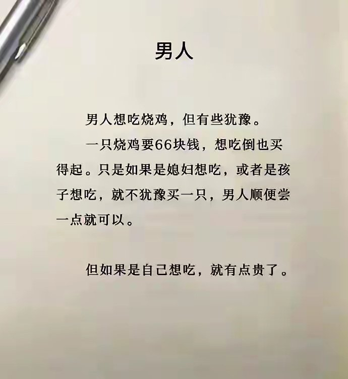

---

## 11

@梅新育

发表于：2026-11-20 08:09

来源：微博

链接：https://m.weibo.cn/status/5367361554875440

【梅新育：丰臣秀吉的日本是人口世界第三的世界级军事强国】

看到 @唐律疏议V 称万历援朝之役是重量级大明与轻量级的日本在朝鲜形成了对峙局面，有人评论称，“万历三大征，对手都不强，汉唐清三朝，多线开战都是常事。但明朝不一样，开国不到百年送光了精锐，之后军事能力就直线下降，幸亏周边没有强敌，不然会比赵宋还不如”，云云。看后摇头。

丰臣秀吉的日本是当时世界第三人口大国，人口仅次于大明和莫卧儿王朝，在经济、政府效率、军事等各方面都拥有强大实力，哪里是什么“轻量级”？

在经济上，除工农业生产进步外，明朝时期的日本实现了金融飞跃，1533年（嘉靖十二年，日本天文二年）引进中国“吹灰法”开发了石见银山，迅速成为世界级产银大国，白银产量占世界1/3，日本在此基础上开始自铸钱币，结束了五代十国以来日本停止自铸钱币、完全依赖中国铜钱的局面，也有力地支持了其军事。

在军事上，丰臣秀吉的军队是日本战国时代连续一个多世纪战争中锤炼出来的百战精锐，东南亚许多国家都大量引进使用了日本雇佣军，引进、大规模使用和改进欧洲火器数十年，他们改进后的火枪比引进的葡萄牙火枪性能要好，一些西方军事著作认为，16世纪末日本陆上火器之精良、应用之普遍，超过英、法等欧洲先进国家。

论军队规模，丰臣秀吉统一日本之后军队30万，可派遣20万以上军队出国作战。万历二十年（1592年）丰臣秀吉第一次进攻朝鲜，动员兵力30余万；万历二十五年（1597年）第二次进攻朝鲜，投入陆军14万余人、水军两万余人。相比之下，1618—1648年“三十年战争”为17世纪时欧洲最大战争，各方兵力最高峰时候的1631—1632年，瑞典国王古斯塔夫、神圣罗马帝国华伦斯坦两大强权兵力10万出头。

丰臣秀吉在战争中和统一日本之后又开展了统一度量衡、检地等全面改革，大大提高了整个国家的效率。

整个明朝，长期面临多个方向严重军事威胁，晚明在南北多个战略方向面对的敌人兵力方面远远超过同期欧洲的全面大战。欧洲直到17世纪末（康熙年间）才出现20万人以上级别会战，晚明时期中国与缅甸、日本、满清战争中，20万以上兵力的会战屡见不鲜。

李伯重《火枪与账簿》一书称中缅边境战争、中日朝鲜战争、明清辽东战争、中荷台海战争为“晚明东亚世界四大战”，认为这四场战争是当时世界上最大的战争，影响深远；我认为，万历年间影响重大的战争有五场：中缅边境战争、宁夏之役、播州之乱、朝鲜之役、明清战争和中荷台海战争，天启元年至崇祯二年奢安之乱又给明朝雪上加霜，重庆、泸州一度沦陷，成都被围7个月。

其中，仅反击缅甸入侵的中缅边境战争就历时30年，从万历四年至万历三十四年（1576—1606年），覆盖了整个援朝抗日战争时期。当时缅甸是东南亚头号军国主义霸权，在这场战争中至少三次出动十几万以上至三十万兵力入侵，加上各土司兵力，一直深入到了大理等地。

在刘綎、邓子龙等军的反击中，明军创造了一批优秀战例，如把总高国春率五百人击败数万缅军，收复了孟养（今缅甸八莫）、木邦（今缅甸掸邦东北部地区）等土司，阿瓦（今缅甸曼德勒附近）缅军守将投降。

相比之下，乾隆与缅甸战争，敌军兵力不如万历中缅边境战争，刘藻、杨应琚前后两任云贵总督因战局不利而自杀或被赐自尽，其后出征的兵部尚书、云贵总督明瑞被敌军包围而阵亡。

令我惊讶的是，万历年间打了那么多大仗，但从时人记载、欧洲人见闻录来看，当时除惨遭入侵缅军大规模屠城的云南等省份外，全国各省居民生活水平相当高，与“康乾盛世”时来华欧洲人见闻录中的记载评论对比鲜明。直到连续十几年的崇祯大旱爆发，民生才开始大范围急转直下。

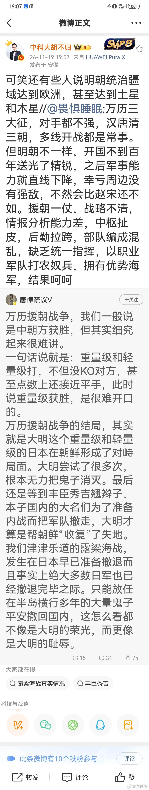

