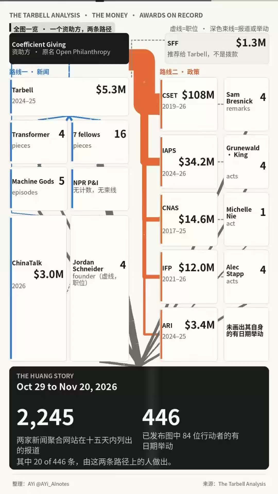
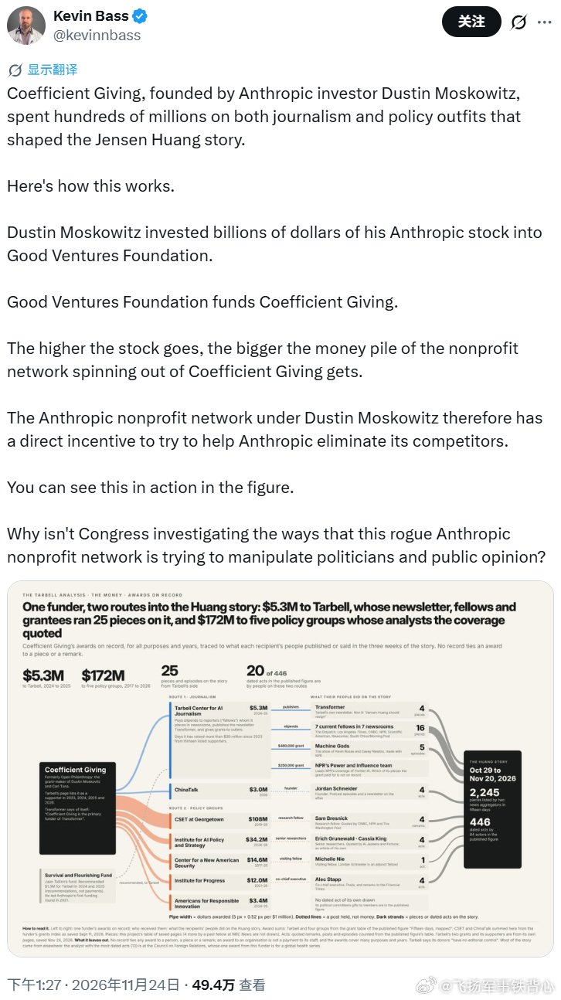
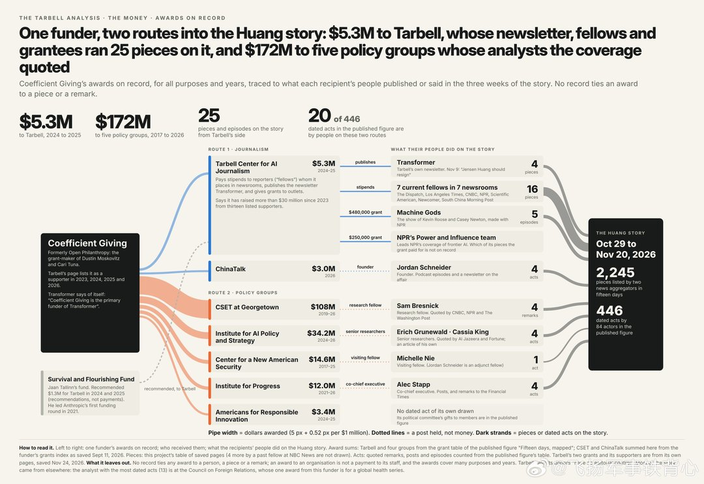
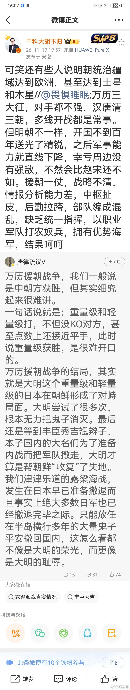
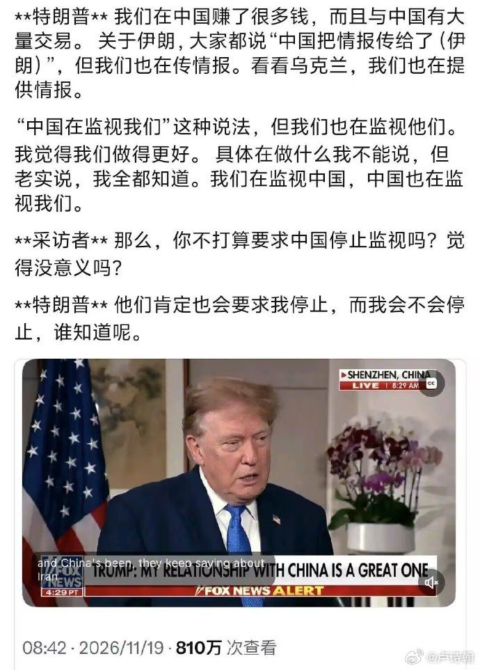
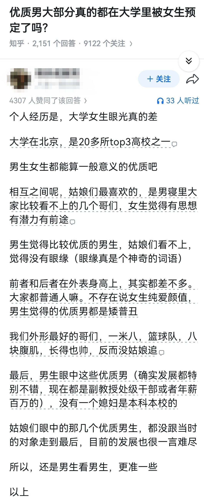
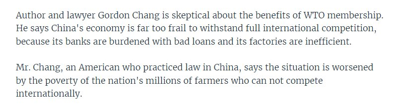

# 2026-11-26

## 1

@飞扬军事铁背心

发表于：2026-11-25 00:11

来源：微博

链接：https://m.weibo.cn/status/5369053265005826

朴实无华的硅谷顶级商战——

Anthropic核心投资人达斯汀·莫斯科维茨（Dustin Moskowitz）花530万美元真金白银给垂直AI媒体，1.72亿美元给五家政策团体，在黄仁勋深陷风波期间打造了对其不利的数十篇负面报道。凯文·巴斯（Kevin Bass）晒出的一张资金流向图点炸了海外科技圈。

华尔街日报翻旧账炮轰黄仁勋没有正式合同，纽约时报在风波期间连发88篇报道且黄仁勋返岗后依然不停，还有一批打着“独立观察”旗号的机构在窗口期密集的负面报道……这下就全串起来了。

各大主流媒体随即反复引用，哄抬针对英伟达的负面声浪，认真落实贯彻一切行动听指挥。

凯文·巴斯：

“由人类学家兼 Anthropic 投资者达斯汀·莫斯科维茨创立的 Coefficient Giving，曾向多家新闻媒体机构和政策组织投入数亿美元，而这些机构参与塑造了有关英伟达 CEO 黄仁勋的舆论叙事。

这一资金运作链条是这样的：

达斯汀·莫斯科维茨将价值数十亿美元的 Anthropic 股票投入 Good Ventures Foundation（良善创投基金会）。

Good Ventures Foundation 为 Coefficient Giving 提供资金。

Anthropic 的股价越高，这个由 Coefficient Giving 衍生出来的非营利组织网络所能掌握的资金规模就越大。

因此，达斯汀·莫斯科维茨旗下的 Anthropic 非营利组织网络，实际上存在着直接的经济利益驱动，促使其试图帮助 Anthropic 消灭竞争对手。

从配图中的资金关系图就可以看到这一运作过程。

为什么国会不调查这个 Anthropic 非营利组织网络，究竟是如何试图操纵政界人士和公众舆论的？”

\#烽火问鼎计划\#

---

## 2

@远东冰原上的猫头鹰

发表于：2026-11-24 10:55

来源：微博

链接：https://m.weibo.cn/status/5368852839663030

感觉马伯庸陷入「雷佳音处境」了。他不缺钱、不缺余裕，为什么要反复生产一个模子的小说。《两京十五日》就像《长安十二时辰》的变形，《太白金星有点烦》是另一种《长安的荔枝》。困在系统里的基层公务员（小吏）做主角，限时营救叙事和满足历史考据爱好者的彩蛋结合。马伯庸有点像中国版的司马辽太郎，但他现阶段似乎进入了一种写法上的路径依赖。这两年他新书《秦二世必须死》的口碑下滑、影改剧口碑不如人意，不是偶然事件，说明有许多中立观众，已经厌倦了马伯庸式戏法的套路。其实他的技法水准一直很稳定，如果把他的历史小说视作「项目」，他是一位又快又水准稳定的产品经理。中篇小说是他谋篇布局的舒适区。所以大鹏选了《长安的荔枝》，改成电影。辛爽也是用他小说的脑洞、设定，重新填充血肉。马伯庸如果匿名投稿，他口碑中下的长篇也一定会是影改、类型向小说比赛的前排。（他以前还匿名参加过匿名小说大赛）。只不过他是马伯庸，一个人在某个领域的头部，同一个模式的作品又扎堆上新（小说这两年除了《秦二世必须死》，还有《楚弓计划》《修桥记》，影改就不说了），观众一定会「腻」，就像前两年的雷佳音。作为读者，我可能更期待一个反叛一些、走出路径依赖的马伯庸。

---

## 3

@信号与噪声

发表于：2026-11-24 13:29

来源：微博

链接：https://m.weibo.cn/status/5368891706443451

分享几点我在 TomorrowX 峰会上的所见所闻：

美股科技圈公认的半导体“硬核大神” Eric Jhonsa（前 TheStreet 王牌科技专栏作家，以极度扎实的算力与财报拆解闻名），刚参加完 TomorrowX 峰会就发了篇重磅复盘。面对华尔街机构对 AI 的集体看空，他甩出一手数据直接硬刚，直言这波回调更像 1998 年大洗盘而非 2000 年崩盘👇

🔥一、机构投资者普遍看空AI，但真正有分量的理由只有两个

正如许多人已经指出的那样，参会的机构投资者普遍对AI交易持谨慎甚至看空态度，而科技行业人士和个人投资者往往更加乐观。

我听到了大量看空理由，但考虑到当前估值已经计入了资本开支大幅削减的预期，我认为真正有分量的理由只有两个：

A. Anthropic近期的推理收入和算力需求估算表明，未来实际需要的算力规模，可能远低于目前计划建设的规模。

B. 头部AI实验室的年度经常性收入（ARR）增速近期放缓，意味着未来产生的收入可能不足以支撑计划中的资本开支。

我认为，第一个看空理由往往建立在一些值得怀疑的数据之上。例如，有人认为Anthropic只需要500MW的推理算力，就能创造1000亿美元的收入。但实际上，Anthropic目前可能使用了1.2—1.3GW的推理算力，才实现了800亿美元的总ARR。

更重要的是，这种观点忽略了Anthropic将超过60%的算力用于模型训练，以及为什么这一比例在2027年可能不会明显下降，甚至完全不会下降。同时，其他头部AI实验室和开放权重模型的收入与推理算力之间的关系，可能截然不同。例如，OpenAI可能需要超过2GW的推理算力，才能实现约700亿美元的总ARR。

在我看来，第二个看空理由更有说服力。毕竟，明年的资本开支可能达到1.5万亿美元，而编程相关业务的增长正在放缓。

但我认为，过度关注OpenAI和Anthropic第四季度的ARR增速，忽略了以下几个事实：

A. 考虑到开放权重模型、其他闭源模型、科技巨头内部的AI使用、互联网企业、独立软件供应商以及本地AI部署等，OpenAI和Anthropic合计可能只占中国以外全球AI算力消耗的25%—30%。

B. 从OpenRouter、Fireworks等平台的数据来看，今年开放权重模型的Token消耗量出现了爆炸式增长，似乎已经达到去年同期的10倍以上。

C. 许多非编程类AI应用仍处于普及曲线的极早期阶段，包括知识工作、企业办公、网络安全、研发等。

D. 考虑到OpenAI和Anthropic已经作出的算力采购承诺、资产负债表状况，以及大语言模型的技术进步，这两家公司不太可能因为一两个季度的ARR增长放缓，就大幅调整资本开支计划。

E. 云计算巨头不仅在季度财报中展现出强劲增长，也对未来几年的增长释放出积极信号。尤其值得注意的是，亚马逊预计AWS在2027年和2028年的增速都将超过40%，而此前亚马逊从未提供过超过一个季度的业绩指引。

F. 历史上的资本开支繁荣周期，无论是铁路、工厂还是光纤网络，通常都是在供给和产能连续多年大幅超过需求之后才结束的，而不是在供给刚刚略微超过需求时结束。当然，目前甚至连供给略微超过需求的情况都没有出现。

与此同时，虽然我听到了大量看空理由，但当我提出各种看多理由时，包括Token和云计算业务增长、GPU价格、未来非编程类AI应用的普及、大语言模型的技术进步等，遭到的反驳比我预想的要少。

再加上我听到的许多回避AI基础设施投资的非基本面理由，例如希望锁定今年的投资收益、不愿承担跑输同行或基准指数的风险等，这让我认为：

近期市场上大量的悲观情绪，实际上源于投资者被近期的股价走势吓到了，随后又试图从基本面上为已经发生的下跌寻找合理解释。

这与今年早些时候SaaS和互联网股票的情况非常相似。

🔥二、技术界对2027年AI技术突破的乐观程度令人印象深刻

那些密切跟踪大语言模型技术进展的人，对明年实现重大技术突破表现出了令人印象深刻的乐观态度。

我听到不止一个人预测，明年将实现递归式自我改进（RSI）。事实上，甚至可以认为，头部AI实验室已经实现了部分递归式自我改进，参见METR近期关于Anthropic大语言模型进步速度的报告。

还有人预测，2027年将出现能够在不同机器人任务和环境之间实现充分泛化的大语言模型。

对于通用机器人和人形机器人而言，硬件工程可能很快就会成为大规模部署所面临的最大障碍。

目前，我还没有将机器人产业的爆发式增长纳入对半导体行业的预期之中，而且这种变化通常也不会一夜之间发生。

但如果这一天真的到来，显然将对存储芯片、计算芯片、功率半导体、传感器等产生巨大的影响。

🔥三、企业AI应用短期可能增长不均，但长期前景乐观

与科技行业和产品领域人士关于企业AI应用的交流，让我认为，短期内AI的普及速度很可能出现波动和分化。这种不均衡的增长，也与Anthropic和OpenAI近期ARR增速放缓的情况相吻合。

但这些交流也让我有理由对更长时间维度上的发展保持乐观。

目前，相对少数的早期采用者和重度用户，无论是在企业、部门、团队还是个人层面，都贡献了非编程类Token消耗增量中的极大一部分。

我的印象是，相当多的企业，尤其是科技和金融行业之外的企业，仍处于不断试错的阶段。它们正在尝试弄清楚哪些AI项目能够带来较高的投资回报率，哪些不能，以及如何让每一笔Token支出创造尽可能大的价值。

与此同时，我也听到了一些有趣的实际案例，包括利用AI分析规模庞大且频繁变化的数据集、从中挖掘有价值的信息，加速和改善芯片设计，以及帮助办公室工作人员处理远超以往的工作量等。

AlphaSense表示，其Token消耗量按年化计算已经达到80万亿，是年初的8倍。

而这还是在其使用量高度集中于重度用户的情况下实现的。据称，其SuperAnalyst工具中排名前1%的用户，Token消耗量是中位数用户的28倍。

此外，我认为，假设非编程类Token的大规模消耗将永远局限于少数早期采用者和重度用户，是一个错误。

一方面，大语言模型和AI应用开发商非常清楚这个问题，正在努力提高普通用户的使用量。

另一方面，大语言模型处理复杂知识工作和企业任务的能力近期已经大幅提高，明年还将迎来更大的进步，尤其是在实现递归式自我改进的情况下。

这将为企业IT部门和重度用户实现各种智能体任务和工作流程的完全自动化铺平道路。

🔥四、现在更像1998年，而不是2000年

总体而言，这次峰会进一步强化了我的一个判断：

如果可以将本轮AI繁荣周期中的市场走势与互联网时代进行类比，那么近期的暴跌，更可能类似于1998年夏秋之际的暴跌，而不是2000年秋季的暴跌。

1998年7月中旬至10月初，在市场动量急剧逆转、宏观经济担忧和基金爆雷的冲击下，纳斯达克指数暴跌超过30%，一度回吐当年全部涨幅，随后牛市盛宴继续。

而2000年秋季，盛宴彻底结束。

不过，从估值、财务状况、技术进步、生产力提升以及企业支出增长等方面来看，我认为，本轮AI繁荣与互联网和电信投资热潮的相似程度，可能反而不如20世纪80年代末至90年代中期的个人电脑和客户端/服务器繁荣周期。

在那个时代，以CPU每秒执行百万条指令数（MIPS）衡量的“智能”成本持续下降，但用户数量的增长，以及更先进的软件和工作负载对计算资源需求的增长，不仅抵消了单位智能成本下降的影响，而且远远超过了这种影响。

---

## 4

@刘新征

发表于：

来源：微博

链接：https://m.weibo.cn/status/4941292074435330

\#电影奥本海默\# 我印象深刻的一句是，美国战争部长说：我们在东京轰炸，死了20万平民，为什么我们国内都没什么反对的声音。。。

我在看《日本帝国衰亡史》那本巨著的时候，就注意到了这一点，咱暂时抽离胜利者视角看的话，就会发现，美国当时已经基本处于杀疯了的状态，总统杜鲁门可以用嗜杀来形容，将军李梅目标就是日本平民，而不军事目标，然后作战方案根本没有遇到什么阻拦，就落地执行了，执行完以后也没有引起美国公众的道德讨论。

而且广岛长崎两颗原子弹是不是真的有必要，其实也是有争议的，毫无疑问两颗原子弹加速了日本投降的速度，但杜鲁门的动机，其实是为了和苏联抢胜利果实，其他人或许不清楚，他不可能不清楚日本已经在讨论如何投降了，他只是不能接受日本向苏联投降，所以才选择前脚试验成功，后脚就连着扔俩。

美国人（包括老百姓）在满口仁义道德的同时不干人事，是非常能够说服自己内心自洽的。。。

这种凶狠，几乎让日本人记到了基因里。。。

---

## 5

@梅新育

发表于：2026-11-24 12:38

来源：微博

链接：https://m.weibo.cn/status/5368878827833742

分享分析。//@幻想狂劉先生:丰臣秀吉时代的日本当然是世界级的军事强权，区域级别的小霸，能在十六世纪完成十万人以上级别的跨海投送&登陆作战本身就说明了其能力。他真正的问题其实是岛国的封闭环境造成的，他的军队各军种完全失衡，他的步兵经验丰富质量不低，在亚洲范围内都有近战优势。他的铳手部队放到同期的欧洲也算不错的轻射手部队（装药量的劣势被数量优势和射术弥补了）。但是他的骑兵畸弱，炮兵接近没有。这也是他和明朝在半岛拉锯的原因-他无法和明军野战，明军强攻其城堡也很难。他的强是一种瘸腿的强，但是如果把他放在一个适合瘸子的环境里，他是相当强的。

---

## 6

@斯图卡98

发表于：2026-11-24 12:41

来源：微博

链接：https://m.weibo.cn/status/5368879555808148

女的不想生孩子，男的正好也不想当爹，难得意见一致，结果女的反而不开心了。

---

## 7

@挨踢牛魔王

发表于：2026-11-24 07:09

来源：微博

链接：https://m.weibo.cn/status/5368795889664837

\#黄仁勋向特朗普作出承诺\#

几个原因：

1.特朗普做了很多工作，联合万斯、司法部长、财长贝森特，消除了英伟达董事会的顾虑。

董事会本来是坚决反对黄仁勋复职的，就是对于目前黄仁勋事件的风险把握不准。

特朗普认为这没多大事情，全力支持老黄复职，那董事会也就没有担忧了。

本来，黄仁勋的出口策略就是对的，全面禁止芯片出口才是错的。

2.万斯出了大力，因为他以前在硅谷工作，有一些人脉资源。

显然，黄仁勋获得了这些人的同情，这些人在万斯面前能说得上话。

万斯也能帮上忙，能在特朗普这么能说上话，在硅谷也能说得上话，影响了核心人物。

3.美股跌成这狗屎样子，影响了所有人的利益。

董事会再这么扛，也负不起这个责任。

你不能和所有人的利益做对。

4.特朗普来中国参加apec期间，了解到中方对黄仁勋的态度。

这样特朗普觉得黄仁勋是国宝级企业家，自己不用，可能被中方挖走。

5.特朗普借助这件事情，告诉外界，在中期选举失败之后，依然可以掌控局面。

台湾省一些反复横跳的家伙，这次当了小丑。

黄仁勋也看出了英伟达存在的问题，不一定会马上清理，但是一定会把反对自己的力量清理出去。

---

## 8

@幻想狂劉先生

发表于：2026-11-23 11:09

来源：微博

链接：https://m.weibo.cn/status/5368494071743858

最近各Ai的智力都有井喷式的提升。我不懂技术，也不太清楚原因。

但是我宣布收回某俄语Ai的智力相当于“一条善解人意的狗”这个言论。

因为它现在是我搞俄白乌文献资料检索和整理的好助手

---

## 9

@卢诗翰

发表于：2026-11-20 10:21

来源：微博

链接：https://m.weibo.cn/status/5367394658946580

直观诠释为什么大众更喜欢特朗普

这真是什么都往外说啊

你这让以后的专家怎么圆

---

## 10

@MingZh

发表于：2026-11-20 10:23

来源：微博

链接：https://m.weibo.cn/status/5367395273146793

优质男大部分真的都在大学里被女生预定了吗？

---

## 11

@水獭一般编-阿怡

发表于：2026-11-19 07:10

来源：微博

链接：https://m.weibo.cn/status/5366984296628411

必须给大家科普一件事儿，章家敦最逆天的“战忽”，不是瞎写“中国崩溃论”，而是论证WTO咩鳖。

是他2001年的时候在美媒撰写熊文，说只要中国加入了WTO，苏联秦制的工业垃圾就会被海量的西方优质商品冲垮，消灭。实际上在西方世界，他写中国崩溃论的时候（2008年有G2论）已经是小丑了。

所以WTO感恩论什么可以拉倒了，人当年是奔着拿WTO淹死你来了，至于后面为啥被中国制造淹死一年1.2万亿顺差那自有别的咩鳖补丁。

我现在看见“黄仁勋跌到大肥鱼完蛋”，和看见“WTO灭鳖”的心情是一样的。就你开心就好。

